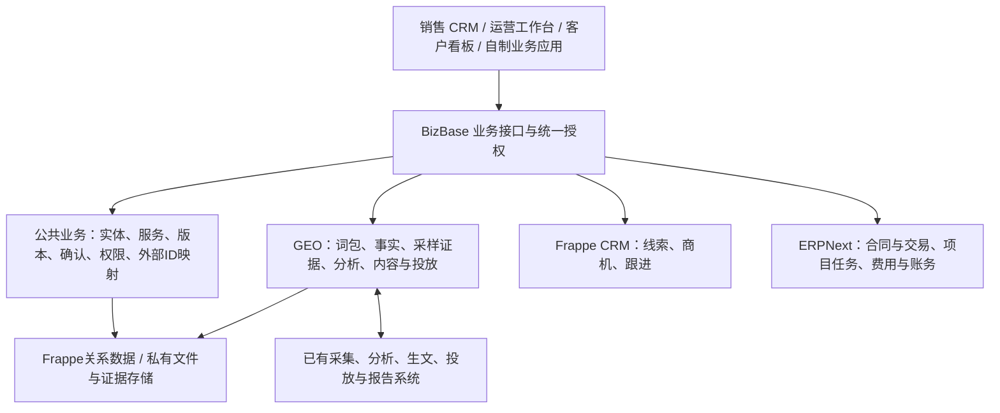
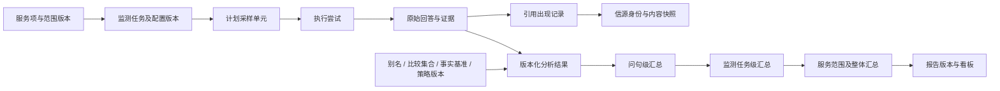

# BizBase 整体方案：共享业务数据、GEO 能力与实施顺序

复核提示（2026-11-18）：本文为组织仓库盘点前的历史建议。第 2 节的数据归属和后续实施次序尚未获得用户确认；当前以[自然式规划](../planning/natural-plan.md)及[决定清单 2](../cycle/sheets/decision-sheet-02.md)组织复核，不直接据本文迁移或确立主库。

版本：2026-11-17 建议稿，已补入用户提供的《客户优化前SOP》CSV。结合用户实际业务介绍、运营手册与关联产品文档，以及当前 Frappe / ERPNext / CRM 官方能力核验。本轮产出为设计文档，未创建业务表、启用同步、迁移数据或修改生产系统。

## 1. 建设目标与总体选择

BizBase 提供公司各业务应用共同使用的身份、权限、业务对象、确定的业务规则和可追溯记录。销售、运营及开发人员可以继续制作不同界面；不同应用对同一服务、问句、文章和费用的理解应一致。

建议保留 **Frappe Framework + Frappe CRM + ERPNext**，开发一个自己的 **BizBase App**。初期在一个自研 App 内按公共业务、GEO、外部系统接入划分模块，随着边界稳定再决定是否拆 App。RPA、AI 推理及既有业务系统通过接口协作。

公共模块的实体、服务、确认、任职、授权及接入机制可供后续业务线复用；GEO 的词包、采样条件、Top和事实核验留在GEO模块。采用自定义App与官方扩展点，模型、权限、默认配置和迁移进入版本控制，不直接修改ERPNext/CRM核心代码。

原生 ERP/CRM 的数据接口与业务方法继续复用，不要求全部经过 BizBase 重新代理或实现。BizBase 的业务接口主要补充跨应用动作、公司的共同规则与 GEO 能力；关键规则在服务端数据层及控制器同样生效。下图展示业务职责，不表示所有原生界面请求必须绕行自定义接口。原 13 项官方候选的最新逐项建议见[项目定位与官方应用选择](2026-11-17-bizbase-positioning-and-app-selection.md)。

当前仓库继承 frappe_docker，主要承担部署和文档，尚无 BizBase 领域实现。2026-11-17 通过运行环境 `bench --site frontend list-apps` 复核版本：Frappe 16.56.0、ERPNext 16.55.0、CRM 16.0.4。原有本地预览可作为开发起点，不能直接等同于生产部署。

统一数据源的含义是：每种事实有明确权威来源、稳定标识和一致访问规则。它不要求所有文件、海量回答和执行程序都放进同一个进程或数据库。其他应用可以有缓存、索引和专用视图，但需要标明来源、刷新位置及允许写入的范围。

## 2. 先确定数据归属

| 业务数据 | 建议权威维护方 | 其他系统如何使用 |
|---|---|---|
| 公司、品牌、产品、型号的身份和别名 | BizBase 实体目录 | CRM、ERP、采集系统记录映射，不能用显示名称充当 ID |
| 联系人基础档案 | Frappe Contact，经过统一业务校验维护 | CRM/ERP 复用；联系人在公司及项目中的角色另存 |
| 渠道触达原始事件、路由及分配历史 | BizBase 接入模块 | 创建或关联 CRM 线索，保留来源与重复事件处理记录 |
| 销售线索、商机阶段、销售跟进 | Frappe CRM | 通过明确接口推进，不再同时经营 ERPNext Lead/Opportunity |
| 交易客户资料、报价、订单、发票、收付款和会计单据 | ERPNext；正式财务启用前仍以现有财务系统为准 | BizBase 引用单据和行，不另建一套会计总账 |
| 合同登记和附件 | 复用 ERPNext Contract 的适用字段 | GEO 的承诺、范围及规则版本由 BizBase 扩展关联 |
| 服务实例、服务项、范围、考核规则、确认及暂停 | BizBase | Project、CRM、看板和采集端共同引用 |
| 执行项目、通用任务、工时 | ERPNext Project / Task / Timesheet | 关联服务项、交付物、预算归属；任务完成不自动代表业务达标 |
| 问句、两类竞品集合、事实基准、分析结果 | BizBase GEO 模块 | 既有工具作为生产者或消费者接入，按阶段切换权威来源 |
| 采样原始结果、证据与信源 | 过渡期指定现有采集系统；切换后以约定结果存储为准 | 每条采样保留来源系统 ID、获取时间和完整性状态，避免两边都改原文 |
| 文章版本、发布回执、回链、运营费用事实 | BizBase；执行工具提交结果 | ERP接收需入账的单据；报告与分析读取同一发布记录 |
| 报表、看板、搜索索引 | 派生数据 | 保存来源批次与计算版本，可重建，不反向覆写原始证据 |

实体目录只保存各业务共同需要的身份与关系。CRM Organization 保留销售侧信息，ERP Customer 保留交易属性，BizBase 不再完整复制两份档案。每个共享字段明确维护者；本方人员、客户联系人、对外品牌名、法律主体名分别表达。

还需区分：ERPNext `Company` 表达我方独立核算主体，不能用来登记全部客户公司；ERPNext `Item` / CRM Product 表达我方销售的服务品项，不能替代客户被优化的产品/型号。`Sales Invoice` 是ERP销售账务单据，不能直接等同于中国税务发票。

官方 CRM 与 ERPNext 集成可以衔接 Customer、Quotation 和 Sales Order，但固定版本存在按名称找 Customer、按邮箱/手机号找 Contact 的逻辑；不能将它当作本公司的统一身份识别规则。建议先有实体 ID 和映射，再选用或适配官方集成。集成启用的角色权限变动也必须在试验环境验证。详见[业务应用边界核验](../research/2026-11-17-business-apps-boundary.md)。

## 3. 核心数据模型

以下是业务对象，不要求每个概念立刻建一张表。共享、独立授权、需要被其他记录引用的对象适合独立 DocType；仅隶属某个版本的明细可用子表。子表不作为跨项目共享主数据。

### 3.1 实体、关系与销售来源

**实体 Entity**：给组织、品牌、产品、型号稳定身份，并以明确类型校验其字段。保存规范名称；组织的登记标识可选填，未知不虚构。别名有适用对象、来源和生效版本。组织归属、品牌持有、产品所属、渠道合作分别记录关系类型与有效期，不能统一塞进“客户父子树”。

**外部映射 External ID Mapping**：`来源系统 + 来源对象类型 + 来源记录ID → BizBase对象ID`。名称匹配只能提出候选；同名不自动合并。旧记录可经核对汇聚到同一实体，合并保留来路、冲突处理与旧 ID 重定向。

**联系人及关系**：同一人可属于多个组织并参与多个项目；“最终确认人”“客户项目接口人”“付款联系人”与内部销售、运营任职分开。联系方式与其他私有信息按数据范围授权。

**触达事件 → CRM Lead → CRM Deal**：触达记录获客品牌、站点/账号、真实渠道、接入方式、时间、原始事件 ID、触达时路由及归属。飞书是接入方式，抖音私信可能才是获客渠道。重复回调幂等，多次触达可归属同一线索，但事件不能丢失。分配与转交记录生效时间、原因和规则版本；当前负责人不覆盖最初归属。

### 3.2 合同、服务与项目

| 对象 | 核心内容 | 解决的问题 |
|---|---|---|
| 商业约定 | 合同/有效补充条款版本、签约角色、付款安排、对应订单行及确认依据 | 签约公司不等于被服务公司；续约不能覆盖旧承诺 |
| 服务实例 Service | 持续合作的主线、被服务组织、业务线、责任团队及商业约定关联 | 多期合同、报告和服务历史可以持续追溯 |
| 服务项 Service Item | 可独立授权、暂停和验收的最小履约单位；明确优化标的、服务产品和归属 | 同一合同或服务中可同时有多个品牌、可见度与可信度 |
| 范围版本 Scope Version | 对应服务项的问句版本、平台/采样条件、比较集合、事实基准、指标约定和有效时间 | 换词、改竞品、年框分批不覆盖旧范围 |
| 里程碑与确认 | 计划/实际时间、所确认对象和版本、确认人、结论、消息或附件证据 | 区分拉群、启动会、资料确认、母稿确认、考核起点 |
| 暂停/恢复与变更 | 作用范围、起止、原因、批准与客户确认、对执行/考核/计费的影响 | 部分暂停、延期及恢复有明确依据 |
| 项目角色任职 | 人员、服务范围、角色、生效期、交接与接受确认 | 更换运营或销售后历史责任不丢失 |
| 交接检查与沟通约定 | 合同/词包/已有资料、客户主接口、是否已有对应采样、报告周期、特殊要求、服务群及沟通渠道 | 建群前锁定交接范围；主接口不自动等于有权确认所有事项的人 |
| 交付与验收 | 合同目标、交付物版本、数据口径、客户结论、遗留事项 | 阶段复盘、项目任务完成与正式验收分开 |

一个合同可以关联多个终端客户的服务；同一服务可以通过有生效期的关联承接续约合同。一个 ERP Project 可组织若干服务项的任务，不决定合同授权边界。可见度与可信度若有不同的考核、暂停或访问要求，应分为不同服务项，并可引用同一批适用采样证据。

例如：渠道签约，服务终端公司 A 的品牌 B 和产品 C。签约实体为渠道，被服务实体为 A，B/C 是优化标的；按实际服务产品拆分服务项。渠道只获得合同约定且明确授权的服务范围，不能自动看到 A 的全部历史。

手册默认拉群开始服务、母稿确认启动首月达标考核；季度换词原则和缺资料暂停也有流程。这些作为可配置模板及版本保存，合同的有效约定优先。暂停不自动让所有日期顺延，也不自动停止所有后台动作。[关键节点](https://yishan-ops-handbook.space.fast/learning/project-management/required/process)、[换词规则](https://yishan-ops-handbook.space.fast/learning/keyword/advanced/revision)

关键记录区分事实发生时间、业务生效时间、系统录入时间；例如客户10日确认、12日补录，不应把12日当考核起点。补录与追溯调整也必须留下依据，不能静默改写已交付结果。公司自营品牌可建立内部服务并复用同一能力，不为内部工作虚构销售合同。

### 3.3 词包、诊断与事实资产

- **词根 / 问句身份 / 问句版本 / 词包版本**：问句版本保存文本、意图、场景、品牌词或业务词等类型及适用对象。版本化成员关系记录某个词包包含哪些问句；一个问句可被不同范围引用，业务授权不能随内容去重而共享。
- **拓词依据与筛选**：记录指数平台、搜索联想等来源、时间、证据和选择/淘汰理由，不将指数等同实际 AI 搜索量。
- **诊断批次**：区分售前诊断和合同确定词包的交付基线；记录原候选集、最终选择、基线采样及确认。不能用售前全集与筛选后的子集直接计算提升。
- **监测竞品集合版本**：用于排名与效果比较；**横评竞品集合版本**：用于内容生产。二者都有目标、候选来源、确认依据、适用层级和版本，不能共用一个列表任意覆盖。
- **品牌事实及版本**：可独立核验的完整陈述，关联品牌/产品/型号、适用条件、有效期、来源证据、确认和核验状态、公开使用范围；单一维度标签或宣传口号不是事实。
- **问句—事实适用关系**：说明某问句应核验哪些事实，形成版本化事实基准；核验不能用本次 AI 回答反向生成“正确答案”。
- **资料请求与缺项**：缺什么、对应哪些问句、客户责任人、期限、阻塞影响和处理记录。客户自述、客户确认、独立核验、存在冲突分别表达。

两条服务线共用实体、问句和证据，可见度分析推荐表现，可信度分析适用事实的出现和正确性。事实变更后保留旧版，旧文章和旧报告仍能说明当时依据。[知识库标准](https://yishan-ops-handbook.space.fast/learning/ai-knowledge-base/required/standards)、[两条业务线](https://yishantech.gitbook.io/veritasai/brand-credibility/how-the-services-work-together)

### 3.4 采样、信源、分析与报告

监测任务是业务监测单元，执行批次和尝试是运行记录。配置保存平台、App/网页/API、Chat/Work、联网、思考/深搜、地区语言、时区、频率、有效时段及随机/均匀要求；实际执行另记参数偏差。不能把不同入口因为模型同名就混成同一类样本。

**采样输入与正式分析基准分别确认。** 新SOP允许确定词包先采集，客户随后确认监测竞品，再用已有回答重出报告。因此采样只绑定当时已明确且获准的问句、标的、平台和条件，不应以监测竞品尚未定稿阻塞这类采样；分析另绑定后续确认的比较集合、事实基准和指标规则。未确认口径的试算需明确状态，不作正式验收；后确认产生新分析和报告版本，不改写旧采样条件或原回答。候选竞品池及筛选理由也要留存，不与客户最终选定名单混同。

每个计划单元有稳定 ID，重试产生尝试记录。是否接纳某次结果、多个重试是否进入统计须有规则，不能因重试重复扩大分母。状态分别表达：计划执行、采集成功、回答可评价、业务达标、证据完整。超时、拒答、无品牌、未排名是不同情形。

原始回答、返回信源、分享链接和截图保留采集时间、来源、获取状态与完整性信息。API没有分享链接不自动失败。证据引用应指向私有受控文件；访问失效不删除历史结果。

信源分为**来源身份、每次引用出现、抓取/补全尝试、内容快照**。一个 URL 被十个回答引用保留十次事实；地址重定向与别名可归一，但不能随意删除参数。来源可为文章、视频、商品卡片。补抓的当前正文不冒充 AI 当时看到的正文，404 不抹掉引用历史。

分析结果固定原始输入和实体别名、监测集合、事实基准、规则、模型/模板与可知版本。保留判断证据、复核状态和改判记录。无明确排序依据不强行赋名次；事实未找到与明确冲突分开。

**指标定义是可执行的业务规范**：明确统计单位、有效样本选择、分子/分母、权重、时间窗、范围和版本。问句→任务→整体按约定重新汇总计数，不简单平均百分比。Top3占比在竞品中第一，与单条回答排名前三，是不同计算层次。

跨期提供两种视图：按当时范围的完整历史，以及相同条件的可比范围。换词可让服务时间线连续，但不能把新旧总指标伪装成同一组趋势。竞品更新可对原始证据复算并另存结果，不能覆盖已交付报告；没有旧回答就不能通过重新访问 AI 补造历史。[共同范围要求](https://yishantech.gitbook.io/veritasai/deliverables/outputs-and-reporting-example)

报告保存范围、分析结果集、规则版本、排除/缺失数量、数据截止时间、生成模板和人工文案版本。指标更正生成新报告及关联，不改旧报告后假装从未变化。不同客户看板可以展示不同视角，但调用相同定义的数据。

### 3.5 内容、投放与经营记录

`分析发现/资料缺口 → 优化任务 → 内容版本 → 审核/客户确认 → 发布订单明细 → 回执与回链 → 引用匹配 → 费用归属与复测`。

- 内容记录主题、关联问句、事实版本、模板/skill/模型、母稿及派生关系。多问句与多文章是多对多关系；修改内容产生版本，发布引用确定版本。
- 认可的事实、公开使用范围与审核策略由底座提供。生成程序可由已有团队维护，返回输出与执行依据；未核实陈述不能自动成为已确认事实。
- 母稿中的事实错误应关联到知识库/事实条目修订，并识别受影响内容、复核及重新确认，不能只改一篇稿件。事实准确性确认与允许对外公开是不同结论，内部可用材料不自动获得发布授权。
- 一个投放批次可包含多篇文章、多媒体及部分成功；保存供应商订单号、提交尝试、状态回调、实际上线时间、URL与核查状态。未知结果先查询/对账，不盲目重下单。
- 投放受理、发布、拿到回链、链接可用、被 AI 引用分别记录。引用匹配关联具体出现记录、地址匹配规则及置信情况；无法确定归属不能硬匹配。
- 从首个真实投放开始记录报价快照、预算占用（如启用）、实际费、退款、服务项/周期归属。跨服务分摊需要明细和守恒检查；财务确认账单与运营估计分别标记。
- 销售、运营任职及贡献事实从第一阶段保留。分成后置为版本化规则、输入快照、计算结果、人工确认和结算状态；不用当前负责人覆盖历史贡献。

投放量、引用结果、目标达标分别评价。投放与指标变化的时间关联不自动形成因果结论；可以记录待验证假设。[运营复盘要求](https://yishan-ops-handbook.space.fast/learning/data-analysis/advanced/review-placement)

### 3.6 服务 SOP、执行依赖与沟通留痕

用户补充的《客户优化前SOP》有23条场景记录，含可见度、可信度及组合服务的话术分支。它是执行模板，没有真实客户已完成记录；不能把23行机械转为每个客户都必做的23个任务。

建议用以下业务信息补充现有项目任务，不预建通用流程编排产品：

| 信息 | 最小内容 | 约束 |
|---|---|---|
| SOP模板版本 | 适用服务产品/合同条件、节点、前置依赖、责任角色、交付物、确认要求、相对时间规则 | 模板升级不自动改动已启动项目；不适用节点不阻塞执行 |
| 执行实例与节点记录 | 关联服务项、采用模板、实际责任人、计划/实际时间、阻塞或延期原因、关联对象版本和证据 | 生成任务不代表任务完成；进入下一步需校验相关交付物及有效确认 |
| 确认请求与结论 | 确认对象/版本、确认事项、授权确认人、发送记录、答复、附加条件与证据 | 需要确认、发出请求、收到同意、对外通知是不同事实；主接口不天然拥有全部批准权 |
| 沟通与交付记录 | 服务群/渠道、参与人、消息或附件引用、关联报告/母稿/变更、实际发送时间 | 生成话术不等于已发送；发送不等于已读或已确认；接口不提供的回执保持未知 |
| 沟通与执行日程 | 采样、人工巡检、进度同步、报告数据周期、报告发送、工作服务窗口分别记录 | 可以使用会前/会后、投放后等事件相对时限；排期延期不自动改变合同、考核或计费 |

第一阶段只实现试点所需的交接检查、关键节点、确认及证据关联，人工发送后可回填消息依据；后续按渠道能力和明确的发送策略增加自动提醒与发送。SOP话术可作为版本化内容模板，绑定真实参数后供人使用，不直接作为业务状态或外部操作指令。

新SOP强调：先交接合同/词包/品牌资料与对客约定；可见度和可信度各有基线、母稿及确认节点；母稿确认记录考核起点；首轮投放完成需要回执及后续复采。投放提交、实际上线、首轮约定范围完成、对客通知和复采验证需分别记录，不能由一句“已完成投放”的话术反推执行成功。

需要保留的文档差异：开场统一写约10天，但可信度明细安排到第15天；横评名单正文请求客户确认而对应确认列为“否”；第11天沟通节点对可信度的适用范围不清；母稿数量、服务时间及横评筛选依据与其他文档存在差异。采集每周2次与巡检每周1–2次可能是不同动作，不直接视为冲突。组合服务是否共用启动、等待及考核时点，也不能仅凭模板推定。

上述规则在确定适用版本前不作为全局硬约束。SOP中“10月1日之后”未给年份，未自行补年；CSV引用的流程图和文档链接没有随导出提供，不能认为已核对其内容。原CSV及逐行证据保留在本机，详细差异未作为客户流程自动执行。

## 4. Frappe 复用与自研边界

| 能力 | 可以复用 | 需要配置或自研 |
|---|---|---|
| 账号、基础角色、登录会话 | Frappe User / Role 及认证机制 | 现有公司身份对接；应用登记、服务范围授权、客户/渠道边界 |
| 数据表、表单、关联、列表、基础报表 | DocType / Link / Child Table / Desk | 本文领域对象、约束、唯一标识、状态迁移与领域查询 |
| 审批、分配、通知、变更记录 | Workflow、Assignment、通知、文档变更能力 | 确认对象和证据、业务版本、跨记录一致性、业务里程碑及权限 |
| 服务SOP与执行 | 复用已选的项目/任务及模板能力 | 服务产品分支、对象版本确认、前置依赖、延期影响和沟通证据；不将CSV的确认列直接当审批规则 |
| 销售跟进 | Frappe CRM Lead / Deal / Organization / Contact | 多渠道接入、归属冲突、统一实体映射、诊断到服务交接 |
| 合同与交易 | ERPNext Contract / Customer / Item / Quotation / Sales Order 等 | 服务承诺版本、服务项、考核范围；确认哪些交易环节实际启用 |
| 项目执行 | Project / Task / Timesheet | 关联服务项、交付依据、资料缺项、验收与服务时钟 |
| 费用与会计 | Supplier、采购/费用/付款与项目财务能力 | 投放订单适配、回链、服务分摊、经营指标；正式账务与本地税票另核实 |
| API 与后台任务 | REST/RPC、认证、队列、scheduler、Webhook 基础 | 稳定业务接口、应用与用户权限交集、业务幂等、可靠事件、重试与对账 |
| 文件 | File、附件、私有文件基础 | 大型证据存储适配、生命周期、访问授权、备份恢复；无原生S3一键开关 |
| GEO 业务 | 框架作为实现底座 | 词包、事实基准、范围版本、采样协议、Top/可信度、信源、发布闭环与报告快照 |

上述“复用”不等于安装即满足。Frappe 文档变更记录不能代替冻结的合同范围/事实/指标版本；Workflow 不能代替原子业务校验。ERP Project 实际起止时间受 Timesheet 计算影响，不用于服务开始和考核起点。框架任务去重不代替收费业务幂等，Webhook有限重试不代替可恢复的业务事件投递。详见[框架边界](../research/2026-11-17-frappe-platform-boundary.md)、[业务应用边界](../research/2026-11-17-business-apps-boundary.md)。

**当前不追加安装其他官方 App。** Insights 在统一指标后按真实报表试评；Helpdesk 在正式工单需求出现时评估；HRMS 在人事薪酬需求明确后评估。已有手册/文档先继续使用，不为统一数据而加装 Wiki、Drive 或协作套件。ERPNext 内置 CRM 保留应用代码，业务入口和角色集中到独立 CRM；隐藏菜单解决导航重复，权限和写入约束另行配置。

## 5. 统一权限与外部应用接入

授权同时考虑**用户、调用应用、动作、服务范围和有效时间**。内部销售、运营、客户和渠道各有角色；角色决定能做什么，授权范围决定能对哪些服务做。组织关系、合同签约关系和全局实体身份均不自动授予可见权限。

- 人操作的外部应用保留用户身份；系统执行器使用限定范围的服务账号。不能共用 Administrator 密钥，也不信任请求随意声明的 `user_id`。
- 应用获准调用某接口，还要满足实际用户对该对象的授权；后台任务保存请求身份、授权范围与对象版本，执行和返回结果时按约定复核权限。
- 列表、详情、搜索、聚合、导出、报告、附件及外链访问都走同一范围规则。撤权要覆盖缓存、已排队任务和尚可使用的访问地址。
- 业务写入通过明确动作，例如 `confirm_scope`、`pause_service_item`、`submit_observations`、`confirm_content`、`submit_publication`，名称为契约示例。写接口做状态、权限、版本及幂等校验；关键校验同样放在服务端领域逻辑/控制器，防止其他原生写路径绕过。
- 共享站点只安装经过审查的后端 App。各岗位独立生成的应用默认作为外部客户端，不能因“同为Frappe应用”而获得共享数据库代码执行权限。

每个接入记录来源系统、外部 ID、事件/请求 ID、契约版本、业务时间与接收时间；重复事件不重复建线索、记费用或发文。批量导入返回逐项错误；冲突进入核对队列，不静默覆盖。对关键变更采用事务内待发送事件记录、消费者去重、失败重放和对账，明确接受至少一次投递的现实条件。

Frappe 原生权限提供扩展基础，但自定义查询、`get_all`、原生接口与代码中的绕过权限路径需要独立审查。统一登录只是身份前提，不能替代服务授权。[官方权限扩展](https://docs.frappe.io/framework/user/en/python-api/hooks)

## 6. 数据规模、部署与迁移

初期采用模块清晰的单体业务后端：Frappe关系数据库管理身份、服务、配置、任务索引、分析结果和费用等结构化事实。回答正文、截图及内容快照按规模使用私有文件/对象存储，关系记录保存引用、校验信息和权限归属。对象存储需要适配和备份验证，不假设原生自动支持。

RPA 会话、云手机、浏览器执行和长时间推理继续由执行系统承担，Frappe负责业务编排和结果契约。已有采集/分析数据先通过适配器接入；观察实际数据量、索引与查询耗时后，再决定是否增加独立观测存储、分析库或 BI。首期不预建微服务集群、数仓、通用事件平台或向量数据库；向量索引若需要，来源仍是可追溯事实与文档。

迁移按对象和客户分批进行：

1. 盘点来源、字段、旧 ID、当前维护者及体量；发现同名多义、缺回链等质量问题。
2. 只读导入暂存区，建立映射和冲突清单；未知值保留未知，不伪造历史合同/时间/费用。
3. 影子计算，与旧系统在同批输入下对账；区分历史口径差异和程序错误。
4. 旧系统继续作为唯一写入方，先验收新读路径。切换时按对象暂停或隔离旧写，取得明确的数据截止点，再同步最终增量并核对，之后才开放新系统写入；持续同步方案也必须有等价的截止点和对账屏障，避免漏增量窗口。
5. 切换后旧系统保留只读和旧 ID 查询能力，不再无约束双向覆盖。回退方案说明新系统已产生数据如何补回及重新核对，不能直接恢复旧备份丢掉切换后的新增记录；备份必须经过恢复验证。

共享数据去重不改变权限。公开来源身份可以复用，某客户的问句、回答、引用关系及私有材料不能随之向其他客户开放。

## 7. 分阶段交付与验收

阶段按可验收成果推进，人员投入、现有接口与数据量盘点后再估工期。每阶段都交付可运行的小范围能力，逐步扩大。

| 阶段 | 要交付什么 | 通过标准 | 此时保留的既有能力 |
|---|---|---|---|
| 0：业务和数据对齐 | 选择一条直客链及渠道/多标的对照场景；实体/服务/问句/旧ID映射；数据归属表；首个指标口径；接口与体量盘点 | 一条合同到回答、文章、回链、费用的样例可对照；未定规则明确标记 | 原系统继续正常使用 |
| 1：最小共享底座 | 自研App骨架；实体映射、服务项/范围版本、确认、项目角色、权限、集成日志及幂等；试点交接检查、SOP关键节点与证据；简单Desk管理入口 | 两个应用读写同一服务数据；重复请求无重复记录；渠道/客户越权失败；改名不丢关联；待客户确认不能被通知或任务勾选绕过 | CRM销售界面、ERP通用记录及已有执行器 |
| 2：采样到报告 | 接一个已有采集来源和一个报告/看板消费者；问句、别名/竞品/事实版本、证据、分析与汇总；先一个已明确指标，再扩展 | 问句→任务→整体能穿透到证据；支持先采样、后确认竞品并产生新分析；换词/换竞品不改旧报告；无效与缺失可解释；至少一个可信度事实案例完成核验链 | RPA执行及可复用分析器保持原运行位置 |
| 3：内容与投放闭环 | 品牌资料/事实确认、母稿与派生版本、已有生成器接入、一个投放供应商适配、回链核查、费用归属和引用匹配 | 每篇发布都可查确定版本、平台、URL和成本；超时后回调不重复下单或计费；退款可追溯 | 现有内容团队和投放程序复用 |
| 4：销售与交付贯通 | 官网/API/人工入口统一接入CRM；来源与分配历史；售前诊断→商机→合同→服务交接；先覆盖主要渠道 | 已分配线索不会无故重分；重复留资保留触达；合同范围继承经确认诊断；业务承诺有接收人 | 官方CRM跟进及ERP报价/订单能力 |
| 5：经营与规模化 | 完整预算/供应商对账/财务映射、经确认的分成规则、交付验收、更多渠道和工具接入；容量与恢复演练 | 一个服务周期能核对收入依据、费用、贡献与结算；新应用按契约接入且权限测试通过 | 根据真实需求评估Insights/Helpdesk/HRMS |

从阶段1就保存责任任职和贡献；从第一次投放就保存成本。阶段5后置的是复杂计提、结算与经营分析，不是晚到那时才收集基础事实。CRM 可以即刻作为日常销售工具使用；阶段4才集中做多渠道自动接入和跨阶段自动化。

**第一个开发里程碑建议是阶段1加阶段2的一条小链路**：一个已有客户/服务范围、一个AI平台、少量已确认问句、一个采集来源和一个报告应用。并行用受控测试数据覆盖渠道隔离、重复回调和版本变更。先证明两个界面确实共用数据与权限，再扩大到内容和投放。可见度与可信度的数据边界一开始保留，各自执行能力按验收逐步接入。

## 8. 关键验收场景与未定规则

必须覆盖：

1. 渠道签约、两个终端客户、多品牌服务；渠道与客户只看授权服务项，汇总与附件也不越权。
2. 总部更名、品牌有俗称、产品与公司名称相近；共享身份稳定，命中依据可解释，联系人不误合并。
3. 售前全集筛成合同子集，年框更换一批词并暂停部分服务；基线、完整历史、共同范围及时间影响分别可查。
4. 原回答不变，仅改竞品、别名或分析模型；旧报告不变，新分析明确是复算而非新采样。
5. 同一引用十次、URL重定向、补抓404；引用事实不丢，文章身份和快照不混。
6. 供应商提交超时后成功回调，另一个媒体失败退款；不重复发文、扣费，服务分摊核对一致。
7. 事实从客户自述变为已核验，内容和报告仍能追溯旧输入；无适用事实/无有效回答不被显示为零分。
8. 销售/运营转交与客户撤权；历史贡献留存，当前访问及后台结果不沿用过期授权。
9. 同批已采回答在客户确认监测竞品后重分析；原始样本数和采样条件不变，正式基线绑定新确认口径，旧报告仍可查。
10. 服务类型不同采用不同SOP节点；资料已发送但客户未确认时保留等待状态。模板更新和一个分支延期不会在没有约定时静默重排其他服务项或改动考核起点。

每个指标上线前，只需先明确该指标涉及的样本范围、分子分母、权重和判定规则。Top要明确名单外品牌是否占位、并列与否定提及；可信度要明确事实适用与部分符合处理；引用指标要明确统计单位和分母。共用采样规则还需说明有效样本、拒答与重试如何计数。其他未明确指标继续保存所需原始证据，暂不用于合同验收，不阻塞已经定义清楚的指标上线。

相关业务上线前再逐项确认：季度的定义及换词例外、暂停的审批与各时钟影响、客户确认授权、报告周期、服务承诺与结算方式、费用分摊、分成规则。手册模板、官网承诺和有效合同有差异时，不能擅自统一为一个全局常量。

## 9. 文档与证据关系

- [业务口述梳理](2026-11-17-geo-service-model.md)保留原始需求及当时假设；本方案是加入手册后的后续设计。
- [术语](../../GLOSSARY.md)记录业务概念，不承载技术实现细则。
- [框架能力核验](../research/2026-11-17-frappe-platform-boundary.md)、[业务App核验](../research/2026-11-17-business-apps-boundary.md)提供官方文档和固定版本源码依据。文档/源码核验不代表组合已实测通过。
- 手册的全面阅读清单保存在本机私有目录，本文只采用建模需要的业务概念与公开来源链接，不复制系统凭据、客户资料或内部经营明细。
- 用户补充CSV《客户优化前SOP - ✅必看-【建群-优化前】运营标准sop.csv》，25条逻辑记录中的第3–25行为23条场景；本次采用的来源指纹为 `122a7d23d780febca59279a4bdf4463036b78ffca628f0df6d6326c020ad4b2f`。原文件未修改，原话术与逐行对照只保存在本机私有目录。

本方案未将未知事项视为既定制度，也未估算未经负载验证的资源与成本。后续实现首先验证一条共享数据链和权限边界，再逐步扩展。
