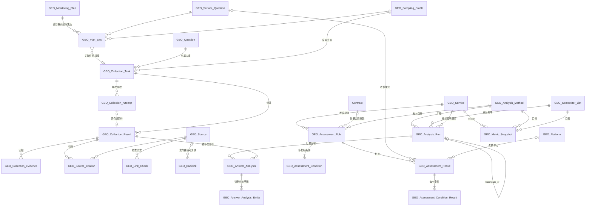
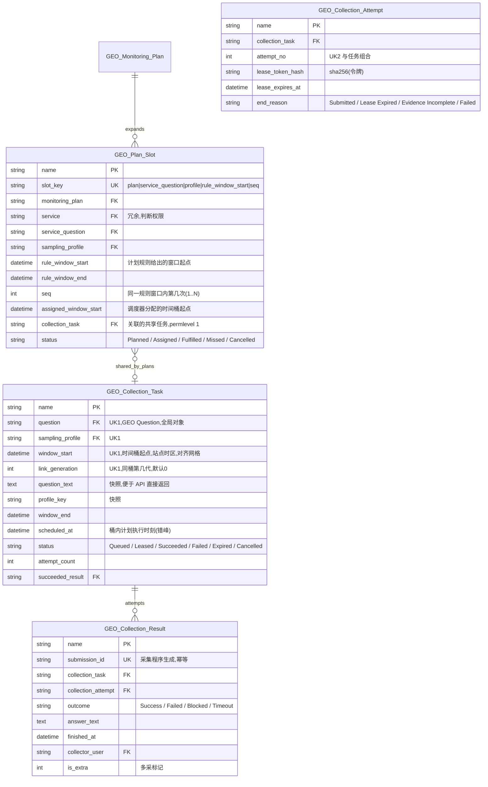
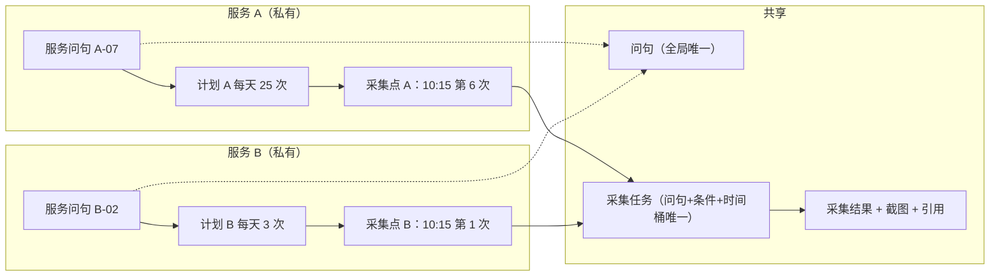

# GEO 运营第一版：领域模型与 ER 图

- 目的：定义「GEO 运营」第一版（签约后服务流程）的对象、关系、关键字段和数据隔离边界。后续状态机、时序图、API、权限、看板文档都以本文的 DocType 名和字段名为准。
- 读者：产品负责人（用户本人），以及后续实现的工程师。
- 状态：**设计草案，待用户确认**。本文不代表已建 DocType、已改站点或已迁移数据。
- 版本：v0.3，2026-11-18。v0.2 按 D-024、D-025 和首个真实合同案例整体修订；v0.3 按 D-026 至 D-028 和设计审查意见修订（变更见 0.4）。
- 输入：[decisions.md](../../cycle/decisions.md) D-017 至 D-028（优先级最高；D-024、D-025、D-026 覆盖此前相关内容，D-027 覆盖本文 v0.2 的 dogfood 内部服务设定）；首个真实合同案例（私有材料，不进 Git，本文称「案例 C1（购物平台类客户）」）；[GEO 服务候选模型](../2026-11-17-geo-service-model.md)（业务背景，候选对象不等于已确认）。

标注约定：

- **已确认（D-0xx）**：用户已裁决，引用决定编号。
- **设计推荐（Agent）**：Agent 依据业界做法或案例 C1 给出的方案，可改。
- **待确认（Q-xx）**：需要用户回答；本文给出推荐默认值，以便先往下设计。问题汇总在第 8 节。

隐私约定：本目录进入 Git。文中不出现真实客户名称、真实问句原文、价格、合同编号和联系人。示例问句均为自编文本。

## 0. 核查记录、命名规则与本版变更

### 0.1 核查记录

只读核查了运行中站点 `frontend` 的源码（容器 `bizbase-backend-1`，`/home/frappe/frappe-bench/apps`，2026-11-18）：

- 已装 App：`frappe`、`erpnext`、`crm`、`hrms`、`geo_operations`（空 App，无 DocType）。源码目录另有 `yishan_id_login`（本设计不涉及）。官方 App 共约 1052 个 DocType。
- 已被占用、与本设计相关的名字：`Service Level Agreement`、`Service Day`、`Brand`、`Competitor`、`Competitor Detail`、`CRM Product`、`Production Plan`、`Subscription Plan`、`Maintenance Schedule`、`Customer Group`、`User Group`、`Email Group`、`Role Profile`、`POS Profile`、`UTM Source`、`CRM Lead Source`、`Support Search Source`、`Target Detail`、`Supplier Scorecard Criteria`、`Appraisal`、`Skill Assessment`、`Delivery Note`、`Delivery Schedule Item`、`Holiday List`。框架还有 `Geolocation Settings`（地理信息 Geo 模块）。
- 以 `GEO ` 开头的 DocType：无。本文新建的全部 DocType 都带 `GEO ` 前缀，与上述名字不冲突。
- `Contract`：可提交（`is_submittable=1`），命名 `CON-.YYYY.-.#####`，字段含 `party_type`、`party_name`（Dynamic Link）、`start_date`、`end_date`、`contract_terms`、`fulfilment_terms`、`amended_from` 等。
- `Holiday List`（ERPNext）：字段含 `from_date`、`to_date`、`holidays`（子表）、`weekly_off`。可作为「工作日」计算的日历来源。

### 0.2 命名规则（设计推荐，Agent）

1. GEO 运营 App 新建的 DocType 一律以 `GEO `（大写 + 空格）开头，例如 `GEO Service`。理由：裸词 Service、Plan、Brand、Competitor、Source、Assessment、Deliverable 已被占用或容易与未来官方 App 撞名；统一前缀在 Build 列表和权限配置中一眼可见归属。框架 Geo 地理模块的 DocType 不以 `GEO ` 开头，按 D-015、D-016 不与其合并。
2. 表名为 `tab` + DocType 名，DocType 名上限 61 字符；本文最长名 `GEO Monitoring Plan Service Question`（36 字符）。
3. 字段名用 `snake_case`。Link 字段以目标概念命名（`service`、`question`、`service_question`、`sampling_profile`），不加 `_id` 后缀。
4. 给 ERPNext 原生 DocType 加的 Custom Field 统一用 `geo_` 前缀，通过 App fixtures 导出。
5. Mermaid erDiagram 的实体名不能含空格，图中用下划线代替空格（`GEO_Service` 即 `GEO Service`）。

### 0.3 v0.1 到 v0.2 的变更（其他文档修订时对照）

| v0.1 设定 | v0.2 设定 | 依据 |
|---|---|---|
| `GEO Question` 带 `service` 字段，问句归属一个服务 | `GEO Question` 是全局对象，无服务、客户字段；全系统同一规范化文本只有一条 | 已确认（D-025） |
| 问句有 `status`、`active_from`、`active_to`、`replaces_question`、`lineage_root`、`primary_target` | 这些字段移到新对象 `GEO Service Question`；问句本身没有生命周期状态 | 已确认（D-025） |
| `text_hash` 在同一服务内 Active 问句不重复 | `text_hash` 全局唯一索引 | 已确认（D-025） |
| 换词记录连接两条 `GEO Question` | 换词记录连接两条 `GEO Service Question`（`old_service_question`、`new_service_question`） | 已确认（D-025） |
| 监测计划子表 `GEO Monitoring Plan Question` 关联问句 | 改为 `GEO Monitoring Plan Service Question`，关联服务问句 | 已确认（D-025） |
| 采集任务去重限于同一服务；任务、结果、引用冗余 `service`、`customer` | 去重全局：同一问句 + 同一采样条件 + 同一时间窗口只有一个任务；任务、结果、引用、证据都不带服务和客户字段 | 已确认（D-025） |
| `GEO Plan Slot` 只是对账用的期望 | `GEO Plan Slot` 同时是「计划与任务的关联表」，是隔离和样本计数的唯一依据 | 已确认（D-025）+ 推荐 |
| `GEO Source Citation` 带 `service`、`customer` 字段做隔离 | 引用挂在共享的采集结果上，不带服务字段；可见性由服务对结果的访问权决定 | 已确认（D-025 覆盖 D-022 的实现） |
| `GEO Contract Commitment` 单一指标约定 | 改为 `GEO Assessment Rule` + `GEO Assessment Condition`（多条件组合），结果存 `GEO Assessment Result` | 已确认（D-024） |
| 口径参数 `rank_scope`、`tie_policy` 等 6 项 | 扩展为可表达案例 C1 全部认定细则的参数集（正文范围、并列、候选不足、品牌类别、分母排除） | 已确认（D-024）+ 推荐 |
| 实体无类别；`GEO Entity.owner_customer` | 新增 `GEO Entity Category`，实体与名单条目带类别；删除 `owner_customer`（避免共享主数据泄露客户关系） | 推荐（案例 C1、D-025 隔离） |
| 竞品名单只挂优化标的，同一标的的多个服务共用 | 竞品名单挂服务 + 优化标的，按服务私有 | 推荐（D-025 隔离），待确认（Q-11） |
| 调度器优先把采集点放进已有任务的时间桶 | 随机分布的计划独立抽取时刻，只在恰好同桶时共享，不为省成本偏向已有任务 | 推荐（D-025），待确认（Q-03） |
| 证据（截图、分享链接）可选 | App 端采集的截图或录屏为必交项（全局策略）；缺失时结果保存但不被采纳，任务在窗口内重试 | 推荐（案例 C1），待确认（Q-12） |
| 去重时间桶默认 60 分钟 | 默认 15 分钟（每天 25 次的计划在 60 分钟网格下放不下） | 推荐（案例 C1 采样量），待确认（Q-14） |
| 无交付物对象 | 新增 `GEO Deliverable` 与合同子表 `GEO Contract Deliverable Term` | 推荐，待确认（Q-15） |
| 回链只做预留 | 回链导入第一版实现，记录稿件与投放事实，可关联服务问句 | 推荐（案例 C1 双周报需要稿件与投放汇总），待确认（Q-16） |

### 0.4 v0.2 到 v0.3 的变更（D-026 至 D-028 与设计审查）

| v0.2 设定 | v0.3 设定 | 依据 |
|---|---|---|
| 问句规范化：NFC、合并内部空白；Q-01 待确认 | 只去首尾空白（Python `str.strip()`），再按内容精确比较；Q-01 已回答 | 已确认（D-026） |
| 任务唯一键 `dedup_key = sha256(...)`，插入冲突时关联已有任务 | 复合唯一索引 `(question, sampling_profile, window_start, link_generation)`；同一桶的任务不可关联时新建下一代任务，不再关联已领取的任务 | 已确认（D-026「不能同时满足就采多条」）+ 推荐 |
| 同一计划的多次采样各自独立抽桶，可能撞桶 | 同一计划、同一服务问句、同一采样条件、同一规则窗口内**不放回抽桶**，次数不得超过可用桶数 | 推荐（设计审查） |
| 任务租约只记 `lease_owner` | 新增共享对象 `GEO Collection Attempt`，每次领取发一个 `lease_token`；续租、回传都凭令牌 | 推荐（设计审查） |
| 证据以 base64 放在回传 JSON 里 | 证据先经 `upload_evidence` 分块上传，回传只引用证据编号 | 推荐（设计审查），存储位置待确认（Q-20） |
| 分析结果没有「当前有效」标记，按 `finished_at` 归入日期 | `GEO Answer Analysis` 增加 `service_question`、`sample_date`、`is_current`；名单选择与期间归属一律按 `sample_date` | 推荐（设计审查） |
| `GEO Metric Snapshot` 可提交，带 `supersedes` | 不可提交，按唯一键覆盖写入（快照可由分析结果重算） | 推荐（设计审查） |
| 私有对象上指向共享对象的 Link 对非管理员可读 | 这些 Link 字段设 `permlevel=1`，只有 `GEO Admin` 可读 | 推荐（设计审查） |
| `GEO Service.service_kind`（Client / Internal），Internal 服务可无合同 | 删除 `service_kind`。dogfood 服务按普通客户处理，有正常合同和考核规则 | 已确认（D-027） |
| 指标名「可见度」 | 产品标准指标名「能见度」；合同考核条件另带 `metric_label`，按合同命名 | 已确认（D-028） |
| 商品卡未定义 | `GEO Collection Result.product_cards` 原样保存，第一版不分析 | 已确认（D-028） |
| 监测计划状态 Draft / Active / Stopped | 增加终态 `Ended`，补 `stop_reason` | 推荐（02 第 3 节） |

## 1. 对象清单

归属取值：**原生复用**（不改）/ **原生 + Custom Field** / **新建**（GEO 运营 App 标准 DocType）/ **子表**（`istable=1`，挂在父对象上）/ **单例**（`issingle=1`）。「隔离」列的含义见第 3 节：**共享** = 全局一份、不带服务或客户信息；**私有** = 属于某个服务，按服务授权；**主数据** = 共享但只含公开信息。

### 1.1 客户、合同、组织关系

| 中文名 | DocType | 归属 | 隔离 | 职责 |
|---|---|---|---|---|
| 客户 | `Customer` | 原生复用 | 私有（按合同、服务授权） | 签约方、付款方、被服务组织都是 Customer 记录。公司自己作为内部客户（`is_internal_customer=1`），按普通客户走合同流程（D-027）。 |
| 合同 | `Contract` | 原生 + Custom Field | 私有 | 签约方用原生 `party_name`；补付款方、被服务组织、问句名额、约定平台、采样下限、证据要求、交付条款。 |
| 合同被服务组织 | `GEO Contract Served Customer` | 子表（挂 `Contract`） | 私有 | 一份合同约定服务哪些组织，可多个。 |
| 合同约定平台 | `GEO Contract Platform` | 子表（挂 `Contract`，Table MultiSelect） | 私有 | 合同约定监测哪些平台。 |
| 合同交付条款 | `GEO Contract Deliverable Term` | 子表（挂 `Contract`） | 私有 | 交付物类型、周期、应交日期规则。设计推荐，待确认（Q-15）。 |
| 集团关系 | `GEO Group Relation` | 新建 | 私有（仅管理员、相关服务） | 总部与子公司等集团关系，带有效期。 |
| 渠道关系 | `GEO Channel Relation` | 新建 | 私有 | 渠道与终端客户的合作关系，带有效期。 |

### 1.2 服务与团队

| 中文名 | DocType | 归属 | 隔离 | 职责 |
|---|---|---|---|---|
| 服务 | `GEO Service` | 新建 | 私有（授权锚点） | 对一个被服务组织持续履约的单元，是权限、服务问句、计划、考核、看板的归属锚点。 |
| 服务合同 | `GEO Service Contract` | 子表（挂 `GEO Service`） | 私有 | 服务依据的合同及其适用期间；续约或改签不必新建服务。 |
| 服务成员 | `GEO Service Member` | 子表（挂 `GEO Service`） | 私有 | 谁、什么角色、从何时到何时参与服务。 |
| 服务优化标的 | `GEO Service Target` | 子表（挂 `GEO Service`） | 私有 | 服务优化哪些公司、品牌或产品。 |
| 服务分析口径 | `GEO Service Metric Policy` | 子表（挂 `GEO Service`） | 私有 | 某段时间看板默认使用哪个分析方法版本。 |
| 服务暂停 | `GEO Service Pause` | 新建 | 私有 | 暂停与恢复事实，只影响内容生成与投放，采集继续。 |

### 1.3 实体、类别、客户资料、竞品名单

| 中文名 | DocType | 归属 | 隔离 | 职责 |
|---|---|---|---|---|
| 实体类别 | `GEO Entity Category` | 新建 | 主数据 | 购物平台、商品品牌、公司、产品等类别，可扩展。分析口径按类别决定谁占名次。 |
| 实体 | `GEO Entity` | 新建 | 主数据 | 公司、品牌、产品、平台的稳定身份。优化标的与竞品都是实体，区别只在角色。不带客户字段。 |
| 实体别名 | `GEO Entity Alias` | 子表（挂 `GEO Entity`） | 主数据 | 当前维护中的名称、简称、俗称、英文名（工作副本）。 |
| 客户资料版本 | `GEO Customer Profile Version` | 新建（可提交） | 私有 | 客户提供的业务资料，每次变化一份新版本。 |
| 竞品名单版本 | `GEO Competitor List` | 新建（可提交） | 私有（属于服务） | 某优化标的在某日起生效的比较集合，提交后不可改。 |
| 竞品名单条目 | `GEO Competitor List Entry` | 子表（挂 `GEO Competitor List`） | 私有 | 名单中的目标和竞品实体，带冻结的类别。 |
| 竞品名单别名快照 | `GEO Competitor List Alias` | 子表（挂 `GEO Competitor List`） | 私有 | 提交时冻结的全部匹配别名，分析只读这份快照。 |

### 1.4 问句、服务问句、换词、分组

| 中文名 | DocType | 归属 | 隔离 | 职责 |
|---|---|---|---|---|
| 问句 | `GEO Question` | 新建 | **共享** | 全局唯一、创建后不可修改的问句文本。只有去首尾空白后的文本、hash 和规则版本，不带服务、客户、标的信息（D-025、D-026）。 |
| 服务问句 | `GEO Service Question` | 新建 | 私有 | 某服务在某段时间监测某问句：状态、生效起止、来源（签约录入/换词/新增）、名额位、签约时原始文本备注、主要标的（D-025）。 |
| 换词记录 | `GEO Question Replacement` | 新建（可提交） | 私有 | 1 换 1：连接旧、新两条服务问句，记录原因、确认人、生效日期（D-019、D-025）。 |
| 问句分组 | `GEO Question Group` | 新建 | 私有 | 看板侧的服务问句聚合视图（主题/标签），不参与调度。 |
| 问句分组成员 | `GEO Question Group Item` | 子表（挂 `GEO Question Group`） | 私有 | 分组包含哪些服务问句。 |

### 1.5 平台、采样条件、监测计划

| 中文名 | DocType | 归属 | 隔离 | 职责 |
|---|---|---|---|---|
| 平台 | `GEO Platform` | 新建 | 主数据 | DeepSeek、豆包等 AI 平台。 |
| 采样选项定义 | `GEO Sampling Option` | 新建 | 主数据 | 可扩展的开关/参数定义（联网、深度思考、深度搜索、单轮/多轮等）。 |
| 采样条件 | `GEO Sampling Profile` | 新建 | 主数据 | 平台 + 端 + 选项取值的一个固定组合，有唯一的规范键。 |
| 采样条件取值 | `GEO Sampling Profile Option` | 子表（挂 `GEO Sampling Profile`） | 主数据 | 该组合下每个选项的取值。 |
| 监测计划 | `GEO Monitoring Plan` | 新建 | 私有 | 服务 + 一组服务问句 + 一组采样条件 + 时间规则。频率挂在这里（D-020）。 |
| 计划服务问句 | `GEO Monitoring Plan Service Question` | 子表（挂 `GEO Monitoring Plan`） | 私有 | 计划包含哪些服务问句。 |
| 计划采样条件 | `GEO Monitoring Plan Profile` | 子表（挂 `GEO Monitoring Plan`） | 私有 | 计划使用哪些采样条件。 |

### 1.6 调度、采集、信源

| 中文名 | DocType | 归属 | 隔离 | 职责 |
|---|---|---|---|---|
| 计划采集点 | `GEO Plan Slot` | 新建 | 私有 | 计划展开出的「应该采一次」，同时是**计划与采集任务的关联表**：记录哪个服务的哪个计划需要哪个任务。隔离判断和样本计数都只看它。 |
| 采集任务 | `GEO Collection Task` | 新建 | **共享** | 去重后的实际待采工作。唯一键 = 问句 + 采样条件 + 时间桶 + 代次（`link_generation`）。同一桶内能共用就共用一条，不能共用时才有第二代（D-026）。外部采集程序通过 API 领取。 |
| 领取记录 | `GEO Collection Attempt` | 新建 | **共享** | 每次领取一条：尝试序号、租约令牌哈希、租约到期时间、结束原因。续租与回传凭令牌校验。 |
| 采集结果 | `GEO Collection Result` | 新建（可提交） | **共享** | 一次采集尝试的回传：回答原文、信源原始列表、实际条件、商品卡原样数据。只追加，不修改。 |
| 采集证据 | `GEO Collection Evidence` | 子表（挂 `GEO Collection Result`） | **共享** | 截图、录屏、分享链接、原始载荷，引用已上传的私有文件。App 端截图或录屏必交。 |
| 信源 | `GEO Source` | 新建 | **共享** | 规范化后的 URL，全系统一份。 |
| 信源引用 | `GEO Source Citation` | 新建 | **共享** | 某条采集结果引用了某信源，保存 AI 给出的原始链接。不带服务字段，可见性跟随结果。 |
| 链接检查 | `GEO Link Check` | 新建 | **共享** | 某次检查信源可访问性的结果，含跳转后的最终链接。 |

### 1.7 分析、指标、考核

| 中文名 | DocType | 归属 | 隔离 | 职责 |
|---|---|---|---|---|
| 分析方法版本 | `GEO Analysis Method` | 新建（可提交） | 主数据 | 分析口径参数、模型、提示模板的一个不可变版本。考核口径细则都是它的参数（D-021、D-024）。 |
| 分析运行 | `GEO Analysis Run` | 新建 | 私有 | 一次批量分析：某服务、某方法版本、某竞品名单版本、某输入范围。 |
| 回答分析结果 | `GEO Answer Analysis` | 新建（可提交） | 私有 | 一次运行对一条采集结果的输出：回答状态、目标是否提及、目标名次。同一口径下只有一条 `is_current=1`。 |
| 回答实体结果 | `GEO Answer Analysis Entity` | 子表（挂 `GEO Answer Analysis`） | 私有 | 回答中识别出的每个品牌：是否在名单内、类别、是否占名次、名次、并列组。 |
| 指标快照 | `GEO Metric Snapshot` | 新建（不可提交，按唯一键覆盖写入） | 私有 | 服务问句 / 计划 / 分组 / 服务层级、某期间的聚合指标，带分子分母与口径。看板用，可随时由分析结果重算。 |
| 考核规则 | `GEO Assessment Rule` | 新建（可提交） | 私有 | 合同或服务的一套考核：考核单元、期间、取样规则、汇总方式、分析方法版本、条件组合方式（D-024）。 |
| 考核条件 | `GEO Assessment Condition` | 子表（挂 `GEO Assessment Rule`） | 私有 | 一个指标条件：指标、比较符、阈值（例如 Top3 提及率 > 60%）。 |
| 考核结果 | `GEO Assessment Result` | 新建（可提交） | 私有 | 一个考核单元（例如服务问句 × 平台）在一个期间的判定：是否达标、样本范围、所用方法版本。 |
| 考核条件结果 | `GEO Assessment Condition Result` | 子表（挂 `GEO Assessment Result`） | 私有 | 每个条件的分子、分母、取值、是否满足、排除样本分类。 |

### 1.8 回链、交付物、全局设置

| 中文名 | DocType | 归属 | 隔离 | 职责 |
|---|---|---|---|---|
| 回链导入批次 | `GEO Backlink Import` | 新建 | 私有 | 一次导入文件及处理结果。 |
| 回链 | `GEO Backlink` | 新建 | 私有 | 给某服务产出的一篇稿件及其投放链接，只导入不投放（D-017）。 |
| 回链针对问句 | `GEO Backlink Service Question` | 子表（挂 `GEO Backlink`） | 私有 | 这篇稿件针对哪些服务问句，供双周报按问句汇总稿件与投放。 |
| 交付物 | `GEO Deliverable` | 新建 | 私有 | 交付物台账：类型、所属期间、应交日期、实交时间、状态、关联文件。设计推荐，待确认（Q-15）。 |
| GEO 运营设置 | `GEO Settings` | 单例 | 系统 | 时间桶长度、时区、证据要求、URL 与问句规范化版本等全局参数。 |

### 1.9 角色（Frappe `Role` 记录，不是 DocType）

| 角色 | 用途 |
|---|---|
| `GEO Operations` | 运营：读写自己负责或参与的服务及其私有对象；只能经由自己服务的关联读取共享对象。 |
| `GEO Sales` | 销售：只读自己参与的服务；可维护客户、合同。 |
| `GEO Admin` | 管理员：全部服务和共享对象。一人可同时持有 `GEO Admin` 与 `GEO Operations` 或 `GEO Sales`（D-023）。 |
| `GEO Collector` | 采集程序机器账号：只能调用任务领取与结果回传 API，不能进 Desk；只看到问句文本和采样条件（D-025）。 |
| `GEO Report Agent` | 报告 Agent 机器账号：经只读 API 读取被授权服务的数据（D-023）。授权方式是服务成员行 `member_role=Report Agent`，见 04 第 1 节。 |

站点已有 `Sales User`、`Sales Manager` 等 ERPNext 角色，名称不冲突。`GEO Sales` 是否同时带 `Sales User` 以使用原生 Customer、Contract 表单，放到权限文档处理。

## 2. ER 图

### 2.1 总图：客户、合同、服务、问句、计划

```mermaid
erDiagram
    Customer ||--o{ Contract : "party_name 签约方"
    Customer ||--o{ Contract : "geo_payer_customer 付款方"
    Contract ||--|{ GEO_Contract_Served_Customer : "被服务组织"
    Customer ||--o{ GEO_Contract_Served_Customer : "被服务"
    Contract ||--o{ GEO_Contract_Platform : "约定平台"
    GEO_Platform ||--o{ GEO_Contract_Platform : ""
    Contract ||--o{ GEO_Contract_Deliverable_Term : "交付条款"
    Customer ||--o{ GEO_Group_Relation : "parent / child"
    Customer ||--o{ GEO_Channel_Relation : "channel / end"

    Customer ||--o{ GEO_Service : "served_customer"
    GEO_Service ||--o{ GEO_Service_Contract : "依据合同"
    Contract ||--o{ GEO_Service_Contract : ""
    GEO_Service ||--|{ GEO_Service_Member : "成员"
    User ||--o{ GEO_Service_Member : ""
    GEO_Service ||--|{ GEO_Service_Target : "优化标的"
    GEO_Entity ||--o{ GEO_Service_Target : ""
    GEO_Service ||--o{ GEO_Service_Metric_Policy : "看板默认口径"
    GEO_Service ||--o{ GEO_Service_Pause : "暂停事实"

    GEO_Entity_Category ||--o{ GEO_Entity : "类别"
    GEO_Entity ||--o{ GEO_Entity_Alias : "当前别名"
    GEO_Entity |o--o{ GEO_Entity : "parent_entity"
    Customer ||--o{ GEO_Customer_Profile_Version : "资料版本"
    GEO_Service ||--o{ GEO_Competitor_List : "名单属于服务"
    GEO_Entity ||--o{ GEO_Competitor_List : "target_entity"
    GEO_Competitor_List ||--|{ GEO_Competitor_List_Entry : "目标 + 竞品"
    GEO_Entity ||--o{ GEO_Competitor_List_Entry : ""
    GEO_Competitor_List ||--|{ GEO_Competitor_List_Alias : "别名快照"

    GEO_Question ||--o{ GEO_Service_Question : "被多个服务关联"
    GEO_Service ||--o{ GEO_Service_Question : "监测哪些问句"
    GEO_Service_Question ||--o| GEO_Question_Replacement : "作为旧服务问句"
    GEO_Service_Question ||--o| GEO_Question_Replacement : "作为新服务问句"
    GEO_Service ||--o{ GEO_Question_Group : ""
    GEO_Question_Group ||--|{ GEO_Question_Group_Item : ""
    GEO_Service_Question ||--o{ GEO_Question_Group_Item : "可属多个分组"

    GEO_Platform ||--o{ GEO_Sampling_Profile : ""
    GEO_Sampling_Profile ||--o{ GEO_Sampling_Profile_Option : ""
    GEO_Sampling_Option ||--o{ GEO_Sampling_Profile_Option : ""
    GEO_Service ||--o{ GEO_Monitoring_Plan : ""
    GEO_Monitoring_Plan ||--|{ GEO_Monitoring_Plan_Service_Question : ""
    GEO_Service_Question ||--o{ GEO_Monitoring_Plan_Service_Question : "可入多个计划"
    GEO_Monitoring_Plan ||--|{ GEO_Monitoring_Plan_Profile : ""
    GEO_Sampling_Profile ||--o{ GEO_Monitoring_Plan_Profile : ""

    GEO_Service ||--o{ GEO_Deliverable : "交付物台账"
    GEO_Contract_Deliverable_Term |o--o{ GEO_Deliverable : "按条款生成"
    GEO_Backlink_Import ||--o{ GEO_Backlink : ""
    GEO_Service ||--o{ GEO_Backlink : ""
    GEO_Backlink ||--o{ GEO_Backlink_Service_Question : "针对问句"
    GEO_Service_Question ||--o{ GEO_Backlink_Service_Question : ""
```

说明：

- `Customer`、`Contract`、`User` 是原生 DocType。集团、渠道关系各有两条指向 `Customer` 的 Link，图中合并成一条线。
- `GEO Question` 与 `GEO Service` 之间没有直接关系，只经过 `GEO Service Question`（D-025）。
- 两条 `GEO_Service_Question` 到 `GEO_Question_Replacement` 的线分别是 `old_service_question` 和 `new_service_question`。1 换 1 时每条服务问句最多作为旧端出现一次、作为新端出现一次。

### 2.2 采集、分析、考核链路

说明：

- `GEO Plan Slot` 同时是计划侧的「应该采一次」和「计划 ↔ 任务」的关联表。一个任务可被多个计划采集点共享；一个采集点只能关联一个任务。
- `GEO Metric Snapshot` 的 scope 用 Dynamic Link，可指向 `GEO Service Question`、`GEO Monitoring Plan`、`GEO Question Group` 或 `GEO Service`；图中只画一条线。
- `GEO Assessment Result` 的考核单元由规则决定：案例 C1 是「服务问句 × 平台」；其他合同可能是「服务 × 平台」或「服务」整体，此时 `service_question`、`platform` 为空。
- 共享对象（任务、结果、证据、引用、信源）与私有对象之间只有一座桥：`GEO Plan Slot.collection_task`。访问判断只看「本服务是否有一个采集点关联了这个任务」，见第 3 节。

### 2.3 关键字段视图：调度与去重（D-025）

说明：

- `GEO Collection Task` 不含 `service`、`customer` 字段（D-025）。图中 `UK1` 表示四列组成一个复合唯一索引。
- 时间窗口：按 `GEO Settings.window_minutes`（默认 15）与站点时区对齐的固定网格，例如 `[09:00, 09:15)`。`window_start` 按站点时区存成不带时区的 Datetime（Frappe 默认做法），不参与任何字符串哈希。
- 复合唯一索引保证同一问句 + 同一采样条件 + 同一时间桶 + 同一代次全系统只有一条任务。正常情况下只有第 0 代；只有当已有任务不能再接受新的采集点（已领取、临近开始）时，才建第 1 代（规则见 4.9）。多个计划的多个采集点可通过 `collection_task` 字段指向同一任务。
- 隔离：服务只能通过 `GEO Plan Slot.service = <自己>` 的采集点看到关联任务与结果，看不到有哪些其他服务也关联了这个任务。
- 样本计数：某服务的采样数只数本服务采集点关联到的、去重后的成功结果，不因其他服务共享同一任务或加密采样而增加，见 3.3。

## 3. 隔离模型

D-025 要求：相同问句跨客户、跨合同只采一次，同时做好数据隔离。本节先定边界，再定访问判定、样本计数和防泄露规则。第 4 节的字段设计都服从本节。

### 3.1 共享对象与按服务私有对象的边界

| 对象 | 类别 | 带 `service` 或客户字段 | 谁能读 | 依据 |
|---|---|---|---|---|
| `GEO Question` | 共享 | 否 | 管理员可列表；其他人只能经由本服务的 `GEO Service Question` 读到文本 | 已确认（D-025） |
| `GEO Collection Task`、`GEO Collection Attempt` | 共享 | 否 | 只有管理员有 DocPerm；本服务有采集点关联它时，运营与销售经服务投影接口读部分字段（04 第 4.5 节）；采集账号只经领取 API 得到下发字段 | 已确认（D-025） |
| `GEO Collection Result`、`GEO Collection Evidence` | 共享 | 否 | 只有管理员有 DocPerm；其他人经投影接口读，可见性跟随任务，再按 3.2 的时间条件过滤 | 已确认（D-025） |
| `GEO Source Citation` | 共享 | 否 | 可见性跟随采集结果 | 已确认（D-025 覆盖 D-022 的实现方式） |
| `GEO Source`、`GEO Link Check` | 共享 | 否 | 经由本服务可见的引用或回链读到；全局统计仅管理员 | 已确认（D-022、D-025） |
| `GEO Entity`、`GEO Entity Category`、`GEO Platform`、`GEO Sampling Option`、`GEO Sampling Profile`、`GEO Analysis Method` | 主数据 | 否 | 所有 GEO 角色可读，管理员维护 | 设计推荐（Agent） |
| `GEO Service Question`、`GEO Question Replacement`、`GEO Question Group` | 私有 | 是 | 本服务成员、管理员 | 已确认（D-025） |
| `GEO Monitoring Plan`、`GEO Plan Slot` | 私有 | 是 | 本服务成员、管理员；采集账号不可读 | 已确认（D-025） |
| `GEO Competitor List` | 私有 | 是 | 本服务成员、管理员 | 设计推荐（Agent），Q-11 |
| `GEO Analysis Run`、`GEO Answer Analysis`、`GEO Metric Snapshot` | 私有 | 是 | 本服务成员、管理员 | 已确认（D-025：分析、指标、看板按服务分别计算和授权） |
| `GEO Assessment Rule`、`GEO Assessment Result` | 私有 | 是 | 本服务成员、管理员 | 已确认（D-024、D-025） |
| `GEO Backlink`、`GEO Deliverable`、`GEO Service Pause` | 私有 | 是 | 本服务成员、管理员 | 设计推荐（Agent） |
| `Customer`、`Contract` | 私有 | 本身是客户数据 | 按合同、服务授权（权限文档细化） | 已确认（D-018） |

共享对象与私有对象之间只有一座桥：`GEO Plan Slot.collection_task`。共享对象上不存任何指回服务的字段，因此即使共享对象的读取权限配置出错，也无法从共享对象反查到客户。

私有对象上指向共享对象的 Link 字段（`GEO Plan Slot.question`、`GEO Plan Slot.collection_task`、`GEO Service Question.question`、`GEO Answer Analysis.collection_result`、`GEO Answer Analysis.question`、`GEO Backlink.source`）一律设 `permlevel=1`，只有 `GEO Admin` 有 permlevel 1 的读权限。Frappe 在 `get_list`、`get_doc`、REST 返回时会去掉无权读取的字段（`apply_fieldlevel_read_permissions`），因此运营、销售通过表单、Report View 或 `/api/resource` 都拿不到共享对象的 `name`。服务端代码用 `frappe.get_all` 或 `frappe.db` 读取这些字段，只出现在 04 第 5.3 节的访问判定函数里（设计推荐，Agent）。

### 3.2 访问判定规则（设计推荐，Agent）

服务 S 能读采集结果 R，当且仅当存在一条采集点 P 同时满足：

1. `P.service = S`；
2. `P.collection_task = R.collection_task`；
3. `P.status` 属于 Assigned、Fulfilled、Missed（Cancelled 不授予访问）；
4. `P.rule_window_start` 落在 `P.service_question` 的生效区间内（采集点只在有效期内生成，这一条由生成逻辑保证，查询时再校验一次）。

由此推出：服务看不到它自己关联之外的任务；看不到问句在关联之前或停止之后的任何采集；看不到别的服务的采集点数量、计划或频率。

调度器链接规则（防止「挂到别人已采完的结果上」）：采集点只能关联 `status=Queued` 且 `window_start >= now + GEO Settings.min_link_lead_minutes` 的任务。已领取、已完成或临近开始的任务不再接受新的采集点，**任何情况下都不例外**。这样每个服务看到的每条结果，都是在它的计划生效后、按它的计划需要才执行的。可关联性的判断和不可关联时怎么办，见 4.9「调度与关联规则」。

下图示例：服务 A（案例 C1）与服务 B 监测同一自编问句「家用投影仪怎么选，去哪个平台买划算」，采样条件相同，两边各自抽到 10:15 这个时间桶。

服务 A 经 `采集点 A` 看到结果，服务 B 经 `采集点 B` 看到结果。双方都不知道对方存在。

### 3.3 样本计数（设计推荐，Agent）

- 服务 S 在某考核单元、某期间的**采样量** = 本服务、本单元、该期间内的采集点所关联任务的去重集合中，有被采纳成功结果（`succeeded_result` 非空）的任务数。
- **有效样本量** = 上述任务被采纳的结果中，按分析方法口径 `answer_status=Evaluable` 的数量。
- 同一服务内抽桶时**不放回**：同一服务、同一服务问句、同一采样条件、同一天内，所有计划的采集点各占不同时间桶（4.9 调度规则 3）。因此一个每天 25 次的计划每天就是 25 个不同的任务，不会因为自己撞桶而少于 25 个样本；同一服务的考核计划与冲刺计划也不会互相吃掉样本。桶不够时启用计划会被拒绝（4.9 校验 2）；运行中仍抽不到桶的采集点记为 Missed（`no_linkable_bucket`），在对账中可见。
- 防御规则：如果同一服务的两个采集点仍指向同一任务（例如数据修复），只算 1 个样本（按任务去重）。计划侧的期望次数仍各自统计，用于对账。
- 合同 `geo_min_samples_per_day` 只按 `purpose=Assessment` 计划的采集点核对；它的采集点在抽桶时优先。
- 其他服务关联同一任务，不会让本服务的计数增加。其他服务加密采样（例如冲刺期每小时一次）产生的任务，本服务没有采集点指向它们，因此也看不到、不计入。
- `is_extra=1` 的多采结果不计入样本，只作为原始记录保留和导出。

### 3.4 共享样本与随机分布要求（已确认 D-026；细节为设计推荐）

D-026 定下两条：共享的单位是一次采集得到的 AI 回答，能否共用取决于产生它的任务能否同时满足各计划的要求；共享是优化，不是强制，合同对采样的要求优先于节省采集量。落到调度上：

- **任务能否复用**由问句 + 全部采样参数（采样条件 `profile_key`）+ 时间桶决定。任一参数不同就是不同任务，不会共享。
- **时间要求**由各计划自己的规则独立生成：Random 计划在活动时段内独立随机抽取时间桶，Uniform 计划按均匀间隔落桶。调度器**不为省成本把任何计划偏向已有任务的时间桶**，只在独立抽取结果恰好同桶、且该任务仍可关联时共享。这样每个服务的样本仍是按它自己规则抽出的样本，满足各自合同对「随机分布」或「均匀分布」的要求。
- **不能同时满足就采多条**：同一桶的任务已不可关联（已领取或临近开始）时，新建同桶的下一代任务，各采各的（4.9）。
- 两个服务都要求随机分布时，共享样本是否影响合同要求：不影响。每个服务的样本时刻仍是自己独立抽出的，共享只是让两次恰好同一时刻的采集合并成一次执行。按案例 C1 的密度估算（每天 25 次，96 个 15 分钟桶），两个独立随机计划之间约四分之一的样本会同桶共享。Q-03 已由 D-026 回答。
- 合同若明确要求「样本不得与其他客户共用」，第一版不支持，后续在计划上加 `exclusive_sampling` 开关，带开关的计划只关联自己新建的任务（用 `link_generation` 区分，不改唯一键）。是否会出现这类合同待确认（Q-04）。

### 3.5 防止经由共享对象泄露（设计推荐，Agent）

1. **问句是否已存在不可见**：运营录入问句文本时，服务端执行「查找或创建」，界面和 API 都不提示「该问句已存在」，也不返回 `GEO Question` 的 `creation`、`owner`。否则运营可以通过试探文本得知别的客户在监测什么。
2. **名称不可推断**：`GEO Question`、`GEO Collection Task`、`GEO Collection Result` 的 `name` 用随机哈希（Frappe `autoname: hash`），不用递增序号，避免从编号推断全系统数量或创建先后。
3. **任务不暴露需求方数量**：`GEO Collection Task` 不存「被多少计划需要」之类的计数；需要时由管理员从 `GEO Plan Slot` 聚合。
4. **信源全局统计仅管理员**：例如「某信源被引用总次数」只给管理员；服务的看板只统计本服务可见的引用。
5. **问句文本中的客户信息**：问句可能包含客户品牌名，这属于问句文本本身，任何关联它的服务本来就知道该文本，因此不构成额外泄露；但问句上不再存标的、客户等结构化字段（D-025）。

### 3.6 采集机器账号看到什么（已确认 D-025，字段为设计推荐）

`GEO Collector` 领取任务时只拿到：任务 `name`（随机哈希）、`question_text`、`platform`、`profile_key` 与各采样选项取值、`window_start`、`window_end`、`scheduled_at`、`lease_expires_at`、证据要求。回传时只写采集结果、证据、原始信源列表。机器账号没有 `GEO Service`、`GEO Plan Slot`、`Customer`、`Contract` 的任何读权限。

## 4. 数据字典

通用约定：

- 所有新建 DocType 带 Frappe 标准字段 `name`、`owner`、`creation`、`modified`、`docstatus`，下表不重复。
- 「可提交」指 `is_submittable=1`：提交后字段只读，只能作废后另建。用于需要不可变快照的对象。
- 「唯一」指数据库唯一索引（DocType 字段 `unique=1`，或在 App 的 `after_migrate` 钩子里建复合唯一索引）。应用层校验只作友好提示，不作为唯一性保证。
- URL 一律用 `Small Text` 或 `Long Text`（Frappe `Data` 是 varchar(140)），检索与唯一性用 hash 字段。
- 时间统一用 `Datetime`，按站点时区 `Asia/Shanghai` 存储；API 传输带时区偏移。日期型期间一律含首尾（闭区间）。
- 私有对象都带 `service`（Link `GEO Service`），供权限查询直接过滤；插入时写入，之后不改。共享对象一律不带。
- 共享对象和私有高频表的 `name` 用随机哈希（`autoname: hash`），理由见 3.5。

### 4.1 `Customer`（原生复用）

不加 Custom Field。复用 `customer_name`、`customer_type`、`customer_group`（仅分类，不用于权限）、`is_internal_customer`（dogfood 置 1）、`represents_company`、`disabled`。不使用原生 `alias`（只有一个 Data 字段）和客户树表达组织关系。

### 4.2 `Contract`（原生 + Custom Field）

复用原生字段：

| 原生字段 | GEO 用法 |
|---|---|
| `party_type` | GEO 合同固定为 `Customer`，服务端校验。 |
| `party_name` | **签约方**（D-018）。 |
| `start_date` / `end_date` | **服务期**。GEO 合同两者必填。 |
| `contract_terms` | 合同正文或摘要（原生必填）。 |
| `status`、`is_signed`、`signed_on` | 原生签署状态。 |
| `fulfilment_terms` | 保留给非结构化履约清单；不用于考核或交付物，因为它只有一个文本列。 |
| `amended_from` | 合同变更走原生作废 + 修订，旧版保留。 |

新增 Custom Field（已确认 D-018 结构化约定；具体字段为设计推荐）：

| 字段 | 类型 | 必填 | 说明 |
|---|---|---|---|
| `geo_payer_customer` | Link Customer | 否，默认取 `party_name` | 付款方（D-018）。 |
| `geo_served_customers` | Table → `GEO Contract Served Customer` | GEO 合同 ≥1 | 被服务组织（D-018）。 |
| `geo_question_quota` | Int | 否 | 约定问句名额，例如 25。 |
| `geo_platforms` | Table MultiSelect → `GEO Contract Platform` | 否 | 约定平台。 |
| `geo_min_samples_per_day` | Int | 否 | 合同约定的每问句每平台每天最低采样次数。监测计划低于它时给出警告。 |
| `geo_sampling_note` | Small Text | 否 | 采样要求原文（端、联网、单轮等）。 |
| `geo_raw_records_required` | Check | 否 | 合同要求随报告提供完整采样原始记录。 |
| `geo_report_frequency` | Select：Weekly / Biweekly / Monthly / Other | 否 | 报告频率。 |
| `geo_deliverable_terms` | Table → `GEO Contract Deliverable Term` | 否 | 交付条款（Q-15）。 |
| `geo_late_penalty_rate` | Percent | 否 | 每逾期一日违约金比例，例如 0.5。 |
| `geo_late_penalty_cap` | Percent | 否 | 违约金累计上限，例如 10。 |
| `geo_late_penalty_base` | Small Text | 否 | 违约金计算基数原文，例如「含税总价」。金额本身不存（第一版不做计费）。 |

考核规则不放在合同子表里，而是单独的 `GEO Assessment Rule`（见 4.11），它用 `contract` 字段指回合同。理由：考核规则要绑定分析方法版本、按服务执行并保留版本，合同子表做不到；合同修订时也不必复制考核结果的引用。

**`GEO Contract Served Customer`（子表）**：`customer` Link Customer，必填，同一合同内唯一；`note` Small Text。

**`GEO Contract Platform`（子表，Table MultiSelect）**：`platform` Link `GEO Platform`，必填，同一合同内唯一。

**`GEO Contract Deliverable Term`（子表；设计推荐，待确认 Q-15）**

| 字段 | 类型 | 必填 | 说明 |
|---|---|---|---|
| `deliverable_type` | Select：Biweekly Report / Monthly Report / Final Report / Execution Plan / Review Meeting / Other | 是 | 交付物类型。 |
| `cadence` | Select：Once / Weekly / Biweekly / Monthly | 是 | 多久一期。 |
| `period_anchor` | Date | 否 | 周期起算日，默认取合同 `start_date`。 |
| `due_basis` | Select：After Period End / After Contract End / Fixed Date | 是 | 应交日期从哪个时点起算。 |
| `due_offset` | Int | 是 | 偏移量，例如 3 或 10。 |
| `due_offset_unit` | Select：Working Day / Calendar Day | 是 | 工作日或自然日。 |
| `holiday_list` | Link Holiday List | 否 | 工作日计算所用日历（ERPNext 原生）。空则只排除周六日（Q-17）。 |
| `required_contents` | Small Text | 否 | 必含内容，例如「各问句各平台采样量、有效样本量、前三提及率、环比、稿件汇总、投放记录汇总」。 |
| `clause_text` | Small Text | 是 | 合同原文。 |

案例 C1 两行：双周报 `Biweekly / After Period End / 3 / Working Day`；结案报告 `Once / After Contract End / 10 / Working Day`。

### 4.3 组织关系（已确认 D-018）

**`GEO Group Relation`**

| 字段 | 类型 | 必填 | 说明 / 约束 |
|---|---|---|---|
| `parent_customer` | Link Customer | 是 | 总部或母公司。 |
| `child_customer` | Link Customer | 是 | 不得等于 `parent_customer`。 |
| `relation_kind` | Select：Subsidiary / Branch / Affiliate / Other | 是 | |
| `valid_from` | Date | 是 | |
| `valid_to` | Date | 否 | 空表示仍有效。 |
| `evidence_note` | Small Text | 否 | 依据。 |

约束：同一 `(parent_customer, child_customer, relation_kind)` 有效期不重叠。不用于授权继承。

**`GEO Channel Relation`**

| 字段 | 类型 | 必填 | 说明 / 约束 |
|---|---|---|---|
| `channel_customer` | Link Customer | 是 | 渠道。 |
| `end_customer` | Link Customer | 是 | 终端客户。 |
| `valid_from` | Date | 是 | |
| `valid_to` | Date | 否 | |
| `contract` | Link Contract | 否 | 建立关系的渠道合同。 |
| `evidence_note` | Small Text | 否 | |

约束：同一 `(channel_customer, end_customer)` 有效期不重叠。不用于授权继承。

### 4.4 服务（已确认 D-017、D-018、D-019）

**`GEO Service`**

| 字段 | 类型 | 必填 | 说明 / 约束 |
|---|---|---|---|
| `service_name` | Data | 是 | 内部名称。 |
| `served_customer` | Link Customer | 是 | 被服务组织，必须出现在某依据合同的 `geo_served_customers` 中。dogfood 服务的被服务组织是内部客户（`is_internal_customer=1`），同样有合同（D-027）。 |
| `contracts` | Table → `GEO Service Contract` | ≥1 | v0.2 的 `service_kind`（Client / Internal）删除：D-027 要求 dogfood 按普通客户处理，不设特殊类型。 |
| `start_date` | Date | 是 | |
| `planned_end_date` | Date | 否 | 默认取合同 `end_date`。 |
| `actual_end_date` | Date | 否 | 暂停后的延期由人改这里或改合同，系统不自动顺延（D-019）。 |
| `status` | Select：Draft / Active / Ended | 是 | 暂停不是状态值。 |
| `members` | Table → `GEO Service Member` | 是 | |
| `targets` | Table → `GEO Service Target` | 是 | ≥1（D-018）。 |
| `metric_policies` | Table → `GEO Service Metric Policy` | 否 | 看板默认口径。 |
| `is_paused` | Check，只读 | | 由暂停记录派生。 |

**`GEO Service Contract`（子表）**：`contract` Link Contract 必填；`valid_from` Date 必填；`valid_to` Date；`note` Small Text。合同经原生「作废 + 修订」后，`Contract.on_submit` 钩子按 `amended_from` 把旧行 `valid_to` 设为前一天，并新增指向新合同的一行（04 UC-01「合同修订」）。

**`GEO Service Member`（子表）**

| 字段 | 类型 | 必填 | 说明 / 约束 |
|---|---|---|---|
| `user` | Link User | 是 | |
| `member_role` | Select：Owner / Operations / Sales / Other / Report Agent | 是 | Owner 即负责人（D-019）。Report Agent 用于给报告 Agent 机器账号授权（04 第 1 节）。保存时校验与用户系统角色匹配。 |
| `from_date` | Date | 是 | |
| `to_date` | Date | 否 | |

约束：任一日期最多一名有效 Owner；同一 `(user, member_role)` 有效期不重叠；人员变动只填 `to_date` 并新增行，不删旧行。索引 `(user, parenttype, from_date, to_date)`，供权限子查询使用（第 6 节）。

**`GEO Service Target`（子表）**：`entity` Link `GEO Entity` 必填；`is_primary` Check；`valid_from` Date 必填；`valid_to` Date。

**`GEO Service Metric Policy`（子表）**：`analysis_method` Link `GEO Analysis Method`（必须已提交）必填；`effective_from` Date 必填；`effective_to` Date；`reason` Small Text。只决定看板默认口径；考核口径由 `GEO Assessment Rule.analysis_method` 决定，两者可以不同。

**`GEO Service Pause`**（已确认 D-019）

| 字段 | 类型 | 必填 | 说明 / 约束 |
|---|---|---|---|
| `service` | Link GEO Service | 是 | |
| `paused_from` | Datetime | 是 | |
| `resumed_at` | Datetime | 否 | 只能写一次。 |
| `reason` | Small Text | 是 | |
| `recorded_by` / `resume_recorded_by` | Link User | 是 / 否 | |
| `note` | Small Text | 否 | 延期安排原文，不自动计算。 |

暂停只停内容生成与投放，采集照常，不影响采集点生成。同一服务暂停区间不重叠。

### 4.5 实体与类别

**`GEO Entity Category`**（设计推荐，Agent；来自案例 C1）

| 字段 | 类型 | 必填 | 说明 / 约束 |
|---|---|---|---|
| `category_code` | Data | 是，唯一 | 作为 `name`，只允许 `[a-z0-9_]`。初始值：`shopping_platform`（购物平台）、`product_brand`（商品品牌）、`company`（公司）、`product`（产品）、`other`。 |
| `category_name` | Data | 是 | 中文名。 |
| `description` | Small Text | 否 | 判定标准，给运营和分析提示模板使用。 |

**`GEO Entity`**（主数据）

| 字段 | 类型 | 必填 | 说明 / 约束 |
|---|---|---|---|
| `entity_name` | Data | 是 | 规范名。 |
| `entity_type` | Select：Company / Brand / Product / Platform / Other | 是 | 身份层级。 |
| `entity_category` | Link GEO Entity Category | 是 | 竞争类别，用于口径中的品牌范围过滤。 |
| `parent_entity` | Link GEO Entity | 否 | 产品 → 品牌 → 公司。只作说明，分析不据此把母公司名算作产品命中。 |
| `website` | Small Text | 否 | |
| `aliases` | Table → `GEO Entity Alias` | 否 | 当前别名工作副本。 |
| `disabled` | Check | 否 | |

v0.1 的 `owner_customer` 删除：实体是共享主数据，若带客户字段，任何能读实体的人都能知道「这个品牌是谁的客户」。标的与客户的关系只由 `GEO Service Target` 表达。

`entity_type` 与 `entity_category` 分开：前者描述它是什么（一个平台、一个品牌），后者描述在比较中算哪一类。同一个购物平台的自营品牌可以是 `entity_type=Brand`、`entity_category=product_brand`。

**`GEO Entity Alias`（子表）**

| 字段 | 类型 | 必填 | 说明 |
|---|---|---|---|
| `alias_text` | Data | 是 | 同一实体内唯一（忽略大小写和首尾空格）。 |
| `alias_kind` | Select：Official / Short / Colloquial / English / Former / Other | 否 | |
| `match_mode` | Select：Exact / Case Insensitive / Word Boundary | 是 | 默认 Case Insensitive；英文短别名建议 Word Boundary。 |
| `note` | Small Text | 否 | 歧义说明。 |

同一集团旗下多个平台（设计推荐，Agent；合同口径待确认 Q-10）：

1. 每个平台建一个独立实体：`entity_type=Platform`、`entity_category=shopping_platform`。母公司另建一个实体：`entity_type=Company`、`entity_category=company`，填为各平台的 `parent_entity`。
2. 合同认定这些平台算**同一个竞品**时，名单只放其中一个平台实体，把其他平台名写进**名单别名快照**（`GEO Competitor List Alias`），不改实体本身的别名。母公司名默认不放进别名快照；合同明确「母公司名也算」时才加。
3. 合同认定各平台是**独立竞品**时，每个平台各占一行名单条目。
4. 回答里只出现母公司名时，它按 `company` 类别识别，`counts_for_rank=0`，不占名次。是否指代某个平台（例如「某集团旗下的电商」）由 `ranking_rule=LLM Relative Order` 的模型判定，判定结果记在实体结果的 `detected_name` 与 `matched_alias` 中，便于人工抽检。
5. 名单条目的 `category` 在提交时冻结。如果某条目被误建为 `company` 类别，它不会占名次；运营在名单草稿里能看到类别列，提交前核对。

**`GEO Customer Profile Version`**（可提交，已确认 D-019「客户资料保留版本」）

| 字段 | 类型 | 必填 | 说明 / 约束 |
|---|---|---|---|
| `customer` | Link Customer | 是 | |
| `target_entity` | Link GEO Entity | 否 | |
| `version_no` | Int | 是 | 同一 `(customer, target_entity)` 内递增、唯一。 |
| `previous_version` | Link GEO Customer Profile Version | 否 | |
| `effective_from` | Date | 是 | |
| `received_on` | Date | 否 | |
| `company_intro`、`products_services`、`differentiators`、`target_audience`、`restricted_claims` | Text Editor | 否 | |
| `change_summary` | Small Text | 否 | |

原始文件作为私有附件挂在版本上。第一版不做内容生成，资料只存不消费。

### 4.6 竞品名单版本（已确认 D-021；挂服务为设计推荐）

**`GEO Competitor List`**（可提交）

| 字段 | 类型 | 必填 | 说明 / 约束 |
|---|---|---|---|
| `service` | Link GEO Service | 是 | 隔离锚点。名单属于服务（Q-11）。 |
| `target_entity` | Link GEO Entity | 是 | 名单按优化标的配置（D-021），必须是该服务的标的。 |
| `version_no` | Int | 是 | `(service, target_entity, version_no)` 唯一，递增。 |
| `previous_version` | Link GEO Competitor List | 否 | |
| `effective_from` | Date | 是 | 从该日（含）起生效。 |
| `change_reason` | Small Text | 是 | |
| `basis_note` | Small Text | 否 | 名单依据，例如「合同品牌范围条款」。 |
| `entries` | Table → `GEO Competitor List Entry` | 是 | |
| `aliases` | Table → `GEO Competitor List Alias` | 是 | |
| `alias_hash` | Data，只读 | | 条目 + 类别 + 别名快照的 sha256，用于判断两版是否同口径。 |

**`GEO Competitor List Entry`（子表）**

| 字段 | 类型 | 必填 | 说明 |
|---|---|---|---|
| `entity` | Link GEO Entity | 是 | 同一名单内唯一。 |
| `role` | Select：Target / Competitor | 是 | 恰有一行 Target，且等于 `target_entity`。 |
| `category` | Link GEO Entity Category | 是 | 提交时从实体复制并冻结。分析按此判断是否属于口径中的品牌范围。 |
| `display_order` | Int | 否 | 仅为配置顺序，不是名次。 |

**`GEO Competitor List Alias`（子表）**：`entity`（必须出现在 `entries` 中）、`alias_text`、`match_mode`，均必填。

生效规则：

1. 草稿时从实体复制别名和类别，可增删；提交后整份名单冻结。改竞品、改别名、改类别都新建一版。
2. 一条采集结果的默认名单 = 该服务该标的已提交版本中 `effective_from` 不晚于该样本 `sample_date` 的最新一版。`sample_date` = 所属任务 `window_start` 在站点时区的日期（4.11），不用 `finished_at`，避免 23:58 的桶在次日 00:01 完成时被归到下一天。
3. 新版生效后旧分析不变；按新名单看历史需发起重算（新的 `GEO Analysis Run`）。
4. `effective_from` 不得早于已有分析运行覆盖的日期，除非作为重算口径明确使用。

### 4.7 问句、服务问句、换词、分组（已确认 D-019、D-025）

**`GEO Question`**（共享，全局唯一，不可变）

| 字段 | 类型 | 必填 | 说明 / 约束 |
|---|---|---|---|
| `question_text` | Small Text | 是 | 去首尾空白后的文本，也是下发给采集程序的原文。插入后只读。 |
| `text_hash` | Data | 是，**唯一** | `sha256(question_text 的 UTF-8 字节)` 的小写十六进制。全局唯一索引保证同一文本只有一条。 |
| `normalization_version` | Int | 是 | 判重规则版本，当前为 1（D-026）。 |
| `loose_key` | Data | 是 | 宽松键（见下），非唯一，带索引，只给管理员看近似重复，不参与判重。 |
| `language` | Data | 否 | 例如 `zh-CN`。 |

没有 `service`、`customer`、`status`、`primary_target`、`replaces_question` 字段。问句没有生命周期，「停止监测」发生在服务问句上（D-025）。

不可变规则（已确认 D-025，实现为设计推荐）：

1. 所有字段插入后只读（服务端 `validate` 拒绝任何修改，即使管理员）。
2. 被任何 `GEO Service Question` 或 `GEO Collection Task` 引用后禁止删除；未被引用的孤儿问句可由管理员清理。
3. 只能通过服务端函数 `get_or_create_question(text)` 创建：去首尾空白 → 计算 hash → 在唯一索引上插入，冲突则返回已有记录。并发提交同一文本时，数据库唯一约束保证只有一条。
4. 运营在服务问句表单里输入文本，不直接创建或浏览 `GEO Question` 列表。界面不提示文本是否已存在（3.5）。

判重规则 v1（已确认 D-026，Q-01 已由 D-026 回答）：

1. 只去掉首尾空白：Python `str.strip()`，去掉的字符包括空格、制表、换行和全角空格 U+3000 等 Unicode 空白。
2. 其余字符保持原样：**不**做 NFC 或 NFKC，**不**合并内部空白，**不**折叠全角/半角标点，**不**折叠大小写。「？」与「?」、「ABC 面霜」与「abc 面霜」、中间多一个空格，都是不同问句。
3. 去首尾空白后为空的文本拒绝录入。

测试向量（实现时写进单元测试）：

| 输入 | 存入的 `question_text` | 与第一行是否同一问句 |
|---|---|---|
| `家用投影仪怎么选，去哪个平台买划算` | 原样 | 是（基准） |
| `␣␣家用投影仪怎么选，去哪个平台买划算␣`（首尾半角空格） | 去掉首尾空格 | 是 |
| `　家用投影仪怎么选，去哪个平台买划算
` | 去掉首尾全角空格和换行 | 是 |
| `家用投影仪怎么选,去哪个平台买划算`（半角逗号） | 原样 | 否 |
| `家用投影仪怎么选，去哪个平台␣买划算`（内部多一个空格） | 原样 | 否 |

宽松键（设计推荐，Agent）：`loose_key = sha256(NFKC(text) → casefold → 去掉全部标点与空白)`。只用于管理员报表「宽松键相同但正式文本不同的问句对」，帮助发现人工录入造成的近似重复，不合并、不提示运营。这份报表只给管理员，不在服务界面出现（3.5）。用户若认为不需要，可删除该字段，不影响判重。

**`GEO Service Question`**（私有）

| 字段 | 类型 | 必填 | 说明 / 约束 |
|---|---|---|---|
| `service` | Link GEO Service | 是 | |
| `question` | Link GEO Question | 是 | 插入后只读。 |
| `question_text` | Small Text，只读 | | 从问句取，方便列表显示。 |
| `quota_slot` | Int | 是 | 名额位，1 到合同 `geo_question_quota`。换词时新服务问句继承旧服务问句的名额位。 |
| `display_no` | Data | 否 | 对外编号，例如合同清单里的序号。 |
| `status` | Select：Draft / Active / Stopped | 是 | 见 02 文档状态机。 |
| `effective_from` | Date | Active 时必填 | 从该日（含）起监测。 |
| `effective_to` | Date | 否 | 最后一天监测日（含）。Stopped 时必填。 |
| `origin` | Select：Contract Signing / Replacement / Addition | 是 | 签约录入、换词、名额外新增。 |
| `contract` | Link Contract | 否 | 来源为签约录入时所依据的合同。 |
| `original_text_note` | Small Text | 否 | 签约时原始文本备注。例如签约前已把「夏季遮阳伞怎么选」调整为「遮阳伞怎么选」，生效问句录后者，前者写在这里，不建换词记录。 |
| `stop_reason` | Select：Replaced / Disabled / Service Ended | Stopped 时必填 | |
| `primary_target` | Link GEO Entity | 否 | 主要针对的标的，须是服务标的。 |
| `note` | Small Text | 否 | |

约束：

- 同一服务内，同一 `question` 的有效区间不重叠（服务可以停掉后过一段时间再监测同一问句，产生新行）。
- 同一服务内，同一 `quota_slot` 在任一日期最多一条 Active。
- `effective_from`、`effective_to` 必须落在服务期内。
- 采集点只在 `[effective_from, effective_to]` 内生成；这也是 3.2 访问判定的时间条件。

**`GEO Question Replacement`**（可提交，私有）

| 字段 | 类型 | 必填 | 说明 / 约束 |
|---|---|---|---|
| `service` | Link GEO Service | 是 | |
| `old_service_question` | Link GEO Service Question | 是，**唯一** | 必须是本服务 Active 的服务问句。 |
| `new_service_question` | Link GEO Service Question | 是，**唯一** | 本服务、Draft、`origin=Replacement`。所指问句不得与旧端相同。 |
| `reason_category` | Select：Too Broad / Refused By AI / Brand Not Appearing / Assessment Failed / Customer Request / Periodic Rotation / Text Fix / Other | 是 | `Assessment Failed` 对应案例 C1「不达标换问句」。 |
| `reason` | Small Text | 是 | |
| `assessment_result` | Link GEO Assessment Result | 否 | 因考核不达标换词时，指向那条不达标结果。 |
| `confirmed_by_user` | Link User | 否 | 内部确认人。 |
| `confirmed_by_contact` | Link Contact | 否 | 客户方确认人。二者至少填一个。 |
| `confirmed_on` | Date | 是 | |
| `effective_date` | Date | 是 | 新服务问句从这天起监测。 |

提交后在一个事务内：旧服务问句 `status=Stopped`、`stop_reason=Replaced`、`effective_to=effective_date - 1 天`；新服务问句 `status=Active`、`effective_from=effective_date`、`quota_slot` 继承旧端；包含旧服务问句且仍有效的监测计划，把旧行替换为新行（计划开启修订跟踪）。旧服务问句已有的采集点、结果、分析、考核结果保持不变。目前 1 换 1（D-019），两端唯一；以后支持 1 换多时改为子表。

换词链 = 同一服务内沿 `old_service_question → new_service_question` 串起的服务问句序列，看板用名额位 `quota_slot` 把它们接成一条连续时间线。

**`GEO Question Group`**（私有，设计推荐）：`service`、`group_name`（同服务内唯一）、`group_kind`（Topic / Intent / Product Line / Custom）、`items`、`description`。

**`GEO Question Group Item`（子表）**：`service_question` Link，必填，组内唯一，须同服务；`follow_replacements` Check，默认 1，换词后新服务问句自动算入该组。

### 4.8 平台与采样条件（已确认 D-020）

**`GEO Platform`**：`platform_code`（唯一，作为 `name`，第一版 `deepseek`、`doubao`）、`platform_name`、`vendor`、`supported_channels`、`enabled`。

**`GEO Sampling Option`**

| 字段 | 类型 | 必填 | 说明 |
|---|---|---|---|
| `option_key` | Data | 是，唯一 | 作为 `name`，`[a-z0-9_]`。初始：`web_search`、`deep_think`、`deep_search`、`conversation`（single_turn / multi_turn）、`mode`。 |
| `label` | Data | 是 | |
| `value_type` | Select：Select / Check / Data | 是 | |
| `allowed_values` | Small Text | 否 | 每行一个值。 |
| `applicable_platforms` | Small Text | 否 | 空表示所有平台。 |
| `description` | Small Text | 否 | 给采集程序开发者看的含义说明。 |

**`GEO Sampling Profile`**

| 字段 | 类型 | 必填 | 说明 / 约束 |
|---|---|---|---|
| `profile_name` | Data | 是 | 例如「豆包 APP 联网 单轮」。 |
| `platform` | Link GEO Platform | 是 | |
| `channel` | Select：App / Web / API | 是 | 第一版只用 App。 |
| `options` | Table → `GEO Sampling Profile Option` | 否 | |
| `profile_key` | Data，只读 | **唯一** | `platform=<code>;channel=<channel>;` 后接各选项 `key=value`，按键字典序，值小写，Check 记为 `on`/`off`。例如 `platform=doubao;channel=app;conversation=single_turn;web_search=on`。 |
| `evidence_required` | Select：None / Screenshot Or Recording / Share Link / Both | 是 | App 默认 `Screenshot Or Recording`（Q-12）。 |
| `in_use` | Check，只读 | | 被采集任务引用后置 1，之后不可改选项。 |

`evidence_required` 放在采样条件上而不是服务上：采集任务是共享的，证据要求必须是任务自身的属性，不能因服务不同而不同。同一采样条件下所有服务都拿到同样完整的证据。

**`GEO Sampling Profile Option`（子表）**：`option`（同一 Profile 内唯一）、`value`（须符合定义）。

### 4.9 监测计划、采集点、采集任务、采集结果（已确认 D-020、D-025、D-026、D-027）

**`GEO Monitoring Plan`**（私有，开启修订跟踪）

| 字段 | 类型 | 必填 | 说明 / 约束 |
|---|---|---|---|
| `service` | Link GEO Service | 是 | |
| `plan_name` | Data | 是 | |
| `purpose` | Select：Assessment / Routine / Sprint / Diagnostic | 是 | 用途标注。调度时 Assessment 计划优先占桶（规则 3），其余不影响调度。 |
| `status` | Select：Draft / Active / Stopped / Ended | 是 | 见 02 第 3 节。 |
| `stop_reason` | Small Text | Stopped 时必填 | |
| `effective_from` / `effective_to` | Date | 是 / 否 | |
| `timezone` | Data | 是 | 默认 `Asia/Shanghai`。 |
| `frequency_unit` | Select：Hour / Day / Week | 是 | |
| `times_per_unit` | Int | 是 | 每单位次数，由每个计划自行配置，系统不预设（D-027）。 |
| `active_time_from` / `active_time_to` | Time | 否 | 活动时段；空表示全天。 |
| `active_weekdays` | Small Text | 否 | 空表示每天。 |
| `distribution` | Select：Uniform / Random | 是 | |
| `service_questions` | Table → `GEO Monitoring Plan Service Question` | 是 | |
| `profiles` | Table → `GEO Monitoring Plan Profile` | 是 | |

校验（设计推荐，Agent）：

1. `times_per_unit` 不得超过一个规则窗口内的可用时间桶数，否则拒绝启用。例如 15 分钟桶时，Hour 规则最多 4 次；Day 规则全天最多 96 次，活动时段 09:00 到 18:00 最多 36 次。
2. 同一服务内，同一服务问句、同一采样条件在同一天的全部 Active 计划采集点总数，不得超过当天可用桶数，否则拒绝启用。理由：同一服务内不放回抽桶（规则 3），超过桶数就必然有采集点合用任务、样本变少。
3. 若计划 `purpose=Assessment` 且合同有 `geo_min_samples_per_day`，`times_per_unit` 换算到每天后低于它时提示警告（不阻止保存）。

**`GEO Monitoring Plan Service Question`（子表）**：`service_question` Link，必填，必须同服务，计划内唯一。服务问句 Stopped 后，计划保留该行但不再为其生成采集点。

**`GEO Monitoring Plan Profile`（子表）**：`sampling_profile` Link，必填，计划内唯一。

**`GEO Plan Slot`**（私有；计划侧的期望，也是计划与任务的关联表；高频表，见第 6 节写入方式）

| 字段 | 类型 | 必填 | 说明 / 约束 |
|---|---|---|---|
| `service` | Link GEO Service | 是 | 隔离依据。 |
| `monitoring_plan` | Link GEO Monitoring Plan | 是 | |
| `service_question` | Link GEO Service Question | 是 | |
| `question` | Link GEO Question | 是 | 冗余，便于按任务唯一键找任务。`permlevel=1`（3.1）。 |
| `sampling_profile` | Link GEO Sampling Profile | 是 | |
| `platform` | Link GEO Platform | 是 | 冗余，便于按平台考核。 |
| `rule_window_start` / `rule_window_end` | Datetime | 是 | 计划规则给出的窗口（某小时、某天活动时段、某周）。 |
| `seq` | Int | 是 | 同一规则窗口内第几次。 |
| `slot_key` | Data | 是，**唯一** | `monitoring_plan|service_question|sampling_profile|rule_window_start|seq`，保证重复展开幂等。 |
| `assigned_window_start` | Datetime | 否 | 调度器分配的时间桶起点。 |
| `collection_task` | Link GEO Collection Task | 否 | 关联的共享任务。`permlevel=1`（3.1）。只能关联可关联的任务（规则 4）。 |
| `linked_at` | Datetime | 否 | 建立关联的时间。 |
| `status` | Select：Planned / Assigned / Fulfilled / Missed / Cancelled | 是 | 见 02 第 4 节。 |
| `missed_reason` | Select：no_linkable_bucket / task_never_claimed / task_failed / task_expired / task_cancelled | 否 | Missed 时必填。 |
| `cancel_reason` | Select：plan_changed / plan_stopped / plan_ended / question_replaced / question_disabled / service_ended | 否 | Cancelled 时必填。 |
| `last_transition_at` | Datetime | 是 | 最后一次状态变化时间。高频表不写 `Version`。 |

**`GEO Collection Task`**（共享，不含服务与客户字段）

| 字段 | 类型 | 必填 | 说明 / 约束 |
|---|---|---|---|
| `question` | Link GEO Question | 是 | 复合唯一索引第 1 列。 |
| `sampling_profile` | Link GEO Sampling Profile | 是 | 复合唯一索引第 2 列。采样条件的 `profile_key` 本身唯一，等价于「全部采集参数」。 |
| `window_start` | Datetime | 是 | 复合唯一索引第 3 列。时间桶起点，对齐全局网格，按站点时区存为不带时区的 Datetime。 |
| `link_generation` | Int | 是 | 复合唯一索引第 4 列，默认 0。同一桶已有任务不可关联时，新任务取当前最大代次 + 1。 |
| `window_end` | Datetime | 是 | `window_start + window_minutes`。 |
| `question_text` | Small Text | 是 | 下发文本快照。 |
| `platform` | Link GEO Platform | 是 | 冗余，供采集程序按平台领取。 |
| `profile_key` | Data | 是 | 快照。 |
| `scheduled_at` | Datetime | 是 | 桶内计划执行时刻（错峰偏移）。 |
| `evidence_required` | Select | 是 | 从采样条件复制。 |
| `status` | Select：Queued / Leased / Succeeded / Failed / Expired / Cancelled | 是 | 见 02 第 5 节。 |
| `current_attempt` | Link GEO Collection Attempt | 否 | Leased 时指向当前领取记录。 |
| `lease_expires_at` | Datetime | 否 | 当前租约到期时间（与当前领取记录一致，便于索引）。 |
| `attempt_count` / `max_attempts` | Int | 是 | 默认 0 / 3。每次领取加 1。 |
| `succeeded_result` | Link GEO Collection Result | 否 | 被采纳的结果。只能从空写成非空一次（条件更新）。 |
| `last_transition_at` | Datetime | 是 | |

v0.2 的 `dedup_key`（字符串哈希）与 `lease_owner` 删除。理由：哈希键要求所有代码路径用完全相同的格式拼接字符串，01 与 03 v0.1 已经各写了一种；复合唯一索引直接用列值比较，不存在格式分歧。唯一索引在 `after_migrate` 中用 `frappe.db.add_unique("GEO Collection Task", ["question", "sampling_profile", "window_start", "link_generation"])` 创建。`lease_owner` 改由领取记录表达，原因见下。

**`GEO Collection Attempt`**（共享，不含服务与客户字段；设计推荐，Agent）

| 字段 | 类型 | 必填 | 说明 / 约束 |
|---|---|---|---|
| `collection_task` | Link GEO Collection Task | 是 | |
| `attempt_no` | Int | 是 | `(collection_task, attempt_no)` 唯一，从 1 起。 |
| `lease_token_hash` | Data | 是，唯一 | 领取时生成 32 字节随机令牌，只把令牌返回给采集程序，库里只存它的 sha256。 |
| `collector_user` | Link User | 是 | 机器账号。同一账号可能在多台设备上运行，所以不用账号判断租约归属。 |
| `device_ref` | Data | 否 | |
| `claimed_at` | Datetime | 是 | |
| `lease_expires_at` | Datetime | 是 | 续租时延长。 |
| `ended_at` | Datetime | 否 | |
| `end_reason` | Select：Submitted / Evidence Incomplete / Reported Failure / Lease Expired | 否 | |

租约与回传规则（设计推荐，Agent；状态转换见 02 第 5 节，接口见 03 第 2 节）：

1. 领取时新建一条领取记录，任务 `status=Leased`、`current_attempt` 指向它。
2. 续租必须带当前领取记录的令牌，且任务仍为 Leased。
3. 回传必须带令牌，接受**曾经为该任务签发过的任何令牌**，在 `window_end + GEO Settings.late_submit_grace_minutes`（默认 60）之前都可以回传。这样租约过期后被重领，旧设备迟到的回传仍能保存。
4. 采纳：结果 `outcome=Success` 且证据完整时，执行 `UPDATE tabGEO Collection Task SET succeeded_result=%s, status='Succeeded' WHERE name=%s AND succeeded_result IS NULL`。影响 1 行即被采纳；影响 0 行说明已有被采纳结果，本结果置 `is_extra=1`。两个完整结果并发回传时只有一个被采纳。
5. 任务已是 Expired、Failed 或 Cancelled 时收到的结果，一律保存为 `is_extra=1`，不改任务状态，只作为原始记录。
6. 证据不完整（`evidence_complete=0`）或回传失败时，该次领取结束：尝试次数未用完且 `window_end > now` 时任务立即回到 Queued，否则置 Failed。不再「保持 Leased」，以免别的设备无法领取、尝试次数也不前进。

调度与关联规则（已确认 D-025、D-026；细节为设计推荐）：

1. **时间桶**：`GEO Settings.window_minutes`（默认 15）、按站点时区对齐的固定网格，例如 `[09:00, 09:15)`。所有服务、所有计划共用同一张网格。
2. **可抽的桶**：只从 `bucket_start >= now + min_link_lead_minutes` 且落在规则窗口和活动时段内的桶中抽。当前已开始的规则窗口（例如计划在当天 10:00 启用、规则按天）只生成剩余部分的次数：`ceil(times_per_unit × 剩余可用桶数 ÷ 窗口总桶数)`，避免把来不及采的次数记成漏采。
3. **同一服务内不放回**：同一服务、同一服务问句、同一采样条件、同一天，所有计划的采集点各占不同的桶。抽桶顺序：先 `purpose=Assessment` 的计划，再其他计划；每个计划只从本服务尚未占用的桶里抽。抽签用以 `slot_key` 为种子的伪随机数，重复运行得到相同结果。已分配的采集点不重抽。
   - Random：从可抽且未占用的桶中不放回地随机抽取。
   - Uniform：可抽桶按时间排序编号 `0..B-1`，第 `i` 次（`i=0..N-1`）取编号 `round_half_up(i × (B-1) / (N-1))`；`N=1` 时取 `floor((B-1)/2)`。`N <= B` 时这 `N` 个编号必然互不相同。例：`B=96`、`N=25` 得 `0, 4, 8, ..., 48, 51, 55, ..., 91, 95`，恰好 25 个。目标桶已被本服务其他计划占用时，取最近的空桶（先往后，再往前）。
4. **关联或新建**：在 `(question, sampling_profile, window_start)` 下取 `link_generation` 最大的任务。它满足「`status=Queued` 且 `window_start >= now + min_link_lead_minutes`」时关联它；否则（不存在、已领取、已取消、临近开始）新建 `link_generation = 最大代次 + 1` 的任务（不存在时为 0）。插入撞上唯一索引（另一个调度进程刚插入）时，重新执行本条，不把采集点关联到不满足条件的任务。由于规则 2 只抽临近开始之后的桶，正常情况下已有任务总是 Queued，新建下一代只发生在任务被取消后又有新需求这类少见情况。
5. **抽不到桶**：规则窗口内已没有可抽且未占用的桶时，采集点直接置 Missed，`missed_reason=no_linkable_bucket`。
6. 一个任务可被任意多个采集点（来自不同服务、不同计划）关联。所有服务共享同一份结果，但只能经由自己的采集点看到它。
7. 若某任务的所有关联采集点都被取消（例如服务停止该问句），任务置 Cancelled；已 Leased 的任务不取消。

对账口径：

- **漏采**：`rule_window_end` 已过，而关联任务没有被采纳的结果，采集点置 Missed，并写 `missed_reason`。
- **多采**：同一任务有多条 Success 结果（例如租约过期后旧设备仍回传）。全部保留，`succeeded_result` 指向第一条被条件更新采纳的结果，其余 `is_extra=1`。
- 计划改动后，未来未关联任务的采集点重新展开；已关联或已有结果的不改。

**`GEO Collection Result`**（共享，可提交，只追加）

| 字段 | 类型 | 必填 | 说明 / 约束 |
|---|---|---|---|
| `collection_task` | Link GEO Collection Task | 是 | |
| `collection_attempt` | Link GEO Collection Attempt | 是 | 凭哪次领取的令牌回传。 |
| `submission_id` | Data | 是，**唯一** | 采集程序生成的 UUID；重复回传返回已有记录（幂等）。 |
| `attempt_no` | Int | 是 | 冗余自领取记录。 |
| `outcome` | Select：Success / Failed / Blocked / Timeout | 是 | 采集是否成功。AI 拒答属于 Success，由分析判定。 |
| `failure_reason` | Small Text | 否 | |
| `answer_text` | Long Text | Success 时必填 | 回答正文原文（不含引用卡片、相关搜索）。 |
| `answer_format` | Select：Markdown / Plain / HTML | 否 | |
| `answer_blocks` | JSON | 否 | 采集程序能区分时，按区块回传：正文、引用标题、网页摘要、相关搜索、追问建议。分析按口径只取正文。 |
| `raw_sources` | JSON | 否 | 原始信源列表，原样保存。 |
| `product_cards` | JSON | 否 | 采集程序能取得的商品卡原样数据，第一版不分析（D-028）。 |
| `started_at` / `finished_at` | Datetime | 是 | 只作记录。样本归属日期用任务 `window_start` 的日期（4.11 `sample_date`）。 |
| `collector_user` | Link User | 是 | 机器账号。 |
| `collector_version` | Data | 否 | |
| `device_ref` | Data | 否 | 设备或账号池标识，不存密码。 |
| `actual_conditions` | JSON | 否 | 实际运行条件（界面显示的模型名、开关实际状态）。 |
| `evidence` | Table → `GEO Collection Evidence` | 否 | |
| `evidence_complete` | Check，只读 | | 是否满足任务的 `evidence_required`。 |
| `rejection_reason` | Select：Evidence Incomplete / Task Closed / Other | 否 | 未被采纳的原因，供采集执行页显示「无证据未采纳」。 |
| `is_extra` | Check | 否 | 多采标记。 |

采纳规则（设计推荐，待确认 Q-12）：`evidence_required` 不为 None 时，`evidence_complete=0` 的 Success 结果保存但不被采纳，任务按租约规则 6 回到 Queued 在窗口内重试；超过重试上限仍无证据，任务置 Failed，对应采集点最终计为漏采。这样每个计入样本的结果都有截图或录屏，满足案例 C1 的「完整采样原始记录」。

**`GEO Collection Evidence`（子表）**

| 字段 | 类型 | 必填 | 说明 |
|---|---|---|---|
| `evidence_type` | Select：Screenshot / Screen Recording / Share Link / Raw Payload / Other | 是 | |
| `file` | Attach | 否 | 私有文件，由 `upload_evidence` 先行上传（03 第 2.4 节）。Screenshot、Screen Recording、Raw Payload 时必填。 |
| `file_sha256` | Data | 否 | 采集程序上传时声明，服务端重算校验一致后才写入。导出给客户复核时可校验未被替换。 |
| `file_size` | Int | 否 | 字节数。 |
| `url` | Small Text | 否 | Share Link 时必填。 |
| `page_index` | Int | 否 | 长回答多张截图的顺序。 |
| `captured_at` | Datetime | 否 | |

证据文件的大小上限放在 `GEO Settings`（截图默认每张 5 MB，录屏上限见 Q-20）。上传成功但始终没有被任何结果引用的文件，由每日作业在 24 小时后删除。

### 4.10 信源（已确认 D-022；隔离方式按 D-025）

**`GEO Source`**（共享，全局唯一，不带客户字段）

| 字段 | 类型 | 必填 | 说明 / 约束 |
|---|---|---|---|
| `url_hash` | Data | 是，**唯一** | `sha256(normalized_url)`，同时作为 `name`。 |
| `normalized_url` | Long Text | 是 | |
| `first_seen_url` | Long Text | 是 | 第一次出现时的原始写法。 |
| `domain` | Data | 是 | 小写主机名。 |
| `first_seen_at` | Datetime | 是 | |
| `normalization_version` | Int | 是 | |
| `latest_check_status` | Select：Unchecked / OK / Redirected / Not Found / Gone / Blocked / Timeout / Error | 是 | 最近一次检查结果缓存。 |
| `latest_final_url` | Long Text | 否 | 缓存。 |
| `last_checked_at` | Datetime | 否 | 缓存。 |

`first_seen_at`、`first_seen_url` 可能来自别的服务的采集。服务界面只显示它在本服务可见结果中的首次出现时间，不显示全局首次出现时间（3.5）。

URL 规范化规则 v1（设计推荐，沿用 v0.1）：去首尾空白，无 scheme 补 `https://`；scheme 与主机名小写，国际化域名转 punycode；去默认端口；去 fragment；百分号编码统一大写，空路径记为 `/`，不去掉非根路径末尾 `/`；去掉 `GEO Settings.url_strip_params` 匹配的参数（默认 `utm_*`），其余参数保留并按名排序；不合并 http 与 https，不去 `www.`，不跟随跳转。

**`GEO Source Citation`**（共享，挂在采集结果上）

| 字段 | 类型 | 必填 | 说明 / 约束 |
|---|---|---|---|
| `collection_result` | Link GEO Collection Result | 是 | 可见性跟随结果。 |
| `citation_index` | Int | 是 | 在信源列表中的顺序。`(collection_result, citation_index)` 唯一。 |
| `source` | Link GEO Source | 是 | |
| `cited_url_raw` | Long Text | 是 | AI 给出的链接原文（D-022）。 |
| `cited_title` | Small Text | 否 | 界面显示的标题。 |
| `cited_site_label` | Data | 否 | 界面显示的站点名。 |
| `placement` | Select：Inline / Reference List / Related Search / Other | 否 | 信源出现位置。 |
| `cited_at` | Datetime | 是 | 等于结果的 `finished_at`（引用发生的真实时间）。 |

v0.1 的 `service`、`customer` 字段删除（D-025）。

**`GEO Link Check`**（共享，只追加）：`source`、`checked_at`、`requested_url`、`final_url`（跳转后的最终链接，D-022）、`redirect_chain` JSON、`http_status`、`outcome`、`checker_version`、`error_message`。失效只新增检查记录、更新 `GEO Source` 缓存，不删除任何引用。

### 4.11 分析（已确认 D-021、D-024）

分析是纯函数：输入（采集结果正文、竞品名单快照、方法参数）→ 输出（回答分析与实体结果）。函数不读服务、客户、合同；运行记录负责把输入范围和服务绑定起来。

**`GEO Analysis Method`**（主数据，可提交）

| 字段 | 类型 | 必填 | 说明 / 约束 |
|---|---|---|---|
| `method_code` | Data | 是 | 例如 `geo_rank_visibility`。 |
| `version` | Int | 是 | `(method_code, version)` 唯一；`name = {method_code}-v{version}`。 |
| `description` | Small Text | 是 | 人能读懂的口径说明，看板和报告标注口径时显示。 |
| `visibility_rule` | Select：Alias String Match | 是 | 能见度用字符串匹配名称和别名（D-021、D-028）。 |
| `ranking_rule` | Select：LLM Relative Order | 是 | 名次过模型（D-021）。 |
| `llm_provider` / `llm_model` | Data | 是 | 模型标识含版本日期。 |
| `prompt_template` | Long Text | 是 | |
| `llm_params` | JSON | 否 | temperature 等。 |
| `policy_params` | JSON | 是 | 口径参数，见下表。提交时按 JSON Schema 校验。 |
| `code_version` | Data | 是 | 分析函数所在 `geo_operations` 的 Git 提交号。 |

提交后不可改；口径变化即新建版本。方法是主数据，不含客户信息，多个服务可以使用同一版本。

`policy_params` 键（已确认 D-024「口径参数化，作为分析方法版本的参数」；键名与默认值为设计推荐）：

| 键 | 取值 | 含义 | 案例 C1 取值 |
|---|---|---|---|
| `answer_scope` | `body_only` / `body_and_references` | 只看回答正文，还是把引用标题、网页摘要、相关搜索也算进去。依赖 `answer_blocks`；采集程序未分块时只用 `answer_text`。 | `body_only` |
| `rank_categories` | 类别代码列表 | 哪些类别的品牌占名次、算候选。其他类别（例如商品品牌）识别出来但不占名次。 | `[shopping_platform]` |
| `rank_scope` | `list_only` / `category_any` | 只有名单内实体占名次，还是回答中任何属于 `rank_categories` 的品牌都占名次（含名单外）。 | `category_any`（Q-09） |
| `top_n_list` | 整数列表 | 需要计算哪些 Top N。 | `[1, 3]` |
| `topn_tie_inclusive` | `true` / `false` | 并列在第 N 位时是否算进 Top N。 | `true`（含并列第三） |
| `top1_requires_sole` | `true` / `false` | 并列第一是否不算 Top 1。 | `true` |
| `few_candidates_threshold` | 整数或空 | 候选品牌少于该数时启用下一条规则。 | `3` |
| `few_candidates_rule` | `mention_counts_as_topn` / `rank_normally` | 候选不足时，目标被提及即算 Top N（只作用于 N 不小于阈值的 Top N，不作用于 Top 1）。 | `mention_counts_as_topn` |
| `no_candidate_policy` | `count_as_fail` / `exclude` | 回答中没有任何候选品牌时：计入分母算未达标，还是排除。 | `count_as_fail`（Q-09） |
| `exclude_from_denominator` | 回答状态列表 | 哪些回答状态不进分母。 | `[Refused, Unparseable]` |
| `unmentioned_policy` | `count_as_fail` | 目标未提及时进分母算未达标。 | `count_as_fail` |
| `parent_entity_match` | `true` / `false` | 出现母公司名是否算子品牌可见。 | `false` |

**`GEO Analysis Run`**（私有）

| 字段 | 类型 | 必填 | 说明 / 约束 |
|---|---|---|---|
| `service` | Link GEO Service | 是 | 隔离锚点。 |
| `run_type` | Select：Scheduled / Manual / Recompute | 是 | |
| `analysis_method` | Link GEO Analysis Method | 是 | 必须已提交。 |
| `competitor_list` | Link GEO Competitor List | 是 | 必须已提交、同服务。一个运行只对一个标的。 |
| `scope_from` / `scope_to` | Date | 是 | 输入样本的 `sample_date` 范围。 |
| `scope_filters` | JSON | 否 | 计划、平台、服务问句等。 |
| `input_result_count` | Int | 是 | |
| `input_hash` | Data | 是 | sha256（排序后的结果 `name` 列表 + 方法 + 名单 + `alias_hash`）。只存哈希，不在服务界面显示结果 `name`。 |
| `recompute_of` | Link GEO Analysis Run | 否 | |
| `status` | Select：Queued / Running / Completed / Partially Failed / Failed | 是 | |
| `started_at` / `finished_at` | Datetime | 否 | |
| `triggered_by` | Link User | 是 | |
| `code_version` | Data | 是 | |

输入结果只能是本服务按 3.2 可见的结果，由运行在取数时用同一条访问判定过滤。两个服务分析同一条共享结果时，各自产生自己的 `GEO Answer Analysis`，互不可见；即使口径相同也不共用分析结果，因为竞品名单和标的不同。

**`GEO Answer Analysis`**（私有，可提交）

| 字段 | 类型 | 必填 | 说明 / 约束 |
|---|---|---|---|
| `analysis_run` | Link GEO Analysis Run | 是 | `(analysis_run, collection_result)` 唯一。 |
| `collection_result` | Link GEO Collection Result | 是 | `permlevel=1`（3.1）。 |
| `service` | Link GEO Service | 是 | |
| `service_question` | Link GEO Service Question | 是 | 样本所属的本服务问句（经采集点取得）。考核与看板按它分组，不必再连表到采集点。 |
| `question` | Link GEO Question | 是 | 冗余。`permlevel=1`。 |
| `sampling_profile` / `platform` | Link | 是 | 冗余，便于聚合。 |
| `sample_date` | Date | 是 | 所属任务 `window_start` 在站点时区的日期。选名单版本、归入期间、取样窗口一律用它。 |
| `analysis_method` / `competitor_list` | Link | 是 | 冗余。 |
| `is_current` | Check | 是 | 同一 `(service, collection_result, analysis_method, competitor_list)` 只有一条为 1。新运行写入同一组合时，在同一事务内把旧行置 0。考核与快照只读 `is_current=1` 的行。 |
| `answer_status` | Select：Evaluable / Refused / Unparseable / Analysis Failed | 是 | 回答能否评价，与采集是否成功分开。 |
| `target_mentioned` | Check | 是 | 在 `answer_scope` 范围内字符串匹配的结果，用于能见度。 |
| `candidate_count` | Int | 否 | 占名次的候选品牌数（含目标）。 |
| `target_position` | Int | 否 | 目标的并列名次（1 起，并列同名次）。未提及为空。 |
| `target_tie_size` | Int | 否 | 与目标同名次的品牌数，1 表示没有并列。 |
| `is_top1` / `is_top3` / `is_top5` | Check | 否 | 按方法参数算好的命中标记，只填 `top_n_list` 包含的项。聚合直接对它们求和。 |
| `llm_raw_output` | Long Text | 否 | 模型原始输出。 |
| `llm_request_ref` | Data | 否 | |
| `entities` | Table → `GEO Answer Analysis Entity` | 是 | |

**`GEO Answer Analysis Entity`（子表）**

| 字段 | 类型 | 必填 | 说明 |
|---|---|---|---|
| `entity` | Link GEO Entity | 否 | 名单内实体；名单外识别出的品牌为空。 |
| `detected_name` | Data | 是 | 回答中出现的写法。 |
| `category` | Link GEO Entity Category | 否 | 名单内取名单快照的类别；名单外由模型判定。 |
| `role` | Select：Target / Competitor / Other | 是 | |
| `in_list` | Check | 是 | 是否在竞品名单内。 |
| `counts_for_rank` | Check | 是 | 按 `rank_categories`、`rank_scope` 是否占名次。商品品牌为 0。 |
| `mentioned_in` | Select：Body / References / Both | 是 | |
| `matched_alias` | Data | 否 | 第一个命中的别名。 |
| `first_offset` | Int | 否 | 首次出现的字符位置。 |
| `position` | Int | 否 | 在占名次品牌中的并列名次；`counts_for_rank=0` 时为空。 |

一条采集结果被同一服务多次分析时，哪条计入（设计推荐，Agent）：口径 = 方法版本 + 名单版本。不同口径的结果并存，互不覆盖；同一口径下以最新一次运行为当前（`is_current=1`），旧行保留可查。考核规则指定方法版本，名单版本按 `sample_date` 选默认版（4.6 规则 2），所以对任一样本，考核只会读到唯一一条当前分析。

案例 C1 的判定样例（自编回答）：正文依次推荐「平台甲、平台乙并列」，再推荐「目标平台」，同时提到三个商品品牌。商品品牌 `counts_for_rank=0`；占名次的候选为 3 个；目标 `target_position=3`、`is_top3=1`、`is_top1=0`。若正文只提到「平台甲」和目标平台，候选 2 个少于 3，目标被提及即 `is_top3=1`。

**`GEO Metric Snapshot`**（私有，不可提交，按唯一键覆盖写入；看板用）

| 字段 | 类型 | 必填 | 说明 / 约束 |
|---|---|---|---|
| `service` | Link GEO Service | 是 | |
| `scope_doctype` | Select：GEO Service Question / GEO Monitoring Plan / GEO Question Group / GEO Service | 是 | |
| `scope_name` | Dynamic Link | 是 | |
| `period_start` / `period_end` | Date | 是 | |
| `platform` / `sampling_profile` | Link | 否 | 空表示不分。 |
| `metric_code` | Select：visibility_rate / top1_rate / top3_rate / top5_rate / sample_count / valid_sample_count / missed_count | 是 | 产品标准指标，中文名分别为能见度、Top1 率、Top3 率、Top5 率、采样量、有效样本量、漏采数，每个只有一个名称和一个默认口径（D-028）。 |
| `numerator` / `denominator` | Float | 是 | |
| `value` | Float | 否 | 分母为 0 时为空。 |
| `excluded_breakdown` | JSON | 否 | 拒答、不可解析、分析失败等排除数。 |
| `weighting` | Select：Per Answer / Per Question Equal | 是 | |
| `analysis_method` | Link | 是 | |
| `competitor_list_versions` | JSON | 是 | |
| `basis_key` | Data | 是 | sha256（方法 + 名单版本列表 + weighting）。相同才可直接比较。 |
| `computed_at` | Datetime | 是 | |

唯一键：`(service, scope_doctype, scope_name, period_start, period_end, platform, sampling_profile, metric_code, basis_key)`。重算时按唯一键覆盖（`INSERT ... ON DUPLICATE KEY UPDATE`），不保留旧值。理由：快照可由 `is_current=1` 的回答分析随时重算，没有独立的审计价值；需要留痕的是考核结果（4.12）。v0.2 的可提交与 `supersedes` 删除。

聚合只从回答分析的计数重新计算，不平均已有百分比。趋势线遇到 `basis_key` 变化时断开并标注「口径变化」（D-021）。

环比（设计推荐，Agent；待确认 Q-40）：报告与看板中的「环比」= 本期值与上一个同类期间（双周报比上一个双周）的值之差，两者都用同一 `basis_key` 的快照或 Final 考核结果计算。上一期间没有数据（例如首个双周报）或 `basis_key` 不同，显示「无可比数据」，不硬算。环比只作参考，不影响考核判定。

### 4.12 考核（已确认 D-024；结构为设计推荐）

考核与看板指标分开：看板指标是「随时看」，考核是「按合同约定的单元、期间和取样窗口判定是否达标，作为结算依据」。考核结果一旦定稿不被覆盖。

**`GEO Assessment Rule`**（私有，可提交）

| 字段 | 类型 | 必填 | 说明 / 约束 |
|---|---|---|---|
| `service` | Link GEO Service | 是 | |
| `contract` | Link Contract | 是 | 依据合同。dogfood 服务同样有合同（D-027）。合同修订后保持原引用（历史事实）；条款变化时由 Owner 新建规则版本（04 UC-01「合同修订」）。 |
| `rule_name` | Data | 是 | |
| `version_no` | Int | 是 | `(service, version_no)` 唯一。同一服务、同一 `rule_name` 的已提交版本有效期不得重叠。 |
| `effective_from` / `effective_to` | Date | 是 / 否 | 规则适用期间。 |
| `analysis_method` | Link GEO Analysis Method | 是 | 考核口径，必须已提交。 |
| `assessment_unit` | Select：Service Question x Platform / Service Question / Service x Platform / Service | 是 | 考核单元。案例 C1 为 `Service Question x Platform`。 |
| `period_type` | Select：Calendar Month / Biweekly / Contract Term / Custom | 是 | 考核期间。 |
| `clip_to_service_term` | Check | 是 | 期间按服务期截断，默认 1。例如服务期从月中开始时，首月期间从服务开始日起算。 |
| `sample_window` | Select：Whole Period / Last N Days Of Period | 是 | 期间内用哪段样本。 |
| `sample_window_days` | Int | 否 | `Last N Days Of Period` 时必填，案例 C1 推荐 7（Q-05）。 |
| `aggregation` | Select：Pooled / Mean Of Daily Rates | 是 | 汇总方式。推荐 `Pooled`：窗口内分子合计 ÷ 分母合计（Q-06）。 |
| `combine_mode` | Select：All / Any | 是 | 条件组合方式。默认 `All`（全部条件满足才达标）。 |
| `unit_start_policy` | Select：From Effective Date / Skip Partial Period | 是 | 期间中途生效或停止的服务问句（例如换词）怎么考核。推荐 `From Effective Date`（Q-08），规则见本节「月中换词」。 |
| `min_valid_samples` | Int | 否 | 有效样本低于该数时结果为 Insufficient Data，不判达标或不达标。 |
| `settlement_effect` | Select：Settle If Passed / Informational | 是 | 达标是否作为结算前提。案例 C1 为 `Settle If Passed`。系统只记录，不算金额。 |
| `conditions` | Table → `GEO Assessment Condition` | 是 | ≥1。 |
| `clause_text` | Long Text | 是 | 合同考核与认定口径原文。 |

**`GEO Assessment Condition`（子表）**

| 字段 | 类型 | 必填 | 说明 |
|---|---|---|---|
| `condition_no` | Int | 是 | 规则内唯一。 |
| `metric_code` | Select：visibility_rate / top1_rate / top3_rate / top5_rate / valid_sample_count | 是 | 必须是方法 `top_n_list` 能算出的指标。计算口径由规则的分析方法决定，可以和产品标准指标的默认口径不同。 |
| `metric_label` | Data | 是 | 合同里的考核指标名，例如「前三提及率」。界面上同时写明分子、分母和取样窗口（D-028）。 |
| `comparator` | Select：`>` / `>=` / `<` / `<=` / `=` | 是 | |
| `threshold` | Float | 是 | 比率用 0 到 1，例如 0.6。 |
| `platform` | Link GEO Platform | 否 | 空表示适用全部平台。 |
| `note` | Small Text | 否 | |

例：能见度 ≥ 80% 且 Top3 提及率 > 60%，就是两行条件加 `combine_mode=All`。

**`GEO Assessment Result`**（私有，可提交）

| 字段 | 类型 | 必填 | 说明 / 约束 |
|---|---|---|---|
| `service` | Link GEO Service | 是 | |
| `assessment_rule` | Link GEO Assessment Rule | 是 | |
| `service_question` | Link GEO Service Question | 视单元 | 单元含问句时必填。 |
| `quota_slot` | Int | 否 | 冗余，便于按名额看。 |
| `platform` | Link GEO Platform | 视单元 | 单元含平台时必填。 |
| `period_label` | Data | 是 | 例如 `2026-12`。 |
| `period_start` / `period_end` | Date | 是 | 截断后的期间。 |
| `window_start` / `window_end` | Date | 是 | 实际取样窗口。 |
| `analysis_method` | Link GEO Analysis Method | 是 | 冗余，取自规则。 |
| `competitor_list_versions` | JSON | 是 | 窗口内涉及的名单版本。 |
| `analysis_runs` | JSON | 是 | 所用分析运行列表。 |
| `analysis_names` | Long Text | 是 | 纳入的回答分析 `name` 列表（排序后，每行一个，均为 `is_current=1`）。复核时据此重算。 |
| `sample_basis_hash` | Data | 是 | sha256（`analysis_names`），复核时证明样本范围未变。 |
| `planned_count` | Int | 是 | 窗口内计划采集点数。 |
| `sample_count` | Int | 是 | 采样量（按 3.3）。 |
| `valid_sample_count` | Int | 是 | 有效样本量。 |
| `outcome` | Select：Passed / Failed / Insufficient Data | 是 | |
| `stage` | Select：Provisional / Final | 是 | 窗口未结束时为 Provisional，看板可显示「目前趋势」；窗口结束且分析完成后生成 Final。Final 修订提交后不再原地改写，重算只产生新修订。 |
| `result_key` | Data | 是 | `rule|service_question|platform|period_start`。 |
| `revision` | Int | 是 | `(result_key, revision)` 唯一。重算产生新修订，旧修订保留。 |
| `supersedes` | Link GEO Assessment Result | 否 | |
| `computed_at` | Datetime | 是 | |
| `conditions` | Table → `GEO Assessment Condition Result` | 是 | |

**`GEO Assessment Condition Result`（子表）**

| 字段 | 类型 | 必填 | 说明 |
|---|---|---|---|
| `condition_no` | Int | 是 | 对应规则条件。 |
| `metric_code` / `comparator` / `threshold` | 同条件 | 是 | 快照，规则以后改版也不影响本结果。 |
| `numerator` / `denominator` | Int | 是 | |
| `value` | Float | 否 | 分母为 0 时为空。 |
| `met` | Check | 是 | |
| `excluded_breakdown` | JSON | 否 | 按回答状态分类的排除数。 |

取样与分析选择规则（设计推荐，Agent）：

1. 样本按 `GEO Answer Analysis.sample_date` 归入期间和取样窗口，按 `service_question`、`platform` 分组。只读 `is_current=1`、`analysis_method` 等于规则方法的行。
2. 名单版本按 `sample_date` 选默认版（4.6 规则 2）。窗口跨名单版本时，各样本用各自日期的名单，所用版本列在 `competitor_list_versions`。
3. Provisional 结果可随新分析刷新（按 `result_key` 覆盖最新的 Provisional 修订）；Final 一经提交不再改写。之后到达的迟到结果、重算或名单变化需要重判时，生成新修订（`revision+1`、`supersedes` 指向旧修订），旧修订保留。

月中换词（设计推荐，Agent；待确认 Q-08）：

考核单元含服务问句时，换词前后的两条服务问句是两个不同的考核单元，同一期间各自产生考核结果，各自判定是否结算。每个结果的期间按该服务问句的 `effective_from`、`effective_to` 截断，再在截断后的期间里取「最后 N 天」作为取样窗口。

例：某名额 12 月 1 日至 7 日监测问句 A，12 月 8 日起换成问句 B。

| 服务问句 | 截断后期间 | 取样窗口（最后 7 天） | 结论 |
|---|---|---|---|
| 旧问句 A | 12-01 至 12-07 | 12-01 至 12-07 | 正常判定。若规则 `min_valid_samples` 很高（例如 500），可能因样本不足记为 Insufficient Data。 |
| 新问句 B | 12-08 至 12-31 | 12-25 至 12-31 | 正常判定。 |

`unit_start_policy=Skip Partial Period` 时，期间不完整的单元（上例两者都不完整）不产生结果，名额本月不结算。案例 C1 合同写「不达标改问句，不结算」，可能指「被换掉的问句在换词当月不结算」，也可能指「整个名额本月不结算」。推荐 `From Effective Date`，并请用户按合同确认旧问句残余时段是否单独判定（Q-08）。

### 4.13 回链（D-017 预留；第一版实现为设计推荐，Q-16）

**`GEO Backlink Import`**：`service`（Link，必填）、`source_system`、`import_file`（私有 Attach）、`imported_by`、`imported_at`、`row_count`、`created_count`、`skipped_count`、`error_count`、`error_log`。

**`GEO Backlink`**（私有）

| 字段 | 类型 | 必填 | 说明 / 约束 |
|---|---|---|---|
| `service` | Link GEO Service | 是 | |
| `backlink_import` | Link GEO Backlink Import | 否 | 手工录入时为空。 |
| `target_entity` | Link GEO Entity | 否 | |
| `article_title` | Small Text | 否 | 稿件标题。 |
| `article_ref` | Small Text | 否 | 稿件在内容系统中的编号或链接。 |
| `url` | Long Text | 是 | 投放后的发布链接。 |
| `url_hash` | Data | 是 | 按 4.10 规范化规则计算。 |
| `source` | Link GEO Source | 否 | `permlevel=1`。只有当该 URL 出现在**本服务可见的**信源引用中时才关联；之后本服务出现新引用时由每日作业补关联。不按全局 `GEO Source` 关联，否则 `source` 非空本身就说明「别的客户的某次回答引用过它」（04 UC-15）。 |
| `publish_channel` | Data | 否 | 公众号、新浪等。 |
| `published_at` | Datetime | 否 | |
| `client_approved_on` | Date | 否 | 客户审核通过日期，只作记录。 |
| `external_id` | Data | 否 | 来源系统 ID。 |
| `service_questions` | Table → `GEO Backlink Service Question` | 否 | |

唯一约束：有 `external_id` 时 `(service, source_system, external_id)`，否则 `(service, url_hash)`。重复导入跳过。

**`GEO Backlink Service Question`（子表）**：`service_question` Link，必填，须同服务。双周报按问句汇总稿件与投放用。

客户审核（设计推荐，Agent；待确认 Q-39）：案例 C1 要求稿件和投放信源在发布前经客户审核，AI 生成内容按规定标识。第一版不做内容生成与投放（D-017），审核发生在外部流程里。回链导入只导入**已发布**的链接，`client_approved_on` 只记录审核通过日期，系统内没有审核工作流，也不判断标识是否合规。以后需要在系统内审核时，再加 `approval_status`（Draft / Pending Review / Approved / Rejected）、`approved_by_contact`、`review_note`，并与客户只读账号（Q-18）一起设计。

### 4.14 交付物台账（设计推荐，Agent；待确认 Q-15）

**`GEO Deliverable`**（私有）

| 字段 | 类型 | 必填 | 说明 / 约束 |
|---|---|---|---|
| `service` | Link GEO Service | 是 | |
| `contract` | Link Contract | 否 | |
| `deliverable_type` | Select | 是 | 同 `GEO Contract Deliverable Term`。 |
| `term_row` | Data | 否 | 生成它的合同交付条款行 `name`。 |
| `period_start` / `period_end` | Date | 否 | 所覆盖的周期，例如某个双周。结案报告为整个服务期。 |
| `due_date` | Date | 是 | 生成时按条款计算并保存；之后条款或假期日历变化不自动改，由人调整并留痕。 |
| `due_rule_snapshot` | Small Text | 是 | 计算依据，例如「周期结束后 3 个工作日，日历 X」。 |
| `status` | Select：Planned / Due Soon / Overdue / Submitted / Accepted / Waived | 是 | Due Soon、Overdue 由定时任务按日期更新。 |
| `waive_reason` | Small Text | Waived 时必填 | |
| `reminded_at` | Datetime | 否 | 最近一次提醒时间，避免重复提醒。 |
| `submitted_at` | Datetime | 否 | 实交时间。 |
| `submitted_by` | Link User | 否 | |
| `submission_channel` | Data | 否 | 邮件、即时消息等。 |
| `file` | Attach | 否 | 报告文件（私有）。 |
| `report_ref` | Small Text | 否 | 系统生成报告或外部报告的链接。 |
| `raw_export_file` | Attach | 否 | 随报告提供的采样原始记录导出（案例 C1 要求）。 |
| `days_late` | Int，只读 | | 实交日晚于应交日的自然日数（违约金按「每逾期一日」计，按自然日，Q-17）。 |
| `accepted_on` | Date | 否 | 客户确认收到或通过。 |
| `note` | Small Text | 否 | |

双周报的「与上一周期对比」按 4.11 的环比规则取数（Q-40）。

唯一约束：`(service, deliverable_type, period_start)`。提醒：`GEO Settings.deliverable_reminder_days`（默认 2 个工作日）前置 Due Soon，并通知服务 Owner。系统不计算违约金金额，只给出逾期天数和合同比例。

### 4.15 `GEO Settings`（单例）

| 字段 | 类型 | 默认 | 说明 |
|---|---|---|---|
| `window_minutes` | Int | 15 | 去重时间桶长度。改动只影响之后生成的任务（Q-14）。 |
| `default_timezone` | Data | Asia/Shanghai | |
| `min_link_lead_minutes` | Int | 30 | 采集点只能关联开始时间晚于「现在 + 该值」的 Queued 任务，也只从这之后的桶里抽（3.2、4.9）。 |
| `lease_seconds` | Int | 900 | 任务租约。 |
| `late_submit_grace_minutes` | Int | 60 | 窗口结束后仍接受迟到回传的时长（作为多采保存）。 |
| `evidence_max_screenshot_mb` | Int | 5 | 单张截图上限。 |
| `evidence_max_recording_mb` | Int | 待定 | 单个录屏上限，随存储方案确定（Q-20）。 |
| `evidence_storage` | Select：Frappe Private Files / Object Storage | Frappe Private Files | 证据存储位置（Q-20）。 |
| `default_max_attempts` | Int | 3 | |
| `slot_horizon_days` | Int | 2 | 提前展开多少天的采集点。 |
| `question_normalization_version` | Int | 1 | |
| `url_normalization_version` | Int | 1 | |
| `url_strip_params` | Small Text | `utm_*` | |
| `deliverable_reminder_days` | Int | 2 | |
| `default_holiday_list` | Link Holiday List | 空 | 工作日计算默认日历。 |

## 5. 用模型表达案例 C1

案例 C1（购物平台类客户）：一个服务、25 个问句名额、两个平台（DeepSeek APP、豆包 APP），按问句 × 平台 × 月考核前三提及率，不达标换问句且不结算。

| 合同要求（抽象） | 模型表达 |
|---|---|
| 25 个问句，部分问句签约前已调整 | 25 条 `GEO Service Question`，`origin=Contract Signing`，`quota_slot` 1 到 25；已调整的录调整后的文本，原文本写在 `original_text_note`，不建换词记录。 |
| 两个平台，联网、单轮、APP 端 | 两条 `GEO Sampling Profile`：`platform=deepseek;channel=app;conversation=single_turn;web_search=on` 和豆包同条件。 |
| 每词每平台每天 N 次 | 一个 `GEO Monitoring Plan`：`purpose=Assessment`、`frequency_unit=Day`、`times_per_unit=25`（推荐值，Q-02）、`distribution=Random`。每天 25 个采集点各占不同的 15 分钟桶（4.9 调度规则 3）。合同 `geo_min_samples_per_day` 填合同下限。 |
| 竞品是购物平台，商品品牌不占名次 | 竞品名单条目 `category=shopping_platform`；方法参数 `rank_categories=[shopping_platform]`。回答中的商品品牌进 `GEO Answer Analysis Entity`，`counts_for_rank=0`。 |
| 只算正文，引用标题、摘要、相关搜索不算 | `answer_scope=body_only`；采集程序按区块回传 `answer_blocks`。 |
| 含并列第三；并列第一不计 Top 1 但计前三 | `topn_tie_inclusive=true`、`top1_requires_sole=true`。 |
| 候选少于 3 个时被提及即算前三 | `few_candidates_threshold=3`、`few_candidates_rule=mention_counts_as_topn`。 |
| 拒答、不可解析不入分母 | `exclude_from_denominator=[Refused, Unparseable]`。 |
| 前三提及率 > 60% | `GEO Assessment Condition`：`metric_code=top3_rate`、`metric_label=前三提及率`、`comparator=>`、`threshold=0.6`。 |
| 按问句 × 平台结算，不达标不结算 | `assessment_unit=Service Question x Platform`、`settlement_effect=Settle If Passed`。每个单元每月一条 `GEO Assessment Result`。 |
| 当月结果按该月最后一周样本 | `period_type=Calendar Month`、`clip_to_service_term=1`、`sample_window=Last N Days Of Period`、`sample_window_days=7`、`aggregation=Pooled`（Q-05、Q-06、Q-13）。 |
| 不达标换问句 | `GEO Question Replacement`，`reason_category=Assessment Failed`，`assessment_result` 指向不达标结果；新服务问句继承名额位。月中换词时旧、新服务问句各自产生当月考核结果（4.12「月中换词」，Q-08）。 |
| 每次采样留截图或录屏，原始记录可完整导出 | 采样条件 `evidence_required=Screenshot Or Recording`；无证据的结果不被采纳。导出 = 本服务可见的采集点 → 任务 → 被采纳结果 → 证据文件，列出采样时间、问句、平台、截图（Q-19）。 |
| 双周报 3 个工作日内、结案报告 10 个工作日内、逾期违约金 | 两行 `GEO Contract Deliverable Term`，生成 `GEO Deliverable` 台账；合同填 `geo_late_penalty_rate`、`geo_late_penalty_cap`。 |
| 双周报含稿件汇总、投放记录汇总、环比 | `GEO Backlink` + `GEO Backlink Service Question` 按问句汇总；环比按 4.11 规则（Q-40）。 |
| 发布前客户审核 | 系统外完成；回链只导入已发布链接，`client_approved_on` 只作记录（Q-39）。 |
| 客户需要看板 | 第一版内部看板；客户只读访问留到下一版本（Q-18）。 |

服务期从月中开始、在下月中结束时，按 `clip_to_service_term=1`，三个考核期间为「服务开始日到首月月末」「次月整月」「末月月初到服务结束日」，各取期间最后 7 天。末月的窗口因此是服务结束前 7 天。这是推荐解释，需用户按合同确认（Q-05）。逐步演示见 [06 案例 C1 走查](06-case-c1-walkthrough.md)。

## 6. 采集量与索引

案例 C1 按每天 25 次：25 问句 × 2 平台 × 25 次 = **每天 1250 个采集点**，在没有其他服务共享时对应 1250 个采集任务；按 5 次为每天 250 个。服务期约 2 个月，单服务约 7.5 万任务、7.5 万条以上结果、7.5 万份以上截图。按每份截图 300 KB 估算约 22 GB，需要在部署文档中规划私有文件存储（设计推荐：对象存储，Q-20）。

错峰：活动时段全天、15 分钟桶时一天 96 个桶，两平台合计每桶平均约 13 个任务；调度器按平台负载均衡 `scheduled_at`。

容量估算（设计推荐，Agent；按 N 个与案例 C1 同规模的服务、12 个月、无共享的上限估算）：

| 表 | 每服务每天 | N=1，12 个月 | N=10，12 个月 | 说明 |
|---|---|---|---|---|
| `tabGEO Plan Slot` | 1,250 | 约 46 万 | 约 460 万 | 每采集点一行 |
| `tabGEO Collection Task` | ≤ 1,250 | 约 46 万 | ≤ 460 万 | 跨服务共享时更少 |
| `tabGEO Collection Attempt` | 约 1,300 | 约 47 万 | 约 470 万 | 含重试 |
| `tabGEO Collection Result` | 约 1,300 | 约 47 万 | 约 470 万 | 含失败与多采 |
| `tabFile`（证据） | 约 1,300 | 约 47 万 | 约 470 万 | 截图约 300 KB 时 N=10 一年约 1.4 TB |
| `tabGEO Answer Analysis` | 约 1,250 × 口径数 | 约 46 万起 | 约 460 万起 | 重算会成倍增加 |
| `tabGEO Answer Analysis Entity` | 约 1,250 × 8 | 约 370 万 | 约 3,700 万 | 每条回答约 6 到 10 个品牌 |
| `tabGEO Metric Snapshot` | 约 50 单元 × 7 指标 | 约 13 万 | 约 130 万 | 按唯一键覆盖，不随重算增长 |

写入与归档（设计推荐，Agent）：

1. `GEO Plan Slot`、`GEO Collection Task`、`GEO Answer Analysis`、`GEO Answer Analysis Entity` 用 `frappe.db.bulk_insert(..., ignore_duplicates=True)` 批量写入，不走逐条 `insert()`，不写 `Version`，不触发 `notify_update`。
2. 这些表不开 `track_changes`；状态变化写在行内的 `last_transition_at` 与原因字段。
3. 归档：服务结束满 12 个月后，`tabGEO Plan Slot` 与 `tabGEO Answer Analysis Entity` 按年迁入归档表（例如 `tabGEO Plan Slot Archive 2027`），主表只保留近期数据；考核结果、快照、证据文件不归档。具体做法在第一版上线一个服务期后按实际数据量再定。
4. 证据文件容量是主要成本，存储位置与保留期待确认（Q-20）。

索引（设计推荐，Agent；在 `after_migrate` 中建，均带 `IF NOT EXISTS` 语义）：

| 表 | 索引 | 类型 | 用途 |
|---|---|---|---|
| `tabGEO Question` | `text_hash` | 唯一 | 全局唯一问句。 |
| `tabGEO Question` | `loose_key` | 普通 | 近似重复检查（管理员）。 |
| `tabGEO Service Member` | `(user, parenttype, from_date, to_date)` | 普通 | 权限子查询（04 第 5.4 节）。 |
| `tabGEO Service Question` | `(service, status)`、`(service, quota_slot)`、`question` | 普通 | 服务问句列表、名额、反查。 |
| `tabGEO Plan Slot` | `slot_key` | 唯一 | 展开幂等。 |
| `tabGEO Plan Slot` | `(service, rule_window_start)` | 普通 | 访问判定、看板期间查询。 |
| `tabGEO Plan Slot` | `collection_task` | 普通 | 任务反查采集点（取消、对账）。 |
| `tabGEO Plan Slot` | `(monitoring_plan, status, rule_window_end)` | 普通 | 漏采对账。 |
| `tabGEO Plan Slot` | `(service, service_question, sampling_profile, assigned_window_start)` | 普通 | 同一服务内不放回抽桶时查已占用的桶。 |
| `tabGEO Collection Task` | `(question, sampling_profile, window_start, link_generation)` | 唯一 | 全局去重。 |
| `tabGEO Collection Task` | `(status, platform, window_end, scheduled_at)` | 普通 | 采集程序领取。 |
| `tabGEO Collection Task` | `(status, lease_expires_at)`、`(status, window_end)` | 普通 | 租约回收与过期。 |
| `tabGEO Collection Attempt` | `(collection_task, attempt_no)`；`lease_token_hash` | 唯一 | 令牌校验。 |
| `tabGEO Collection Result` | `submission_id` | 唯一 | 幂等回传。 |
| `tabGEO Collection Result` | `(collection_task, outcome)` | 普通 | |
| `tabGEO Source` | `url_hash` | 唯一（主键） | |
| `tabGEO Source Citation` | `(collection_result, citation_index)` | 唯一 | |
| `tabGEO Source Citation` | `source` | 普通 | 信源反查。 |
| `tabGEO Answer Analysis` | `(analysis_run, collection_result)` | 唯一 | |
| `tabGEO Answer Analysis` | `(service, service_question, platform, analysis_method, is_current, sample_date)` | 普通 | 考核与看板聚合。 |
| `tabGEO Answer Analysis` | `(service, collection_result, analysis_method, competitor_list, is_current)` | 普通 | 新运行时把旧行置为非当前。 |
| `tabGEO Metric Snapshot` | 4.11 所列唯一键 | 唯一 | 覆盖写入。 |
| `tabGEO Assessment Result` | `(result_key, revision)` | 唯一 | |
| `tabGEO Deliverable` | `(service, deliverable_type, period_start)` | 唯一 | |
| `tabGEO Deliverable` | `(status, due_date)` | 普通 | 提醒任务。 |

## 7. 关键建模决策与依据

| # | 决策 | 状态 | 依据 |
|---|---|---|---|
| M-01 | 客户、合同用 ERPNext 原生，GEO 只补服务相关对象 | 已确认（D-018） | 复用原生签署、修订、权限和 API。 |
| M-02 | 合同与服务分离，服务通过子表关联多份合同 | 设计推荐（Agent） | 合同是商业约定，服务是履约单元；改签直签时服务历史不断。 |
| M-03 | 签约方用原生 `party_name`，付款方、被服务组织用 Custom Field | 已确认（D-018） | ERP 常见的 sold-to、bill-to、ship-to 分离。 |
| M-04 | 集团、渠道关系两张有效期关系表，不进客户树，不用于授权 | 已确认（D-018） | 用户场景：总部先签子公司后直签、渠道先签终端后直签。 |
| M-05 | 问句全局唯一、不可变，只存规范化文本与 hash | 已确认（D-025） | 用户指令「一个问句在整个系统中应该只有一个」。数据库唯一索引保证并发下也只有一条。 |
| M-06 | 服务与问句的关系、启停、来源、名额放在 `GEO Service Question` | 已确认（D-025） | 用户指令「修改问句 = 停止监测 + 创建新的」，生命周期属于服务的使用关系，不属于文本。 |
| M-07 | 换词连接两条服务问句，新端继承名额位 | 已确认（D-019、D-025）+ 推荐 | 名额位让看板和考核能连续看「这个名额」的演变。 |
| M-08 | 问句判重只去首尾空白，其余精确比较；另存宽松键给管理员查近似重复 | 已确认（D-026）；宽松键为推荐 | 用户指令「Trim 之后，看问句内容或者哈希」。 |
| M-09 | 频率挂监测计划 | 已确认（D-020） | 同一问句不同目的需要不同频率。 |
| M-10 | 采集任务全局去重，复合唯一索引 `(question, sampling_profile, window_start, link_generation)`，不带服务字段 | 已确认（D-025、D-026）+ 推荐 | 用户指令「避免重复采集」「不能满足就采多条」；数据库唯一约束比应用层判断可靠，复合列比字符串哈希不易出现格式分歧。 |
| M-11 | `GEO Plan Slot` 是共享与私有之间唯一的桥，访问和计数都只看它 | 设计推荐（Agent），落实 D-025 | 共享对象不存反查字段，配置出错也不会从共享对象泄露客户。 |
| M-12 | 只能关联尚未开始的 Queued 任务；各计划独立抽桶，不偏向已有任务；不可关联时新建下一代任务 | 已确认（D-026）+ 推荐 | 保证每个服务的样本是按自己规则、在自己生效期内抽出的；合同要求优先于节省采集量。 |
| M-13 | 样本按服务独立计数；同一服务内不放回抽桶 | 设计推荐（Agent），落实 D-025 | 不因共享或别人加密采样虚增，也不因自己撞桶减少。 |
| M-14 | 信源全局一份，引用挂在共享结果上，不带服务字段 | 已确认（D-022、D-025） | 同一回答的引用对所有能看到该回答的服务都是同一事实。 |
| M-15 | 证据要求挂在采样条件上，无证据结果不被采纳 | 设计推荐（Agent），Q-12 | 任务共享，证据要求必须是任务属性；案例 C1 要求每次采样有截图或录屏。 |
| M-16 | 分析是纯函数，方法版本化，口径全部参数化；分析结果按服务各自产生 | 已确认（D-021、D-024、D-025） | 口径按合同配置；分析、指标按服务分别计算。 |
| M-17 | 实体带竞争类别，名单条目冻结类别，分析按类别决定谁占名次 | 设计推荐（Agent） | 案例 C1：竞品是购物平台，商品品牌识别但不占名次。 |
| M-18 | 实体不带客户字段 | 设计推荐（Agent），落实 D-025 | 共享主数据不能透露「谁是谁的客户」。 |
| M-19 | 竞品名单挂服务 | 设计推荐（Agent），Q-11 | 名单属于客户约定，是私有信息；同一标的的两个服务可以各自配置。 |
| M-20 | 考核规则独立于看板指标；多条件组合；结果按单元 × 期间存分子分母、样本范围和修订号 | 已确认（D-024）+ 推荐 | 考核是结算依据，需要可复核、不可覆盖。 |
| M-21 | 考核结果分 Provisional 与 Final | 设计推荐（Agent） | 运营要在窗口结束前看到趋势，结算只用 Final。 |
| M-22 | 采集状态、回答可评价状态、考核结果分三处记录 | 设计推荐（Agent） | 超时与拒答对指标影响不同。 |
| M-23 | 指标与考核只从回答计数重新汇总，不平均百分比 | 设计推荐（Agent），Q-06 | 每天样本量可能不同，平均百分比会失真。 |
| M-24 | 交付物台账按合同条款生成，应交日期生成时固化 | 设计推荐（Agent），Q-15 | 案例 C1 有逾期违约金；固化日期可追溯当时的计算依据。 |
| M-25 | 回链第一版实现，并关联服务问句 | 设计推荐（Agent），Q-16 | 案例 C1 双周报要求稿件与投放汇总。 |
| M-26 | 暂停只记事实，不自动顺延；采集继续 | 已确认（D-019） | |
| M-27 | dogfood 服务按普通客户处理，有正常合同与考核规则 | 已确认（D-027） | 用户指令「就当做一个普通的客户来对待」。被服务组织是 ERPNext 内部客户。 |
| M-28 | 问句分组独立于监测计划，成员为服务问句 | 设计推荐（Agent） | 计划决定「采什么」，分组决定「怎么看」；分组改动不影响调度和成本。 |
| M-29 | 共享对象 `name` 用随机哈希；界面不提示问句已存在；私有对象上指向共享对象的 Link 设 `permlevel=1` | 设计推荐（Agent） | 防止从编号、录入反馈或 REST 字段推断其他客户。 |
| M-30 | 租约用领取记录与随机令牌，不用机器账号判断归属；采纳用条件更新 | 设计推荐（Agent） | 同一机器账号在多台设备上运行；迟到回传要能保存为多采；并发回传只采纳一条。 |
| M-31 | 证据先上传再回传，回传只引用证据 | 设计推荐（Agent），Q-20 | 录屏超过请求体上限；避免在事务里解码大文件、回滚留下孤儿文件。 |
| M-32 | 回答分析带 `sample_date` 与 `is_current`；考核只读当前分析并保存所用分析清单 | 设计推荐（Agent） | 重算后考核可复现；跨零点完成的样本不跑到下一天或下一个月。 |

## 8. 待确认问题

| # | 问题 | 推荐 | 影响对象 |
|---|---|---|---|
| Q-01 | 全角/半角标点、首尾空格、大小写是否视为同一问句 | **已由 D-026 回答**：只去首尾空白，其余（含内部空白、全角/半角、大小写）都按字面区分。仍待确认的只有：是否保留管理员用的宽松键报表（推荐保留） | `GEO Question` 判重规则 |
| Q-02 | 案例 C1 每天采样次数以合同（≥5）还是报价（≥25）为准 | 按 25 次执行，满足合同下限 | `GEO Monitoring Plan.times_per_unit`、采集量 |
| Q-03 | 两个服务都要求随机分布时，恰好同桶就共享同一条回答，是否可接受 | **已由 D-026 回答**：能用一条任务同时满足各计划要求时才共用，否则分别采 | 调度器、3.4 |
| Q-04 | 是否会有合同要求样本独占、不与其他客户共用 | 第一版不支持；出现时在计划上加 `exclusive_sampling`，带开关的计划只关联自己新建的任务 | `GEO Monitoring Plan`、`link_generation` |
| Q-05 | 「当月最后一周」取期间最后 7 天吗？服务期在月中结束时，末月取结束前 7 天吗？ | 都取（截断后）期间最后 7 天 | `GEO Assessment Rule.sample_window_days`、`clip_to_service_term` |
| Q-06 | 窗口内「平均值」是合计计算还是每天比率再平均 | 合计：窗口内前三样本合计 ÷ 有效样本合计 | `aggregation` |
| Q-07 | 结算是否按每个问句在每个平台单独判定 | 是，单元为服务问句 × 平台 | `assessment_unit` |
| Q-08 | 月中换词后当月怎么考核：旧问句换词前的残余时段是否单独判定结算，新问句是否从生效日起单独考核 | 两者各自截断期间、各取最后 7 天、各自判定（4.12「月中换词」）；有效样本不足 `min_valid_samples` 时记为 Insufficient Data | `unit_start_policy`、`min_valid_samples` |
| Q-09 | 名单外的购物平台是否占名次；回答中没有任何购物平台时是否进分母 | 名单外同类平台也占名次（`category_any`）；没有候选时进分母算未达标 | `policy_params.rank_scope`、`no_candidate_policy` |
| Q-10 | 同一集团旗下多个平台名（例如某集团的两个电商平台）算一个竞品还是多个；母公司名出现时算不算 | 以合同品牌范围条款为准；算一个时把其他平台名放进名单别名快照；母公司名默认不算（4.5） | `GEO Competitor List Alias` |
| Q-11 | 竞品名单挂服务（私有）还是挂标的（跨服务共用） | 挂服务 | `GEO Competitor List.service` |
| Q-12 | App 端采集没有截图或录屏时，结果是否不计入样本 | 不计入，窗口内重试，最终计漏采 | `evidence_required`、采纳规则 |
| Q-13 | 合同「中途不设考核要求」与「按月考核」的关系 | 理解为月中不考核，每月只看最后一周；看板月中只显示 Provisional | `stage` |
| Q-14 | 去重时间桶 15 分钟是否合适 | 15 分钟 | `GEO Settings.window_minutes` |
| Q-15 | 是否在第一版做交付物台账 | 做，含应交日期计算和提前提醒，不算违约金金额 | `GEO Deliverable`、`GEO Contract Deliverable Term` |
| Q-16 | 回链导入是否提前到第一版、需要哪些列 | 提前到双周报之前；列：稿件标题、发布链接、渠道、发布时间、针对问句、客户审核日期 | `GEO Backlink` |
| Q-17 | 工作日按哪个日历算（法定节假日、调休）；逾期天数按自然日还是工作日 | 应交日按 ERPNext `Holiday List` 的工作日；逾期天数按自然日 | `holiday_list`、`days_late` |
| Q-18 | 客户看板是否下一版本给客户开只读账号 | 是：第一版内部看板，下一版本加客户只读账号，只看本服务 | 权限文档、后续对象 |
| Q-19 | 是否需要导入甲方或第三方采样数据做对账 | 第一版不做；原始记录完整导出 | 导出功能 |
| Q-20 | 截图、录屏的存储位置、大小上限与保留期限 | 第一版先用 Frappe 私有文件（截图每张 ≤ 5 MB，录屏另定上限）；数据量上来后迁对象存储，采用预签名上传并由服务端校验大小与 sha256；保留到服务期满后至少一年 | 部署文档、`GEO Collection Evidence`、`GEO Settings` |
| Q-21 | 换词确认人是否必须是客户方联系人 | 内部用户或客户联系人至少一个 | `GEO Question Replacement` |
| Q-22 | 销售「看自己的服务」按服务成员表还是按 Customer 的 `account_manager` | 只按服务成员表 | 权限文档 |
| Q-23 | 采集失败重试上限与是否跨时间桶补采 | 3 次，不跨桶，过窗计漏采 | `GEO Collection Task`、`GEO Settings` |
| Q-24 | URL 规范化是否去 `www.`、合并 http/https、去更多跟踪参数 | 都不合并；只去 `utm_*` | `GEO Settings.url_strip_params` |
| Q-25 | dogfood 的内部客户对应哪个 ERPNext Company；合同甲方主体信息由用户提供 | 新建一条内部客户，按 D-027 建正常合同 | 测试数据准备 |
| Q-26 | 年框中途增减问句名额（非 1 换 1）是否会发生 | 第一版不支持，按合同修订处理 | `GEO Question Replacement` 唯一约束 |
| Q-39 | 回链导入是否需要表达客户审核状态，系统内是否要做审核 | 第一版只导入已发布链接，`client_approved_on` 只作记录，不做审核工作流 | `GEO Backlink` |
| Q-40 | 双周报的「与上一周期对比」怎么算 | 与上一个双周的同口径结果比较；上一期无数据或口径不同时显示「无可比数据」；只作参考，不影响考核 | `GEO Metric Snapshot`、报告取数 |

Q-27 至 Q-38 见 [04](04-use-cases-flows-permissions.md) 第 6 节；全部问题按业务流程合并排序见 [README](README.md)。

## 附：DocType 全集

原生复用：`Customer`、`Contract`（加 Custom Field）、`User`、`Contact`、`Holiday List`。

新建（含子表与单例，共 52 个）：

`GEO Contract Served Customer`、`GEO Contract Platform`、`GEO Contract Deliverable Term`、`GEO Group Relation`、`GEO Channel Relation`、`GEO Service`、`GEO Service Contract`、`GEO Service Member`、`GEO Service Target`、`GEO Service Metric Policy`、`GEO Service Pause`、`GEO Entity Category`、`GEO Entity`、`GEO Entity Alias`、`GEO Customer Profile Version`、`GEO Competitor List`、`GEO Competitor List Entry`、`GEO Competitor List Alias`、`GEO Question`、`GEO Service Question`、`GEO Question Replacement`、`GEO Question Group`、`GEO Question Group Item`、`GEO Platform`、`GEO Sampling Option`、`GEO Sampling Profile`、`GEO Sampling Profile Option`、`GEO Monitoring Plan`、`GEO Monitoring Plan Service Question`、`GEO Monitoring Plan Profile`、`GEO Plan Slot`、`GEO Collection Task`、`GEO Collection Attempt`、`GEO Collection Result`、`GEO Collection Evidence`、`GEO Source`、`GEO Source Citation`、`GEO Link Check`、`GEO Analysis Method`、`GEO Analysis Run`、`GEO Answer Analysis`、`GEO Answer Analysis Entity`、`GEO Metric Snapshot`、`GEO Assessment Rule`、`GEO Assessment Condition`、`GEO Assessment Result`、`GEO Assessment Condition Result`、`GEO Backlink Import`、`GEO Backlink`、`GEO Backlink Service Question`、`GEO Deliverable`、`GEO Settings`。

v0.1 中删除或改名：`GEO Contract Commitment`（由 `GEO Assessment Rule` 取代）、`GEO Monitoring Plan Question`（改为 `GEO Monitoring Plan Service Question`）。v0.3 新增：`GEO Collection Attempt`。
