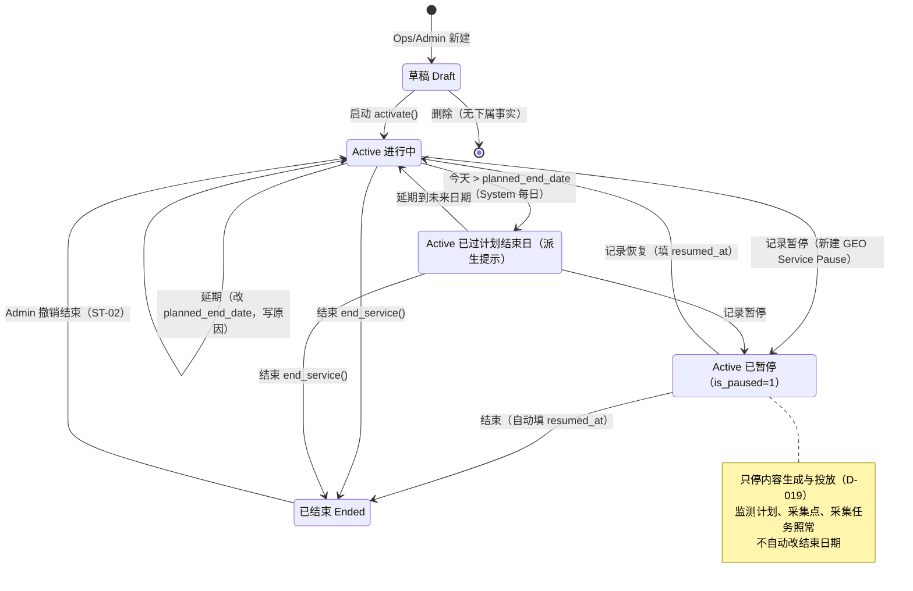
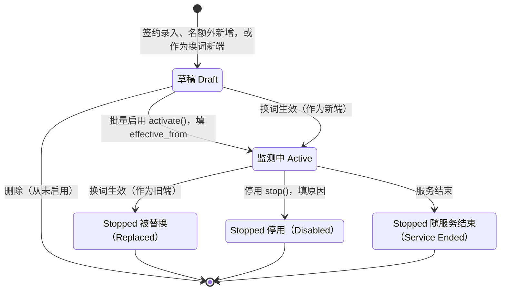
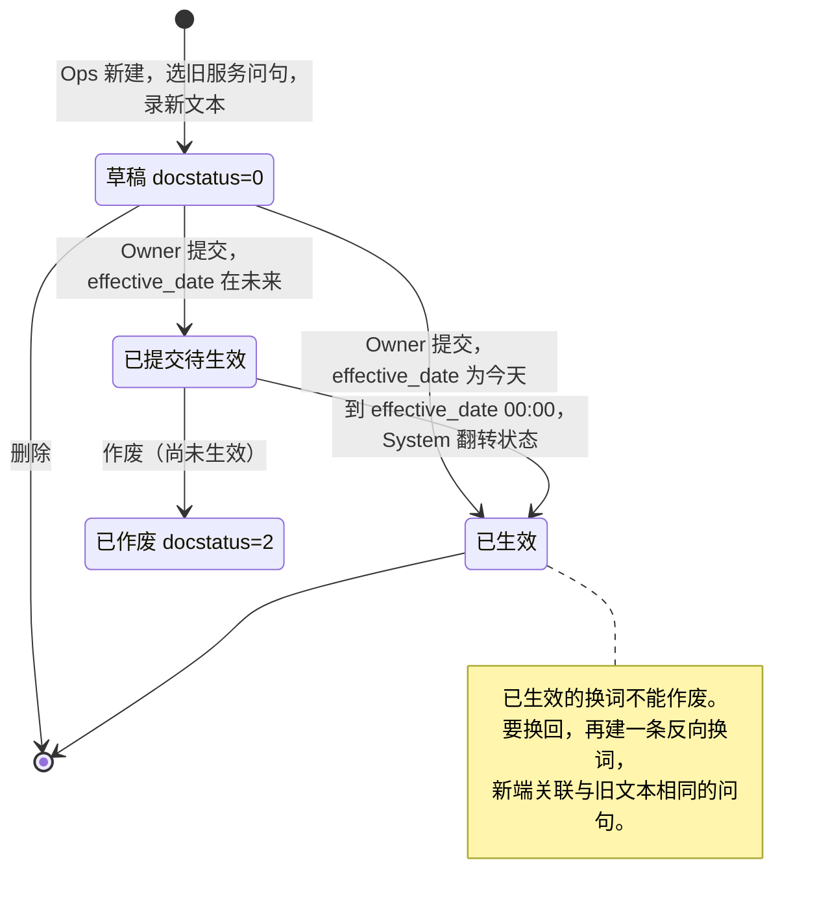
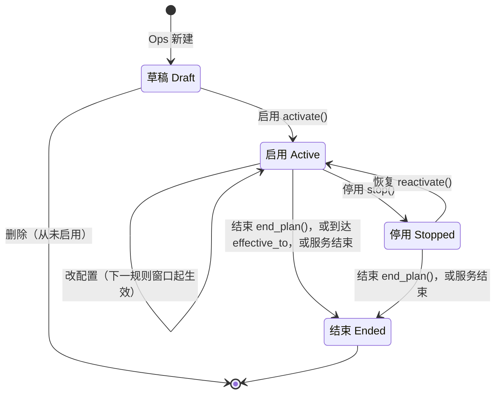
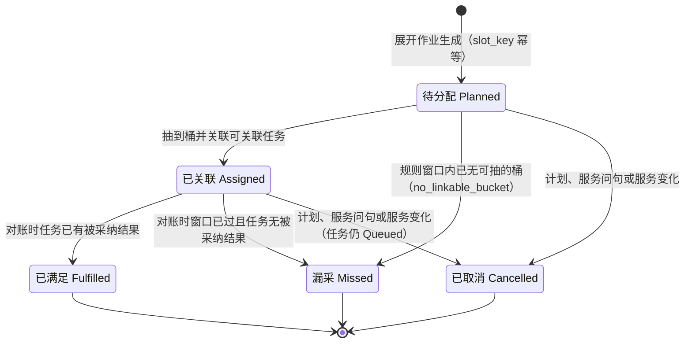
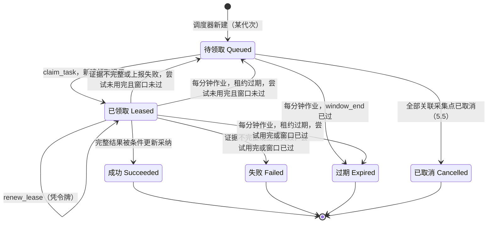
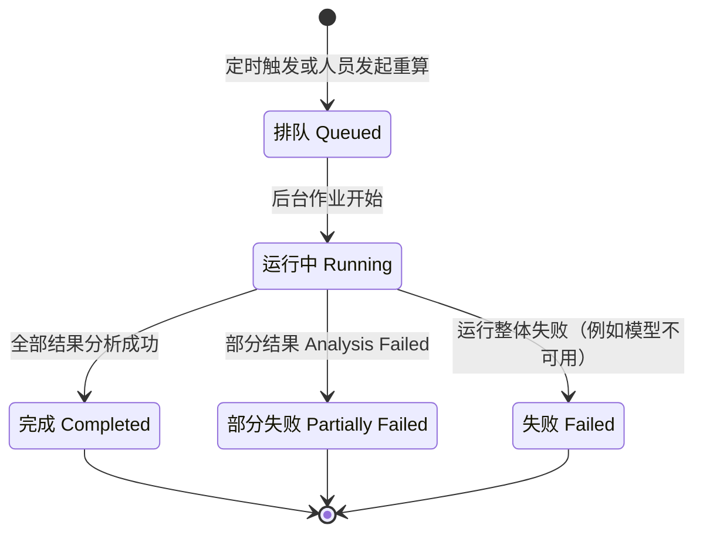
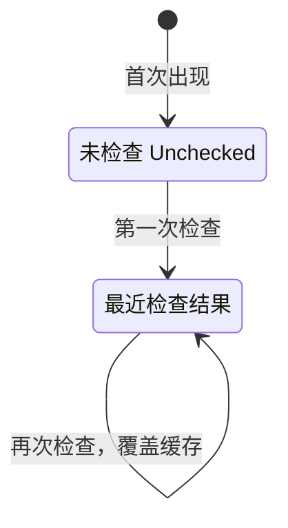
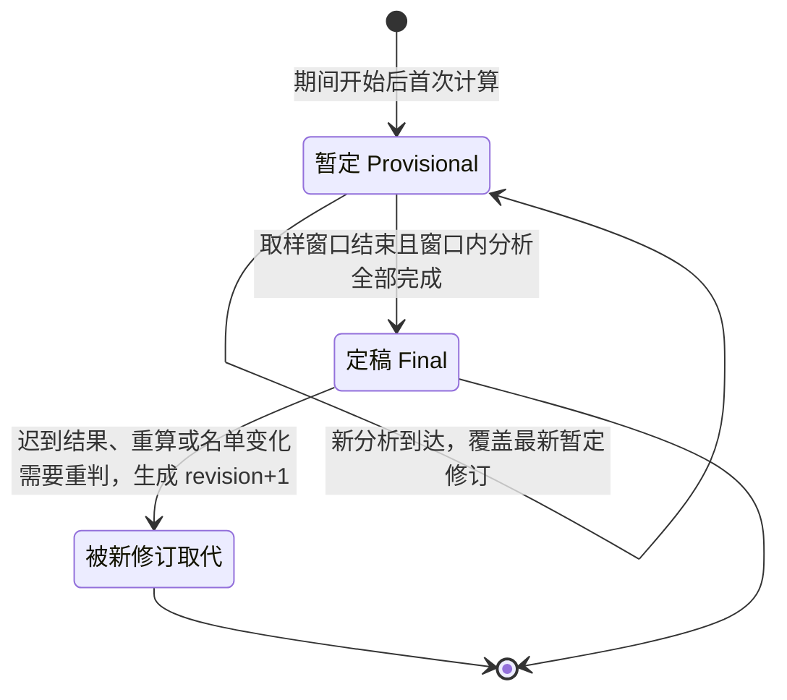
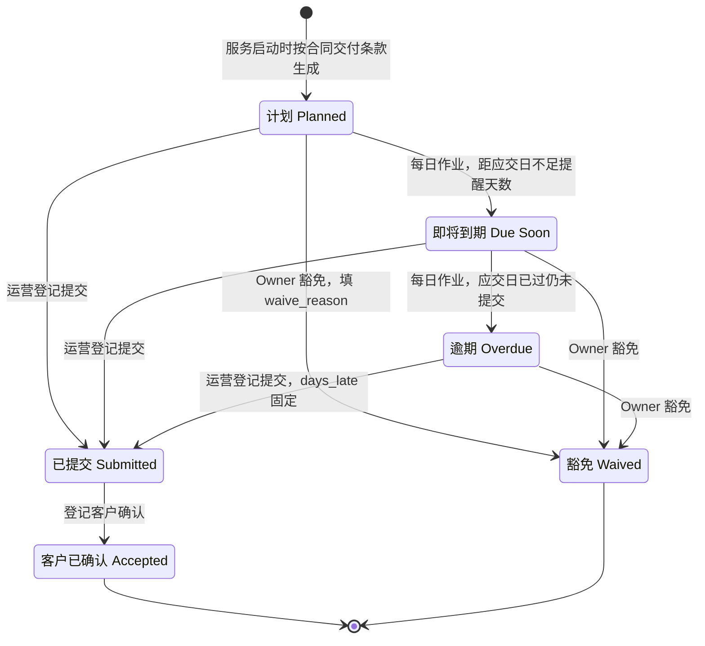

# GEO 运营第一版：状态机

- 目的：定义第一版中有生命周期的对象有哪些状态，状态之间怎样转换，谁能触发，以及哪些转换不允许。实现时服务端校验和后台任务以本文为准。
- 读者：用户本人（产品负责人），以及后续实现的工程师。
- 状态：**设计草案，待用户确认**。本文不代表已建 DocType、已改站点或已迁移数据。
- 版本：v0.2，2026-11-18。v0.1 写于 D-024 至 D-028 之前，只完成到第 3 节。本版重写第 2 节（问句不可变、服务问句有生命周期），补齐第 4 至第 10 节，并按设计审查修正租约模型。
- 输入：[decisions.md](../../cycle/decisions.md) D-017 至 D-028（优先级最高；D-025、D-026 覆盖 v0.1 的问句状态机，D-027 覆盖 v0.1 的 dogfood 设定）；[01 领域模型与 ER 图](01-domain-model-er.md) v0.3（DocType 名、字段名、状态取值以 01 为准）；[03 时序图与 API](03-sequences-and-api.md)（接口细节）；[GEO 服务候选模型](../2026-11-17-geo-service-model.md)（业务背景）。

隐私约定：本目录进入 Git。文中不出现真实客户名称、真实问句、价格、合同编号和联系人。示例均为自编。

标注约定（与 01 相同）：

- **已确认（D-0xx）**：用户已裁决，引用决定编号。
- **设计推荐（Agent）**：Agent 依据业界做法给出的方案，可改。
- **待确认**：需要用户回答；本文给出默认值，以便先往下设计。本文的问题编号用 `ST-xx`，与 01 的 `Q-xx` 区分。
- **建议补充到 01**：本文需要但 01 尚未定义的字段或取值。汇总在第 10 节，不另起对象名。

## 0. 通用规则

### 0.1 触发者缩写

| 缩写 | 含义 |
|---|---|
| Ops | 持有 `GEO Operations` 角色，且在该服务 `GEO Service Member` 中有有效的 Owner 或 Operations 行。 |
| Owner | 该服务当前有效的 Owner 行对应的用户（负责人）。 |
| Sales | 持有 `GEO Sales` 角色，且是该服务有效的 Sales 成员。第一版以只读为主。 |
| Admin | 持有 `GEO Admin` 角色，可操作全部服务（D-023）。 |
| Collector | 持有 `GEO Collector` 的采集程序机器账号，只调用任务领取与结果回传 API。 |
| System | 服务端后台任务（Frappe scheduler、RQ 后台作业）或其他转换的连带效果。 |

### 0.2 实现约定（设计推荐，Agent）

1. 所有 `status` 字段在表单上只读，只能通过服务端白名单方法改变（例如 `GEO Service.activate()`、`GEO Collection Task` 的 claim API）。表单保存不能直接改状态。理由：转换条件跨多个对象（服务、计划、采集点、任务），只靠表单字段无法校验。
2. 不使用 Frappe 原生 Workflow 驱动这些状态。原生 Workflow 适合单据审批（按角色点按钮），本文多数转换由时间或其他对象触发（租约过期、换词生效、服务结束）。人工动作做成表单按钮，调用同一组服务端方法。
3. 每次转换写入修订记录：开启 `track_changes=1` 的对象由 Frappe `Version` 记录；高频对象（`GEO Plan Slot`、`GEO Collection Task`）不逐条写 `Version`，而是在对象上保存最后一次转换的时间与原因（见第 10 节建议补充字段），完整轨迹由 `GEO Collection Result` 的追加记录还原。
4. 时间驱动的转换分三个定时作业（Frappe `scheduler_events` 的 `cron`，细节见 03 第 1.4 节）：每分钟一次的「租约回收与任务过期」；每 5 分钟一次的「采集点对账」；每小时一次（也可按需触发）的「展开与分配」。每日 00:05 的作业只翻转按日期生效的状态（换词生效、计划到期、交付物提醒），不再承担展开工作。判断时一律用转换条件里的时间，而不是作业运行时间。所有作业都必须幂等，可以重复运行。
5. 转换在数据库事务内完成，并用条件更新防并发，例如 `UPDATE ... SET status='Leased' WHERE name=%s AND status='Queued'`，影响行数为 0 即视为被别人抢先。

### 0.3 三类状态不混用

已确认（D-021）的「采集与分析分离」，加上 01 的 M-17，决定了本文把以下状态放在不同对象上，互不替代：

| 问题 | 记录在 | 本文章节 |
|---|---|---|
| 这次该不该采 | `GEO Plan Slot.status` | 第 4 节 |
| 这次采到了没有 | `GEO Collection Task.status`、`GEO Collection Result.outcome` | 第 5 节 |
| 回答能不能评价、评价结果 | `GEO Answer Analysis.answer_status` 及名次字段 | 第 6 节 |
| 引用的链接现在能不能打开 | `GEO Link Check.outcome`，缓存在 `GEO Source.latest_check_status` | 第 7 节 |

## 1. 服务（`GEO Service` 与 `GEO Service Pause`）

### 1.1 设计要点

- 已确认（D-019）：暂停只停内容生成和投放，采集继续；暂停后需要延期但不一定等额顺延，系统只记录暂停和恢复事实。
- 01 已定：`GEO Service.status` 只有 `Draft / Active / Ended`；暂停不是状态值，而是 `GEO Service Pause` 记录，`is_paused` 由它派生。
- 设计推荐（Agent）：图中的「进行中 / 已暂停」是 `Active` 内部的两个子状态，「已过计划结束日」是派生提示，均不写入 `status`。理由：暂停与服务是否在履约是两个维度；把暂停做成 `status` 值，会让「暂停期间采集继续」这类判断到处写成 `status in (Active, Paused)`，容易漏。
- 设计推荐（Agent）：到达 `planned_end_date` 时系统**不**自动结束服务，只提醒负责人。理由：D-019 说明延期不一定等额顺延，系统算不出真实结束日；自动结束会停掉采集，造成不可补的数据缺口。
- 第一版没有内容生成和投放模块（D-017），所以暂停在第一版只产生「事实记录 + 看板标注」两个效果。以后接入内容、投放模块时，它们必须在执行前检查 `is_paused`。

### 1.2 状态图

说明：三个「Active ...」节点在数据上都是 `status=Active`，区别分别来自 `GEO Service Pause` 和 `planned_end_date`，不写入 `status`。三者下采集都照常。暂停期间也可能越过计划结束日，此时同时显示两种提示，图中省略这条组合路径。

### 1.3 状态说明

| 状态 | 含义 | 进入条件 | 允许动作 | 谁能触发 |
|---|---|---|---|---|
| Draft 草稿 | 服务在配置中，还没开始履约。 | 新建。 | 改所有字段；维护成员、标的、合同、服务问句（Draft）、监测计划（Draft）、竞品名单。不生成采集点。 | 销售或 Admin 新建草稿并指定 Owner（ST-01，与 04 Q-29 一致）；之后由 Owner 配置。 |
| Active · 进行中 | 正在履约，未暂停。 | 从 Draft 启动；或从已暂停恢复。启动校验：`start_date` 必填；`targets` ≥1；`members` 有一名有效 Owner；`contracts` ≥1 且 `served_customer` 在合同 `geo_served_customers` 中。dogfood 服务同样适用（D-027）。 | 启用/停用监测计划；问句启用与换词；记录暂停；延期；增减成员（加新行或填 `to_date`）；增减标的（有效期方式）；结束。 | 启动、暂停、恢复、延期、结束：Owner、Admin。日常配置：Ops、Admin。Sales 只读。 |
| Active · 已暂停 | 履约中，内容生成与投放暂停，采集继续。 | 存在一条 `paused_from <= now` 且 `resumed_at` 为空的 `GEO Service Pause`。 | 同「进行中」，但内容生成、投放类动作被拒绝（第一版无此模块）；记录恢复；结束（同时自动填 `resumed_at`，ST-03）。 | 恢复：Owner、Admin。 |
| 已过计划结束日（派生） | `planned_end_date` 已过但未结束。 | 每日作业比较日期。 | 延期或结束。采集照常。列表与看板显示提醒。 | System 提醒；处理由 Owner、Admin。 |
| Ended 已结束 | 履约结束。 | `end_service()`：填 `actual_end_date`（必填，可早于或晚于 `planned_end_date`）。 | 只读查看全部历史；看板与指标快照照常可查；回链仍可导入（补录历史发布）。 | Owner、Admin 结束；撤销结束仅 Admin。 |

暂停记录（`GEO Service Pause`）自身也有两个状态：「暂停中」（`resumed_at` 为空）与「已恢复」（`resumed_at` 已填）。`resumed_at` 只能写一次（01 已定 `set_only_once`）。记错时由 Admin 作废该记录并重新登记，作废记录保留（ST-04 默认作法；需要 `GEO Service Pause` 设为可提交，见第 10 节）。

### 1.4 结束服务时对下属对象的连带效果（设计推荐，Agent）

`end_service()` 在一个事务内完成：

1. 本服务全部 `Active` 监测计划转为 `Ended`（第 3 节），`effective_to` 设为 `actual_end_date`。
2. 全部 `rule_window_start >= actual_end_date 次日 00:00` 的可取消采集点（定义见第 4.1 节）转为 `Cancelled`，原因 `service_ended`。
3. 采集任务按第 5.5 节处理：只服务于被取消采集点的 `Queued` 任务转为 `Cancelled`；`Leased` 任务不打断，允许回传，结果照常保存。
4. 本服务全部 `Active` 服务问句转为 `Stopped`，`stop_reason=Service Ended`，`effective_to = actual_end_date`；`Draft` 服务问句（例如尚未生效的换词新端）删除，对应未生效的换词记录作废。全局 `GEO Question` 不受影响（它没有状态，D-025）。服务 `Ended` 后服务问句的启用、换词按钮隐藏，服务端拒绝。
5. 若有暂停中的记录，自动填 `resumed_at = actual_end_date 结束时刻`，`resume_recorded_by` = 操作人，`note` 追加「随服务结束关闭」。

### 1.5 非法转换

| 转换 | 拒绝原因 |
|---|---|
| Draft → Ended | 未履约的服务直接删除或保留草稿；结束意味着曾经履约，看板会据此展示期间。 |
| Ended → Draft | 结束后的历史不能回到可任意改写的草稿。 |
| 暂停中再次暂停 | 同一服务暂停区间不重叠（01 已定）。 |
| 未暂停时恢复 | 没有可关闭的暂停记录。 |
| 暂停导致监测计划停用或采集点取消 | 违反 D-019「采集继续」。服务端在暂停时不触碰计划、采集点、任务。 |
| 暂停或恢复自动修改 `planned_end_date` / `actual_end_date` | 违反 D-019「系统只记录暂停和恢复事实」。延期由人在服务或合同上修改，并写原因。 |
| 删除有采集点、采集结果或服务问句已启用的服务 | 历史事实不删。 |
| Draft → Active 但校验不通过 | 见进入条件；返回具体缺失项。 |
| Ended 服务上新增问句、启用计划、记录暂停 | 结束后不再履约。需要继续服务时由 Admin 撤销结束（ST-02）或新建服务。 |

### 1.6 dogfood 服务

已确认（D-027）：dogfood 服务按普通客户处理，不设特殊类型，启动校验同样要求合同（甲方为公司自身，被服务组织是 ERPNext 内部客户）。公司自己的服务同样可以暂停、延期、结束，便于在 dogfood 中把这些路径都走一遍。v0.1 的 `service_kind=Internal` 例外删除。

## 2. 问句、服务问句与换词（`GEO Question`、`GEO Service Question`、`GEO Question Replacement`）

### 2.1 设计要点

- 已确认（D-025）：问句是全局对象，文本创建后不可修改，全系统同一文本只有一条。「修改问句」= 该服务停止监测旧问句、关联一个新问句。
- 已确认（D-026）：判重只去首尾空白，再按内容精确比较（01 第 4.7 节）。
- 已确认（D-019、D-025）：换词记录在服务问句上，目前 1 换 1，保留原因、确认人和生效日期。年框不一定每三个月换词，系统不设定期换词提醒。
- 因此：**`GEO Question` 没有生命周期**，只有「存在」。生命周期属于服务对问句的使用关系 `GEO Service Question`：Draft → Active → Stopped，停止原因 `stop_reason` 取 Replaced / Disabled / Service Ended。
- 「不改写历史」的含义：旧服务问句的采集点、分析结果、考核结果都保持原样并继续指向旧服务问句；新服务问句从 `effective_date` 起才有采集点。看板用名额位 `quota_slot` 把换词链接成一条时间线，在换词日标注。
- 签约前已调整的问句（案例 C1 有若干条）直接以调整后的文本作为签约录入的服务问句，`origin=Contract Signing`，原文本写在 `original_text_note`，不建换词记录，不出现在换词链上。

### 2.2 问句（`GEO Question`）

`GEO Question` 只有一种状态：已存在。规则：

| 动作 | 是否允许 | 说明 |
|---|---|---|
| 创建 | 只经 `get_or_create_question(text)` | 去首尾空白、算 hash、在唯一索引上插入，冲突则返回已有记录。界面与返回值不区分新建或复用（01 第 3.5 节）。 |
| 修改任何字段 | 拒绝，包括管理员 | 服务端 `validate` 拒绝；REST `PUT`、`frappe.client.set_value` 同样拒绝。 |
| 删除 | 被任何服务问句或采集任务引用后拒绝 | 未被引用的孤儿问句可由管理员清理。 |

### 2.3 状态图：服务问句

三个「Stopped」节点在数据上都是 `status=Stopped`，区别在 `stop_reason`。

### 2.4 状态说明：服务问句

| 状态 | 含义 | 进入条件 | 允许动作 | 谁能触发 |
|---|---|---|---|---|
| Draft | 已关联问句，尚未开始监测。 | 签约录入（`origin=Contract Signing`）、名额外新增（`origin=Addition`）、换词新端（`origin=Replacement`）。 | 改 `display_no`、`quota_slot`、`primary_target`、`original_text_note`、备注；可加入 Draft 计划（ST-05）。`question` 一经写入不可改：录错文本就删除这条 Draft 服务问句，重新录入。不生成采集点。 | Ops、Admin。 |
| Active | 正在监测。 | `activate()`：服务为 Draft 或 Active；`effective_from` 必填且在服务期内；同服务内同一问句无重叠有效期；同一 `quota_slot` 当天无其他 Active；名额数不超过合同 `geo_question_quota`。或换词生效。 | 加入或移出监测计划；加入分组；作为换词旧端；停用。 | 批量启用：Owner、Admin（04 第 4.3 节）；换词生效时 System。 |
| Stopped · Replaced | 名额由新服务问句接替。 | 换词生效：`effective_to = effective_date - 1 天`。 | 只读；历史采集、分析、考核照常可查；可继续留在分组里。 | System。 |
| Stopped · Disabled | 不再监测，也没有接替。 | `stop()`：填 `effective_to`（默认今天）与原因。从本服务所有 Draft、Active、Stopped 计划中移除该行；`effective_to` 之后的可取消采集点 → `Cancelled`（`question_disabled`），任务按第 5.5 节处理。若某 Active 计划因此没有服务问句，该计划自动转 Stopped。 | 同上。 | Owner、Admin（停用改变合同名额覆盖，ST-07）。 |
| Stopped · Service Ended | 随服务结束。 | `end_service()` 连带（第 1.4 节）。 | 同上。 | System。 |

### 2.5 状态图：换词记录

「已提交待生效」与「已生效」都是 `docstatus=1`，用只读字段 `applied_at`（切换实际执行时间）区分：为空即待生效。

### 2.6 换词提交与生效时的连带动作（设计推荐，Agent）

换词把「采集点的调整」放在**提交时**，把「状态翻转」放在**生效日**。理由：采集点要提前展开到 `slot_horizon_days` 天，如果等到生效日 00:00 才为新服务问句展开，当天头 30 分钟的桶已经进入 `min_link_lead_minutes`，会被记成漏采；而旧服务问句已经提前两天展开了采集点。

**提交时**（一个事务内）：

1. 校验：旧端为本服务 Active；新端为本服务 Draft、`origin=Replacement`，所指问句与旧端不同，也不与本服务其他有效服务问句相同；`effective_date` 为今天或未来（ST-08）。
2. 旧服务问句：`rule_window_start >= effective_date 00:00` 的可取消采集点（第 4.1 节）→ `Cancelled`（`question_replaced`）；失去全部有效采集点的 Queued 任务按第 5.5 节处理。
3. 新服务问句：为 `effective_date` 起、`slot_horizon_days` 范围内的日期展开采集点并分配时间桶（03 第 1 节）。这些采集点在状态翻转前就已存在，但访问判定（01 第 3.2 节）要求 `rule_window_start` 落在服务问句有效期内，新服务问句的 `effective_from` 在翻转时才写入，所以生效前不会让任何人看到新问句的结果。
4. `effective_date` 为今天时，立即执行下面的「生效时」步骤。

**生效时**（`effective_date` 00:05 的每日作业，或提交时 `effective_date` 为今天）：

1. 旧服务问句 → `Stopped`，`stop_reason=Replaced`，`effective_to = effective_date - 1 天`。
2. 新服务问句 → `Active`，`effective_from = effective_date`，`quota_slot` 继承旧端。
3. 本服务所有 Draft、Active、Stopped 监测计划中，把旧服务问句行替换为新服务问句行（计划的 `Version` 留痕）。Stopped 计划也替换，否则恢复后会指向已退出的服务问句。Ended 计划不改。
4. 写换词记录的 `applied_at`。

换词只作用于本服务。其他服务若也在监测同一个全局问句，它们的服务问句、采集点和任务不受影响。

作废待生效的换词：撤销提交时第 2、3 步的影响，即取消新服务问句的未来采集点，为旧服务问句重新展开 `effective_date` 起的采集点，并删除新端 Draft 服务问句。

### 2.7 非法转换

| 转换或操作 | 拒绝原因 |
|---|---|
| 修改 `GEO Question` 的任何字段 | 问句不可变（D-025）。修错字也走换词，原因选 Text Fix。 |
| 修改服务问句的 `question` | 服务问句与问句的关联一经写入不可改。Draft 时可删除重录。 |
| Stopped → Active、Stopped → Draft、Active → Draft | 停止的服务问句不复活。要恢复同一文本，新建服务问句并走换词或名额外新增，链路可追溯。 |
| 删除 Active 或 Stopped 服务问句 | 历史事实不删。 |
| 同一旧服务问句提交第二条换词 | 1 换 1，`old_service_question` 唯一（D-019）。 |
| 新端不是本服务 Draft，或所指问句与旧端相同 | 新端必须是尚未启用、文本不同的同服务服务问句。 |
| 已生效的换词作废 | 切换已发生并已影响调度；用反向换词处理。 |
| 换词修改旧服务问句已有的采集结果、分析或考核 | 违反「历史不被改写」（D-019、D-021）。 |
| 服务 Ended 时启用服务问句或提交换词 | 服务不再履约。 |
| 服务暂停时禁止换词 | **不禁止**。暂停只停内容生成与投放（D-019）。 |

## 3. 监测计划（`GEO Monitoring Plan`）

### 3.1 设计要点

- 已确认（D-020、D-025、D-027）：采集频率挂在监测计划上；计划关联服务、一组服务问句、采样条件和时间规则。一个服务问句可加入多个计划。频率、时段、间隔和分布方式由每个计划自行配置，系统不预设固定值。
- 01 v0.3 已定：`status` 取 `Draft / Active / Stopped / Ended`；开启修订跟踪 `track_changes=1`。
- 本文定义 `Ended` 的含义。设计推荐（Agent）：`Stopped` 是人工停用，可以恢复；`Ended` 是终态，由服务结束连带产生，或由人工明确「计划到此为止」。理由：停用常用于临时停一段（例如客户要求先停某平台），结束用于封存，看板据此区分「暂停的计划」与「历史计划」。
- 只有 `Active` 计划展开采集点（`GEO Plan Slot`）。暂停服务不影响计划状态（D-019）。
- 计划停用、结束只影响**还没开始执行**的采集点和任务；已领取的任务不打断，回传结果照常保存（第 5.5 节）。

### 3.2 状态图

### 3.3 状态说明

| 状态 | 含义 | 进入条件 | 允许动作 | 谁能触发 |
|---|---|---|---|---|
| Draft 草稿 | 配置中，不生成采集点。 | 新建。 | 改全部字段；可加入 Draft 或 Active 服务问句（ST-05）；删除。 | Ops、Admin。 |
| Active 启用 | 按规则展开采集点并调度。 | `activate()`：服务为 Active；`effective_from` 必填；`service_questions` ≥1 且启用时全部为 Active；`profiles` ≥1 且对应平台 `enabled=1`；频率规则合法（`times_per_unit` 不超过规则窗口内可用桶数，例如 15 分钟桶时 Hour 规则最多 4 次；同一服务同一服务问句同一采样条件每天的采集点总数不超过当天可用桶数；`active_time_from < active_time_to`，01 第 4.9 节校验）。 | 改配置；停用；结束。只能加入 Active 服务问句。 | 启用、停用、结束：Owner、Admin。改配置：Ops、Admin（Owner 是否需复核见 ST-09）。 |
| Stopped 停用 | 暂时不再展开新的采集点。 | `stop()`：填 `stop_reason`。 | 恢复；结束；查看历史；不能改配置。 | Owner、Admin。 |
| Ended 结束 | 计划封存。 | `end_plan()`；或 `effective_to` 已过（System）；或服务结束（System，`effective_to = actual_end_date`）。 | 只读。可被复制为新的 Draft 计划（新记录，不复用旧记录）。 | Owner、Admin；System。 |

### 3.4 启用、改配置、停用、结束对采集点的影响

术语见第 4 节：**可取消的采集点** = `Planned`，或 `Assigned` 且其任务仍为 `Queued`。

| 动作 | 生效边界 | 对采集点 | 对采集任务 |
|---|---|---|---|
| 启用 | 当前时刻起，到 `now + slot_horizon_days`。当前已开始的规则窗口只按剩余可用桶生成相应次数（01 第 4.9 调度规则 2）。启用时立即触发一次展开作业。 | 展开新采集点；`slot_key` 唯一，重复展开幂等。 | 调度器为新采集点关联或新建任务（按复合唯一键）。 |
| 改配置（增删服务问句、采样条件、频率、时段） | **下一个尚未开始的规则窗口**起。理由：例如「每日 3 次」改为「每日 5 次」，若当天就改，当日次数无法解释。 | 下一规则窗口起，不再需要的可取消采集点 → `Cancelled`（`plan_changed`）；新增组合展开。仍需要的保留。 | 按第 5.5 节检查失去全部有效采集点的任务。 |
| 停用 | 立即。 | 全部可取消采集点 → `Cancelled`（`plan_stopped`）。已 `Fulfilled`、`Missed` 的不变；任务已 `Leased` 的采集点保持 `Assigned`，等待结果。 | 第 5.5 节。 |
| 恢复 | 当前时刻起。 | 与启用相同，重新展开；**不补**停用期间的采集点，停用期间对账显示为「计划停用」，不算漏采。 | 同启用。 |
| 结束 | 立即（服务结束连带时按 `actual_end_date` 次日 00:00）。 | 同停用，原因 `plan_ended` 或 `service_ended`。 | 第 5.5 节。 |

### 3.5 非法转换

| 转换或操作 | 拒绝原因 |
|---|---|
| Active 计划加入 Draft 或 Stopped 服务问句 | 只监测有效服务问句。 |
| 服务非 Active 时启用或恢复计划 | 服务未启动或已结束。服务**暂停**时允许，因为采集继续（D-019）。 |
| Ended → 任何状态 | 终态。需要继续时复制为新计划。 |
| Stopped 状态改配置 | 先恢复再改，避免停用期间的配置变化无法对应到任何执行。如需调整后再启用，改配置与恢复在同一操作中完成（`reactivate(changes)`）。 |
| Draft → Stopped / Ended | 从未启用的计划直接删除。 |
| 删除曾经启用过的计划 | 已有采集点与对账历史。 |
| 停用或结束时把已 `Leased` 任务强制取消 | 采集程序可能正在执行；回传结果仍是有效事实。 |
| 修改已过去的采集点（改时间、改问句） | 计划与实际执行分开保存（D-020），历史期望不改。 |

## 4. 采集点（`GEO Plan Slot`）

### 4.1 设计要点

- 采集点是「计划要求采一次」的期望，也是计划与共享任务之间唯一的关联（01 第 3.1 节）。状态只由 System 改变：展开、分配、对账、取消。人员没有任何写权限。
- **可取消的采集点** = `Planned`，或 `Assigned` 且关联任务仍为 `Queued`。关联任务已 `Leased` 的采集点不取消，等待结果，因为采集程序可能正在执行。
- 高频表不写 `Version`，每次转换更新 `last_transition_at`，并在进入 Missed、Cancelled 时写 `missed_reason`、`cancel_reason`（01 第 4.9 节）。

### 4.2 状态图

### 4.3 状态说明

| 状态 | 含义 | 进入条件 | 谁能触发 |
|---|---|---|---|
| Planned | 已展开，尚未分配时间桶。 | 展开作业生成（03 第 1.3.1 节）。 | System。 |
| Assigned | 已关联任务，等待执行。 | 分配作业按 01 第 4.9 调度规则 2 至 4 抽桶并关联，写 `assigned_window_start`、`collection_task`、`linked_at`。 | System。 |
| Fulfilled | 任务有被采纳的结果。 | 对账作业：关联任务 `succeeded_result` 非空。可以在 `rule_window_end` 之前进入。 | System。 |
| Missed | 漏采。 | Planned 时已无可抽的桶（`no_linkable_bucket`）；或 `rule_window_end` 已过且任务无被采纳结果，`missed_reason` 取自任务终态：`task_never_claimed`（任务 Expired 且从未领取）、`task_expired`（领取过但租约过期）、`task_failed`、`task_cancelled`。 | System。 |
| Cancelled | 不再需要。 | 计划改配置、停用、结束；服务问句换词、停用；服务结束。`cancel_reason` 见 01 第 4.9 节。 | System（由人员动作连带）。 |

### 4.4 非法转换

| 转换 | 拒绝原因 |
|---|---|
| Fulfilled、Missed、Cancelled → 任何状态 | 终态。计划与实际执行分开保存（D-020），历史期望不改。 |
| 改已分配采集点的 `assigned_window_start` 或 `collection_task` | 换桶会让已看到的结果与采集点对不上。计划改动只影响未关联任务的采集点（01 第 4.9 节对账口径）。 |
| 把采集点关联到 Leased、Succeeded 或临近开始的任务 | 01 第 3.2 节链接规则，无例外。 |
| 暂停服务时取消采集点 | 暂停期间采集继续（D-019）。 |

## 5. 采集任务、领取记录与采集结果

### 5.1 设计要点

- 已确认（D-025、D-026）：任务按 `(question, sampling_profile, window_start, link_generation)` 全局唯一，不带服务、客户字段；能同时满足各计划要求时共用一条，否则分别生成。
- 设计推荐（Agent）：租约由 `GEO Collection Attempt` 表达，每次领取发一个随机令牌（01 第 4.9 节租约与回传规则）。v0.1 设想的「证据不完整时任务保持 Leased」取消：保持 Leased 会让别的设备无法领取，尝试次数也不前进。
- 任务的终态（Succeeded、Failed、Expired、Cancelled）之后仍可收到迟到回传，结果保存为多采（`is_extra=1`），不改任务状态。

### 5.2 状态图：采集任务

### 5.3 状态说明：采集任务

| 状态 | 含义 | 进入条件 | 允许动作 | 谁能触发 |
|---|---|---|---|---|
| Queued | 等待领取。 | 调度器新建；或从 Leased 退回（见图）。退回时当前领取记录写 `ended_at`、`end_reason`，任务 `current_attempt`、`lease_expires_at` 清空。 | 被领取；被新采集点关联（仅当 `window_start >= now + min_link_lead_minutes`）；过期；取消。 | Collector 领取；System。 |
| Leased | 已被某次领取占用。 | `claim_task`：条件更新 `WHERE status='Queued' AND window_end > now`，`attempt_count+1`，新建领取记录并返回令牌。 | 凭令牌续租、回传、上报失败。不接受新的采集点关联。 | Collector；System 回收。 |
| Succeeded | 已有被采纳结果。 | 回传 `outcome=Success` 且证据完整，`UPDATE ... SET succeeded_result=%s, status='Succeeded' WHERE name=%s AND succeeded_result IS NULL` 影响 1 行。 | 只读。之后的回传保存为多采。 | Collector 回传触发。 |
| Failed | 尝试用完或窗口已过，仍没有可采纳结果。 | 见图。 | 只读。之后的回传保存为多采。 | Collector 回传或 System。 |
| Expired | 窗口过了，没有可采纳结果。 | Queued 且 `window_end <= now`；或 Leased 且租约过期，同时尝试用完或窗口已过。 | 只读。迟到回传在 `window_end + late_submit_grace_minutes` 前仍保存为多采。 | System（每分钟作业）。 |
| Cancelled | 不再被任何有效采集点需要。 | 第 5.5 节。 | 只读。 | System。 |

### 5.4 领取记录与回传规则

`GEO Collection Attempt` 不设状态字段：`ended_at` 为空表示该次领取仍占用任务。

| 事件 | 校验 | 结果 |
|---|---|---|
| 领取 `claim_task` | `frappe.only_for("GEO Collector")`；任务 Queued 且 `window_end > now` | 新领取记录；返回令牌（只返回一次，库里只存哈希）。 |
| 续租 `renew_lease` | 令牌等于任务 `current_attempt` 的令牌，任务仍 Leased | 延长该领取记录和任务的 `lease_expires_at`。令牌不是当前令牌时返回 409 `lease_superseded`。 |
| 上传证据 `upload_evidence` | 令牌是该任务曾签发过的任一令牌；`now <= window_end + late_submit_grace_minutes`；大小与 sha256 校验通过 | 返回 `evidence_ref`（03 第 2.4 节）。 |
| 回传 `submit_result` | 同上；`submission_id` 未用过（已用过则返回已有结果） | 按任务当前状态处理，见下。 |

回传时按任务当前状态处理：

1. 任务 Leased 且令牌是当前令牌：保存结果，结束该领取记录。完整则尝试条件更新采纳；不完整或失败则按图退回 Queued 或转 Failed。
2. 任务 Leased 但令牌是旧令牌（租约过期后被别的设备重领）：保存结果。完整则同样尝试条件更新采纳，影响 0 行时置 `is_extra=1`；不完整则只保存，不影响当前领取。
3. 任务已是 Queued（旧租约已被回收、尚未被重领）且结果完整：保存并尝试采纳；成功则任务转 Succeeded。
4. 任务已是 Succeeded、Failed、Expired、Cancelled：保存为 `is_extra=1`，`rejection_reason=Task Closed`（Succeeded 时为空，标多采即可），不改任务状态。

这样同一机器账号在多台设备上运行时，设备 2 不能凭账号身份替设备 1 回传（令牌不同）；而设备 1 迟到的完整结果仍被保存（AC-09）。

### 5.5 采集点取消对任务的影响

某任务的全部关联采集点都为 `Cancelled` 时：

- 任务 Queued → Cancelled。
- 任务 Leased → 不取消，允许回传，结果照常保存（结果不被任何服务的有效采集点引用，只有管理员可见）。
- 任务已终态 → 不变。

### 5.6 采集结果

`GEO Collection Result` 可提交，插入即 `docstatus=1`，只追加，不能修改或作废。是否被采纳看任务的 `succeeded_result` 与结果的 `is_extra`、`rejection_reason`，不另设状态字段。

| 情形 | `evidence_complete` | `is_extra` | `rejection_reason` |
|---|---|---|---|
| 被采纳 | 1 | 0 | 空 |
| 完整，但任务已有被采纳结果 | 1 | 1 | 空 |
| 证据不完整 | 0 | 0 | Evidence Incomplete |
| 任务已 Failed、Expired、Cancelled 后到达 | 任意 | 1 | Task Closed |
| 上报失败（`outcome` 不是 Success） | 0 | 0 | 空 |

## 6. 分析（`GEO Analysis Run`、`GEO Answer Analysis`）

### 6.1 状态图：分析运行

运行记录终态后不再改变。重跑失败部分 = 新建一个运行（`recompute_of` 指向原运行），只包含失败的结果。

### 6.2 回答分析

`GEO Answer Analysis` 可提交，插入即提交，不修改。「哪条有效」用 `is_current` 表达（01 第 4.11 节）：

- 同一 `(service, collection_result, analysis_method, competitor_list)` 只有一条 `is_current=1`。
- 新运行写入同一组合时，在同一事务内把旧行置 0，新行置 1。
- `answer_status=Analysis Failed` 的行也会成为当前行，直到重跑成功替换它。考核把它计入 `excluded_breakdown`，不进分母（与拒答、不可解析同样分开统计）。

## 7. 信源检查（`GEO Link Check`、`GEO Source.latest_check_status`）

`GEO Link Check` 只追加，每次检查一条，没有状态机。`GEO Source.latest_check_status` 是最近一次检查结果的缓存：

「最近检查结果」取值：OK / Redirected / Not Found / Gone / Blocked / Timeout / Error。任何取值之间都可以互相转换（链接可能失效后又恢复）。失效不删除任何引用（D-022）。

## 8. 考核结果（`GEO Assessment Result`）

| 阶段 | 含义 | 规则 |
|---|---|---|
| Provisional | 窗口未结束或分析未完成，只作趋势。 | 同一 `result_key`（`rule|service_question|platform|period_start`）只保留一条最新的暂定修订，可覆盖。 |
| Final | 结算依据。 | 提交后不原地改写。重判时新建 `revision+1`，`supersedes` 指向旧修订；旧修订保留，在界面标「已被取代」。 |

「分析全部完成」= 窗口内所有被采纳结果都有一条 `is_current=1` 的分析，且没有 Queued 或 Running 的运行覆盖该窗口。

## 9. 交付物（`GEO Deliverable`）

| 状态 | 进入条件 | 谁能触发 |
|---|---|---|
| Planned | 生成时；或 Owner 把 `due_date` 改到提醒期之外。 | System；Owner 改日期（留痕）。 |
| Due Soon | 距 `due_date` 不足 `deliverable_reminder_days` 个工作日；同时通知 Owner，写 `reminded_at`。 | System。 |
| Overdue | `due_date` 已过且未提交。 | System。 |
| Submitted | 填 `submitted_at`、文件或 `report_ref`；`days_late` 按自然日计算并固定。 | 运营、Owner、Admin。 |
| Accepted | 填 `accepted_on`（客户确认收到或通过）。 | 运营、Owner、Admin。 |
| Waived | 填 `waive_reason`。 | Owner、Admin。 |

## 10. 对 01 的字段补充

v0.1 第 10 节列出的建议已全部并入 01 v0.3：`GEO Monitoring Plan.status` 增加 `Ended` 与 `stop_reason`；`GEO Plan Slot` 的 `missed_reason`、`cancel_reason`、`last_transition_at`；`GEO Collection Task` 的 `current_attempt`、`last_transition_at`；新对象 `GEO Collection Attempt`；`GEO Collection Result.rejection_reason`；`GEO Deliverable` 的 `waive_reason`、`reminded_at`。

本文仍需补充到 01 的：

| 对象 | 字段 | 说明 |
|---|---|---|
| `GEO Question Replacement` | `applied_at`（Datetime，只读） | 切换实际执行时间，区分「已提交待生效」与「已生效」（2.5）。 |
| `GEO Service Pause` | 设为可提交 | 记错时由 Admin 作废后重新登记，作废记录保留（ST-04）。 |
| `GEO Service` | `reopen_reason`（Small Text） | Admin 撤销结束时必填（ST-02）。 |

## 11. 待确认问题（本文新增，ST-xx）

| # | 问题 | 推荐 |
|---|---|---|
| ST-01 | 谁新建服务草稿 | 销售或管理员建草稿并指定 Owner，Owner 配置并启动（与 04 Q-29 合并） |
| ST-02 | 服务结束后能否撤销 | 只限管理员，填原因；结束时停止的服务问句不自动恢复，需要时重新启用新服务问句 |
| ST-03 | 暂停中结束服务时，是否自动关闭暂停记录 | 是，`resumed_at` 取结束时刻，备注写明 |
| ST-04 | 暂停记录记错怎么改 | 管理员作废后重新登记，作废记录保留 |
| ST-05 | Draft 服务问句能否先加入 Draft 计划 | 能；计划启用时要求全部为 Active |
| ST-06 | （v0.1 的「服务结束后批量归档问句」） | 取消：服务结束时服务问句自动 Stopped |
| ST-07 | 停用服务问句是否只限 Owner | 是，因为它改变合同名额覆盖 |
| ST-08 | 换词 `effective_date` 能否设在过去 | 不能，只允许今天或未来 |
| ST-09 | 运营改 Active 计划配置是否需要 Owner 复核 | 不需要；计划开启修订跟踪，改动从下一规则窗口起生效 |
