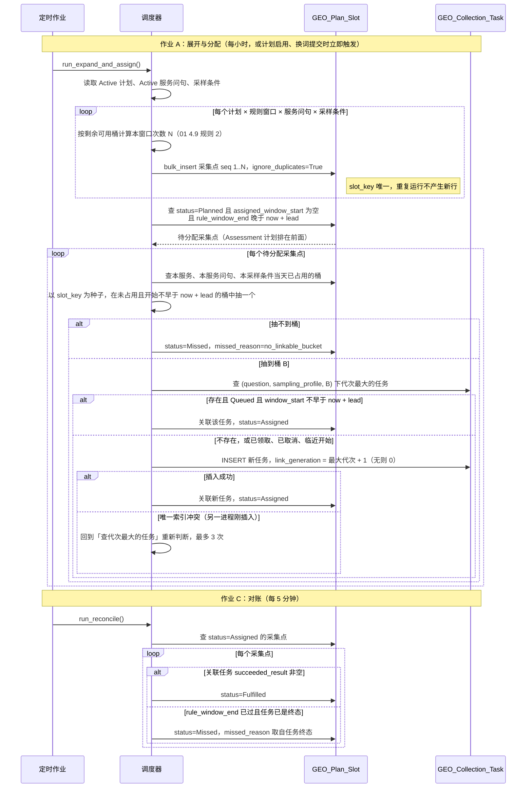
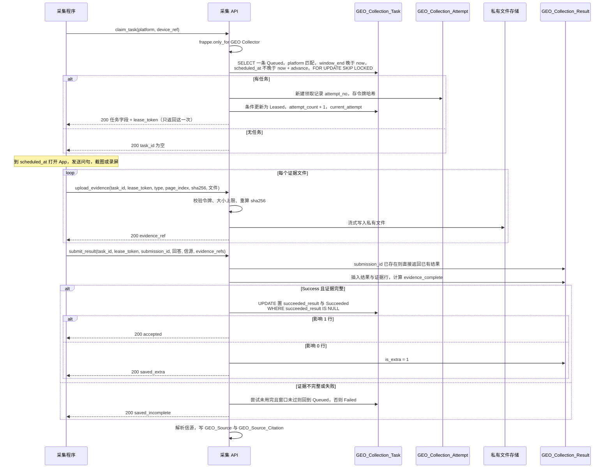
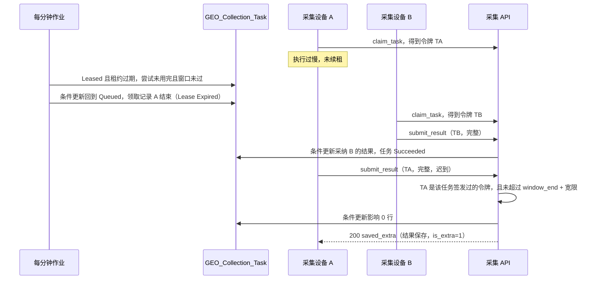
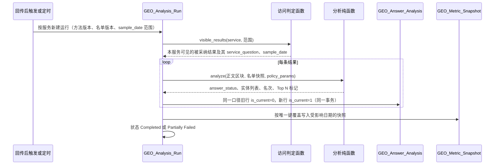
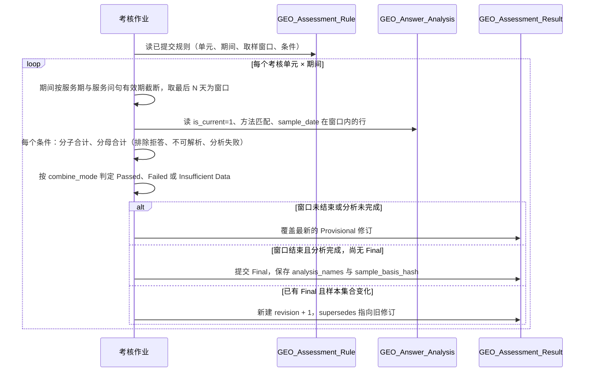
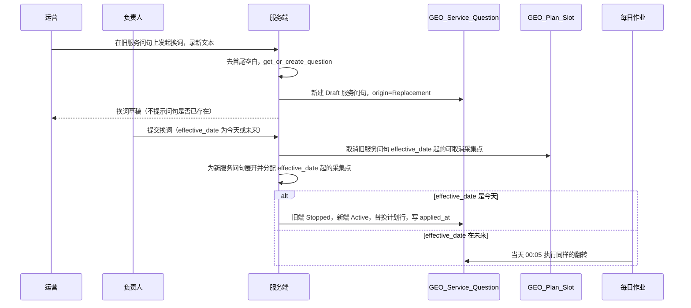

# GEO 运营第一版：时序图与采集 API

- 目的：定义调度展开、采集程序领取任务与回传结果、分析与考核计算、换词、回链导入、报告 Agent 取数等关键流程的步骤、失败分支与接口，作为后端、调度器、采集程序、分析模块开发的规格说明。
- 读者：产品负责人（用户本人）与实现工程师（后端、调度器、采集程序、看板、报告 Agent）。
- 状态：**设计草案，待用户确认**。本文不代表已实现接口、已配置调度任务或已部署采集程序。
- 版本：v0.2，2026-11-18。v0.1 的任务唯一键、租约、证据上传和调度粒度有缺陷，本版按设计审查重写第 1、2 节，补齐第 3 至第 7 节。
- 输入：[01 领域模型与 ER 图](01-domain-model-er.md) v0.3（对象名、字段名、状态名、调度与租约规则以它为准）；[02 状态机](02-state-machines.md) v0.2（状态转换以它为准）；[decisions.md](../../cycle/decisions.md) D-017 至 D-028（D-024、D-025、D-026 覆盖此前相关内容）。

标注约定（同 01）：**已确认（D-0xx）**、**设计推荐（Agent）**、**待确认**。01 的 Q-xx、04 的 Q-27 至 Q-38 直接引用；本文新增问题用 `API-xx`，汇总在第 8 节。v0.1 中本文的 Q-28 至 Q-30 与 04 编号冲突，已改为 API-01 至 API-03。

隐私约定：本目录进入 Git。文中不出现真实客户名称、问句原文、价格、合同编号、联系人。示例问句、公司名均为自编。

## 0. 与模型的一致性

本文使用 01 v0.3 的英文标识。与 v0.1 相比的主要变化：

| v0.1 | v0.2 | 依据 |
|---|---|---|
| `dedup_key = sha256(text_hash|profile_key|window_start.isoformat())` | 任务复合唯一索引 `(question, sampling_profile, window_start, link_generation)`，`window_start` 为站点时区不带时区的 Datetime | 01 第 4.9 节 |
| 已有任务不可关联时 INSERT，冲突后 SELECT 并关联已有任务 | 不可关联时新建下一代任务；冲突只说明另一个调度进程刚插入，重新判断，**任何情况下都不关联到不可关联的任务** | 01 第 3.2、4.9 节 |
| 每个 seq 独立抽桶 | 同一服务、同一服务问句、同一采样条件、同一天不放回抽桶；抽签以 `slot_key` 为种子 | 01 第 4.9 节 |
| 每日 02:00 一个作业做展开、分配、对账 | 三个作业：每小时展开与分配、每分钟租约与过期、每 5 分钟对账；每日 00:05 只翻转按日期生效的状态 | 本文 1.4 |
| `lease_owner = current_user` 判断租约 | 每次领取发随机令牌，续租和回传凭令牌 | 01 第 4.9 节 |
| 证据 base64 放在回传 JSON | `upload_evidence` 先传文件，`submit_result` 只引用 `evidence_ref` | 本文 2.4 |
| 证据不完整时任务保持 Leased | 立即退回 Queued 或转 Failed | 02 第 5 节 |
| `frappe.has_permission('GEO Collector')` | `frappe.only_for("GEO Collector")` | Frappe 源码核查 |

## 1. 调度：展开采集点、分配时间桶、关联任务、对账

### 1.1 场景说明

- **输入**：`status=Active` 的 `GEO Monitoring Plan`，及其 Active 服务问句与采样条件。
- **目标**：把计划展开成 `GEO Plan Slot`；为每个采集点抽一个时间桶；在该桶上关联可关联的共享任务，或新建任务；窗口过后对账。
- **原则**（已确认 D-025、D-026）：只有一条任务能同时满足各计划的问句、全部采样参数、时间桶要求时才共用；不能满足就分别生成。合同对采样的要求优先于节省采集量。

### 1.2 时序图



### 1.3 步骤说明

#### 1.3.1 展开规则窗口

| 单位 | 规则窗口 | seq 范围 | 说明 |
|---|---|---|---|
| Hour | 每小时 `[H:00, H+1:00)`，只取活动时段内的小时 | 1..N | 15 分钟桶时 N 最多 4。 |
| Day | 每日 `active_time_from` 到 `active_time_to`（空表示全天） | 1..N | N 由计划自行配置（D-027）。 |
| Week | 周一 00:00 到下周一 00:00，按 `active_weekdays` 筛选可用日 | 1..N | |

- 展开范围：当前规则窗口到 `now + slot_horizon_days`（默认 2 天）。
- 当前已开始的规则窗口只生成剩余部分：`N' = ceil(N × 剩余可用桶数 ÷ 窗口总桶数)`。例：每天 25 次的计划在 10:00 启用，剩余可用桶为 10:30 之后的 54 个，`N' = ceil(25 × 54 ÷ 96) = 15`。
- 写入：`frappe.db.bulk_insert("GEO Plan Slot", fields, rows, ignore_duplicates=True)`。v0.1 的 `INSERT ... ON DUPLICATE KEY UPDATE modified=NOW()` 删除：它在冲突时返回 2 行受影响，不能用于判断是否新建，也无必要更新 `modified`。
- 只为 `effective_from <= 日期 <= effective_to`（空为不限）的服务问句展开。换词提交后，新服务问句的 `effective_from` 尚未写入，展开作业按换词记录的 `effective_date` 为它展开（02 第 2.6 节）。

#### 1.3.2 分配时间桶

规则以 01 第 4.9 节「调度与关联规则」为准，这里只给实现要点：

1. 待分配采集点的筛选条件：`status='Planned' AND assigned_window_start IS NULL AND rule_window_end > now + min_link_lead_minutes`。v0.1 用 `rule_window_start BETWEEN NOW() AND NOW()+2天`，会漏掉当天 00:00 开始、中午才启用的 Day 窗口。
2. 可抽的桶：落在规则窗口与活动时段内，且 `bucket_start >= now + min_link_lead_minutes`。
3. 同一服务内不放回：排除本服务、本服务问句、本采样条件当天已被任何计划的采集点占用的桶。处理顺序为 Assessment 计划优先，然后按 `slot_key` 排序，保证结果可重现。
4. Random：`random.Random(sha256(slot_key)).choice(可抽且未占用的桶)`。种子固定，重复运行或作业中途失败后重跑，同一采集点总是得到同一个桶（除非该桶已被占用或已过）。
5. Uniform：可抽桶按时间编号 `0..B-1`，第 `i` 次（`i = seq-1`）取 `round_half_up(i × (B-1) / (N-1))`，`N=1` 时取 `floor((B-1)/2)`。例：`B=96`、`N=25` 得 `0, 4, 8, 12, 16, 20, 24, 28, 32, 36, 40, 44, 48, 51, 55, 59, 63, 67, 71, 75, 79, 83, 87, 91, 95`，恰好 25 个不同的桶。目标桶已被占用时取最近的空桶（先往后，再往前）。
6. `scheduled_at = window_start + 偏移`，偏移在 `[0, window_minutes×60 - 120]` 秒内，由任务名派生的种子决定，并按平台在同一桶内错开（API-04）。

#### 1.3.3 关联或新建任务

1. 在 `(question, sampling_profile, window_start)` 下取 `link_generation` 最大的任务，加行锁 `SELECT ... FOR UPDATE`。
2. 它满足 `status='Queued' AND window_start >= now + min_link_lead_minutes` 时，关联它。
3. 否则 INSERT 新任务，`link_generation = 最大代次 + 1`（不存在时为 0）。新任务的 `question_text`、`profile_key`、`evidence_required` 从问句和采样条件快照，`max_attempts` 取 `GEO Settings.default_max_attempts`。
4. INSERT 撞上唯一索引：说明另一个调度进程刚插入了同一代次，回到第 1 步重新判断，最多 3 次，仍失败则本采集点留到下一轮。
5. 采集点更新为 `Assigned`，写 `collection_task`、`assigned_window_start`、`linked_at`、`last_transition_at`。

由于第 2 步只抽 `now + lead` 之后的桶，正常情况下桶上已有的任务都是 Queued，新建下一代只在任务被取消后又有新需求等少见情况出现。

#### 1.3.4 对账

| 条件 | 采集点结果 | `missed_reason` |
|---|---|---|
| 任务 `succeeded_result` 非空（任何时候） | Fulfilled | |
| `rule_window_end` 已过，任务 Expired 且 `attempt_count=0` | Missed | `task_never_claimed` |
| `rule_window_end` 已过，任务 Expired 且领取过 | Missed | `task_expired` |
| `rule_window_end` 已过，任务 Failed | Missed | `task_failed` |
| `rule_window_end` 已过，任务 Cancelled | Missed | `task_cancelled` |
| `rule_window_end` 已过，任务仍 Queued 或 Leased | 暂不处理，等每分钟作业把任务推到终态 | |

漏采不进入分析，也不计入任何考核分母（AC-10）。

### 1.4 定时作业与幂等

| 作业 | 频率（`scheduler_events` cron） | 内容 |
|---|---|---|
| A 展开与分配 | `0 * * * *`（每小时）；计划启用、恢复、改配置、换词提交时另行 `enqueue` 一次 | 第 1.3.1 至 1.3.3 节 |
| B 租约回收与过期 | `* * * * *`（每分钟） | Leased 且租约过期：尝试未用完且 `window_end > now` → Queued，否则 → Expired；Queued 且 `window_end <= now` → Expired。均用条件更新 |
| C 对账 | `*/5 * * * *` | 第 1.3.4 节 |
| D 按日期翻转 | `5 0 * * *`（每日 00:05） | 换词生效（02 第 2.6 节）、计划到 `effective_to` 转 Ended、交付物 Due Soon 与 Overdue |
| E 清理 | `30 3 * * *` | 删除上传超过 24 小时仍未被任何结果引用的证据文件 |

幂等要求：

1. 每个作业都可以在任意时刻重复运行，结果不变。采集点靠 `slot_key` 唯一与 `ignore_duplicates`；桶分配靠固定种子；任务靠复合唯一索引；状态变化靠条件更新。
2. 手动触发用 `frappe.enqueue(..., job_id=..., deduplicate=True)`。它只阻止「同一 job_id 仍在排队或运行」时重复入队（`frappe/utils/background_jobs.py`），作业结束后再次入队会再跑一遍，所以作业本身必须幂等，不能依赖去重。
3. 作业按服务分批提交事务，单个服务失败不影响其他服务；失败写 `Error Log`。

### 1.5 失败分支与日志

| 异常 | 处理 |
|---|---|
| 计划配置不合法（`times_per_unit` 超过可用桶数等） | 跳过该计划，写 `Error Log`，通知服务 Owner。启用时已校验，这里只是兜底。 |
| 服务问句不是 Active | 跳过该服务问句。 |
| 抽不到桶 | 采集点 Missed（`no_linkable_bucket`），在采集执行页可见。 |
| 唯一索引冲突重试 3 次仍失败 | 本采集点留在 Planned，下一轮再试。 |
| 数据库写入失败 | 回滚本服务批次，下一轮重试。 |

每次运行写一条运行摘要到 `Scheduled Job Log`（框架自带）：扫描计划数、新增采集点数、关联已有任务数、新建任务数、新建下一代任务数、漏采数。v0.1 建议的 `GEO Scheduling Log` 取消。

## 2. 采集程序领取任务与回传结果

### 2.1 场景说明

- **参与者**：持有 `GEO Collector` 的机器账号。只能调用本节的白名单方法，不能进 Desk，对任何 DocType 都没有 DocPerm（04 第 5.5 节）。只看到问句文本与采样条件（D-025）。
- **流程**：领取任务，得到令牌 → 到 `scheduled_at` 执行 → 逐个上传证据文件，得到 `evidence_ref` → 回传结果，引用证据 → 服务端校验、采纳、解析信源。

### 2.2 时序图：领取、上传证据、回传



### 2.3 时序图：租约过期、重领与迟到回传



同一机器账号在两台设备上运行时，设备 2 拿不到设备 1 的令牌，不能替设备 1 续租或回传。v0.1 用 `lease_owner = current_user` 判断，做不到这一点，也会拒绝设备 A 的迟到回传，和 AC-09 的期望矛盾。

### 2.4 API 规格

#### 2.4.1 认证、授权、时间格式

- 认证：Frappe 原生 API Key + Secret，`Authorization: token <api_key>:<api_secret>`。
- 授权：每个方法第一行 `frappe.only_for("GEO Collector")`。机器账号 `desk_access=0`，不得同时持有人员角色（04 第 1.3 节）。
- 返回体用固定字段白名单序列化，不含服务、客户、合同、采集点字段（AC-26）。
- 时间：API 传输用 ISO 8601 带 `+08:00`；库内 Datetime 按站点时区 `Asia/Shanghai` 存储，不带时区。转换只发生在 API 边界。
- 限流：`@frappe.rate_limit(limit=120, seconds=60)` 按用户计（API-02）。

#### 2.4.2 `claim_task`

`POST /api/method/geo_operations.collection.api.claim_task`

请求：

```json
{"platform": "deepseek", "device_ref": "dev-001", "collector_version": "1.2.3", "advance_seconds": 120}
```

逻辑：

1. `SELECT ... WHERE status='Queued' AND platform=%s AND window_end > now() AND scheduled_at <= now() + advance ORDER BY scheduled_at LIMIT 1 FOR UPDATE SKIP LOCKED`。
2. 生成 32 字节随机令牌，新建 `GEO Collection Attempt`（`attempt_no = attempt_count + 1`，存 `sha256(令牌)`）。
3. `UPDATE ... SET status='Leased', attempt_count=attempt_count+1, current_attempt=%s, lease_expires_at=%s WHERE name=%s AND status='Queued'`。影响 0 行时回滚，继续找下一条，最多 3 次。

响应（200）：

```json
{
  "task_id": "3f9a0c1e7b2d4a56",
  "attempt_no": 1,
  "lease_token": "base64url-32-bytes",
  "lease_expires_at": "2027-06-20T10:32:23+08:00",
  "question_text": "家用投影仪怎么选，去哪个平台买划算",
  "platform": "deepseek",
  "profile_key": "platform=deepseek;channel=app;conversation=single_turn;web_search=on",
  "conditions": {"channel": "app", "conversation": "single_turn", "web_search": "on"},
  "window_start": "2027-06-20T10:15:00+08:00",
  "window_end": "2027-06-20T10:30:00+08:00",
  "scheduled_at": "2027-06-20T10:17:23+08:00",
  "evidence_required": "Screenshot Or Recording",
  "evidence_limits": {"screenshot_max_mb": 5, "recording_max_mb": null}
}
```

无任务时返回 `{"task_id": null}`。

#### 2.4.3 `renew_lease`

请求 `{"task_id": "...", "lease_token": "..."}`。令牌必须是任务 `current_attempt` 的令牌，任务仍 Leased。成功返回新的 `lease_expires_at`；令牌不是当前令牌返回 409 `lease_superseded`；任务不是 Leased 返回 409 `task_not_leased`。建议每 `lease_seconds / 2` 续租一次。

#### 2.4.4 `upload_evidence`

`POST /api/method/geo_operations.collection.api.upload_evidence`，`multipart/form-data`。

| 字段 | 必填 | 说明 |
|---|---|---|
| `task_id`、`lease_token` | 是 | 令牌是该任务曾签发过的任一令牌；`now <= window_end + late_submit_grace_minutes`。 |
| `evidence_type` | 是 | Screenshot / Screen Recording / Raw Payload。分享链接不走本接口，直接写在回传里。 |
| `page_index` | 否 | |
| `sha256` | 是 | 采集程序计算的文件哈希。服务端边接收边计算，不一致返回 422 `checksum_mismatch`。 |
| `file` | 是 | 文件本体。 |

逻辑与约束（设计推荐，Agent；存储方案待确认 Q-20）：

1. 大小上限：截图 `evidence_max_screenshot_mb`（默认 5 MB）；录屏 `evidence_max_recording_mb`。Frappe 对非 `upload_file` 路径的请求体上限是站点配置 `max_file_size`，未配置时为 25 MB（`frappe/app.py`），所以录屏上限超过 25 MB 时必须同时调大站点 `max_file_size`，或改用对象存储的预签名上传。
2. 写入私有文件（`File`，`is_private=1`），挂在一个占位上，返回 `evidence_ref`（即 `File.name`，随机哈希）。此时还没有任何结果引用它。
3. 回传成功后，证据行引用 `evidence_ref`，文件改挂到该结果上。
4. 每日清理作业删除上传超过 24 小时仍未被引用的文件。这样回传失败、事务回滚都不会留下长期孤儿文件。
5. 第一版用 Frappe 私有文件即可；数据量上来后迁对象存储时，本接口改为返回预签名 PUT 地址，采集程序直传，服务端在 `submit_result` 时用对象存储元数据校验大小与 sha256，接口其余部分不变。

v0.1 把证据 base64 放进回传 JSON：base64 体积增加约三分之一，录屏很容易超过 25 MB 请求体上限；整包在事务内解码，文件先落盘后事务回滚会留下孤儿文件。每个服务每天约 1,250 次回传，这是热路径，所以拆开。

#### 2.4.5 `submit_result`

请求：

```json
{
  "task_id": "3f9a0c1e7b2d4a56",
  "lease_token": "base64url-32-bytes",
  "submission_id": "8d0c5f8e-0b8a-4a8e-9f61-2b3f8c7d9a10",
  "outcome": "Success",
  "answer_text": "如果预算有限，可以先看平台甲和平台乙……",
  "answer_format": "Markdown",
  "answer_blocks": {"body": "……", "references": "……", "related_search": "……"},
  "raw_sources": [{"index": 1, "title": "家用投影仪选购指南", "url": "https://example.com/guide", "site_label": "示例评测网", "placement": "Reference List"}],
  "product_cards": [],
  "started_at": "2027-06-20T10:17:25+08:00",
  "finished_at": "2027-06-20T10:18:02+08:00",
  "actual_conditions": {"model_displayed": "<界面显示的模型名>", "web_search_actual": "on"},
  "evidence": [
    {"type": "Screenshot", "evidence_ref": "a1b2c3d4e5", "page_index": 1, "captured_at": "2027-06-20T10:18:00+08:00"},
    {"type": "Share Link", "url": "https://example.com/share/abc"}
  ],
  "device_ref": "dev-001",
  "collector_version": "1.2.3"
}
```

逻辑：

1. 校验令牌是该任务签发过的令牌，找到对应领取记录；未超过 `window_end + late_submit_grace_minutes`。
2. `submission_id` 已存在：返回已有结果（幂等）。
3. 校验 `evidence_ref` 都存在、未被其他结果引用、属于本任务的上传。
4. 插入 `GEO Collection Result`（含 `collection_attempt`）与证据行，计算 `evidence_complete`。
5. 按 02 第 5.4 节「回传时按任务当前状态处理」更新任务与结果：完整则用条件更新尝试采纳；不完整或失败时，若这是当前领取，则按尝试次数和窗口退回 Queued 或转 Failed。
6. 结束该领取记录（`ended_at`、`end_reason`）。
7. 解析信源：URL 按 01 第 4.10 节规范化，`GEO Source` 用 `INSERT IGNORE` 写入（`url_hash` 是主键），再插入 `GEO Source Citation`。
8. 提交事务后，异步触发该结果的分析（第 3 节）。

响应：

| `status` | 含义 |
|---|---|
| `accepted` | 已被采纳为该任务的样本。 |
| `saved_extra` | 完整但任务已有被采纳结果，或任务已关闭，保存为多采。 |
| `saved_incomplete` | 证据不完整，结果保存但不被采纳；任务视尝试次数退回 Queued 或转 Failed。 |
| `saved_failure` | `outcome` 不是 Success。 |
| `already_exists` | 幂等返回。 |

v0.1 的 `report_failure` 合并进 `submit_result`（`outcome=Failed / Blocked / Timeout`，`failure_reason` 必填），少一个接口。

#### 2.4.6 错误码

| HTTP | `error` | 含义 | 采集程序处理 |
|---|---|---|---|
| 400 | `validation_error` | 请求体不合法 | 修正后重试 |
| 401 | `authentication_failed` | 认证失败 | 检查 Key |
| 403 | `permission_denied` | 不是 `GEO Collector` | 联系管理员 |
| 403 | `invalid_token` | 令牌不属于该任务 | 停止操作该任务 |
| 404 | `task_not_found` | 任务不存在 | 停止 |
| 409 | `lease_superseded` | 续租时令牌已不是当前令牌 | 可继续采集并回传，结果可能成为多采 |
| 409 | `task_not_leased` | 任务不是 Leased | 停止续租 |
| 410 | `submission_window_closed` | 已超过 `window_end + 宽限` | 丢弃，本地留档 |
| 413 | `evidence_too_large` | 证据超过上限 | 压缩或分段 |
| 422 | `checksum_mismatch` | sha256 不一致 | 重传 |
| 429 | `rate_limit_exceeded` | 超过限流 | 退避重试 |
| 500 | `internal_error` | 服务端错误 | 同一 `submission_id` 退避重试 |

#### 2.4.7 证据要求与采纳

| `evidence_required` | 完整条件 |
|---|---|
| None | 无要求 |
| Screenshot Or Recording | 至少一个 Screenshot 或 Screen Recording（App 端默认） |
| Share Link | 至少一个分享链接 |
| Both | 截图或录屏，加分享链接 |

不完整的结果保存但不计入样本，保留在原始记录中；超过 `max_attempts` 仍不完整，任务 Failed，采集点最终 Missed（`task_failed`），采集执行页显示「无证据」（Q-12）。

#### 2.4.8 版本与兼容

第一版路径不带版本号。新增可选字段向后兼容；删除或改必填字段时发布 `geo_operations.collection.api_v2.*`，给采集程序升级窗口（API-03）。新平台、新采样选项通过 `GEO Sampling Option` 添加，`conditions` 是开放的键值对，不改接口结构。

## 3. 分析运行与指标快照



要点：

1. 回传被采纳后，按「服务 × 当天」合并触发，不为每条结果单独建运行。一条共享结果被几个服务可见，就在各服务的运行里各分析一次，结果互不可见（D-025）。
2. 分析函数只接收明确输入，不读服务、客户、合同（D-021）。
3. 名单版本按 `sample_date` 选默认版（01 第 4.6 节）。
4. 回答分析与实体结果用 `bulk_insert` 写入，不写 `Version`，不推送实时消息（01 第 6 节）。

## 4. 考核计算



规则见 01 第 4.12 节；状态见 02 第 8 节。作业每小时跑一次 Provisional，每日 01:00 检查哪些窗口已结束可以出 Final。

## 5. 换词



细节见 02 第 2.6 节。

## 6. 回链导入

1. 运营在服务页上传表格，服务端新建 `GEO Backlink Import`，后台逐行处理。
2. URL 按 01 第 4.10 节规范化，算 `url_hash`；按唯一约束跳过重复行。
3. 「针对问句」只在本服务的服务问句中按 `display_no` 或文本匹配。
4. `GEO Backlink.source` 只在该 URL 出现在本服务可见的信源引用中时才关联（01 第 4.13 节）。
5. 计数与错误写回导入批次。只导入已发布链接（Q-39）。

## 7. 报告 Agent 取数

报告 Agent 用 `GEO Report Agent` 机器账号，经服务成员行 `member_role=Report Agent` 授权（04 UC-17）。接口都在 `geo_operations.report.api.*`，每个接口必填 `service`，第一步 `assert_service_access`：

| 接口 | 返回 |
|---|---|
| `list_services` | 本账号有有效成员行的服务 |
| `get_service_overview` | 名额、平台、服务期、暂停记录、当前考核规则（含 `metric_label`、分子分母说明） |
| `get_service_questions` | 服务问句、名额位、换词链 |
| `get_metric_snapshots` | 按期间、口径的快照 |
| `get_assessment_results` | 考核结果与条件结果（含修订） |
| `get_execution_summary` | 采样量、有效样本量、漏采数 |
| `get_backlinks` | 回链与按服务问句的稿件汇总 |
| `get_deliverables` | 交付物台账 |
| `get_answers` | 本服务可见结果的正文与本服务分析结果；不含截图（Q-31） |

返回体不含共享对象内部编号（04 第 4.5 节）。环比按 01 第 4.11 节规则计算后返回，上一期无可比数据时返回空并给出原因（Q-40）。

## 8. 待确认问题（本文新增）

| # | 问题 | 推荐 |
|---|---|---|
| API-01 | 采集程序轮询间隔（原 03 Q-28） | 10 到 30 秒；无任务时退避到 60 秒 |
| API-02 | 采集账号限流（原 03 Q-29） | 每账号每分钟 120 次 |
| API-03 | 接口版本策略（原 03 Q-30） | 第一版不带版本号；破坏性变更发布 `api_v2`，保留旧版 3 个月 |
| API-04 | 同一桶内是否按平台错峰 | 是；不同平台互不影响，同平台任务在桶内均匀打散 |
| API-05 | 迟到回传宽限时长 | 窗口结束后 60 分钟 |
