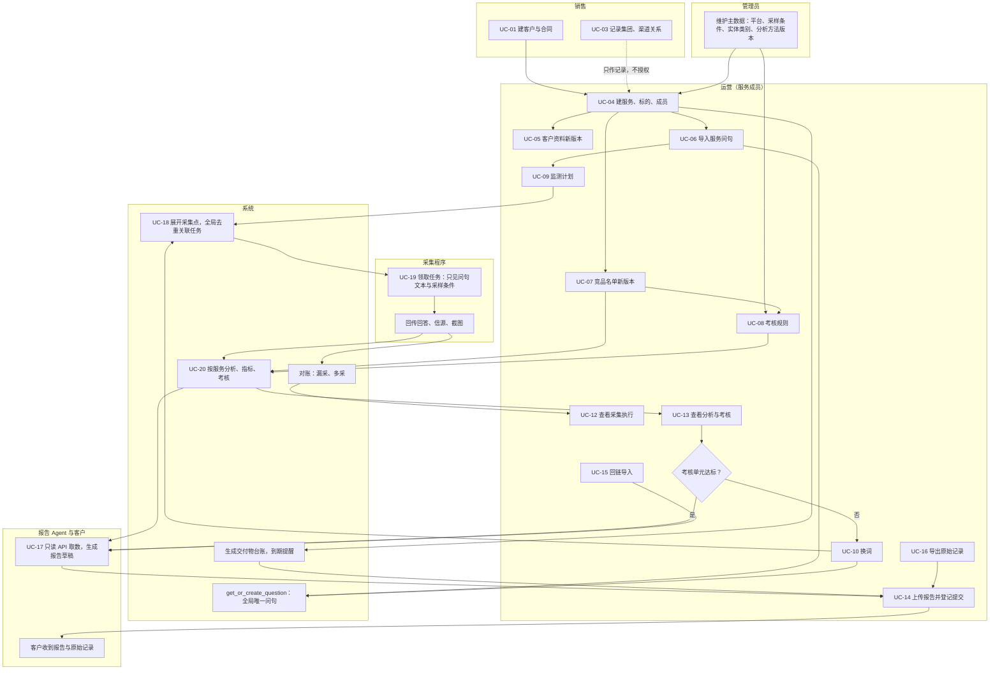
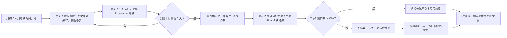
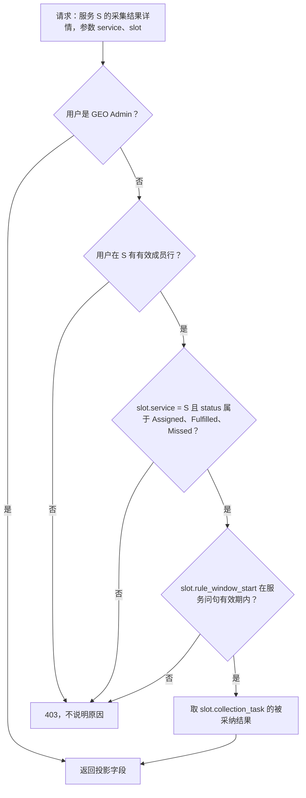

# GEO 运营第一版：用例、流程与权限

- 目的：定义第一版的参与者与角色、用例（UC-xx）、端到端流程、权限矩阵与行级范围。重点说明共享对象（问句、采集任务与结果、信源）如何只经由服务关联授权，保证列表、详情、搜索、报表、导出、API 都不能跨服务看到数据，也不能推断出别的客户在用同一问句。
- 读者：产品负责人（用户本人）与实现工程师。
- 状态：**设计草案，待用户确认**。本文不代表已建角色、已配置权限或已实现界面。
- 版本：v0.3，2026-11-18。v0.3 按设计审查补充字段级权限、主数据防泄露、合同修订处理，并按 D-027 修订 dogfood 用例。
- 输入：[01-domain-model-er.md](./01-domain-model-er.md) v0.3（对象名、字段名、状态名以它为准）；[02-state-machines.md](./02-state-machines.md) v0.2；[03-sequences-and-api.md](./03-sequences-and-api.md) v0.2；[decisions.md](../../cycle/decisions.md) D-017 至 D-028；首个真实合同案例（私有材料，不进 Git，本文称「案例 C1（购物平台类客户）」）。

标注约定同 01：**已确认（D-0xx）**、**设计推荐（Agent）**、**待确认（Q-xx）**。01 中的 Q-01 至 Q-26 直接引用；本文新增问题从 Q-27 起编号，汇总在第 6 节。

隐私约定：本目录进入 Git。文中不出现真实客户名称、问句原文、价格、合同编号、联系人和竞品名单。示例问句、公司名均为自编。

## 0. 核查记录与对 01 的影响

### 0.1 Frappe 源码核查（只读）

核查对象：容器 `bizbase-backend-1` 中 `/home/frappe/frappe-bench/apps` 的源码，2026-11-18。结论用于第 5 节。

| 核查点 | 源码位置 | 结论 |
|---|---|---|
| `has_permission` 钩子 | `frappe/permissions.py` `has_controller_permissions` | 钩子只能拒绝，不能授予角色本身没有的权限。 |
| `permission_query_conditions` 钩子 | `frappe/model/db_query.py` `get_permission_query_conditions` | 只在 `frappe.get_list` 一类带权限的查询中生效；`frappe.get_all`、`frappe.db.sql`、`frappe.db.get_value` 不经过它。 |
| User Permission | `frappe/database/query.py` `get_user_permission_conditions` | 按指向被限制 DocType 的 Link 字段过滤。未开启「严格用户权限」时，Link 为空的记录照样放行。对没有指向 `GEO Service` 的 Link 字段的 DocType（全部共享对象）不起作用。 |
| Link 字段搜索与校验 | `frappe/desk/search.py` `search_widget`；`frappe/client.py` `validate_link_and_fetch` | 走 `frappe.get_list`，会套用上面两类条件。Link 字段若配置了自定义 `query` 方法，过滤由该方法自己负责。 |
| 表单「关联」面板计数 | `frappe/desk/notifications.py` `get_doc_count` | 用 `frappe.get_all` 计数，**不做行级过滤**。 |
| Script Report / Query Report | `frappe/desk/query_report.py` | 只检查 `ref_doctype` 的 `report` 权限，报表内部查询不会自动加行级条件。 |
| 全局搜索 | `frappe/utils/global_search.py` `search` | 返回前对每条结果做 `has_permission`，但索引表 `__global_search` 本身保存了文本。 |
| 文件 | `frappe/core/doctype/file/file.py` `has_permission` | 公开文件所有人可读；私有文件按所挂文档的权限判断，文件上传者本人也可读。 |
| 实时推送 | `frappe/model/document.py` `notify_update` | 保存时向该 DocType 的房间推送 `list_update`，内容含文档 `name` 和操作人。 |
| DocShare | `frappe/model/db_query.py` | 被「共享」给某人的文档会出现在该人的列表里，绕过 User Permission。 |
| 原生 `Contract` 权限 | `erpnext/crm/doctype/contract/contract.json` | 只有 Sales Manager、Purchase Manager、HR Manager、System Manager 可读写；`Sales User` 没有任何权限。 |
| User Permission 字段 | `frappe/core/doctype/user_permission/user_permission.json` | 只有 `user`、`allow`、`for_value`、`is_default`、`apply_to_all_doctypes`、`applicable_for`、`hide_descendants`，**没有有效期字段**，也无法区分服务内角色。结果有缓存（`user_permissions`）。 |
| DocShare 与权限钩子的先后 | `frappe/permissions.py` `has_permission`、`get_doc_permissions` | `has_permission` 钩子拒绝后，只要文档被共享给该用户，`false_if_not_shared()` 仍会放行；列表查询也把共享文档用 OR 并入。**钩子挡不住 DocShare**。 |
| 指派自动共享 | `frappe/desk/form/assign_to.py` | 把文档指派给没有权限的人时，若未关闭文档共享，系统自动给他建 DocShare。 |
| 实时房间订阅 | `frappe/realtime/handlers.js`、`frappe/realtime/__init__.py` | 加入某 DocType 房间只要求对该 DocType 有读权限，不检查具体行；`list_update` 推给房间内所有人。 |
| 全局搜索收录范围 | `frappe/hooks.py` `global_search_doctypes`、`utils/global_search.py` | 只收录 `global_search_doctypes` 中的 DocType 以及字段勾选了 `in_global_search` 的 DocType。 |
| `Version` 权限 | `frappe/core/doctype/version/version.json` | 只有 System Manager、Administrator 可读。 |
| 客户命名 | `erpnext/selling/doctype/customer/customer.py` `autoname` | 全局默认 `cust_master_name` 为 `Customer Name` 时（本站点取值未核查），客户 `name` 就是客户名，重名插入会报重复。 |
| 原生 `Customer` 权限 | `erpnext/selling/doctype/customer/customer.json` | `Sales User` 可读写全部客户；Stock、Accounts 相关角色可读全部客户。 |

### 0.2 与 01 的对齐情况

本文 v0.2 第 7 节「建议补充到 01」的各项，已全部并入 01 v0.3：D-026 判重规则、`GEO Report Agent` 角色与 `member_role=Report Agent`、共享对象只给管理员 DocPerm、不返回字段清单、考核规则版本不重叠、回链只关联本服务可见的信源、`GEO Deliverable.waive_reason`、成员行角色校验。

另外两条仍需注意：

1. 原生 `Contract` 不对 `Sales User` 开放，`GEO Sales` 需要用 Custom DocPerm 单独授权（第 5.5 节），不能指望「带上 `Sales User` 就能用合同」。
2. D-027 取消了 dogfood 的内部服务例外：dogfood 服务有正常合同和考核规则（UC-02）。

## 1. 参与者与角色

### 1.1 参与者

| 参与者 | Frappe 角色 | 类型 | 做什么 | 依据 |
|---|---|---|---|---|
| 管理员 | `GEO Admin` | 人 | 全部服务与共享对象；维护主数据（平台、采样条件、实体类别、分析方法版本）、`GEO Settings`；可作为任何服务的成员。 | 已确认（D-023） |
| 运营 | `GEO Operations` | 人 | 在自己是成员的服务里维护服务问句、竞品名单、考核规则草稿、监测计划、回链、交付物；查看采集执行、分析、考核；导出原始记录。 | 已确认（D-023） |
| 销售 | `GEO Sales` | 人 | 维护客户、合同、组织关系；只读自己参与服务的配置、看板与考核结果。签约后继续参与沟通。 | 已确认（D-019、D-023） |
| 采集程序 | `GEO Collector` | 机器账号 | 只调用任务领取与结果回传 API；只看到问句文本与采样条件。 | 已确认（D-020、D-025） |
| 报告 Agent | `GEO Report Agent` | 机器账号 | 通过只读 API 读取被授权服务的指标、考核、回链、交付物数据，生成报告草稿。 | 已确认 D-023「报告通过 API 提供数据给其他 Agent」；角色名为设计推荐（01 第 1.9 节） |
| 系统 | 无（服务端作业） | 后台 | 调度展开、去重、对账、分析、指标、考核、交付物提醒。以 `Administrator` 身份运行，代码里显式带服务过滤。 | 设计推荐（Agent） |
| 客户联系人 | 无账号 | 外部 | 第一版不登录。作为 `Contact` 记录出现，例如换词的客户确认人；通过报告、导出文件获得数据。 | 已确认（D-017 不做客户登录）；下一版本只读账号见 Q-18 |

### 1.2 两层授权：系统角色 × 服务成员身份

一个人能做什么，由两层共同决定（设计推荐，Agent）：

1. **系统角色**（Frappe `Role`）决定「能对哪类对象做哪类动作」。例如 `GEO Operations` 能新建 `GEO Service Question`，`GEO Sales` 不能。
2. **服务成员身份**（`GEO Service Member` 的有效行）决定「能在哪些服务里做」。有效行指 `from_date <= 今天`，且 `to_date` 为空或 `>= 今天`。

有效权限 = 角色授予的动作 ∩ 成员行覆盖的服务。`GEO Admin` 不受第 2 层限制。

成员行的 `member_role` 进一步区分服务内的分工：

| `member_role` | 服务内能力 | 要求的系统角色 |
|---|---|---|
| Owner | 运营全部能力，加负责人专属动作（见 4.3）。 | `GEO Operations` 或 `GEO Admin` |
| Operations | 运营日常能力。 | `GEO Operations` 或 `GEO Admin` |
| Sales | 只读。 | `GEO Sales`、`GEO Operations` 或 `GEO Admin` |
| Other | 只读。 | 任一 GEO 人员角色 |
| Report Agent | 只读 API（01 第 4.4 节）。 | `GEO Report Agent` |

服务端在保存成员行时校验「`member_role` 与系统角色匹配」，不匹配时拒绝。理由：只有系统角色 `GEO Sales` 的人被填成 Owner，界面上看似负责人，实际却改不了任何东西。

### 1.3 兼任（已确认 D-023；实现为设计推荐）

Frappe 的角色权限取并集：一个用户持有多个角色时，任一角色允许的动作都允许。

| 兼任 | 结果 |
|---|---|
| `GEO Admin` + `GEO Operations` | 等同管理员。可同时作为某服务的 Owner 出现在成员表中，用于负责人提醒和看板「我的服务」。 |
| `GEO Admin` + `GEO Sales` | 等同管理员。 |
| `GEO Operations` + `GEO Sales` | 动作取并集：能维护客户、合同，也能维护运营对象。服务范围仍只限自己是成员的服务。 |

常见误区：

1. **以为「我在这个服务里是 Sales 成员」就只能读**。服务内能力还取决于系统角色。持有 `GEO Operations` 的人即使在某服务里登记为 Sales，系统也按 `member_role` 只给只读，这一条由 `has_permission` 钩子实现（第 5 节），不是 DocPerm 自带的。
2. **以为给管理员也登记成员行，就能让他「只看自己的服务」**。管理员角色不受成员范围限制，成员行只影响提醒和「我的服务」过滤。需要限制时不要给 `GEO Admin`（Q-34）。
3. **以为兼任时可以「切换身份」**。Frappe 没有会话级角色切换，并集一直生效。界面上的「按运营视角查看」只是过滤条件，不是安全边界。
4. **给 GEO 用户顺手加 ERPNext 的 `Sales User`、`Accounts User`、`Stock User`**。这些角色原生可读全部 `Customer`（第 0.1 节核查）。本设计用 `permission_query_conditions` 对 GEO 人员角色收窄 `Customer`，但为减少意外，第一版 GEO 用户不加 ERPNext 业务角色（设计推荐，Agent）。
5. **机器账号与人员角色兼任**。`GEO Collector`、`GEO Report Agent` 不得与任何人员角色同时出现在一个用户上，人员账号也不得持有机器角色。服务端在 `User` 保存时校验（设计推荐，Agent）。理由：采集账号一旦能进 Desk，就能把问句文本与客户对上号，违反 D-025。
6. **把 `System Manager` 当成管理员角色发给业务人员**。`System Manager` 能看所有 DocType、跑 System Console、改权限，超出 `GEO Admin`。第一版只给技术负责人。

## 2. 用例清单

每个用例写：参与者、前置条件、主流程、异常、产生对象。字段名、状态名以 01 为准。案例 C1 的数值只写抽象规则。

| 编号 | 用例 | 主参与者 |
|---|---|---|
| UC-01 | 建客户与合同（含总部签约、子公司被服务） | 销售 |
| UC-02 | dogfood：公司自身作为内部客户 | 管理员 |
| UC-03 | 记录集团关系与渠道关系 | 销售、管理员 |
| UC-04 | 建服务、优化标的与成员；成员变动 | 运营（Owner）、管理员 |
| UC-05 | 客户资料新版本 | 运营 |
| UC-06 | 导入服务问句（全局问句已存在则复用） | 运营 |
| UC-07 | 竞品名单新版本（含类别） | 运营 |
| UC-08 | 配置考核规则 | 运营起草，Owner 提交 |
| UC-09 | 建监测计划 | 运营起草，Owner 启用 |
| UC-10 | 换词 | 运营起草，Owner 提交 |
| UC-11 | 暂停与恢复 | Owner |
| UC-12 | 查看采集执行（漏采、多采） | 运营、销售 |
| UC-13 | 查看分析与考核结果 | 运营、销售 |
| UC-14 | 交付物台账 | 运营、系统 |
| UC-15 | 回链导入 | 运营 |
| UC-16 | 导出原始采样记录供客户复核 | 运营 |
| UC-17 | 报告 Agent 取数 | 报告 Agent |
| UC-18 | 调度展开与全局去重（系统用例） | 系统 |
| UC-19 | 采集领取与回传（系统用例） | 采集程序 |
| UC-20 | 分析、指标与考核计算（系统用例） | 系统 |

### UC-01 建客户与合同

- **参与者**：销售（主），管理员。
- **前置**：已拿到合同文本或关键条款；签约方、付款方、被服务组织的主体信息。
- **主流程**：
  1. 销售在 `Customer` 中查找签约方、付款方、被服务组织；没有就新建。三者可以是同一条记录。
  2. 新建 `Contract`：`party_type=Customer`，`party_name`=签约方，`start_date`、`end_date`=服务期，`contract_terms` 填正文或摘要。
  3. 填 Custom Field：`geo_payer_customer`；子表 `geo_served_customers`（至少一行）；`geo_question_quota`；`geo_platforms`；`geo_min_samples_per_day`；`geo_sampling_note`；`geo_raw_records_required`；`geo_report_frequency`；`geo_late_penalty_rate`、`geo_late_penalty_cap`、`geo_late_penalty_base`。
  4. 有交付物条款时，填子表 `geo_deliverable_terms`（Q-15）。
  5. 销售或管理员提交合同（原生 `docstatus=1`）。合同变更走原生「作废 + 修订」（`amended_from`），处理见下面「合同修订」。
- **总部签约、子公司被服务**（已确认 D-018）：总部 H 是 `party_name` 与 `geo_payer_customer`；子公司 S 是 `geo_served_customers` 的一行；之后建服务时 `served_customer=S`，标的是 S 的某个产品（UC-04）。H 与 S 的集团关系另在 UC-03 记录，不因此让 H 的其他服务成员看到 S 的服务。S 以后直签时，新合同 `party_name=S`，加到同一服务的 `GEO Service Contract`，服务历史不断（01 M-02）。
- **案例 C1**：一个签约主体同时是付款方和被服务组织；问句名额 25；两个平台；采样下限按合同填（Q-02）；`geo_raw_records_required=1`；两行交付条款（双周报：周期结束后 3 个工作日；结案报告：期满后 10 个工作日）；逾期违约金比例与上限照合同填，金额不存。
- **异常**：
  - `party_type` 不是 Customer：拒绝（01 4.2）。
  - `geo_served_customers` 为空：拒绝提交。
  - 同名客户已存在：若站点按客户名命名 `Customer`，范围外的同名客户会让插入报重复，等于告诉销售「系统里已有这个客户」。推荐把客户命名改为编号序列（Naming Series），重名由管理员定期合并（Q-36）。
- **合同修订**（设计推荐，Agent）：原生作废会让原合同 `docstatus=2`，修订得到新编号（例如 `CT-0001-1`）。服务、考核规则、交付物都还引用旧编号，若不处理，行级范围（4.4）里「被服务引用的合同」就只剩已作废的那一份，新合同对成员不可见。处理：
  1. `Contract.on_submit` 钩子：新合同带 `amended_from` 时，在同一事务内找到所有引用 `amended_from` 的 `GEO Service Contract` 行，把旧行 `valid_to` 设为新合同提交日前一天，新增一行指向新合同，`valid_from` 为提交日。
  2. 引用旧合同的 `GEO Assessment Rule`、`GEO Deliverable` 保持原引用（它们是历史事实）。考核口径或交付条款随修订变化时，Owner 按 UC-08、UC-14 新建规则版本或重新生成交付物；系统在服务页提示「依据合同已修订，请核对考核规则与交付条款」。
  3. 4.4 中「被服务引用的合同」包括服务合同子表中有效期已结束的行，所以成员仍能看到修订链上的旧合同，用于追溯。
  4. 作废但没有修订的合同：服务页提示「依据合同已作废」，由 Owner 决定是否结束服务。系统不自动结束服务。
- **产生对象**：`Customer`、`Contract`、`GEO Contract Served Customer`、`GEO Contract Platform`、`GEO Contract Deliverable Term`。

### UC-02 dogfood：公司自身作为客户

- **参与者**：销售或管理员。
- **前置**：确认 dogfood 对应的 ERPNext `Company`（Q-25）；用户提供合同甲乙方信息、问句清单和竞品名单（D-027，私有材料不进 Git）。
- **主流程**（已确认 D-027：按普通客户处理，正常合同流程都要走）：
  1. 新建或找到 `Customer`，`is_internal_customer=1`，`represents_company` 指向公司。
  2. 按 UC-01 建正常合同，甲方为公司自身，`geo_served_customers` 含该内部客户。
  3. 按 UC-04 建服务，与外部客户没有类型差别；按 UC-08 设置考核规则，`contract` 指向该合同。频率与阈值在录入时配置，设计阶段不定死（D-027）。
- **异常**：无特殊异常，同 UC-01、UC-04。
- **测试作用**（D-028）：验证别名误命中（例如公司简称是常用词）、竞品名含与问句重叠的词、待核对名单先用于分析并标注「所用名单有未确认条目」。
- **产生对象**：`Customer`（内部）、`Contract`、`GEO Service` 等，同普通客户。

### UC-03 记录集团关系与渠道关系

- **参与者**：销售、管理员。
- **前置**：双方 `Customer` 已存在。
- **主流程**：
  1. 集团关系：新建 `GEO Group Relation`，填 `parent_customer`、`child_customer`、`relation_kind`、`valid_from`、`valid_to`、`evidence_note`。
  2. 渠道关系：新建 `GEO Channel Relation`，填 `channel_customer`、`end_customer`、`valid_from`、`valid_to`、`contract`（渠道合同）、`evidence_note`。
  3. 关系变化时填 `valid_to` 并新增一行，不改旧行。
- **异常**：`parent_customer = child_customer`；同一对客户、同一类型有效期重叠。
- **授权说明**：关系只用于记录与查询，不产生任何数据可见性（已确认 D-018）。关系记录本身只有当用户能看到两端客户时才可见（第 4.4 节）。
- **产生对象**：`GEO Group Relation`、`GEO Channel Relation`。

### UC-04 建服务、优化标的与成员；成员变动

- **参与者**：销售或管理员建服务草稿并指定 Owner（Q-29）；Owner 完成配置并激活；管理员。
- **前置**：有已提交的 `Contract`（dogfood 服务同样需要，D-027）。标的对应的 `GEO Entity` 已存在，或在本用例中新建。
- **主流程**：
  1. 新建 `GEO Service`：`service_name`、`served_customer`、`start_date`、`planned_end_date`，`status=Draft`。
  2. 子表 `contracts`：依据合同及 `valid_from`。
  3. 子表 `members`：建草稿时必须指定一名 Owner（持有 `GEO Operations` 的用户）；建草稿的销售自动加一行 Sales。之后由 Owner 补充运营、销售成员，各带 `from_date`。理由：运营在成为成员之前看不到合同和客户（第 4.4 节），由运营新建服务就选不到被服务组织。02 v0.2 的 ST-01 已按此同步。
  4. 子表 `targets`：选择或新建 `GEO Entity`（`entity_type`、`entity_category`、别名），标记 `is_primary`。
  5. 准备完成后，Owner 或管理员调用 `activate()`，服务转 Active（02 第 1 节）。
  6. 服务激活时，系统按合同交付条款生成交付物台账（UC-14）。
- **成员变动**：离开的成员填 `to_date`，新成员新增一行，不删旧行。更换负责人 = 旧 Owner 行填 `to_date`，新 Owner 行 `from_date` 为次日。`to_date` 之后，该用户失去该服务的全部访问（Q-28）。
- **异常**：
  - `served_customer` 不在任何依据合同的 `geo_served_customers` 中：拒绝激活。
  - 同一日期多于一名 Owner，或没有 Owner：拒绝保存。
  - `member_role` 与用户系统角色不匹配（1.2）：拒绝保存。
  - 新建实体时，实体上不得填写客户信息；别名备注同样不写客户关系（01 M-18）。
- **产生对象**：`GEO Service`、`GEO Service Contract`、`GEO Service Member`、`GEO Service Target`，可能新建 `GEO Entity`、`GEO Entity Alias`。

### UC-05 客户资料新版本

- **参与者**：运营。
- **前置**：客户提供或更新了业务资料。
- **主流程**：
  1. 在 `GEO Customer Profile Version` 新建草稿；有上一版时从上一版复制，`previous_version` 自动填。
  2. 填 `customer`、`target_entity`（可选）、`effective_from`、`received_on`、各资料栏位、`change_summary`；原始文件作为私有附件挂在版本上。
  3. 提交。`version_no` 在同一 `(customer, target_entity)` 内自动递增。
- **异常**：要改已提交版本，只能再建新版本（已确认 D-019）。
- **授权说明**：资料按客户归属。同一客户若有两个服务，两个服务的成员都能看到该客户的资料版本（Q-35）。
- **产生对象**：`GEO Customer Profile Version` 及私有附件。第一版只存不用（不做内容生成）。

### UC-06 导入服务问句（全局问句已存在则复用）

- **参与者**：运营。
- **前置**：服务为 Draft 或 Active；合同 `geo_question_quota` 已填（外部服务）。
- **输入**：每行一个问句：`display_no`、生效问句文本、`original_text_note`（签约前调整过的原文本，可空）、`primary_target`（可空）、`quota_slot`（可空，默认按行序）。
- **主流程**：
  1. 运营在服务页点「导入问句」，粘贴或上传表格。不使用 Frappe 通用 Data Import（它需要对 `GEO Question` 有 Link 读权限，见第 5.6 节）。
  2. 服务端逐行处理文本：只去掉首尾空白，其他字符保持原样（已确认 D-026）。去掉后为空的行报错。
  3. 批内检查：同一批出现两行相同文本时报错，指出行号。
  4. 名额检查：本服务在生效日的 Active 与 Draft 服务问句数 + 本批行数，不超过 `geo_question_quota`。
  5. 对每行调用 `get_or_create_question(text)`：按 `text_hash` 在唯一索引上插入，冲突则返回已有 `GEO Question`。**返回值和界面都不区分「新建」与「已存在」**（01 3.5）。
  6. 为每行新建 `GEO Service Question`：`service`、`question`、`question_text`、`quota_slot`、`display_no`、`status=Draft`、`origin=Contract Signing`、`contract`、`original_text_note`、`primary_target`。
  7. 运营核对后，把这批服务问句设为 Active，`effective_from` 默认取服务 `start_date`。
- **签约前已调整的问句**（案例 C1 有 4 条）：录入调整后的文本作为生效问句，原文本写进 `original_text_note`，`origin=Contract Signing`，不建 `GEO Question Replacement`。
- **异常**：
  - 文本与本服务一条有效期重叠的服务问句相同：拒绝该行，提示「本服务已在监测该问句」。这只涉及本服务自己的数据，不泄露别的服务。
  - 文本与其他服务正在监测的问句相同：**正常复用，不提示**。
  - 超名额：整批拒绝，提示超出几条。
  - 并发：两人同时导入相同文本，由唯一索引保证只有一条 `GEO Question`；`get_or_create_question` 捕获唯一冲突后重读，不把数据库报错（内含记录名）返回给前端。
- **产生对象**：`GEO Question`（可能是已有的）、`GEO Service Question`。

### UC-07 竞品名单新版本（含类别）

- **参与者**：运营；管理员。
- **前置**：服务有标的；名单中的实体和 `GEO Entity Category` 已存在。
- **主流程**：
  1. 选择服务和标的，新建 `GEO Competitor List` 草稿。有上一版时复制条目和别名快照，填 `previous_version`。
  2. 维护 `entries`：恰有一行 `role=Target`（等于 `target_entity`），其余为 Competitor。`category` 从实体复制。
  3. 维护 `aliases`：从实体当前别名复制，可增删。同一集团多个平台名算一个竞品时，把其他名称作为该实体的别名放进快照（Q-10）。
  4. 填 `effective_from`、`change_reason`、`basis_note`（例如「合同品牌范围条款」）。
  5. 提交。系统计算 `alias_hash`。提交后冻结。
  6. 可选：发起重算（新的 `GEO Analysis Run`，`run_type=Recompute`），用新名单重看历史。旧分析不变（已确认 D-021）。
- **案例 C1**：目标与竞品的 `category` 都是 `shopping_platform`。商品品牌不进名单；分析方法 `rank_categories=[shopping_platform]`，回答里出现的商品品牌被识别为 `product_brand`，`counts_for_rank=0`，不占名次。
- **异常**：
  - 名单内需要的实体不存在：运营新建实体（Q-27）。
  - `effective_from` 早于已有分析运行覆盖的日期：拒绝，除非勾选「作为重算口径」。
  - 两行条目指向同一实体：拒绝。
- **产生对象**：`GEO Competitor List`、`GEO Competitor List Entry`、`GEO Competitor List Alias`；可能有 `GEO Entity`、`GEO Analysis Run`。

### UC-08 配置考核规则

- **参与者**：运营起草；Owner 或管理员提交；管理员维护分析方法版本。
- **前置**：已有合适的、已提交的 `GEO Analysis Method`。没有时由管理员新建方法版本，把口径细则写进 `policy_params`。方法是共享主数据，只放参数，不写客户信息和合同原文（设计推荐，Agent）。
- **主流程**：
  1. 新建 `GEO Assessment Rule` 草稿：`service`、`contract`、`rule_name`、`effective_from`、`effective_to`、`analysis_method`、`assessment_unit`、`period_type`、`clip_to_service_term`、`sample_window`、`sample_window_days`、`aggregation`、`combine_mode`、`unit_start_policy`、`min_valid_samples`、`settlement_effect`、`clause_text`。
  2. 子表 `conditions`：每行一个指标条件（`metric_code`、`metric_label`、`comparator`、`threshold`、可选 `platform`）。例如「能见度 ≥ 0.8」和「前三提及率 > 0.6」两行，`combine_mode=All`（已确认 D-024）。`metric_label` 填合同里的指标名，界面同时显示分子、分母和取样窗口（D-028）。
  3. Owner 或管理员提交。之后要改口径或阈值，新建规则版本（`version_no` 递增），旧版本的考核结果不变。
- **案例 C1**：方法参数 `answer_scope=body_only`、`rank_categories=[shopping_platform]`、`topn_tie_inclusive=true`、`top1_requires_sole=true`、`few_candidates_threshold=3`、`few_candidates_rule=mention_counts_as_topn`、`exclude_from_denominator=[Refused, Unparseable]`；规则 `assessment_unit=Service Question x Platform`、`period_type=Calendar Month`、`sample_window=Last N Days Of Period`、`sample_window_days=7`、`aggregation=Pooled`、`settlement_effect=Settle If Passed`；条件一行 `top3_rate > 0.6`（Q-05、Q-06、Q-07、Q-13）。
- **异常**：
  - 条件的 `metric_code` 不在方法 `top_n_list` 能算出的范围：拒绝提交。
  - 同一服务、同一 `rule_name` 的两个已提交版本有效期重叠：拒绝（01 第 4.12 节）。
  - 方法未提交：不能被引用。
- **产生对象**：`GEO Assessment Rule`、`GEO Assessment Condition`；可能有 `GEO Analysis Method`（管理员）。

### UC-09 建监测计划

- **参与者**：运营起草；Owner 或管理员启用（02 第 3 节）。
- **前置**：服务 Active；服务问句已有 Active 的；所用 `GEO Sampling Profile` 已由管理员维护。
- **主流程**：
  1. 新建 `GEO Monitoring Plan` 草稿：`plan_name`、`purpose`、`effective_from`、`effective_to`、`timezone`、`frequency_unit`、`times_per_unit`、`active_time_from`、`active_time_to`、`active_weekdays`、`distribution`。
  2. 子表 `service_questions` 选本服务的服务问句；子表 `profiles` 选采样条件。
  3. 系统给出提示：按计划换算的每问句每平台每天次数低于合同 `geo_min_samples_per_day` 时警告；采样条件的平台不在合同 `geo_platforms` 中时警告。
  4. Owner 或管理员 `activate()`。系统从下一个可执行窗口起展开采集点（UC-18）。
  5. 计划修改从下一个尚未开始的规则窗口起生效（02 3.4）。
- **案例 C1**：一个计划，`purpose=Assessment`、`frequency_unit=Day`、`times_per_unit=25`（Q-02）、`distribution=Random`，25 条服务问句 × 2 个采样条件，每天 1250 个采集点。
- **异常**：
  - 选到别的服务的服务问句：不可能出现在选择框中（Link 查询按服务过滤，第 5.6 节）；服务端再校验同服务。
  - 服务问句 Stopped：不能加入 Active 计划。
- **产生对象**：`GEO Monitoring Plan`、`GEO Monitoring Plan Service Question`、`GEO Monitoring Plan Profile`；启用后系统产生 `GEO Plan Slot`。

### UC-10 换词

- **参与者**：运营起草；Owner 或管理员提交（Q-30）。
- **前置**：旧服务问句为本服务 Active；服务不是 Ended。暂停中允许换词（D-019）。
- **主流程**：
  1. 在旧服务问句上点「换词」，新建 `GEO Question Replacement` 草稿，`old_service_question` 自动填。
  2. 输入新问句文本。服务端去首尾空白后调用 `get_or_create_question`，建一条新的 `GEO Service Question`：`status=Draft`、`origin=Replacement`。界面同样不提示问句是否已存在。
  3. 填 `reason_category`、`reason`；因考核不达标时选 `Assessment Failed` 并填 `assessment_result`；填 `confirmed_by_user` 或 `confirmed_by_contact`（至少一个，Q-21）、`confirmed_on`、`effective_date`（今天或未来，02 ST-08）。
  4. Owner 或管理员提交。到 `effective_date` 时系统在一个事务内：旧服务问句 Stopped（`stop_reason=Replaced`、`effective_to=effective_date-1`）；新服务问句 Active（`effective_from=effective_date`，继承 `quota_slot`）；本服务包含旧行的计划替换为新行；旧服务问句生效日起的可取消采集点取消；新服务问句展开采集点（01 4.7、02 2.5）。
  5. 新服务问句按考核规则的 `unit_start_policy` 从生效日起单独考核（Q-08）。
- **案例 C1**：某名额本月考核不达标，客户确认后换词，该名额本月不结算；新问句从生效日起考核。
- **异常**：
  - 新文本去首尾空白后与旧文本相同：拒绝。
  - 新文本与本服务另一条有效服务问句相同：拒绝，提示本服务已在监测。
  - 旧服务问句已有换词记录：拒绝（1 换 1，`old_service_question` 唯一）。
  - 已生效的换词不能作废；要换回就再建一条反向换词。
- **产生对象**：`GEO Question Replacement`、`GEO Service Question`（新）、可能新建的 `GEO Question`；更新计划子表；取消与新增 `GEO Plan Slot`。

### UC-11 暂停与恢复

- **参与者**：Owner、管理员。
- **前置**：服务 Active。
- **主流程**：
  1. 新建 `GEO Service Pause`：`paused_from`、`reason`、`recorded_by`、`note`（延期安排原文）。
  2. 恢复时在同一记录填 `resumed_at`、`resume_recorded_by`（只能写一次）。
  3. 看板在暂停区间加标注。
- **不发生的事**（已确认 D-019）：监测计划、采集点、采集任务都不变；`planned_end_date` 不自动顺延。需要延期由 Owner 手动改服务或走合同修订，写原因。
- **异常**：暂停区间重叠；未暂停时恢复；`resumed_at` 早于 `paused_from`。
- **产生对象**：`GEO Service Pause`。

### UC-12 查看采集执行（漏采、多采）

- **参与者**：运营、销售（只读）、管理员。
- **前置**：服务有 Active 计划。
- **主流程**：
  1. 打开服务的「采集执行」页，选期间、计划、平台、服务问句。
  2. 页面按「日 × 服务问句 × 平台」显示：计划采集点数（不含 Cancelled）、已完成（Fulfilled）、漏采（Missed）、进行中（Assigned）、多采结果数（`is_extra=1`）、证据不全被拒采纳的次数。
  3. 点某个格子，看采集点清单；点采集点，看关联任务的执行情况与被采纳结果（回答原文、截图、信源列表）。
- **数据来源与隔离**：所有数字都从本服务的 `GEO Plan Slot` 出发（`service=本服务`），再取关联任务和结果（01 3.2、3.3）。页面不显示任务被多少个采集点关联、任务的创建时间和创建人。共享的任务和结果通过投影接口读取（第 5.3 节），运营对这些 DocType 没有 DocPerm。
- **异常与提醒**：某计划当天漏采率超过阈值（设计推荐默认 10%）时提醒 Owner；采集账号长时间无回传时提醒管理员。
- **产生对象**：无（只读）。

### UC-13 查看分析与考核结果

- **参与者**：运营、销售（只读）、管理员。
- **前置**：分析运行已完成（UC-20）。
- **主流程**：
  1. 打开服务看板：按服务问句 × 平台看能见度、Top1 率、Top3 率、采样量、有效样本量、排除样本分类、趋势。口径（`basis_key`）变化处断线并标注（已确认 D-021）。
  2. 打开「考核」页：按考核规则列出每个考核单元在每个期间的 `GEO Assessment Result`，显示 `stage`（Provisional 或 Final）、`outcome`（Passed、Failed、Insufficient Data）、每个条件的分子、分母、取值、是否满足。
  3. 从考核结果下钻到纳入的回答分析，再到采集结果和截图（投影接口）。
  4. 对不达标单元，直接发起换词（UC-10），`assessment_result` 自动带入。
- **案例 C1**：每月每个名额 × 每个平台一行，月中显示 Provisional 趋势，期间结束且分析完成后出 Final。结算只看 Final（Q-13）。
- **异常**：有效样本不足 `min_valid_samples` 时显示 Insufficient Data；分析失败的结果显示原因并允许重跑。
- **产生对象**：无（只读）；发起换词时进入 UC-10。

### UC-14 交付物台账

- **参与者**：系统生成与提醒；运营登记提交；Owner 或管理员豁免（Q-30）。
- **前置**：合同有 `geo_deliverable_terms`（Q-15）。
- **主流程**：
  1. 服务激活时，系统按每行交付条款生成 `GEO Deliverable`：周期型按 `cadence` 从 `period_anchor` 起切周期；`due_date` 按 `due_basis`、`due_offset`、`due_offset_unit` 和 `holiday_list` 计算并固化，`due_rule_snapshot` 记录依据。
  2. 每日作业：距 `due_date` 不足 `GEO Settings.deliverable_reminder_days` 个工作日转 Due Soon，并通知服务 Owner；过期未交转 Overdue。
  3. 运营上传报告文件或填 `report_ref`，需要时附 `raw_export_file`（UC-16），填 `submitted_at`、`submission_channel`，状态转 Submitted。`days_late` 自动计算。
  4. 客户确认后填 `accepted_on`，转 Accepted。
- **案例 C1**：双周报每个双周期一条，应交日为周期结束后第 3 个工作日；结案报告一条，应交日为服务期满后第 10 个工作日。报告须含各问句各平台采样量、有效样本量、前三提及率、环比、稿件汇总、投放记录汇总（`required_contents`）。逾期按合同比例计违约金，系统只给逾期天数和比例。
- **异常**：
  - 没有 `holiday_list` 也没有 `GEO Settings.default_holiday_list`：只排除周六日，并在台账上标「日历缺失」（Q-17）。
  - 条款或假期日历变化：已生成的 `due_date` 不自动改，由 Owner 手动调整并写原因（`track_changes` 留痕）。
  - 豁免（Waived）须写原因（`waive_reason`，01 第 4.14 节）。
- **产生对象**：`GEO Deliverable`。

### UC-15 回链导入

- **参与者**：运营。
- **前置**：服务存在（Ended 服务也可补录）。
- **主流程**：
  1. 在服务页上传回链表格（列：稿件标题、稿件编号或链接、发布链接、渠道、发布时间、针对问句编号、客户审核日期、来源系统 ID；Q-16）。
  2. 系统新建 `GEO Backlink Import`，逐行生成 `GEO Backlink`：URL 按 01 4.10 规范化并算 `url_hash`；按唯一约束跳过重复。
  3. 「针对问句」只在**本服务**的服务问句里按 `display_no` 或文本匹配，写入 `GEO Backlink Service Question`。不与全局 `GEO Question` 匹配。
  4. 关联信源：只有该 URL 出现在**本服务可见的**信源引用里时，才填 `GEO Backlink.source`。设计推荐（Agent），01 v0.3 第 4.13 节已同步。理由：若按全局 `GEO Source` 关联，`source` 非空本身就说明「这个链接被别的客户的某次回答引用过」。之后本服务出现新引用时，由每日作业补关联。
  5. 导入结果写回 `GEO Backlink Import` 的计数与 `error_log`。
- **异常**：URL 为空或不合法；针对问句编号在本服务找不到（记错误，不中断整批）；重复行跳过并计数。
- **产生对象**：`GEO Backlink Import`、`GEO Backlink`、`GEO Backlink Service Question`。

### UC-16 导出原始采样记录供客户复核

- **参与者**：运营；管理员。
- **前置**：合同 `geo_raw_records_required=1`，或客户要求复核。
- **主流程**：
  1. 在服务页选期间、平台、服务问句，选择是否带截图文件、是否带分析结果列（选定一个分析方法版本）。
  2. 系统在后台作业中生成导出包（采集量大，见 01 第 6 节）：
     - 一份表格，每行一个本服务的采集点：导出行号（采集点 `name`）、计划时刻、实际采样时间（`finished_at`）、`display_no`、问句文本、平台、采样条件说明、采集结果（Success、Failed、Missed 等）、回答正文、信源列表、证据文件名与 `file_sha256`、分享链接；可选列为回答状态、是否提及、名次、是否 Top3。
     - 截图与录屏文件，文件名用「导出行号 + 序号」，不用原文件名。
  3. 导出包作为私有文件挂在本服务的 `GEO Deliverable`（`raw_export_file`）上，或挂在服务上供下载。
  4. 系统写一条 Frappe 原生 `Access Log`（谁、何时、导出了什么范围），不新建对象。
- **隔离要求**：
  - 行范围只来自本服务的采集点，按 01 3.2 判定。
  - 不导出共享对象的内部编号（`GEO Collection Task.name`、`GEO Collection Result.name`、`GEO Collection Attempt.name`、`GEO Source.name`）、采集账号、设备标识（Q-32）。理由：两个客户若都拿到导出文件，相同的内部编号会直接暴露共享。
  - `is_extra=1` 的多采结果默认不导出；勾选「含多采」时单独成表并标注不计入样本。
- **残余风险**：共享样本的截图本身是同一张图。两个客户若互相比对导出文件，会发现截图相同。见 Q-33。
- **异常**：导出范围过大时按月分包；后台作业失败时通知发起人。
- **产生对象**：私有 `File`、`Access Log`；可能更新 `GEO Deliverable.raw_export_file`。

### UC-17 报告 Agent 取数

- **参与者**：报告 Agent（机器账号 `GEO Report Agent`）；运营负责授权和使用产出。
- **前置**：管理员为 Agent 建账号与 API Key；Owner 把 Agent 加为服务成员（`member_role=Report Agent`，有效期即授权期）。
- **主流程**：
  1. Agent 调用 `list_services`，只得到自己有有效成员行的服务。
  2. 按服务调用只读接口：服务概况（名额、平台、服务期、暂停记录）、服务问句与换词链、指标快照、考核结果（含条件结果）、采集执行汇总（采样量、有效样本量、漏采）、回链与按问句的稿件汇总、交付物台账。
  3. 需要读回答原文时调用回答明细接口，只返回本服务可见结果的正文与本服务的分析结果；截图不经此接口提供（Q-31）。
  4. Agent 生成报告草稿后交给运营；运营在 UC-14 上传并登记提交。第一版 Agent 不写任何对象。
- **隔离要求**：每个接口必填 `service`，接口内部先做成员校验，再用与 Desk 相同的访问判定函数取数。返回体不含共享对象内部编号，规则同 UC-16。
- **异常**：成员行过期即返回 403；请求速率超限返回 429。
- **产生对象**：无。

### UC-18 调度展开与全局去重（系统用例）

- **参与者**：系统。
- **主流程**（细节见 03）：每个 Active 计划按规则展开 `GEO Plan Slot`（`slot_key` 唯一）；为采集点选时间桶；按复合唯一键 `(question, sampling_profile, window_start, link_generation)` 新建或关联 `GEO Collection Task`，只关联 Queued 且开始时间晚于 `now + min_link_lead_minutes` 的任务（01 3.2）；对账把过窗未完成的采集点置 Missed。
- **D-026 约束**：只有一条任务能同时满足各计划对问句、全部采样参数、时间窗口与分布方式的要求时才共用；不能同时满足就分别生成任务。合同对采样的要求优先于节省采集量。
- **授权说明**：调度器以系统身份运行，读写跨服务数据。代码不得把一个服务的任何信息写到共享对象上。
- **产生对象**：`GEO Plan Slot`、`GEO Collection Task`。

### UC-19 采集领取与回传（系统用例）

- **参与者**：采集程序（`GEO Collector`）。
- **主流程**（接口细节见 03）：领取到期任务，得到任务 `name`、`question_text`、平台、`profile_key` 与选项取值、窗口、`scheduled_at`、租约到期时间、证据要求；执行后用 `submission_id` 幂等回传回答、`answer_blocks`、`raw_sources`、证据文件。
- **授权说明**：机器账号对任何 DocType 都没有 DocPerm，只能调用两个白名单方法；方法内部用 `frappe.only_for("GEO Collector")` 校验角色，再以受控方式写入。上传的证据文件是私有文件，挂在 `GEO Collection Result` 上。
- **产生对象**：`GEO Collection Result`、`GEO Collection Evidence`、`GEO Source`、`GEO Source Citation`、私有 `File`。

### UC-20 分析、指标与考核计算（系统用例）

- **参与者**：系统；运营可手动发起重算。
- **主流程**：按服务分别建 `GEO Analysis Run`，输入只取本服务按 01 3.2 可见的结果；纯函数产出 `GEO Answer Analysis` 与实体结果；聚合出 `GEO Metric Snapshot`；按考核规则在窗口结束后生成 `GEO Assessment Result`（Provisional 随时更新，Final 在窗口结束且分析完成后生成）。
- **授权说明**：两个服务分析同一条共享结果，各自产生自己的分析与指标，互不可见（已确认 D-025）。
- **产生对象**：`GEO Analysis Run`、`GEO Answer Analysis`、`GEO Answer Analysis Entity`、`GEO Metric Snapshot`、`GEO Assessment Result`、`GEO Assessment Condition Result`。

## 3. 端到端流程

### 3.1 泳道图：签约到交付



### 3.2 案例 C1 的月度循环



### 3.3 运营读取一条共享采集结果的判定



拒绝时一律返回同一个 403，不区分「记录不存在」与「无权访问」。理由：区分两者会让人用不存在的编号探测哪些编号存在。


## 4. 权限矩阵与行级范围

### 4.1 对象分组

| 分组 | DocType | 授权方式 |
|---|---|---|
| 原生客户数据 | `Customer`、`Contract`、`Contact` | 角色 + 按服务成员身份收窄（4.4） |
| 组织关系 | `GEO Group Relation`、`GEO Channel Relation` | 两端客户都可见才可见 |
| 服务及其子表 | `GEO Service` 与 `GEO Service Contract`、`GEO Service Member`、`GEO Service Target`、`GEO Service Metric Policy` | 本人在该服务有有效成员行 |
| 服务私有对象 | `GEO Service Pause`、`GEO Customer Profile Version`、`GEO Competitor List`（含子表）、`GEO Service Question`、`GEO Question Replacement`、`GEO Question Group`（含子表）、`GEO Monitoring Plan`（含子表）、`GEO Plan Slot`、`GEO Analysis Run`、`GEO Answer Analysis`（含子表）、`GEO Metric Snapshot`、`GEO Assessment Rule`（含子表）、`GEO Assessment Result`（含子表）、`GEO Backlink Import`、`GEO Backlink`（含子表）、`GEO Deliverable` | 记录的 `service` 是本人有效成员的服务（`GEO Customer Profile Version` 按客户，见 4.4） |
| 共享对象 | `GEO Question`、`GEO Collection Task`、`GEO Collection Result`、`GEO Collection Evidence`、`GEO Source`、`GEO Source Citation`、`GEO Link Check` | 只有管理员有 DocPerm；其他人只经服务投影接口读取（4.5、5.3） |
| 主数据 | `GEO Entity Category`、`GEO Entity`（含别名）、`GEO Platform`、`GEO Sampling Option`、`GEO Sampling Profile`（含子表）、`GEO Analysis Method` | 所有 GEO 人员可读，管理员维护 |
| 设置 | `GEO Settings`、`Holiday List` | 管理员 |

### 4.2 角色 × 对象 × 动作

缩写：R 读，C 建，W 改（草稿或可改字段），S 提交，X 作废，D 删除，E 导出，A 专属动作（见 4.3）。「范围」列见 4.4。空白表示无权限。

| 对象 | `GEO Admin` | `GEO Operations` | `GEO Sales` | `GEO Report Agent` | `GEO Collector` | 范围（非管理员） |
|---|---|---|---|---|---|---|
| `Customer` | R C W | R | R C W | | | 本人服务涉及的客户 |
| `Contract` | R C W S X | R | R C W S X（Q-38） | | | 本人服务依据的合同；本人建的草稿 |
| `Contact` | R C W | R | R C W | | | 关联到可见客户的联系人 |
| `GEO Group Relation`、`GEO Channel Relation` | R C W D | R | R C W | | | 两端客户都可见 |
| `GEO Service`（含子表） | R C W A | R W；Owner 有 A | R C（只建草稿，Q-29） | R（API） | | 有效成员 |
| `GEO Service Pause` | R C W S X | R；Owner C S | R | R（API） | | 同服务 |
| `GEO Customer Profile Version` | R C W S X | R C W S | R | | | 客户在本人服务内（Q-35） |
| `GEO Competitor List`（含子表） | R C W S X | R C W S | R | R（API） | | 同服务 |
| `GEO Service Question` | R C W A | R C W；Owner 有 A | R | R（API） | | 同服务 |
| `GEO Question Replacement` | R C W S X | R C W；Owner S X | R | R（API） | | 同服务 |
| `GEO Question Group`（含子表） | R C W D | R C W D | R | R（API） | | 同服务 |
| `GEO Monitoring Plan`（含子表） | R C W A | R C W；Owner 有 A | R | | | 同服务 |
| `GEO Plan Slot` | R | R | R | 汇总（API） | | 同服务；只由系统写 |
| `GEO Analysis Run` | R C | R C（发起重算） | R | | | 同服务 |
| `GEO Answer Analysis`（含子表） | R | R | R | R（API，Q-31） | | 同服务；只由系统写 |
| `GEO Metric Snapshot` | R | R | R | R（API） | | 同服务；只由系统写 |
| `GEO Assessment Rule`（含子表） | R C W S X | R C W；Owner S X | R | R（API） | | 同服务 |
| `GEO Assessment Result`（含子表） | R | R | R | R（API） | | 同服务；只由系统写 |
| `GEO Backlink Import`、`GEO Backlink`（含子表） | R C W D | R C W | R | R（API） | | 同服务 |
| `GEO Deliverable` | R C W A | R W；Owner 有 A | R | R（API） | | 同服务 |
| 原始采样记录导出包 | E | E | | | | 同服务（UC-16） |
| `GEO Question` | R | 投影读 | 投影读 | 投影读 | 领取时得到文本 | 4.5 |
| `GEO Collection Task` | R | 投影读 | 投影读 | | 领取、续租（API） | 4.5；采集程序只见自己租到的任务 |
| `GEO Collection Result`、`GEO Collection Evidence` | R | 投影读 | 投影读 | 投影读（正文） | 回传（API） | 4.5 |
| `GEO Source`、`GEO Source Citation`、`GEO Link Check` | R | 投影读 | 投影读 | | 回传时由服务端写入 | 4.5 |
| 主数据（类别、实体、平台、采样选项与条件、分析方法） | R C W S | R（`GEO Entity` 可 C，Q-27） | R | R（方法说明） | 平台与采样条件只经领取 API | 无行级限制 |
| `GEO Settings`、`Holiday List` | R W | R（`Holiday List`） | R（`Holiday List`） | | | |

说明：

1. 「只由系统写」的对象（采集点、分析结果、指标快照、考核结果）对任何人员角色都不给 C、W。人员通过按钮调用白名单方法（例如「重算」），由方法写入。
2. 表中的 W 只覆盖草稿或允许改的字段；状态转换一律走服务端方法（02 0.2）。
3. 删除：私有对象一律不给 D，只有问句分组与组织关系这类纯视图或纯记录对象可删。已提交对象只能作废。

### 4.3 负责人专属动作（设计推荐，Agent；范围待确认 Q-30）

以下动作要求调用者是该服务当天有效的 Owner，或持有 `GEO Admin`：

| 对象 | 动作 |
|---|---|
| `GEO Service` | `activate()`、`end_service()`、改 `planned_end_date`、维护成员表 |
| `GEO Service Pause` | 记录暂停、记录恢复 |
| `GEO Service Question` | 批量启用（签约录入）、停用 `Disabled` |
| `GEO Question Replacement` | 提交、作废未生效的换词 |
| `GEO Monitoring Plan` | `activate()`、`stop()`、`reactivate()`、`end_plan()` |
| `GEO Assessment Rule` | 提交、作废 |
| `GEO Deliverable` | 改 `due_date`、豁免（Waived） |

撤销服务结束（02 ST-02）只限管理员。

### 4.4 行级范围

记号：`S(u)` = 用户 u 当天有有效成员行（`from_date <= 今天`，`to_date` 为空或 `>= 今天`）的服务集合。

| 对象 | 用户 u 可见的行 |
|---|---|
| `GEO Service` | `name ∈ S(u)` |
| 服务私有对象 | `service ∈ S(u)`；子表跟随父记录 |
| `Contract` | 被 `S(u)` 中任一服务的 `GEO Service Contract` 引用；或 `owner = u` 且尚未被任何服务引用（销售自己起草的合同） |
| `Customer` | 下列之一：`S(u)` 中服务的 `served_customer`；可见合同的 `party_name`、`geo_payer_customer`、`geo_served_customers`；`owner = u` 且尚未被任何合同或服务引用 |
| `Contact` | 通过原生 `Dynamic Link` 关联到可见客户 |
| `GEO Group Relation`、`GEO Channel Relation` | 两端客户都可见。只能看到一端的关系不显示，否则会暴露「某可见客户与某不可见客户有关系」 |
| `GEO Customer Profile Version` | `customer` 是 `S(u)` 中某服务的 `served_customer`（Q-35） |
| 主数据 | 全部，但只含公开信息；客户相关的口径细节不进主数据（4.7） |

范围规则：

1. **只看成员表，不看组织关系**（已确认 D-018）。总部服务的成员看不到子公司服务；渠道服务的成员看不到终端客户后来直签的服务。
2. **只看成员表，不看 `Customer.account_manager`**（01 Q-22 推荐）。
3. **离开即失去**：成员行 `to_date` 过后，该用户对该服务的列表、详情、看板、导出、API 全部失效，包括他自己当时建的记录（Q-28）。理由：Frappe 默认的「创建者可读」（`if_owner`）会在人员离开后留下后门，本设计不使用 `if_owner`。
4. **管理员不受范围限制**。
5. **销售看到的范围与运营一致**，区别只在动作（4.2）。

### 4.5 共享对象如何经服务关联授权（已确认 D-025；实现为设计推荐）

**访问判定**：用户 u 在服务 S 的上下文中能读采集结果 R，当且仅当 `S ∈ S(u)`，且存在采集点 P 满足 01 3.2 的四个条件（`P.service = S`；`P.collection_task = R.collection_task`；`P.status ∈ {Assigned, Fulfilled, Missed}`；`P.rule_window_start` 在 `P.service_question` 的生效区间内）。其他共享对象由此派生：

| 共享对象 | 可读条件（在服务 S 上下文中） | 投影后返回的字段 | 不返回的字段 |
|---|---|---|---|
| `GEO Question` | 存在 `GEO Service Question`，`service = S` 且 `question` 为它 | 文本（实际从 `GEO Service Question.question_text` 读，不直接查问句表） | `name`、`text_hash`、`loose_key`、`creation`、`owner`、`modified` |
| `GEO Collection Task` | 存在满足判定的采集点 P 指向它 | 窗口、计划执行时刻、状态、尝试次数 | `name`、`link_generation`、`current_attempt`、`creation`、关联采集点数量；领取记录全部字段 |
| `GEO Collection Result` | 其任务满足上一行；只返回被采纳结果，`is_extra=1` 的结果只在多采明细中返回 | `outcome`、`answer_text`、`answer_blocks`、`raw_sources`、`started_at`、`finished_at`、`actual_conditions`、`evidence_complete`、`is_extra` | `name`、`submission_id`、`collector_user`、`collector_version`、`device_ref` |
| `GEO Collection Evidence` | 随结果 | 证据类型、页序、截图时间、`file_sha256`；文件经服务下载接口取得 | 原始文件路径、`File.name` |
| `GEO Source Citation` | 随结果 | `citation_index`、`cited_url_raw`、`cited_title`、`cited_site_label`、`placement` | `name` |
| `GEO Source` | 至少一条本服务可读的引用或本服务的回链指向它 | `normalized_url`、`domain`、`latest_check_status`、`latest_final_url`、`last_checked_at`；首次出现时间改为「本服务可见引用中最早的 `cited_at`」 | `first_seen_at`、`first_seen_url`、全局引用次数 |
| `GEO Link Check` | 所属信源可读 | `checked_at`、`final_url`、`redirect_chain`、`http_status`、`outcome` | `checker_version` 以外的内部字段均可返回；不返回 `name` |

**不能推断别的服务存在**。以下每一条都对应一个可能的推断渠道：

1. 问句录入、换词时不提示问句是否已存在；`get_or_create_question` 新建与复用两条路径的返回结构、错误信息一致（UC-06）。响应耗时的差异属于残余风险，不做专门处理。
2. 共享对象的 `name` 是随机哈希，且不出现在任何非管理员界面、导出或 API 中。界面和导出用本服务私有对象的编号（采集点 `name`、`display_no`）指代。
3. 不返回共享对象的 `creation`、`owner`、`modified`、`first_seen_at`。否则「这个问句的创建时间早于我录入的时间」就说明别人先用过它。
4. 不显示任务被多少个采集点关联；任务状态只显示与本服务采集点相关的事实。
5. 服务只看到它关联之后才排队的任务（01 3.2 链接规则：只关联 Queued 且开始时间晚于 `now + min_link_lead_minutes` 的任务）。因此不会出现「刚关联就已经有结果」的现象。
6. 信源的全局统计（被引用总次数、被多少服务引用）只给管理员。
7. 回链的「已被 AI 引用」标记只基于本服务可见的引用（UC-15）。
8. 错误信息统一：无权访问与记录不存在返回同一个 403 文本（3.3）。
9. 样本计数只数本服务的采集点（01 3.3），他人加密采样不改变本服务的任何数字。

**两个服务共享同一条回答时的口径**（D-026 已确认共享以采集任务能否复用为准）：每个服务各自分析、各自计数、各自导出。共享对本服务唯一可见的痕迹是截图文件内容相同，见 Q-33。

### 4.6 各入口的防护要求

| 入口 | 风险 | 要求 |
|---|---|---|
| Desk 列表、看板视图、报表视图（Report View） | 列出范围外的行 | 私有对象由 5.4 的条件过滤；共享对象对非管理员无 DocPerm，列表直接 403 |
| 表单详情 `/app/<doctype>/<name>` | 猜 `name` 打开 | `has_permission` 钩子（5.4）；共享对象无 DocPerm |
| 列表侧栏分组计数、筛选建议 | 计数泄露 | 走 `frappe.get_list`，套用 5.4 条件；共享对象无 DocPerm |
| Link 字段搜索与校验 | 选到别的服务的服务问句、计划；在 Link 框输入文本试探问句是否存在 | 私有对象 Link 加 `query` 方法并按当前表单的 `service` 过滤；不在任何非管理员表单上放指向共享对象的可编辑 Link（5.6） |
| 表单「关联」面板与计数 | `get_doc_count` 用 `frappe.get_all`，不过滤 | 私有 DocType 不配置 Dashboard 关联，或只配置同服务的私有对象；共享 DocType 不配置（5.6） |
| 全局搜索、Awesome Bar | 索引中的文本 | 所有 GEO DocType 不加入 `global_search_doctypes`，字段不勾 `in_global_search` |
| Report Builder、Group By、导出 Excel（`export_query`） | 导出范围外的行 | 都经 `frappe.get_list`，与列表一致；共享对象无 DocPerm，不能选为报表对象 |
| Script Report、Query Report | 只检查 `ref_doctype` 的 report 权限，内部 SQL 不自动过滤 | GEO 报表一律写成 Script Report，入参必填 `service`，先校验 `service ∈ S(u)` 再取数；不建 Query Report（5.6） |
| Number Card、Dashboard Chart | 基于 `frappe.get_list` 或报表 | 只基于私有对象或 GEO Script Report；不在共享 DocType 上建卡片 |
| REST `/api/resource`、`frappe.client.*` | 绕过界面 | 与列表、详情相同的权限；共享对象 403 |
| 白名单方法（投影接口、看板、导出、报告 API） | 方法内部用 `frappe.get_all`、`frappe.db.sql`、`ignore_permissions` 绕过框架过滤 | 第一步校验 `service ∈ S(u)`，再用统一访问判定函数取数（5.3） |
| 文件下载 `/private/files/...` | 截图、导出包 | 证据文件挂在共享结果上，非管理员按文件路径下载会被拒绝；运营经服务下载接口取文件（5.6） |
| 实时推送 `list_update`、`doc_update` | 推送包含其他服务记录的 `name` 与操作人 | 房间订阅要求对 DocType 有读权限，共享对象非管理员进不了房间；私有对象的推送只含 `name`，打开仍受 `has_permission` 约束，残余风险见 5.6 |
| DocShare、指派（Assign To） | 共享与自动共享绕过 `has_permission` 钩子 | 在 System Settings 开启 `disable_document_sharing`（Q-37），指派前先校验对方是同服务成员 |
| 修订历史 `Version`、`Activity Log`、评论、邮件 | 跨服务的修改记录 | `Version` 只给 System Manager；GEO 人员不加 System Manager。评论、邮件随文档权限 |
| Data Import | 可写入任意 `service` | 只给管理员；运营的问句、回链导入走专用方法（UC-06、UC-15） |
| 打印、PDF | 随文档权限 | 无额外风险 |
| 后台作业与定时任务 | 以 Administrator 运行，没有任何过滤 | 每个作业只接受一个 `service` 参数，或只处理不含服务信息的共享对象；跨服务的作业（调度、对账）不得写服务信息到共享对象 |

### 4.7 主数据与私有对象上的共享引用（设计推荐，Agent）

**主数据可能泄露什么**：主数据（实体、类别、平台、采样条件、分析方法）对所有 GEO 人员可读、无行级限制。下面三种写法会让主数据带上「谁是客户」：

| 写法 | 泄露 | 处理 |
|---|---|---|
| 运营为新客户新建实体，实体名或别名就是客户品牌 | 实体存在本身说明「有人在关注这个品牌」，但品牌是公开信息，不能推断它是客户还是竞品 | 接受。实体不带客户字段（01 M-18），也不配置「被哪些服务引用」的关联面板（5.6 第 3 条） |
| 别名备注写「客户要求加的」「某客户的子品牌」 | 直接写出客户关系 | 禁止。别名表单上方提示「只写公开信息」；管理员每周复核新增实体与别名（Q-27） |
| 分析方法 `policy_params` 或说明里写合同条款、客户名称、竞品范围 | 所有人可读 | 方法只放可复用的参数（名次口径、分母规则），不写客户与合同原文。客户特有的范围由服务私有的竞品名单表达。方法名用中性名称，例如 `geo_rank_visibility-v2`，不用客户代号 |
| 只有一个客户在用某个分析方法，其参数明显对应其合同 | 能推断「有一个合同要求这样算」，推断不出是谁 | 接受，残余风险 |

**创建时间与创建人**：主数据的 `owner`、`creation` 对所有人可见，能看出「某运营在某日新建了某品牌实体」。第一版用户都是内部员工，接受；有客户只读账号时（Q-18），客户角色不读主数据表单，只经投影接口取实体名。

**私有对象上指向共享对象的 Link**（01 第 3.1 节）：`GEO Service Question.question`、`GEO Plan Slot.question`、`GEO Plan Slot.collection_task`、`GEO Answer Analysis.collection_result`、`GEO Answer Analysis.question`、`GEO Backlink.source` 在 DocType 中设 `permlevel=1`，DocPerm 只给 `GEO Admin` 一行 permlevel 1 的读权限。效果（`frappe/model/document.py` 与 `frappe/model/db_query.py` 的 `apply_fieldlevel_read_permissions`）：

1. 表单与 `frappe.client.get`、`/api/resource/<doctype>/<name>` 返回时去掉这些字段。
2. 列表、Report View、`frappe.get_list` 请求这些字段时，字段被移出查询，不报错也不返回。
3. Report Builder 的列选择器不列出这些字段。

服务端代码需要这些字段时，在 5.3 的访问判定函数里用 `frappe.get_all` 或 `frappe.db` 读取，结果不返回给前端。这是 4.5「共享对象 `name` 不出现在任何非管理员界面」的落地手段。

## 5. Frappe 实现手段与边界

### 5.1 手段总览

| 手段 | 本设计用来做什么 | 边界（第 0.1 节核查） |
|---|---|---|
| `Role` | 定义 5 个 GEO 角色；`GEO Collector`、`GEO Report Agent` 设 `desk_access=0` | 只表达「哪类人」，不表达「哪个服务」 |
| `DocPerm` / `Custom DocPerm` | 给角色授予 4.2 中的动作；原生 `Customer`、`Contract` 用 Custom DocPerm 补 GEO 角色 | 只到 DocType 级别。共享 DocType 只给 `GEO Admin` 一行，其他角色没有任何行 |
| `permission_query_conditions` 钩子 | 给列表类查询加 4.4 的行级条件 | 只在 `frappe.get_list` 一类带权限的查询中生效；`frappe.get_all`、`frappe.db.*`、原生 SQL 不经过它 |
| `has_permission` 钩子 | 单条记录的读、写、提交判断：行级范围 + Owner 专属动作 | 只能拒绝，不能授予角色本身没有的权限；挡不住 DocShare |
| `User Permission` | **不用于服务范围**（5.2） | 没有有效期；不区分服务内角色；按 Link 字段过滤，对没有 `service` 字段的共享对象无效 |
| 白名单方法 `@frappe.whitelist()` | 投影接口、导入、导出、看板数据、采集 API、报告 API | 方法内部的查询不受框架行级过滤保护，必须自己校验 |
| Link 字段 `query` 与 `set_query` | 选择框只列同服务记录 | 前端 `set_query` 只改界面；服务端 `validate` 必须再校验 |
| System Settings | 关闭文档共享（`disable_document_sharing`） | 全站生效，影响所有 App（Q-37） |

### 5.2 为什么服务范围不用 User Permission（设计推荐，Agent）

Frappe 常见做法是给用户建 `User Permission(allow=GEO Service, for_value=S)`，所有带 `service` Link 的 DocType 自动按它过滤。本设计不用它：

1. `User Permission` 没有有效期字段，成员表的 `from_date`、`to_date` 只能靠定时任务增删记录，到期当天会有延迟窗口。
2. 它按 Link 字段过滤，共享对象没有 `service` 字段，过滤对它们无效；而服务成员表、`Customer`、`Contract` 又需要另写条件。两套机制并存更容易漏。
3. 未开启严格用户权限时，Link 为空的记录照样放行；`GEO Plan Slot` 等对象虽然 `service` 必填，但一旦数据出错就会整体放行。
4. 一个用户只要有任意一条 `GEO Service` 的 User Permission，所有带 `GEO Service` Link 的 DocType 都受影响，包括以后新增的报表与卡片，不易预测。

替代做法：服务范围统一由 `permission_query_conditions` 与 `has_permission` 两个钩子实现，条件直接读 `GEO Service Member` 的有效行。成员变动即时生效，不需要同步任务。

### 5.3 统一的访问判定函数（设计推荐，Agent）

`geo_operations` 内只保留一处判定逻辑，所有钩子、白名单方法、导出、报表都调用它：

| 函数 | 输入 → 输出 | 用途 |
|---|---|---|
| `services_of(user, on_date)` | 用户、日期 → 服务 `name` 集合 | 4.4 的 `S(u)` |
| `assert_service_access(user, service, action)` | 用户、服务、动作 → 通过或抛 403 | 每个白名单方法的第一行 |
| `is_service_owner(user, service, on_date)` | → 布尔 | 4.3 专属动作 |
| `visible_slots(service, filters)` | 服务、期间、问句、平台 → 采集点查询 | 01 3.2 访问判定的唯一实现 |
| `visible_results(service, filters)` | 服务 → 被采纳结果集合（经 `visible_slots`） | 投影接口、分析运行取数、导出 |
| `project_result(result, service)` | 结果 → 去掉内部字段的字典 | 所有返回共享内容的接口 |
| `customers_visible_to(user)`、`contracts_visible_to(user)` | → 集合 | 4.4 的客户、合同范围 |

规则：

1. 业务代码查询私有对象时用 `frappe.get_list`（带权限）。用 `frappe.get_all` 或 SQL 时，必须显式带 `service` 条件，并在代码评审时逐处确认。
2. 读取共享对象的代码只能出现在上述函数与采集 API 中，其他模块不得直接查询共享 DocType。实现时可用一个静态检查（例如 grep 规则）放进 CI。
3. 后台作业（调度、分析、对账）以 Administrator 身份运行，按服务循环，每轮只处理一个服务的数据。

### 5.4 钩子配置（设计推荐，Agent）

`hooks.py`（示意，函数名为推荐）：

```python
permission_query_conditions = {
    "GEO Service": "geo_operations.permissions.service_pqc",
    "GEO Service Question": "geo_operations.permissions.service_scoped_pqc",
    # 其余服务私有 DocType 同上，一一列出
    "Customer": "geo_operations.permissions.customer_pqc",
    "Contract": "geo_operations.permissions.contract_pqc",
    "GEO Group Relation": "geo_operations.permissions.relation_pqc",
    "GEO Channel Relation": "geo_operations.permissions.relation_pqc",
    "GEO Customer Profile Version": "geo_operations.permissions.profile_pqc",
}

has_permission = {
    "GEO Service": "geo_operations.permissions.service_has_permission",
    "GEO Service Question": "geo_operations.permissions.service_scoped_has_permission",
    # 与上面相同的 DocType 列表
    "Customer": "geo_operations.permissions.customer_has_permission",
    "Contract": "geo_operations.permissions.contract_has_permission",
}
```

行级条件的形状（以服务私有对象为例）：

```sql
`tab{doctype}`.service IN (
  SELECT m.parent FROM `tabGEO Service Member` m
  WHERE m.parenttype = 'GEO Service'
    AND m.user = {user}
    AND m.from_date <= CURDATE()
    AND (m.to_date IS NULL OR m.to_date >= CURDATE())
)
```

要点：

1. 持有 `GEO Admin` 时返回空条件；`Administrator` 同。
2. 没有任何有效成员行时返回 `1=0`，不能返回空字符串（空字符串等于不过滤）。
3. `Customer`、`Contract` 的钩子只对持有 GEO 人员角色、且不持有 `GEO Admin` 与 ERPNext 管理类角色的用户收窄；其他 ERPNext 用户维持原生行为，避免影响财务、库存等模块（Q-36 一并确认）。
4. `has_permission` 钩子先判断行级范围，再判断服务内分工：成员行 `member_role` 为 Sales、Other、Report Agent 时，写入、提交类动作一律拒绝，即使用户持有 `GEO Operations`（1.3 误区 1）；Owner 专属动作（4.3）要求有效 Owner 行。读不涉及分工。
5. 子表不单独注册：框架对子表的列表查询会关联父表并套用父表条件（`frappe/database/query.py` 中 `permission_doctype` 的处理）。
6. 共享 DocType 不注册钩子。它们只给 `GEO Admin` DocPerm，其他角色在 DocPerm 这一层已被拒绝。

### 5.5 DocPerm 配置要点

1. 每个 GEO DocType 的 DocPerm 写在 DocType JSON 中随 App 发布；原生 `Customer`、`Contract` 的补充权限用 Custom DocPerm，通过 fixtures 导出（01 0.2 第 4 条）。
2. 原生 `Contract` 只对 Sales Manager 等角色开放，`GEO Sales` 必须单独加 Custom DocPerm（R C W S X）；`GEO Operations` 加 R。
3. 原生 `Customer` 给 `GEO Sales` 加 R C W，`GEO Operations` 加 R。原生的 Stock、Accounts 等角色可读全部客户，GEO 用户不应持有这些角色（1.3 误区 4）。
4. 所有 GEO DocType 不勾 `if_owner`（4.4 规则 3）。
5. `GEO Collector` 不在任何 DocType 上有 DocPerm，采集 API 内部用 `frappe.only_for("GEO Collector")` 校验后再写入。
6. `GEO Report Agent` 对服务私有对象给 R，但不给 Desk 访问；报告 API 仍走白名单方法与 `assert_service_access`，DocPerm 只作兜底。
7. 「导出」与「报表」权限（DocPerm 的 `export`、`report`）只给 `GEO Admin`。运营的导出走 UC-16 的专用方法，不用列表上的通用导出，原因是通用导出无法加投影与文件打包。
8. 私有 DocType 上指向共享对象的字段设 `permlevel=1`，只有 `GEO Admin` 有 permlevel 1 的读权限（4.7）。

### 5.6 容易漏的入口与处理

1. **Link 字段搜索**：`search_widget` 走 `frappe.get_list`，会套用钩子条件，但只按用户范围过滤，不按「当前表单的服务」过滤。用户同时是两个服务的成员时，在服务 A 的计划里能选到服务 B 的服务问句。处理：私有对象之间的 Link 都配置服务端 `query` 方法，按表单传入的 `service` 过滤；`validate` 再校验同服务。指向共享对象的 Link（例如 `GEO Service Question.question`、`GEO Plan Slot.collection_task`）在非管理员表单上设为只读并隐藏，界面用 `question_text` 等冗余字段显示。只读 Link 在表单上仍会渲染成可点击链接，点开就是一个 403 页面，隐藏可以避免这种困惑。
2. **Link 校验**：`validate_link_and_fetch` 同样走 `search_widget`。对非管理员没有 DocPerm 的共享 DocType，校验必然失败，所以任何需要非管理员写入共享 Link 的地方（问句导入、换词）都必须走服务端方法，不能走表单保存。这也是 UC-06 不用 Data Import 的原因。
3. **表单「关联」面板**：`get_doc_count` 用 `frappe.get_all` 计数，不做行级过滤。若在 `GEO Question` 上配置「被哪些服务问句引用」的关联，管理员以外的人虽然打不开问句表单，但这个模式一旦用在私有对象上（例如在 `GEO Entity` 上配置「被哪些服务标的引用」），任何能打开实体的人都能看到跨服务的计数。处理：主数据和共享 DocType 不配置 Dashboard 关联；私有 DocType 只配置同服务的关联。
4. **Report Builder 与通用导出**：走 `frappe.get_list`，与列表一致；风险在于「报表视图」允许选子表字段和关联字段。共享对象对非管理员无 DocPerm，不能被选为列。`export`、`report` 权限只给管理员（5.5 第 7 条）。
5. **Script Report 与 Query Report**：框架只检查 `ref_doctype` 的 `report` 权限，不改写报表内部 SQL。Query Report 是一段固定 SQL，无法按用户加条件，因此不建；Script Report 第一行调用 `assert_service_access`。
6. **`frappe.get_list` 与 `frappe.get_all`**：二者看起来一样，后者不做权限过滤。白名单方法里用 `get_all` 查私有对象，就会绕过全部钩子。处理见 5.3 规则 1、2。
7. **文件**：私有文件按所挂文档判断权限，挂在共享结果上的截图，非管理员直接下载会被拒绝。服务下载接口校验访问判定后，以服务端身份读取文件内容返回，响应头的文件名改为「采集点编号 + 页序」，不暴露原始路径。导出包挂在本服务的私有对象上，按服务权限下载。上传者本人可读自己上传的文件，采集机器账号因此可读自己上传过的截图，这不构成跨服务泄露。
8. **实时推送**：私有对象保存时的 `list_update` 推送到该 DocType 房间，房间内所有对该 DocType 有读权限的人都会收到「某条记录变了」的通知（含记录 `name` 与操作人用户名），打开记录仍受 `has_permission` 约束。残余风险是：服务 A 的成员能看到服务 B 的某个运营在某时刻改了某个计划。设计推荐：高频的系统写入对象（`GEO Plan Slot`、`GEO Answer Analysis`）保存时关闭推送（`flags.notify_update = False`）；人员写入的私有对象接受这个残余风险，第一版用户都是内部员工。
9. **DocShare 与指派**：`has_permission` 钩子拒绝后，DocShare 仍会放行；指派给无权限的人会自动建 DocShare。处理：站点开启 `disable_document_sharing`（Q-37）；GEO 表单隐藏「共享」按钮；指派只允许指派给同服务成员。
10. **全局搜索**：GEO DocType 不加入 `global_search_doctypes`，字段不勾 `in_global_search`。问句文本、回答正文因此不进入搜索索引。
11. **`Version`**：只给 System Manager 读。私有对象开启 `track_changes` 后，修订历史只在表单内显示，随表单权限。共享对象不开启 `track_changes`。
12. **System Console、Server Script、Permission Manager**：属于 System Manager，能看到一切。第一版 System Manager 只给技术负责人；`GEO Admin` 不附带 System Manager。

### 5.7 隔离验收测试（设计推荐，Agent）

准备：服务 A 与服务 B 由不同客户签约，监测同一个自编问句「家用投影仪怎么选，去哪个平台买划算」，采样条件相同，至少有一个时间桶共享同一任务。用户 a 只是服务 A 的运营成员，用户 b 是服务 B 的运营成员，用户 ab 同时是两个服务的成员。

| # | 操作（以用户 a） | 期望 |
|---|---|---|
| T-01 | 打开 `GEO Question`、`GEO Collection Task`、`GEO Collection Result`、`GEO Source` 列表 | 403；菜单中不出现 |
| T-02 | 用 REST `/api/resource/GEO Collection Result` 与 `frappe.client.get_list`、`get_count`、`get_value` | 403 |
| T-03 | 打开服务 B 的服务问句、计划、采集点、考核结果的 URL | 403，与不存在的编号返回相同 |
| T-04 | 在服务 A 计划的服务问句 Link 框中搜索 | 只出现服务 A 的服务问句 |
| T-05 | 在服务 A 录入与服务 B 相同的问句文本 | 成功；界面、返回值、错误信息与录入全新文本时一致 |
| T-06 | 查看服务 A 采集执行与采样量 | 数字只来自服务 A 的采集点；服务 B 加密采样前后，服务 A 的数字不变 |
| T-07 | 导出服务 A 原始采样记录 | 不含任何共享对象 `name`、`link_generation`、采集账号、设备标识；行数等于服务 A 的采集点数 |
| T-08 | 用导出中的截图下载链接换成服务 B 的采集点编号 | 403 |
| T-09 | 全局搜索问句文本中的关键词 | 无 GEO 结果 |
| T-10 | 打开实体、平台、采样条件表单的「关联」面板 | 没有跨服务计数 |
| T-11 | 用户 ab 在服务 A 的计划里选择服务问句 | 只出现服务 A 的服务问句 |
| T-12 | 用户 a 的成员行 `to_date` 设为昨天 | 服务 A 的列表、详情、看板、导出、API 全部 403 |
| T-13 | 以采集账号调用 Desk 页面与 `/api/resource/*` | 拒绝；领取 API 返回体不含服务、客户、合同、采集点字段 |
| T-14 | 以报告 Agent 请求未授权服务 | 403 |
| T-15 | 用户 b 把服务 B 的计划指派给用户 a | 拒绝 |

## 6. 待确认问题（本文新增）

| # | 问题 | 推荐 | 影响 |
|---|---|---|---|
| Q-27 | 运营能否直接新建 `GEO Entity` | 能建，`disabled=1` 待管理员启用前也可用于本服务名单；管理员每周复核去重。实体是主数据，只放公开信息 | UC-04、UC-07、4.2 |
| Q-28 | 成员 `to_date` 过后，是否连自己当时建的记录也看不到 | 是，不使用 `if_owner` | 4.4 |
| Q-29 | 谁建服务草稿 | 销售或管理员建草稿并指定 Owner；Owner 配置并激活。02 v0.2 ST-01 已同步 | UC-04 |
| Q-30 | 哪些动作只限 Owner | 按 4.3 表；普通运营可起草全部对象 | 4.3、UC-08 至 UC-11、UC-14 |
| Q-31 | 报告 Agent 能否读回答正文、截图 | 能读本服务的回答正文与本服务分析结果；截图不经 API 提供，由运营随报告提供 | UC-17 |
| Q-32 | 给客户的导出是否隐藏采集账号、设备标识、共享对象编号 | 隐藏 | UC-16 |
| Q-33 | 共享样本时两个客户拿到相同截图，是否可接受 | 可接受：截图只能说明恰好在同一时刻得到同一回答，推断不出对方客户；合同明确要求样本独占时按 01 Q-04 处理 | UC-16、4.5 |
| Q-34 | 是否需要「只看部分服务的管理员」 | 第一版不需要；需要时不给 `GEO Admin`，改为加成员 | 1.3 |
| Q-35 | 客户资料版本按客户还是按服务可见 | 按客户：同一客户的各服务成员都能看。若客户资料包含某个服务的保密信息，改为加 `service` 字段 | UC-05、4.4 |
| Q-36 | `Customer` 命名方式与 ERPNext 其他角色的客户可见范围 | 客户改用编号序列命名，避免重名报错泄露客户存在；行级收窄只作用于 GEO 人员角色 | UC-01、5.4 |
| Q-37 | 是否全站关闭文档共享 | 关闭。站点目前只有 GEO 运营在用 Desk；以后 CRM、HRMS 需要共享时，改为仅对 GEO DocType 拒绝 | 5.6 |
| Q-38 | 销售能否提交、作废合同 | 能；合同修订走原生作废 + 修订 | 4.2、UC-01 |

01 中与本文相关、仍待确认的问题：Q-04（样本独占）、Q-11（竞品名单挂服务）、Q-18（客户只读账号，下一版本按本文 4.4 的范围规则增加客户角色）、Q-19（第三方对账数据）、Q-21（换词确认人）、Q-22（销售范围按成员表）。

## 7. 与 01 的同步记录

v0.2 本节列出的 8 条建议已全部并入 01 v0.3（见 0.2）。v0.3 新增的 4.7 字段级权限已写入 01 第 3.1 节；UC-01 的合同修订处理已写入 01 第 4.4 节 `GEO Service Contract` 与第 4.12 节 `contract` 字段说明。
