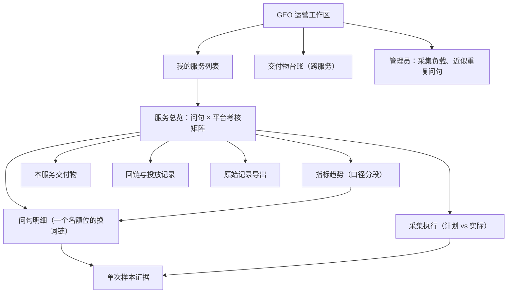

# GEO 运营第一版：看板、验收用例与切片

- 目的：定义第一版内部看板的信息架构与线框、客户看板（下一版本）的范围、Frappe 实现选型、验收用例 AC-xx，以及按日交付的切片。
- 读者：产品负责人（用户本人），以及后续实现的工程师。
- 状态：**设计草案，待用户确认**。本文不代表已建页面、DocType、报表或已改站点。
- 版本：v0.1，2026-11-18。
- 输入：[decisions.md](../../cycle/decisions.md) D-017 至 D-026（D-024、D-025、D-026 覆盖此前相关内容）；[01 领域模型与 ER 图](01-domain-model-er.md) v0.2（对象名、字段名、状态名以 01 为准）；[02 状态机](02-state-machines.md)；[03 时序图与 API](03-sequences-and-api.md)；首个真实合同案例（私有材料，不进 Git，本文称「案例 C1（购物平台类客户）」）。

标注约定（与 01 相同）：

- **已确认（D-0xx）**：用户已裁决。
- **设计推荐（Agent）**：Agent 给出的方案，可改。
- **待确认（Q-xx / DB-xx）**：Q-xx 沿用 01 第 8 节编号；本文新增问题用 DB-xx，汇总在第 7 节。
- **建议补充到 01**：本文需要但 01 尚未定义的字段或取值，汇总在第 6 节，不另起同义对象。

隐私约定：本目录进入 Git。文中不出现真实客户名称、真实问句、价格、合同编号和联系人。线框和用例里的问句、品牌、平台名都是自编的（例如「家用投影仪怎么选，去哪个平台买划算」「平台甲」「目标平台」「品牌 K」）。

与 D-026 的关系：D-026 晚于 01 v0.2，已回答 Q-01（问句只去首尾空白后精确比较，不做全角/半角、大小写或空白合并），并把共享采集改为「只有一条任务能同时满足各计划要求时才共用，否则分别生成」。本文的用例按 D-026 写；01 的规范化规则 v1 第 1、3 条和 3.4 节需要按 D-026 修订（见第 6 节）。

## 0. 看板的边界

| 项 | 内容 | 依据 |
|---|---|---|
| 看板与报告分开 | 看板随时看；报告（双周报、结案报告）是交付物，由系统生成或经 API 取数后由其他 Agent 写，登记在交付物台账。本文只定义看板和台账页，不定义报告版式。 | 已确认（D-023） |
| 授权单位 | 看板按服务授权和计算。任何页面的数据都从「当前用户可访问的服务」出发，经 `GEO Plan Slot` 到共享的任务和结果。 | 已确认（D-025） |
| 指标来源 | 趋势和比率读 `GEO Metric Snapshot`；考核状态读 `GEO Assessment Result`；计数从 `GEO Answer Analysis` 重新汇总，不平均百分比。 | 01 第 4.11、4.12 节 |
| 口径标注 | 每个指标都显示所用 `GEO Analysis Method`（名称 + 版本）与竞品名单版本；`basis_key` 变化处断开趋势线。 | 已确认（D-021） |
| 第一版用户 | 运营、销售、管理员（可兼任）。客户不登录。 | 已确认（D-017、D-023） |
| 第一版不做 | 内容生成、投放执行、获客、线索、售前诊断、SOP 清单、分成计算、违约金金额计算、甲方或第三方数据导入对账（Q-19）。 | 已确认（D-017、D-023）+ 推荐 |

## 1. 内部看板信息架构

### 1.1 页面结构（设计推荐，Agent）



| 页面 | 主要问题 | 主要数据 | 谁能看 |
|---|---|---|---|
| 我的服务列表 | 我负责哪些服务，哪个最需要处理 | `GEO Service`、`GEO Service Member`、未达标单元数、逾期交付物数、昨日漏采率 | 运营、销售（只读）看自己参与的；管理员看全部 |
| 服务总览 | 本期每个问句在每个平台是否达标，离期末还有几天 | `GEO Assessment Result`（最新修订）、`GEO Metric Snapshot` | 本服务成员、管理员 |
| 指标趋势 | 指标怎么变化，口径什么时候变过 | `GEO Metric Snapshot`（按日）、`basis_key` | 同上 |
| 问句明细 | 这个名额位用过哪些问句，各自表现，回答里谁占了名次 | `GEO Service Question`、`GEO Question Replacement`、`GEO Answer Analysis`、`GEO Answer Analysis Entity` | 同上 |
| 单次样本证据 | 这次采样的回答、截图、信源、分析结论和口径 | `GEO Collection Result`、`GEO Collection Evidence`、`GEO Source Citation`、`GEO Link Check`、`GEO Answer Analysis` | 同上，且需满足 01 第 3.2 节访问判定 |
| 采集执行 | 计划采多少、实际采了多少、漏在哪里 | `GEO Plan Slot`、`GEO Collection Task`、`GEO Collection Result` | 同上 |
| 交付物台账 | 什么该交、什么时候交、是否逾期 | `GEO Deliverable`、`GEO Contract Deliverable Term`、`Contract` 违约金比例 | 同上；跨服务台账按服务授权过滤 |
| 回链与投放记录 | 给这个客户发了哪些稿件和链接，针对哪些问句 | `GEO Backlink`、`GEO Backlink Service Question`、`GEO Backlink Import` | 同上 |
| 管理员全局视图 | 全系统采集负载、共享率、宽松键近似重复问句 | `GEO Collection Task`、`GEO Plan Slot` 聚合、`GEO Question.loose_key` | 仅管理员 |

### 1.2 考核状态的显示规则（设计推荐，Agent）

服务总览矩阵的每格是一个考核单元（案例 C1 为「服务问句 × 平台」）在当前期间的状态。状态只来自 `GEO Assessment Result`，看板不自行判定。

| 显示 | 条件 | 说明 |
|---|---|---|
| 达标 | `stage=Final` 且 `outcome=Passed` | 结算依据。 |
| 未达标 | `stage=Final` 且 `outcome=Failed` | 结算依据；格内给出「换词」入口。 |
| 样本不足 | `outcome=Insufficient Data` | 有效样本低于 `min_valid_samples`。Final 时同样作为结论展示，是否结算待确认（DB-03）。 |
| 趋势：预计达标 / 预计未达标 | `stage=Provisional` | 取样窗口未结束或未进入。用浅色和「暂定」字样，与 Final 明显区分（Q-13）。 |
| 未进入取样窗口 | 今天早于 `window_start` | 显示「距窗口 N 天」，并显示期间至今的参考值（参考值按同一口径算，但不是考核结果）。 |
| 不适用 | 该单元在本期间无有效服务问句 | 例如换词前的旧问句在新期间。 |

每格同时显示：主条件的值（例如 Top3 63.2%）、分子/分母（例如 98/155）、各条件是否满足的小标记、排除样本数（拒答、不可解析）。多条件规则（D-024）在格内逐条列出，`combine_mode` 写在矩阵表头。

### 1.3 线框：服务总览

案例 C1 形态的自编数据：25 个名额位、2 个平台、按自然月考核、每月取最后 7 天样本、条件为 Top3 提及率 > 60%。下图为某月 20 日打开时的样子。

```text
+----------------------------------------------------------------------------------+
| 服务：示例服务 C1          被服务组织：<客户>        状态：Active   [暂停中] 标记位 |
| 负责人：运营甲   参与人：运营乙、销售丙       服务期 2026-11-16 ~ 2027-01-15      |
+----------------------------------------------------------------------------------+
| 考核规则 v1：单元=服务问句×平台  期间=自然月(按服务期截断)  取样=期末 7 天  合计   |
| 条件(全部满足)：[1] top3_rate > 60%      口径：geo_rank_visibility-v2 (名单 v3)  |
| 当前期间：2026-12  取样窗口 12-25 ~ 12-31  距窗口开始 5 天  距期末 11 天         |
+----------------------------------------------------------------------------------+
| 汇总：达标 0 | 未达标 0 | 样本不足 0 | 暂定预计达标 31 | 暂定预计未达标 19 (单元) |
| 昨日采集：计划 1250  采到 1238  漏采 12 (1.0%)   交付物：1 项 3 天内到期          |
+----------------------------------------------------------------------------------+
| 名额 | 问句（自编示例）                     | DeepSeek APP       | 豆包 APP           |
|------+--------------------------------------+--------------------+--------------------|
|  01  | 家用投影仪怎么选，去哪个平台买划算   | 暂定 72% (412/572) | 暂定 58% (330/569) |
|  02  | 儿童护眼台灯哪里买正品               | 暂定 64% ...       | 暂定 61% ...       |
|  07  | 露营帐篷怎么选，去哪里囤划算  [换]   | 暂定 41% (自12-08) | 暂定 47% (自12-08) |
|  ... |                                      |                    |                    |
+----------------------------------------------------------------------------------+
| 上期 2026-11（Final）：达标 32 / 未达标 16 / 样本不足 2    [查看上期] [导出原始记录] |
+----------------------------------------------------------------------------------+
```

要点：

- 「距期末天数」和「距取样窗口开始天数」同时显示。案例 C1 的结果只由窗口内样本决定，运营最关心窗口开始前还有几天可以调整。
- 窗口开始前，格内是「期间至今的参考值」并标「暂定」；窗口内是「窗口至今」的暂定值；窗口结束且分析完成后变为 Final。
- 名额位旁的 `[换]` 表示本期发生过换词，格内括号写新问句的考核起点（`unit_start_policy=From Effective Date`，Q-08）。
- 「暂停中」只是标记，采集数字照常更新（D-019）。
- 页面不出现「该问句也被其他服务使用」之类的任何信息（D-025）。

### 1.4 线框：指标趋势（口径分段）

```text
+----------------------------------------------------------------------------------+
| 指标趋势  范围：[服务整体 v] [问句：名额 01 v] [平台：全部 v]  粒度：[日 v]        |
| 指标：[x] Top3 提及率  [x] 可见度  [ ] Top1   加权：[按回答 v]                    |
+----------------------------------------------------------------------------------+
| 100% |                                                                           |
|      |             :                         :                                   |
|  60% |------------ : ---------- 考核线 ----- : ----------------------------------|
|      |   ~~~~~~~   :   ~~~~~~~~~~~~~~        :   ~~~~~~~~~~                      |
|      |  /          :  /                      :  /                                |
|   0% +-------------:-------------------------:----------------------------------+
|        11-16       11-28                     12-08                     12-20     |
|        |-- 段 A ---|-------- 段 B -----------|-------- 段 C --------|           |
|  段 A：方法 v1 + 名单 v1                                                         |
|  段 B：方法 v1 + 名单 v2（新增竞品 平台丁）  11-28 起                              |
|  段 C：名额 01 换词，新问句 12-08 起（换词链在问句明细查看）                       |
|  [ ] 用当前口径重算历史（发起 Recompute 分析运行，管理员或负责人）                  |
+----------------------------------------------------------------------------------+
| 日期   | 采样量 | 有效样本 | 排除(拒答/不可解析) | Top3 | 可见度 | 口径段 |         |
| 12-19  |   50   |    48    |       2 / 0         | 62%  |  88%   |   C    |         |
+----------------------------------------------------------------------------------+
```

要点：

- 趋势线在 `basis_key` 变化处断开，不在断点两侧连线；段标签列出方法版本和名单版本（D-021）。
- 换词也是分段点：同一名额位的换词链在一张图上连续显示，但新旧问句分属不同线段（D-025：新旧是不同问句）。
- 「用当前口径重算历史」生成新的 `GEO Analysis Run`（`run_type=Recompute`），重算结果作为另一条虚线叠加，原结果不覆盖。
- 考核线只在当前视图对应考核规则时画出，多条件时每个指标各画一条。

### 1.5 线框：问句明细

```text
+----------------------------------------------------------------------------------+
| 名额位 07   换词链：                                                              |
|   [SQ-a] 露营帐篷怎么选，哪里买划算         11-16 ~ 12-07  Stopped(Replaced)      |
|      └─ 换词 12-08  原因：Assessment Failed  依据：2026-11 DeepSeek 未达标         |
|         确认：运营甲 + 客户联系人（Contact）  确认日 12-05                         |
|   [SQ-b] 露营帐篷怎么选，去哪里囤划算       12-08 ~       Active                  |
|   来源：Replacement   签约原文备注：无                                            |
+----------------------------------------------------------------------------------+
| 考核历史    | 期间     | 平台     | 结果      | Top3          | 有效/采样   | 修订 |
|  SQ-a       | 2026-11  | DeepSeek | 未达标    | 41% (66/161)  | 161/173     | r1   |
|  SQ-a       | 2026-11  | 豆包     | 达标      | 66% (108/164) | 164/175     | r1   |
|  SQ-b       | 2026-12  | 两平台   | 暂定      | ...           | ...         |      |
+----------------------------------------------------------------------------------+
| 名次构成（近 7 天，SQ-b，豆包）                                                   |
|   占名次的候选：平台甲 52%  目标平台 47%  平台乙 33%  平台丙 20%                   |
|   识别但不占名次（商品品牌）：品牌 K 61%  品牌 L 40%                              |
|   名单外同类平台：平台戊 6%（rank_scope=category_any，Q-09）                       |
+----------------------------------------------------------------------------------+
| 最近样本   时间        平台  状态       目标名次  并列  Top1 Top3  证据   [查看]  |
|            12-19 14:15 豆包  Evaluable  3         2    否   是    截图2  [>]     |
|            12-19 10:30 豆包  Refused    -         -    -    -     截图1  [>]     |
+----------------------------------------------------------------------------------+
```

要点：

- 问句文本只读，没有编辑按钮。「修改问句」入口就是「换词」，打开 `GEO Question Replacement` 表单（D-025）。
- 签约前已调整的问句在这里显示 `origin=Contract Signing` 和 `original_text_note`，不显示换词链。
- 名次构成把三类分开：占名次的候选、识别但不占名次的商品品牌、名单外同类平台。这样运营能直接看到商品品牌没有挤占名次。

### 1.6 线框：单次样本证据钻取

```text
+----------------------------------------------------------------------------------+
| 样本 3f9a…（随机哈希）  问句：露营帐篷怎么选，去哪里囤划算  平台：豆包 APP          |
| 采样条件：platform=doubao;channel=app;conversation=single_turn;web_search=on      |
| 采集时间：12-19 14:16:02 ~ 14:16:41   结果：Success  证据完整：是                 |
| 实际条件：模型显示名 <界面文本>  联网=开                                           |
+-------------------------------------+--------------------------------------------+
| 回答（按区块）                      | 截图 / 录屏                                |
|  [正文]                             |  [图 1/2] [图 2/2]   sha256: 7c1e…         |
|   ...推荐 平台甲、平台乙 ...         |  分享链接：<有/无>                         |
|   ...也可以看看 目标平台 ...         |                                            |
|   ...品牌 K 的入门款 ...             |                                            |
|  [引用标题] 不计入（body_only）      |                                            |
|  [相关搜索] 不计入                   |                                            |
+-------------------------------------+--------------------------------------------+
| 信源（引用挂在本结果上）                                                          |
|  # | AI 给出的链接           | 跳转后链接          | 最近检查        | 位置        |
|  1 | https://example.com/a?… | https://example...  | OK 12-20        | Inline      |
|  2 | https://example.org/b   | -                   | Not Found 12-20 | Ref List    |
+----------------------------------------------------------------------------------+
| 分析结果（本服务）  方法 geo_rank_visibility-v2  名单 v3  运行 AR-…  12-19 15:00   |
|  answer_status=Evaluable  候选数=3  目标名次=3  并列=1  Top1=否  Top3=是           |
|  实体：平台甲 #1(并列,2) 平台乙 #1(并列,2) 目标平台 #3  品牌 K 不占名次            |
|  口径要点：只算正文；含并列第三；并列第一不计 Top1；候选<3 提及即计；              |
|           品牌范围=shopping_platform；拒答/不可解析不入分母                       |
|  [查看模型原始输出]   [其他分析版本：v1 (旧口径)]                                   |
+----------------------------------------------------------------------------------+
| 本样本计入：采集点 2 个（计划「考核」第 6 次、计划「冲刺」第 1 次），样本计 1 次   |
+----------------------------------------------------------------------------------+
```

要点：

- 页面只在 01 第 3.2 节访问判定通过时打开，否则返回「不存在」（与不存在的记录同样的响应，不说明是无权还是不存在）。
- 「本样本计入」只列本服务的采集点，不显示其他服务的采集点数量或计划（D-025）。
- 信源的「首次出现时间」显示本服务可见范围内的首次出现，不显示 `GEO Source.first_seen_at`（01 第 4.10 节）。
- 同一结果被本服务多个分析版本分析过时，都能切换查看，默认显示服务当前默认口径（`GEO Service Metric Policy`）。

### 1.7 线框：采集执行（计划 vs 实际）

```text
+----------------------------------------------------------------------------------+
| 采集执行  日期 [12-19 v]  计划 [全部 v]  平台 [全部 v]                            |
+----------------------------------------------------------------------------------+
| 计划          | 用途       | 频率      | 计划点 | 已满足 | 漏采 | 待采 | 取消 |   |
| 考核计划      | Assessment | 25/天 随机 |  1250  |  1238  |  12  |   0  |  0   |   |
| 冲刺计划      | Sprint     | 每小时 1次 |   48   |   46   |   2  |   0  |  0   |   |
| 去重后任务数（本服务）：1289   多采(is_extra)：3   无证据未采纳：5             |
+----------------------------------------------------------------------------------+
| 时段分布（考核计划，豆包）每格 15 分钟                                           |
|  00h ▁▁▂▁ 01h ▁▂▁▁ ... 14h ▂▃▂▁ ...     漏采：■ 03:15  ■ 03:30  ■ 16:45             |
+----------------------------------------------------------------------------------+
| 漏采明细   采集点        问句(名额)  平台   窗口         任务状态  原因           |
|            PS-…  #14     07          豆包   03:15-03:30  Failed    3 次超时       |
|            PS-…  #3      12          DeepSk 16:45-17:00  Failed    无证据(重试满)  |
+----------------------------------------------------------------------------------+
```

要点：

- 计划侧数字来自 `GEO Plan Slot.status`；「去重后任务数」是本服务采集点关联任务的去重数，同一服务两计划共享的任务只算一次（01 第 3.3 节）。
- 漏采、多采、无证据未采纳分开显示，三者含义不同。
- 不显示任务被多少计划或服务需要（01 第 3.5 节第 3 条）。

### 1.8 线框：交付物台账

```text
+----------------------------------------------------------------------------------+
| 交付物台账  [仅本服务 / 我的全部服务]  状态 [未完成 v]                             |
+----------------------------------------------------------------------------------+
| 服务     | 类型         | 覆盖期间        | 应交日  | 状态      | 实交        | 逾期 |
| 示例 C1  | 双周报 #3    | 12-14 ~ 12-27   | 12-30   | Due Soon  | -           | -    |
| 示例 C1  | 双周报 #2    | 11-30 ~ 12-13   | 12-16   | Submitted | 12-17 18:20 | 1 天 |
| 示例 C1  | 结案报告     | 11-16 ~ 01-15   | 01-29   | Planned   | -           | -    |
| 内部 D   | 月报         | 12-01 ~ 12-31   | 01-05   | Planned   | -           | -    |
+----------------------------------------------------------------------------------+
| 选中：双周报 #2   依据：周期结束后 3 个工作日（日历：<Holiday List>）              |
| 必含内容：各问句各平台采样量、有效样本量、前三提及率、环比、稿件汇总、投放记录汇总 |
|  [x] 报告文件  [x] 原始记录导出  [x] 稿件汇总(回链 14 条)  [x] 投放记录汇总        |
| 合同违约条款：每逾期一日 0.5%，累计上限 10%（只显示比例，不算金额）                 |
| [标记已提交] [标记已确认] [豁免(需原因)] [生成报告数据包]                           |
+----------------------------------------------------------------------------------+
```

要点：

- 违约金比例与上限来自合同 `geo_late_penalty_rate`、`geo_late_penalty_cap`，只显示比例和逾期天数（01 第 4.14 节）。
- 「必含内容」清单逐项勾选；回链为 0 条时「稿件汇总」显示警告（案例 C1 双周报要求，Q-16）。
- 「生成报告数据包」导出该期间的指标表、原始记录和回链清单，供系统或外部 Agent 生成报告（D-023）。

### 1.9 客户看板（下一版本，只读账号）

第一版不做客户登录（D-017）。案例 C1 合同要求客户能看看板，推荐下一版本给客户开只读账号，只看自己服务的数据（Q-18，待确认）。第一版期间用截图或导出提供。

| 方面 | 内部看板（第一版） | 客户看板（下一版本，设计推荐） |
|---|---|---|
| 用户 | 运营、销售、管理员 | 客户方只读账号，绑定一个或多个 `GEO Service`（建议补充到 01：角色 `GEO Customer Viewer` 与服务授权表） |
| 范围 | 自己参与的服务；管理员看全部 | 只看被授权的服务；不跟随集团、渠道关系继承（D-018） |
| 考核 | Final 与 Provisional 都显示 | 默认只显示 Final；Provisional 是否给客户看待确认（DB-01，推荐显示为「本期至今」，不显示「预计达标/未达标」措辞） |
| 指标 | 所有指标、所有口径版本、重算对比 | 只显示考核口径和合同约定指标；口径变化处标注 |
| 名次构成 | 含名单外平台、商品品牌、模型原始输出 | 只显示目标与名单内竞品的提及与名次；不显示模型原始输出 |
| 样本证据 | 全部字段 | 回答正文、截图、采样时间、平台、是否计入前三；不显示 `device_ref`、`collector_version`、`actual_conditions` 原始 JSON |
| 信源 | 含链接检查历史 | AI 给出的链接和最近检查状态 |
| 采集执行 | 漏采明细、失败原因 | 只显示采样量和有效样本量（合同双周报口径） |
| 换词 | 原因分类、关联考核结果、内部确认人 | 只显示换词日期和新旧问句 |
| 交付物 | 全部状态、违约条款 | 已提交交付物的下载 |
| 回链 | 全部字段 | 已发布稿件与链接 |
| 导出 | 原始记录完整导出 | 原始记录完整导出（合同要求可复核） |
| 管理功能 | 有 | 无 |

隔离要求与内部一致：客户账号读到的共享结果，也必须经由其服务的 `GEO Plan Slot` 判定（01 第 3.2 节），并且看不到其他服务或客户使用同一问句。

## 2. Frappe 实现选型（设计推荐，Agent）

### 2.1 可选方式

只读核查（容器 `bizbase-backend-1`，2026-11-18）：框架带 `Workspace`、`Number Card`、`Dashboard Chart`、`Dashboard`、`Access Log` 等 DocType，前端图表库为 frappe-charts 2.0.0-rc27；CRM App 的前端用 frappe-ui（Vue 单页应用）。

| 方式 | 适合 | 不适合 | 本项目用法 |
|---|---|---|---|
| Workspace + Number Card + Dashboard Chart（Desk 原生配置） | 入口、计数卡片、简单分组图 | 矩阵布局、截图并排、口径分段；图表数据源按 DocType 计数，难以套用 01 第 3.2 节的经由采集点的访问判定 | 只做「GEO 运营」工作区入口和少量卡片（我的服务数、逾期交付物数、昨日漏采），卡片数据源用自定义方法，按服务过滤 |
| Script Report（Python 报表） | 表格类视图、筛选、导出 CSV/Excel、权限检查集中在服务端 | 交互式钻取和图片展示 | 采集执行、交付物台账、考核结果清单、原始记录清单 |
| 自定义 Desk Page（`frappe.ui.Page` + frappe-charts） | 服务总览矩阵、趋势分段、问句明细、样本证据钻取 | 对外客户访问 | 第一版内部看板主体 |
| frappe-ui 单页应用（与 CRM 同类做法） | 客户只读看板、移动端友好 | 第一版时间成本高 | 下一版本客户看板 |
| DocType 表单 | 录入和维护（服务、服务问句、计划、换词、交付物） | 看板 | 维护入口；`GEO Collection Task` 等共享对象对非管理员不开放 Desk 列表 |

### 2.2 推荐

1. **第一版内部看板 = 自定义 Desk Page + Script Report + 白名单 API。** 页面只调用 `geo_operations.dashboard.api.*` 下的白名单方法，方法第一步解析「当前用户可访问的服务」，再按 01 第 3.2 节取数。理由：访问判定跨私有和共享对象，集中写在一处可以测试；Desk 原生图表和列表按 DocType 权限工作，无法自然表达「经由本服务采集点才能读共享结果」。
2. **私有 DocType 用 `permission_query_conditions` + `has_permission` 钩子**，条件是「当前用户在该服务 `GEO Service Member` 中有有效行，或持有 `GEO Admin`」。表单、列表、Link 搜索、报表都会经过这两个钩子。
3. **共享 DocType（`GEO Question`、`GEO Collection Task`、`GEO Collection Result`、`GEO Source Citation`、`GEO Source`、`GEO Link Check`）只给 `GEO Admin` 角色读权限**。运营、销售只能通过白名单 API 读，API 内做 3.2 判定。证据文件是私有 `File`，下载走 API 校验后转发（`File` 的权限默认跟随附着的文档，而共享结果的文档权限只给管理员，因此需要这个代理接口）。
4. **趋势图用 frappe-charts**：每个口径段一个 dataset，段外取空值以断开折线；考核线用 y 轴标记（yMarkers）；段边界在图下方以文字列出。是否需要更强的图表库留到客户看板版本再评估。
5. **指标预计算**：看板读 `GEO Metric Snapshot` 与 `GEO Assessment Result`，不在请求时扫 `GEO Answer Analysis`。按日快照由分析运行完成后的后台作业生成。案例 C1 每天约 1250 条结果，单服务两个月约 7.5 万条，按日聚合后每服务每天约 50 单元 × 若干指标，页面查询量很小。
6. **导出用后台作业**：原始记录导出（含截图）可能达数 GB，用 `frappe.enqueue` 生成 zip 到私有文件，完成后通知；导出记录写 `Access Log`（建议补充到 01：导出记录对象或沿用 `Access Log`，见第 6 节）。
7. **下一版本客户看板**用 frappe-ui 单页应用，挂在独立路由，只调用同一组白名单 API 的客户只读子集。内部和客户共用一套访问判定代码。

不推荐：给运营开放共享 DocType 的 Desk 列表再用 User Permission 限制。理由：共享对象没有 `service` 字段（01 第 3.1 节），User Permission 无从过滤；加回 `service` 字段又违反 D-025 的隔离设计。

## 3. 验收用例

### 3.1 约定

- 验收环境：原 `bizbase` 项目的 `frontend` 站点（本地预览，D-004、D-012）。真实客户数据只存本地预览，不进 Git（D-017）；下列用例用自编数据，真实案例 C1 数据另行在本地复验。
- 测试账号（自编）：`ops_a`（运营，服务 A 成员）、`ops_b`（运营，服务 B 成员）、`sales_a`（销售，服务 A 成员）、`admin_ops`（同时持有 `GEO Admin` 与 `GEO Operations`，只是服务 A 成员）、`collector_1`（`GEO Collector` 机器账号）。
- 时间以 `Asia/Shanghai` 计。时间桶 15 分钟（Q-14）。
- 每条用例写明主要依据。「验证方式」中的 API 名沿用 03 文档；03 未定义的以「白名单 API」泛称。
- 用例编号 AC-xx 在实现中作为自动化测试名（`test_ac_xx_*`）。

### 3.2 客户、合同、服务

**AC-01 总部签约，服务子公司的产品**（D-018）

- Given：Customer「集团总部 H」「子公司 S」；`GEO Group Relation`（H → S，Subsidiary）；Contract 的 `party_name=H`、`geo_payer_customer=H`、`geo_served_customers=[S]`；`GEO Entity`「产品 P」（`entity_type=Product`）。
- When：`ops_a` 创建 `GEO Service`（`service_kind=Client`、`served_customer=S`、`contracts=[该合同]`、`targets=[产品 P]`）并启动。
- Then：启动成功；服务详情分别显示签约方 H、付款方 H、被服务组织 S、优化标的 P。
- And：把 `served_customer` 改为 H 以外、且不在 `geo_served_customers` 中的客户时，启动被拒并提示缺失项。
- And：仅凭集团关系，H 的其他服务的成员看不到本服务（关系不用于授权继承）。

**AC-02 dogfood 内部服务**（D-017；M-27）

- Given：内部客户（`is_internal_customer=1`）；公司自有品牌实体。
- When：创建 `service_kind=Internal` 的服务，不关联合同，启动。
- Then：启动成功；考核规则可以不填 `contract`；看板、采集、分析与客户服务行为一致。
- And：`service_kind=Internal` 但 `served_customer` 不是内部客户时，启动被拒。

### 3.3 问句、共享采集与隔离

**AC-03 两个客户的服务含同一问句：只采一次、互不可见、各自计数正确**（D-025、D-026；01 第 3.2、3.3 节）

- Given：服务 A（客户 X）与服务 B（客户 Y）各录入问句「家用投影仪怎么选，去哪个平台买划算」，采样条件都是 `platform=doubao;channel=app;conversation=single_turn;web_search=on`。A 的计划每天 25 次随机，B 的计划每天 3 次随机。调度器为某日展开后，A 与 B 各有一个采集点落在 10:15 桶。
- When：调度器生成任务；`collector_1` 领取并回传该桶结果。
- Then：`GEO Question` 只有一条；10:15 桶的 `GEO Collection Task` 只有一条（`dedup_key` 唯一），两个采集点的 `collection_task` 指向它。
- And：A 当天采样量 = A 的采集点关联的去重任务中有被采纳结果的数量（全部成功时为 25），B 为 3；共享不让任何一方多算。
- And：`ops_a` 在服务 A 的任何页面、API、导出中都看不到服务 B、客户 Y、B 的采集点或计划频率；问句录入时界面不提示「已存在」；任务与结果的 `name` 是随机哈希。
- And：`ops_b` 用服务 A 才有的某个任务 `name` 调白名单 API，返回与不存在的记录相同的响应。
- And：A 与 B 对同一结果各自产生 `GEO Answer Analysis`，互不可见。

**AC-04 时间要求不能同时满足时不共用**（D-026）

- Given：服务 A 的计划要求 Uniform 分布、每天 8 次；服务 B 的计划 Random 分布，同一问句、同一采样条件。
- When：调度器展开同一天。
- Then：只有两者独立生成的时间桶恰好相同的采集点才共享任务；调度器不为了共享而移动任何一方的时间桶。A 的采集点时刻仍是均匀网格，B 的仍是独立随机抽取。
- And：两个服务的采样条件中任一参数不同（例如 B 关闭联网）时，没有任何共享任务。

**AC-05 同一服务的两个计划共享任务**（D-020；01 第 3.3 节）

- Given：服务 A 的「考核计划」与「冲刺计划」都包含同一服务问句和同一采样条件，两者各有一个采集点落在 14:15 桶。
- When：采集完成。
- Then：只有一条任务；两个采集点都为 Fulfilled；采集执行页两个计划各计 1 个已满足；服务 A 的采样量只计 1。
- And：样本证据页的「本样本计入」显示 2 个采集点、样本计 1 次。

**AC-06 问句判重与不可修改**（D-025、D-026）

- Given：已存在问句「家用投影仪怎么选，去哪个平台买划算」。
- When：另一服务录入「  家用投影仪怎么选，去哪个平台买划算 」（首尾有空白）。
- Then：关联到同一条 `GEO Question`（去首尾空白后 hash 相同）。
- When：录入把「，」改为半角「,」或把英文字母改了大小写的文本。
- Then：创建新的 `GEO Question`（D-026 不做全角/半角、大小写归一）。
- When：管理员通过表单、`frappe.client.set_value`、REST `PUT` 修改 `question_text`。
- Then：全部被拒；文本与 `text_hash` 不变。
- When：两个会话并发提交同一新文本。
- Then：数据库中只有一条，两个服务问句都指向它。
- And：被引用的问句不能删除。

**AC-07 换词：旧结果不变，新问句开始采集**（D-019、D-025）

- Given：服务 A 名额位 07 的服务问句 SQ-a 已 Active，有 11 月的 Final 考核结果（DeepSeek 未达标）和若干采集结果与分析。
- When：`ops_a` 提交 `GEO Question Replacement`（`old_service_question=SQ-a`，新文本「露营帐篷怎么选，去哪里囤划算」，`reason_category=Assessment Failed`，`assessment_result` 指向未达标结果，确认人与确认日已填，`effective_date=12-08`）。
- Then：SQ-a 变为 Stopped（`stop_reason=Replaced`、`effective_to=12-07`）；新服务问句 SQ-b 变为 Active，`quota_slot=07`；包含 SQ-a 的有效计划改为包含 SQ-b。
- And：SQ-a 的采集点、结果、分析、考核结果的数量和内容与换词前完全一致（比对记录 `name` 与 `modified`）。
- And：12-08 起只为 SQ-b 生成采集点；12-08 之后 SQ-a 没有新采集点；SQ-a 尚未领取的未来任务若无其他关联采集点则置 Cancelled。
- And：如果其他服务也在监测 SQ-a 的问句，那个服务的采集点和任务不受影响（换词只作用于本服务）。
- And：问句明细页显示换词链，指标趋势在 12-08 分段。

**AC-08 签约前已调整的问句**（案例 C1）

- Given：合同清单里某条原文本在签约前已调整。
- When：签约录入时录调整后的文本，原文本写入 `original_text_note`。
- Then：服务问句 `origin=Contract Signing`，没有 `GEO Question Replacement`；原文本不创建 `GEO Question`。

### 3.4 采集与执行

**AC-09 租约过期重领，重复回传幂等**（01 第 4.9 节；03 文档 API）

- Given：任务 T 为 Queued。
- When：`collector_1` 领取 T（Leased），超过 `lease_seconds` 未回传。
- Then：租约回收作业把 T 放回 Queued（`attempt_count` 小于 `max_attempts` 且窗口未结束时），`lease_owner` 清空；另一次领取可再次拿到 T。任务状态转换以 02 第 5 节为准。
- When：第二次领取后成功回传，`submission_id=U2`；随后用同一 `submission_id=U2` 再次回传。
- Then：第二次回传返回第一次创建的结果，不新增记录。
- When：第一次领取的旧设备迟到回传 `submission_id=U1`，内容完整。
- Then：结果保存并标 `is_extra=1`；`succeeded_result` 仍是第一条证据完整的结果；采样量不变。

**AC-10 漏采可见**（D-020；01 第 4.9 节对账口径）

- Given：服务 A 某采集点关联的任务连续 3 次 Timeout，任务 Failed。
- When：采集点的 `rule_window_end` 已过，对账作业运行。
- Then：采集点为 Missed；采集执行页该计划漏采数加 1，漏采明细显示窗口、问句名额、平台、任务状态与失败原因；服务总览「昨日采集」的漏采数一致。
- And：漏采不进入分析，也不计入任何考核分母。

**AC-11 缺截图的回传不被采纳**（Q-12；01 第 4.9 节采纳规则）

- Given：采样条件 `evidence_required=Screenshot Or Recording`。
- When：`collector_1` 回传 `outcome=Success`、有 `answer_text`、没有截图或录屏。
- Then：API 返回明确的「证据不完整」状态；结果保存为 `evidence_complete=0`，不被采纳，不计入采样量；任务在窗口内允许重试。
- When：重试后回传带截图的结果。
- Then：该结果被采纳，采集点 Fulfilled。
- And：重试满仍无证据时，任务 Failed，采集点最终 Missed，采集执行页把原因显示为「无证据」。

**AC-12 暂停期间采集继续**（D-019）

- Given：服务 A Active，有 Active 监测计划。
- When：`ops_a` 记录暂停（`GEO Service Pause`），持续 3 天后记录恢复。
- Then：暂停期间每天采集点数量与暂停前相同；任务照常被领取；分析与看板照常更新；服务总览显示「暂停中」标记；`planned_end_date` 不被自动修改。

### 3.5 分析口径

分析用例都以纯函数形式验证：输入（`answer_blocks` 或 `answer_text`、竞品名单快照、`policy_params`），输出（`GEO Answer Analysis` 与实体结果）。名次判断需要过模型（D-021），自动化测试用固定的模型输出夹具，另用少量真实调用做抽检。默认口径为案例 C1 取值（01 第 4.11 节表格）：`answer_scope=body_only`、`rank_categories=[shopping_platform]`、`rank_scope=category_any`、`topn_tie_inclusive=true`、`top1_requires_sole=true`、`few_candidates_threshold=3`、`few_candidates_rule=mention_counts_as_topn`、`exclude_from_denominator=[Refused, Unparseable]`。名单：目标平台（Target）、平台甲、平台乙、平台丙（Competitor），均为 `shopping_platform`。

**AC-13 竞品名单新版本后口径分段**（D-021；01 第 4.6 节）

- Given：名单 v1 自 11-16 生效；11-16 至 11-27 的结果已用 v1 分析。
- When：提交 v2（新增平台丁），`effective_from=11-28`。
- Then：11-28 之后的结果默认用 v2 分析；11-16 至 11-27 的 `GEO Answer Analysis` 不变。
- And：指标趋势在 11-28 断开，段标签分别为「方法 + 名单 v1」「方法 + 名单 v2」；两段的 `basis_key` 不同。
- When：负责人用 v2 发起重算 11-16 至 11-27。
- Then：生成 `run_type=Recompute` 的新运行和新分析结果；原结果保留；趋势页可叠加查看。
- And：已 Final 的考核结果不被改写；如需按新口径重判，产生新的 `revision`。

**AC-14 商品品牌不占平台名次**（案例 C1；M-17）

- Given：回答正文依次提到「品牌 K」「品牌 L」（`product_brand`），然后推荐平台甲、平台乙、目标平台。
- When：分析运行。
- Then：品牌 K、L 出现在实体结果中，`counts_for_rank=0`、`position` 为空；占名次的候选为 3 个；目标 `target_position=3`、`is_top3=1`。
- And：把 `rank_categories` 改为包含 `product_brand` 的另一方法版本时，同一回答目标名次为 5、`is_top3=0`（证明口径由参数决定）。

**AC-15 并列第三计入，并列第一不计 Top1**（案例 C1）

- Given 1：正文推荐平台甲第一、平台乙第二，目标平台与平台丙并列第三。
- Then 1：目标 `target_position=3`、`target_tie_size=2`、`is_top3=1`。
- Given 2：正文推荐「目标平台和平台甲都可以」作为并列首选，平台乙第三。
- Then 2：目标 `target_position=1`、`target_tie_size=2`、`is_top1=0`、`is_top3=1`。
- And：`topn_tie_inclusive=false` 时 Given 1 得 `is_top3=0`；`top1_requires_sole=false` 时 Given 2 得 `is_top1=1`。

**AC-16 候选少于 3 个时提及即计**（案例 C1）

- Given：正文只提到平台甲和目标平台（目标在第 2 位），另提到品牌 K。
- Then：占名次的候选 2 个，少于 `few_candidates_threshold=3`；`is_top3=1`；`is_top1` 按正常名次判定为 0（该规则不作用于 Top 1）。
- And：只提到平台甲、平台乙、未提目标时，`target_mentioned=0`、`is_top3=0`，进入分母（`unmentioned_policy=count_as_fail`）。
- And：正文没有任何购物平台时，按 `no_candidate_policy=count_as_fail` 进分母且 `is_top3=0`（Q-09 待确认）。

**AC-17 只算正文**（案例 C1）

- Given：`answer_blocks` 中目标平台只出现在「引用标题」和「相关搜索」区块，正文未提。
- Then：`target_mentioned=0`；对应实体 `mentioned_in=References`、不占名次；`is_top3=0`。

**AC-18 拒答与不可解析不入分母**（案例 C1；M-22）

- Given：某考核单元窗口内 10 条被采纳结果：6 条前三提及、2 条未进前三、1 条 Refused、1 条 Unparseable。
- When：生成指标与考核结果。
- Then：采样量 10；有效样本量 8；Top3 提及率 = 6 / 8 = 75%；`excluded_breakdown` 为 `{Refused: 1, Unparseable: 1}`。
- And：采集失败（Timeout）的任务不出现在采样量中，单独计入漏采（与拒答区分）。

### 3.6 考核

**AC-19 当月最后一周取样**（案例 C1；Q-05、Q-06）

- Given：考核规则 `period_type=Calendar Month`、`clip_to_service_term=1`、`sample_window=Last N Days Of Period`、`sample_window_days=7`、`aggregation=Pooled`；服务期 11-16 至次年 01-15。
- When：生成各月考核结果。
- Then：三个期间分别为 11-16~11-30、12-01~12-31、01-01~01-15；取样窗口分别为 11-24~11-30、12-25~12-31、01-09~01-15。
- And：窗口外样本不影响考核结果，只显示在趋势中。
- And：窗口内按天样本量不同时，结果 = 窗口内分子合计 ÷ 分母合计，与「每天比率再平均」的值不同，测试数据要构造出两者差异。
- And：窗口未结束时 `stage=Provisional`；窗口结束且分析完成后产生 `stage=Final`；之后新到达的迟到结果只能通过新 `revision` 进入。

**AC-20 多指标组合考核**（D-024）

- Given：规则含两条条件：`visibility_rate >= 0.8` 与 `top3_rate > 0.6`，`combine_mode=All`。
- When：某单元窗口内可见度 85%、Top3 58%。
- Then：结果 `Failed`；`GEO Assessment Condition Result` 两行，分别 `met=1`、`met=0`，各带分子、分母。
- When：同数据下 `combine_mode=Any` 的另一规则版本。
- Then：结果 `Passed`。
- And：服务总览格内逐条显示两条条件的取值与是否满足。
- And：恰好等于阈值时按比较符判定（`top3_rate` 恰为 60% 时 `> 0.6` 不满足）。

**AC-21 按问句 × 平台判定**（Q-07）

- Given：同一服务问句在豆包达标、在 DeepSeek 不达标。
- Then：产生两条 `GEO Assessment Result`，分别 Passed、Failed；服务总览两格分别显示；考核结果清单可按「达标的问句 × 平台」导出，作为结算依据（系统不算金额）。

### 3.7 导出与交付物

**AC-22 原始记录导出**（案例 C1；Q-19）

- Given：服务 A 某双周期间内有被采纳结果、未采纳结果和多采结果。
- When：`ops_a` 在交付物或服务总览发起「导出原始记录」。
- Then：后台作业生成私有 zip：一份清单（采样时间、名额位、问句文本、平台、采样条件、结果状态、是否采纳、是否计入有效样本、Top3 是否命中、截图文件名、`file_sha256`）加全部截图或录屏文件。
- And：清单只包含服务 A 采集点关联的任务；与服务 B 共享的任务出现在 A 的导出中，但导出不含任何 B 的信息。
- And：导出记录（谁、何时、范围）可查。
- And：清单里每条的 `file_sha256` 与文件实际哈希一致。

**AC-23 交付物逾期提醒**（Q-15、Q-17）

- Given：合同交付条款「双周报：周期结束后 3 个工作日」，`holiday_list` 为指定日历；某双周周期结束日为周五。
- When：生成交付物台账。
- Then：应交日为下一周的周三（跳过周末和日历中的假日），`due_rule_snapshot` 写明依据。
- When：日期到达应交日前 `deliverable_reminder_days` 个工作日。
- Then：状态 Due Soon，服务 Owner 收到通知（Frappe `Notification Log`）。
- When：应交日过后仍未提交。
- Then：状态 Overdue，台账显示逾期天数（按自然日）与合同违约比例；提交后 `days_late` 固定。
- And：结案报告按 `After Contract End / 10 / Working Day` 计算。

### 3.8 权限

**AC-24 运营看不到非参与服务**（D-023、D-025）

- Given：`ops_a` 只在服务 A 的成员表中。
- When：`ops_a` 打开服务 B 的表单、列表筛选、Link 搜索、看板 API、导出接口、Script Report。
- Then：全部看不到服务 B 及其私有对象；共享对象的 Desk 列表无权访问；经白名单 API 访问 B 才有的任务或结果返回「不存在」。
- And：`ops_a` 在服务 A 的成员行 `to_date` 已过后，同样看不到服务 A 的后续数据（是否保留历史只读待确认 DB-04）。
- And：`sales_a` 能看服务 A，但不能提交换词、修改计划或记录暂停。

**AC-25 兼任管理员可见全部**（D-023）

- Given：`admin_ops` 同时持有 `GEO Admin` 与 `GEO Operations`，只是服务 A 的成员。
- Then：能看到全部服务、共享对象列表、管理员全局视图（采集负载、共享率、宽松键近似问句）。
- And：管理员视图中能看到某任务关联了几个服务的采集点；这是管理员专有信息，不出现在任何服务页面。
- And：同一个问句不可修改的规则对 `admin_ops` 同样生效。

**AC-26 机器账号读不到客户信息**（D-025；01 第 3.6 节）

- Given：`collector_1` 只持有 `GEO Collector`。
- When：调用任务领取 API。
- Then：返回字段只有任务 `name`、`question_text`、`platform`、`profile_key` 与选项取值、时间窗口、`scheduled_at`、`lease_expires_at`、证据要求。
- When：用 REST 读 `Customer`、`Contract`、`GEO Service`、`GEO Plan Slot`、`GEO Monitoring Plan`、`GEO Answer Analysis`，或登录 Desk。
- Then：全部拒绝。
- And：领取 API 的返回体用固定字段白名单序列化，测试断言返回 JSON 的键集合与白名单完全相等。

**AC-27 回链按客户可查**（D-017；Q-16）

- Given：服务 A（客户 X）导入 14 条回链，其中 3 条的 URL 也出现在服务 A 可见结果的信源中；服务 B（客户 Y）导入 5 条。
- When：`ops_a` 打开服务 A 的回链页，或按客户 X 查询。
- Then：看到 14 条，含稿件标题、发布链接、渠道、发布时间、针对的服务问句、客户审核日期；3 条显示「已被 AI 引用」。
- And：看不到服务 B 的 5 条；即使服务 B 的某条回链 URL 也出现在 A 的信源中，A 看不到 B 发过这篇稿件。
- And：重复导入同一文件，已存在的行跳过，导入批次显示 `skipped_count`。
- And：双周报数据包按期间、按服务问句汇总稿件数与投放记录。

## 4. 第一版切片（设计推荐，Agent）

按 D-004，每个切片交付到本地预览 `frontend` 站点，可访问、可操作、通过所列验收用例并留记录才计为一个版本。目标每天一个切片。顺序按 D-017：客户与合同 → 资料 → 问句与竞品 → 计划与任务 → 分析 → 看板。


| 切片 | 内容 | 可验收结果 | 覆盖用例 |
|---|---|---|---|
| S1 服务与问句 | Contract Custom Field；`GEO Service` 及子表；组织关系；实体与类别；竞品名单版本；`GEO Question` 全局唯一与不可修改；`GEO Service Question`；换词；角色与私有对象权限钩子 | 在 Desk 中手工录入两个客户的服务和 dogfood 服务，录入同一问句只产生一条 `GEO Question`；`ops_a` 看不到服务 B | AC-01、AC-02、AC-06、AC-07（换词表单与状态部分）、AC-08、AC-24（私有对象部分）、AC-25 |
| S2 计划、任务与采集 API | 采样选项与采样条件；监测计划；采集点展开与全局去重；领取、回传 API；租约回收；证据采纳规则；漏采对账；暂停 | 用脚本模拟采集程序跑一天，两个服务共享任务、各自计数正确；缺截图被拒；漏采可查（先用列表，看板在 S5） | AC-03（采集与计数部分）、AC-04、AC-05、AC-09、AC-10（数据部分）、AC-11、AC-12、AC-26 |
| S3 分析与口径 | `GEO Analysis Method` 与 `policy_params` 校验；分析纯函数；分析运行与重算；按日 `GEO Metric Snapshot` | 用夹具回答跑出全部口径用例；同一共享结果被两个服务分别分析 | AC-13（分析部分）、AC-14 至 AC-18、AC-03（分析隔离部分） |
| S4 考核与服务总览 | 考核规则与条件；Provisional/Final；服务总览矩阵；指标趋势分段；问句明细 | 打开服务总览能看到每个问句×平台的考核状态、距期末天数；趋势在名单变更和换词处分段 | AC-19、AC-20、AC-21、AC-13（趋势部分）、AC-07（看板部分） |
| S5 证据、执行、导出 | 单次样本证据页与文件代理下载；采集执行页；原始记录导出作业 | 从总览一路点到截图；导出 zip 可用哈希校验；漏采在页面上可见 | AC-10（页面部分）、AC-22、AC-24（共享对象与 API 部分） |
| S6 交付物与回链 | 合同交付条款；`GEO Deliverable` 生成、提醒、逾期；回链导入；双周报数据包 | 台账自动生成双周报和结案报告应交日，到期前提醒；回链按客户可查，并能出现在双周报数据包中 | AC-23、AC-27 |

切片说明：

- S1、S2 是后续全部切片的前提，必须按序；S5、S6 可以按用户优先级对调。案例 C1 首个双周报应交日前必须完成 S6 的交付物与回链部分（推荐日期由用户按实际上线时间确认，DB-05）。
- 真实案例 C1 数据在 S1 完成后录入本地预览（不进 Git），S2 起用真实问句跑采集程序联调；采集程序本身不属于本项目（D-020）。
- 每个切片完成时运行该切片及之前所有切片的 AC 自动化测试；隔离类用例（AC-03、AC-24、AC-26）每个切片都要回归。

## 5. 验收用例覆盖对照

| 要求 | 用例 |
|---|---|
| 总部签约服务子公司产品 | AC-01 |
| dogfood | AC-02 |
| 两个客户同一问句只采一次、互不可见、计数正确 | AC-03、AC-04 |
| 同一服务两计划共享任务 | AC-05 |
| 租约过期重领与重复回传幂等 | AC-09 |
| 漏采可见 | AC-10 |
| 换词后旧结果不变、新问句开始采集 | AC-07 |
| 全局问句文本不可修改 | AC-06 |
| 暂停期间采集继续 | AC-12 |
| 竞品名单新版本后口径分段 | AC-13 |
| 商品品牌不占平台名次 | AC-14 |
| 并列第三计入、并列第一不计 Top1 | AC-15 |
| 候选少于 3 个时提及即计 | AC-16 |
| 拒答不入分母 | AC-18 |
| 最后一周取样规则 | AC-19 |
| 多指标组合考核 | AC-20 |
| 缺截图的回传被拒 | AC-11 |
| 原始记录导出 | AC-22 |
| 交付物逾期提醒 | AC-23 |
| 运营看不到非参与服务 | AC-24 |
| 兼任管理员可见全部 | AC-25 |
| 机器账号读不到客户信息 | AC-26 |
| 回链按客户可查 | AC-27 |
| 补充：签约前已调整的问句、只算正文、按问句×平台判定 | AC-08、AC-17、AC-21 |

## 6. 建议补充到 01

| # | 建议 | 原因 |
|---|---|---|
| S-01 | 按 D-026 修订 01 第 4.7 节规范化规则：只去首尾空白，不做 NFC、不合并内部空白；Q-01 标为已确认（D-026）。`loose_key` 是否保留由用户决定（推荐保留给管理员查近似重复）。 | D-026 晚于 01 v0.2。AC-06 按 D-026 写。 |
| S-02 | 按 D-026 修订 01 第 3.4 节与 M-12：共享只在一条任务能同时满足各计划的问句、采样条件、时间窗口与分布要求时发生，否则分别生成；Q-03 标为已确认。 | AC-04 依赖。 |
| S-03 | 原始记录导出的审计记录：沿用框架 `Access Log`（记录导出人、时间、范围），或补一个 `GEO Raw Export` 对象记录导出范围、文件、`sample_basis_hash`。推荐先用 `Access Log`。 | AC-22 要求导出记录可查。 |
| S-04 | 下一版本客户只读访问：角色 `GEO Customer Viewer`，以及服务授权（可作为 `GEO Service Member.member_role` 新增取值 `Customer Viewer` 并允许关联 `Contact`，或单独授权表）。 | 第 1.9 节；Q-18。 |
| S-05 | `GEO Collection Result` 增加 `rejection_reason`（Select：Evidence Incomplete / Other），供采集执行页显示「无证据未采纳」。 | AC-11、线框 1.7。 |
| S-06 | `GEO Deliverable` 增加 `reminded_at`，避免提醒重复发送。 | AC-23。 |

## 7. 待确认问题（本文新增）

| # | 问题 | 推荐 |
|---|---|---|
| DB-01 | 客户看板是否显示本期 Provisional 结果 | 显示为「本期至今」数值，不显示「预计达标/未达标」措辞 |
| DB-02 | 内部看板默认口径用 `GEO Service Metric Policy` 还是考核规则的方法版本 | 服务总览用考核规则口径；趋势页默认用服务默认口径，可切换 |
| DB-03 | Final 为「样本不足」时是否结算 | 不由系统决定，只标出；按合同由人处理 |
| DB-04 | 成员退出服务后是否保留对历史数据的只读访问 | 不保留；需要时由管理员查看 |
| DB-05 | 案例 C1 首个双周报应交日前，S6 是否必须上线 | 是；S5 与 S6 可对调以赶在应交日前 |
| DB-06 | 第一版看板是否需要移动端适配 | 不需要；客户看板版本再做 |

沿用 01 的待确认问题中，本文直接依赖的有：Q-02（每天采样次数）、Q-05、Q-06、Q-07、Q-08、Q-09、Q-12、Q-13、Q-15、Q-16、Q-17、Q-18、Q-19。
