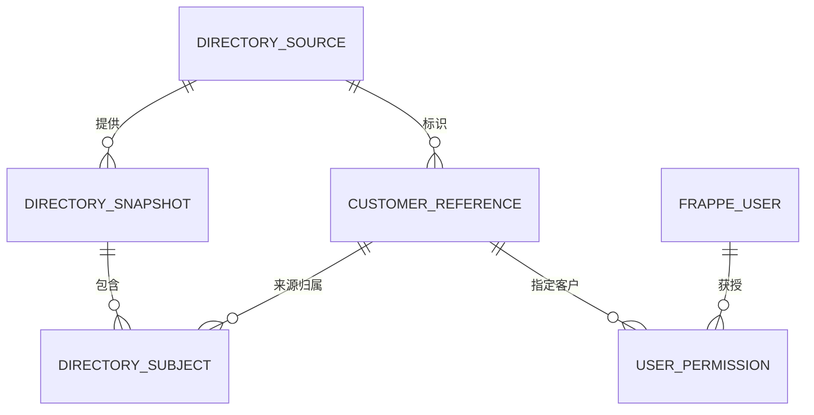
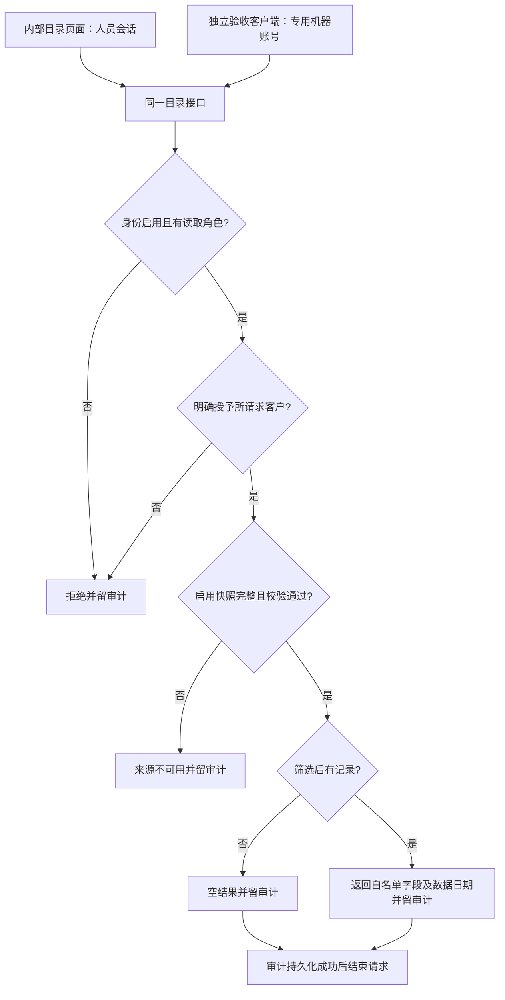
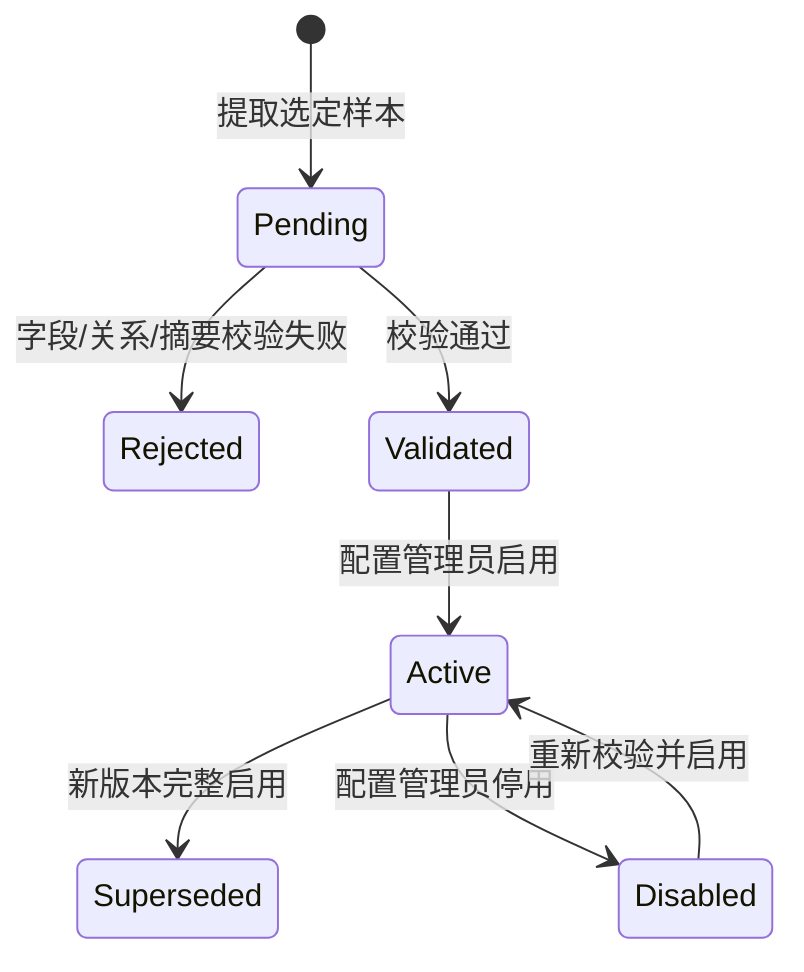
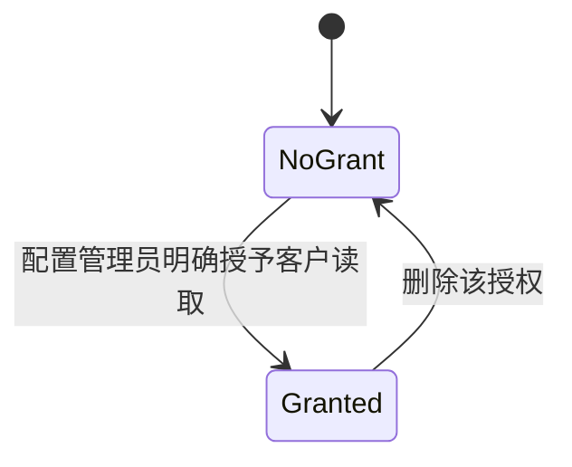

# 受控目录：模型审阅图

对应[已确认最小模型](directory-model.md)，关系与规则按 D-007—D-009 获接受，尚未实现为已安装的表或已签发的授权。真实样本详见私有 S-01；以下 S-01 的登记客户、交付客户、优化对象均有实际来源 ID。

## 1. 结构及真实路径

这是概念图，不代表六张新表。User、User Permission 复用 Frappe；客户引用是新增 DocType；来源配置、不可变文件和对象返回结构不强制建独立业务表。角色能力还须同时满足。

真实关系：S-01 登记客户 → 历史上下文合同 → S-01 交付客户 → S-01 优化对象。首版仅截取其中的客户身份及对象关系；上下文合同日期为人工补录，不能解释为履约期。

拟定验收操作：测试读者取得“交付客户”的明确授权后，查询到该优化对象；仅取得“登记客户”授权的另一测试读者，直接访问交付客户必须被拒绝。两名测试读者及其授权尚未创建，真实关系本身不授予他们权限。

## 2. 端到端路径

下图的目录判定从框架认证通过、进入目录方法后开始；之前即被框架拒绝的无效凭证等请求依赖框架日志，未进入业务方法就不会有该方法的 Integration Request。方法内仍复核当前身份状态，以处理认证后发生的停用等变化。

详情越权与不存在不区分；不返回范围外上级 ID。审计基础设施失败时不放行读取，返回请求失败；界面不能将故障显示为零对象。

## 3. 生命周期

快照状态是拟采用的流程状态，不是新增的客户业务状态。

| 状态 | 含义 | 谁能改变 |
|---|---|---|
| Pending / Rejected | 尚不可读 / 本次校验拒绝 | 导入校验流程；修正后作为新候选版本 |
| Validated | 已校验但未启用 | 配置管理员启用 |
| Active | 本来源当前可读版本，最多一个 | 配置管理员停用或切换 |
| Disabled / Superseded | 不再提供新请求读取 | Disabled 重新校验后可启用；Superseded 仅作历史证据 |

NoGrant / Granted 表示原生授权记录不存在/存在，不另造状态列。角色撤销、用户停用、来源停用也会使请求失去有效权限，但不自动删除客户引用。撤权完成后开始的新请求重新判定；不依赖浏览器隐藏入口或过期缓存。

## 4. 首版边界

这条路径证明一个真实客户—对象关系能被共同识别、受控读取和复查；不证明完整真实服务链、当前生产数据、真实员工生产权限、SSO 或多人应用代办已完成。后续按整体规划分别补齐这些能力。
