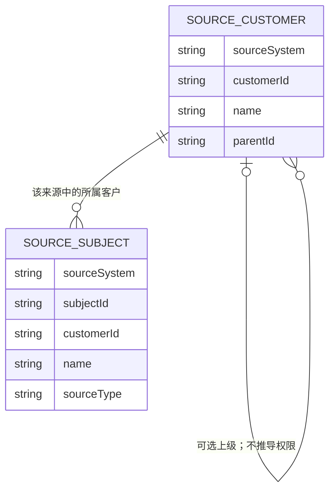
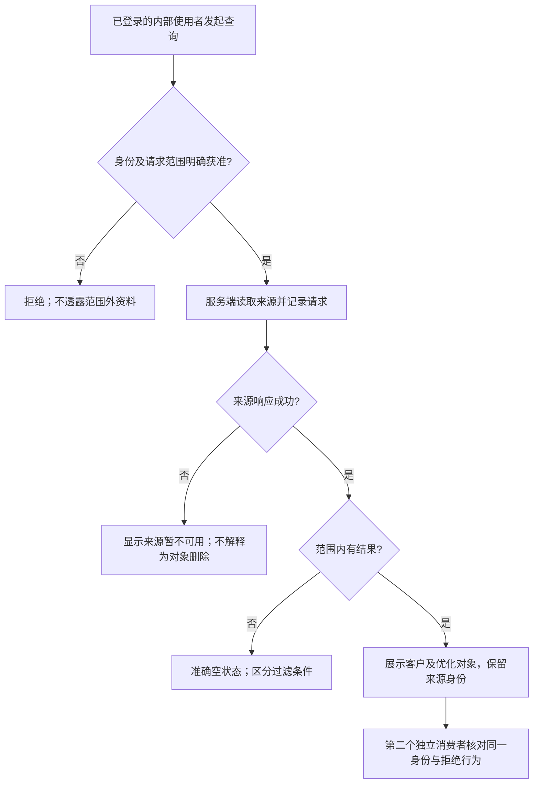

# 下一行动：验证客户与优化对象的受控查询

日期：2026-11-18。状态：首轮取证记录；据此形成的[最小模型](../../business/directory-model.md)与[清单 3](../sheets/decision-sheet-03.md)已由 D-007—D-009 获批。整体目标及发布标准沿用 D-003、D-004。下文保留最初取证过程；当前采用明确日期的本地真实快照版本。

## 希望先交付的结果

建议让内部使用者从一个真实客户进入其优化对象，看到同一来源身份；第二个独立消费者用相同契约得到一致结果。把可读、拒绝、空数据、来源故障都验证清楚。完整服务、采样和交付追溯继续按整体依赖推进。

推断：目录查询比“完整服务详情”更适合作为第一个候选，因为已有代码提供客户与对象查询，而已核验的通用目录接口不提供完整合同、服务周期和人员权限。首个目录版本只是整体成果的前置增量，不能替代 D-003 要求的真实服务链验证。

## 已核实事实及边界

| 项目 | 当前证据 | 对下一行动的影响 |
|---|---|---|
| 真实客户—对象关联 | E-07 找到历史生产导入的真实来源 ID、登记客户、交付客户及对象关联 | 可以核对身份；记录保留在私有证据中，不复制客户资料到公开仓库 |
| 服务时间 | 样本的上下文日期是人工补录，明确不是合同日期 | 不能展示成真实服务周期，不能据此推导在服、履约或授权 |
| 通用对象接口 | 旧文档排除未分类对象，当前源码已允许；字段范围也有差异 | 固定实际契约版本后再接入，不能只照旧文档生成客户端 |
| 来源系统授权 | 当前源码包含接入方能力与显式客户范围；历史浏览器验收有拒绝记录 | 不能据历史记录认定今天的 BizBase 用户已有权限；层级关系不是授权证据 |
| 当前在线接入 | 未验证部署版本、有效接入方、真实响应及当前成员 | 这些属于取证任务，不向用户询问代码本身能回答的事实 |
| 本地开发环境 | E-08 证明运行中的应用容器没有源码挂载，尚未安装自研 App | 需要持久化开发源码与可重复构建；不能在运行容器内临时编辑后声称交付 |

## 需要用样本核对的最小关系

下图是来源关系的概念图，包含拟议的命名空间和字段别名，不是实际 schema 或已确认接口：`sourceSystem` 是建议附加的来源标识，`sourceType` 是来源类型字段的概念别名，其余 ID 也用接口语义表达。已观察到的客户—对象关系不代表所有业务线都必须采用同一结构；详细字段、真实行及当前结构对照见私有 E-07 样本。

已确认的首版原则见 D-007：保留来源命名空间和稳定 ID，不按名称合并；来源中的客户、ERPNext 客户、签约方、被服务组织不自动等同；对象分类未知时保持未知。首版由来源维护资料；未来是否建立全局身份或迁移修改责任，不因读通目录而确定。

## 建议验证的使用路径

这是最初建议的实时验收路径，未签发真实新权限。“来源接口能返回”不代表调用人员能读取。新增[模型视图](../../business/directory-model-views.md)已补授权生命周期，并区分本地拟定测试授权与现有实际权限；清单 3 建议先以快照验证业务读取，未来实时模式仍须核对上游范围。

## 下一行动及完成证据

1. 已固定历史真实样本并核对当前源码的范围/字段差异；当前在线凭证与响应仍未知，实时接入不得以代码证据替代。
2. 已核对本地身份、原生权限缺省和分享路径；本地没有客户引用授权实例，拟建立隔离验收身份，允许/拒绝输入见[第 01 轮正式验收](../rounds/01/acceptance.md)。
3. 最小模型、状态图和清单 3 已获确认，进入正式实施准备；整体规划及已接受的三项不再询问。
4. 模型门槛通过后建立正式实施轮；readback 确认后依次完成模型、可点击原型、只读服务和验收镜像。现有文章回链及实时接口保留后续候选。

复用方向：Frappe 的现有身份、标准页面及权限机制；既有目录读取服务；单独放入 Git 的自研 App 源码。具体技术方式由实施 readback 对照实际版本说明，当前未运行安装、迁移或生产写入。
