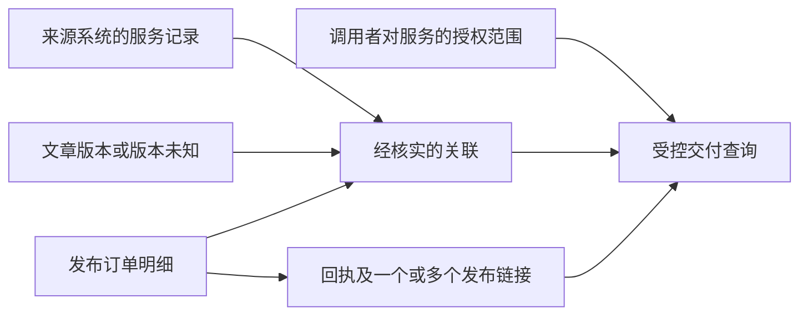
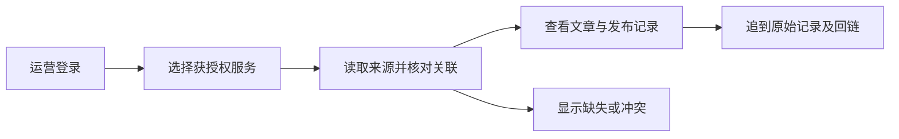
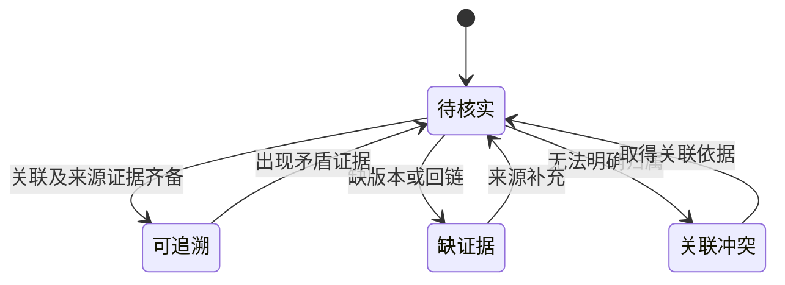

# 候选切片：服务已发文章与回链查询

状态：保留研究，尚未选定为首个实施轮次。依据 [E-01、E-02、E-03](../evidence.md)；D-002 要求先完成[整体规划](../../planning/natural-plan.md)。下文的首轮比较保留此前推理，不构成当前顺序或验收结果。

## 可亲手核验的结果

获授权运营选择一个服务，能回答：有哪些文章、哪个版本、在哪个平台发布、回链和凭证在哪里，哪些材料仍缺失。用户此前明确说过无法完整向客户提供已发文章清单。

推断：这条路径能同时验证对象关联、权限和交付追溯，业务价值比单独展示客户目录更直观，范围小于完整 GEO 与经营链。

| 比较过的路径 | 收益 | 首轮代价或缺口 | 建议 |
|---|---|---|---|
| 完整客户/合同/服务主库 | 长期统一对象 | 写入归属和当前使用仍未知，易先迁移后返工 | 按切片逐步决定 |
| 只做客户目录 API | 稳定 ID 与部分权限 | 用户还看不到交付痛点被解决 | 嵌入本轮必要关联 |
| 文章与回链查询 | 直接核验实际交付 | 需要真实记录、映射及授权 | 实施候选，顺序未定 |
| 完整监测—分析—内容—财务链 | 价值广 | 指标、暂停、成本、分成尚未确定 | 后续切片 |

## 候选关联图

表示需核验的关系，不决定新表、全局主键或关系基数。正式 ER 图需真实样本与 schema 对照。

## 候选用户路径

## 证据状态草案

查询证据状态不替代供应商订单状态或合同验收结果。

## 真实例子与缺口

用户的“宜山自营获客”是业务案例；SOP 的“首轮投放完成回执”是实际模板行。二者均不是已读取的一组订单，不能拼造客户 ID、文章或 URL。完整真实数据路径目前未知；本图不能用于确认完整领域模型。

## 验收草案

| 场景 | 动作 | 预期；实际输入仍需核验 |
|---|---|---|
| 正常 | 选择真实服务，展开发布明细 | 文章版本、平台、原始记录、回链可追溯；实际 ID 尚未取得 |
| 空状态 | 查询有效服务但期间内无发布记录 | 明确“暂无发布记录”，不展示演示文章 |
| 缺失 | 来源标为已发布但无回链/版本 | 同时显示来源状态和缺失项，不补造 URL 或默认最新稿 |
| 来源失败 | 对已授权来源触发可控读取失败 | 显示失败或带时间的旧快照，不显示为零条 |
| 权限 | 无授权身份请求列表、详情、导出 | 服务端拒绝，不泄漏文章或链接 |
| 关联冲突 | 同名服务但身份依据不足 | 保留冲突，不按名称自动合并 |

目标：至少一条真实“服务—文章版本—发布明细—回链”完整可追溯；选定样本的其余记录均有来源或明确缺口；未授权测试全部拒绝。若全部缺关联，只算完成缺口诊断，不能宣布交付路径验证成功。这些是待验证目标，没有实测结果。真实样本与工作量核实后才填写正式轮次的时间预算和验收输入。

## 复用与切分

- 模型：复用既有服务、文章、订单身份，只补必要引用与授权关系；新增表在模型确认时决定。
- 页面：先评估 Frappe 标准列表、详情和报表；可点击样例只放在明确 prototype 范围。
- 逻辑：优先接既有查询接口；新增只读适配与服务范围校验需说明现有能力缺口。
- 本轮暂不发文、不改源记录、不迁客户主库、不重算 Top、不做费用分摊或分成；见 backlog。
