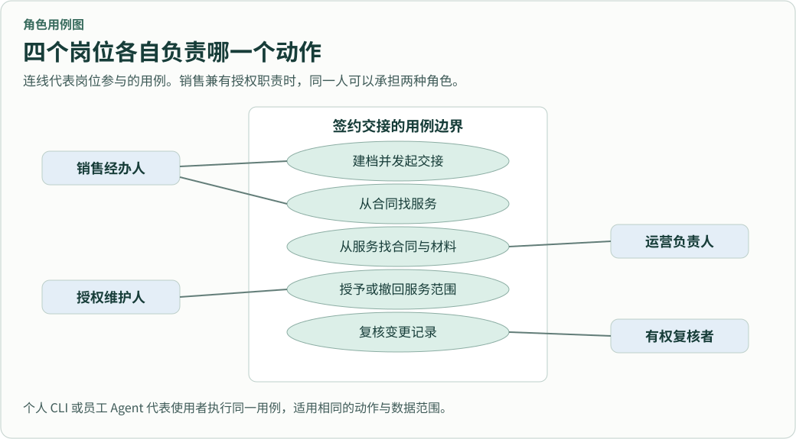
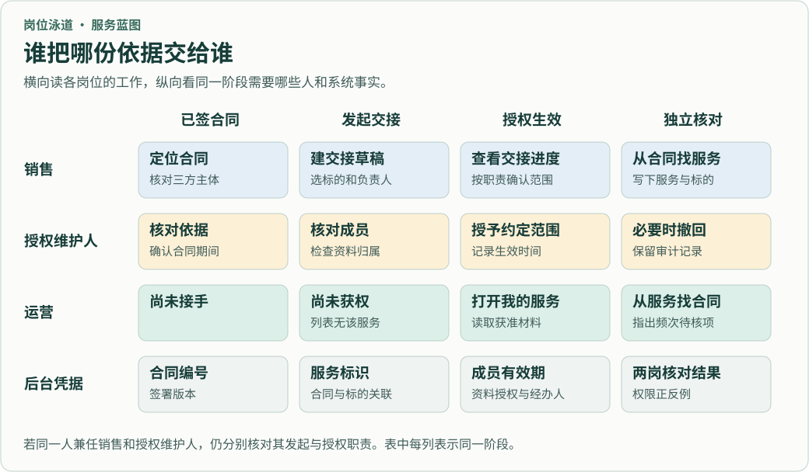
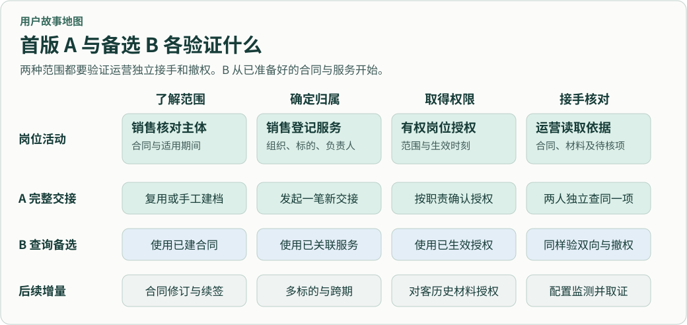
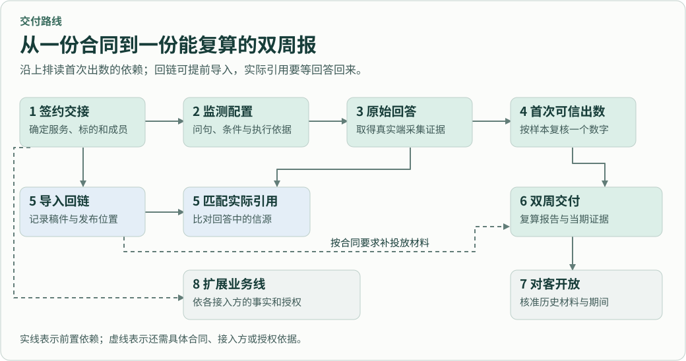
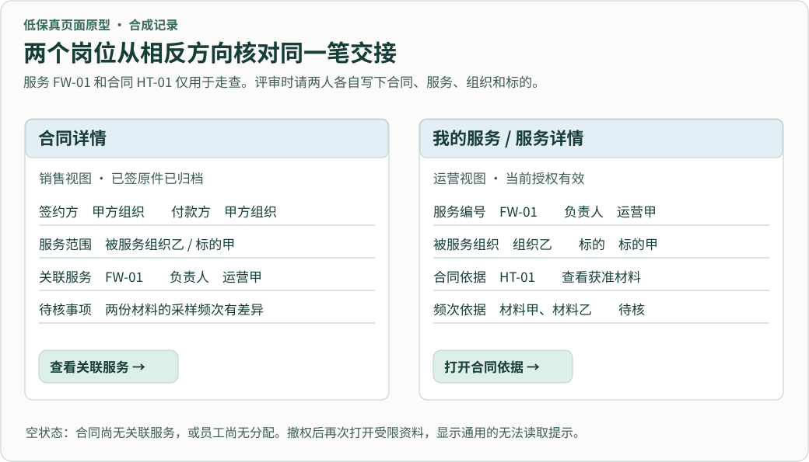
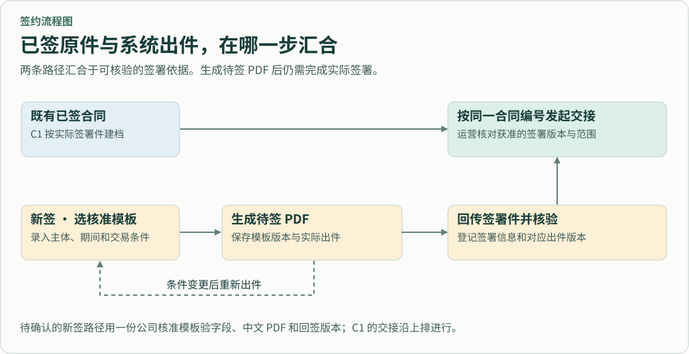

# 第四步评审 · 从签约交接到首次可信出数

2026-11-19，供销售、运营、产品负责人共同评审。建议保留交付地图的八项结果，首版用一份 C1 合同完成从销售发起到运营接手的完整交接（A）。若普通账号已能验证查询和隔离，但写入职责或预览环境仍限制交接，则单独交付授权查询（B）。首个业务里程碑仍是运营能解释一个问句在一个平台的数字。[交付地图](delivery-map.md) · [成果与原则](natural-plan.md) · [业务决定](../cycle/decisions.md#d-017-第一轮从签约后的服务流程开始2026-11-18用户明确指令)

## 谁遇到什么问题

| 岗位与触发时机（JTBD） | 要完成的判断 | 现有证据及其限制 |
|---|---|---|
| 销售刚签完合同，要把我方负责的标段交给运营 | 谁接手，服务的是哪个组织、哪个标的；日后从合同还能找到这笔服务 | C1 有标段和范围材料。两份材料对频次的描述有差异，不能任选其一填成已确认条款。 |
| 运营首次接手，原销售不在场 | 仅凭自己的入口指出合同、标的、有效资料和未决事项，据此判断下一步能做什么 | D-018、D-019 明确多方关系、服务负责人及资料版本。能否独立找到这些信息，还需岗位走查。 |
| 销售收到客户对双周报的质疑 | 找回当期范围、分子、分母和参与计算的回答；解释两个版本为什么不同 | G4–G6 定义复核标准。竞品对能见度、排名的命名和计算各异，合同口径须回到原文。 |

证据主要来自业务决定、合同材料的脱敏摘要、既有 SOP 和厂商调研。尚无本轮一线岗位访谈或任务耗时实测。运营手册用于发现可能遗漏的动作；每笔服务的完成事实须另有凭据。[六轮业务问答](opportunities.md#六轮自问自答) · [证据及反证](../cycle/evidence.md) · [厂商流程研究](../research/2026-11-17-geo-vendor-workflows.md)

## 用户旅程与服务蓝图

| 旅程 | 岗位眼前的任务 | 背后由谁提供什么 | 最容易误判的情况 |
|---|---|---|---|
| 交接 | 销售从合同找服务，运营反向找合同、组织和标的 | ERPNext 保存客户与合同，GEO 记录服务和成员，BizBase 限定可读客户资料 | 同集团另一个产品被带入，或合同已建就以为运营已经接到 |
| 配置、采样 | 运营按有依据的频次排计划，设备按约定条件交回回答 | 运营维护问句和口径，设备维护方提供真实端回传，服务分别记录采用哪些样本 | 两个计划可以共享一次回答，却不能因此各多算一次；漏采须可见 |
| 解释、复盘 | 运营从数字找证据，销售按双周报版本复核 | 分析保留方法及名单版本；外部发文系统提供稿件与回链；报告引用当期材料 | 把拒答当未提及，或用新口径改写已交付报告 |

## 故事地图与优先级

| 交付切片 | 本次必须贯通的故事 | 排在这里的理由 |
|---|---|---|
| 1 · 首选 A，完成新交接 | 手工建档或复用 Customer、Contract，按 C1 合同范围创建服务草稿并指定负责人。授权生效后，销售从合同查服务，运营从服务查合同。随后用 C2 复走普通合同流程。 | 双方独立指出同一合同、组织和标的，才能证明交接完整。只取一项服务、一个标的即可检验这个判断。 |
| 1 · 备选 B，查到已交接服务 | 有权人员预置 C1 合同、服务、标的和授权；运营从自己的入口找回资料。交叉和撤权验证随首版执行。 | 若写入受阻，可先验证数据归属与隔离。单列资料准备工时，保留销售发起交接的验收项。 |
| 2 → 3 → 4 · 首次可信出数 | 运营给一个标的配置问句和计划，取得真实设备样本，在看板核对一个问句×平台的分子、分母、原文，再补齐第二个平台与反例。 | 这是最短的测量链。模拟端可提前验证契约；真实端联调、部分共享与样本隔离仍须按队列原验收。 |
| 5 与 6 · 发文回链及双周交付 | 确定服务归属后可并行导入回链。第 6 项使用当期出数与合同要求的投放材料，反向复算一次。 | 回链导入不占首次出数的前置位置。正式报告是否需要回链，取决于该合同。 |
| 7 与 8 · 对客开放及其他业务线 | 首版保留授权依据，后续再开放客户侧管理、跨期组合和独立业务应用 | 当前受益人是内部岗位。对客开放需要真实授权，扩展业务线需有实际使用方。 |

排序依据是业务价值、依赖和判断错误后的返工范围。覆盖人数、当前交接耗时和各项开发工时尚无实测，因此不计算 RICE 分数。条款核实、设备联调和回链收集均可独立准备。[八项队列及完整验收](delivery-map.md#交付队列与依赖)

## 首版需求、职责与验收例子

**交接后的入口和输出。** 销售打开自己有权查看的合同，找到关联服务；运营打开“我的服务”，看到同一服务标识、合同、被服务组织、优化标的、负责人和获准读取的材料。无关联服务时销售看到待交接；运营尚无分配时看到空列表。每个本版开放的读取动作在后台、API、CLI 和员工 Agent 上遵循同一范围。客户主档、联系人、地址及附件各按实际授权范围读取。[G1、G7、G9](natural-plan.md#第二步完成后是什么样)

**完整交接 的写入边界。** 既有用例 UC-01、UC-04、Q-29 建议销售建档、建服务草稿并指定运营负责人，由负责人配置履约。这里把这个分工作为候选规则：“销售只读”适用于后续履约配置。合同提交、修订、作废及更广的主数据写权须按实际职责单独核对。运营查到服务可用作交接验收证据；是否另需签收或审批，由真实工作要求决定。[已有用例与权限矩阵](../business/2026-11-18-service-v1/04-use-cases-flows-permissions.md)

| 给定 | 当岗位执行 | 可观察的通过条件 |
|---|---|---|
| C1 合同与一项有明确归属的服务，销售与运营均为有效成员 | 两人分别从合同、服务起步，不提示编号，各自写下合同、服务、组织、标的 | 四项逐一相同，能打开各自获准的当期依据。同一员工换入口，结果一致。 |
| 同一客户另有一项未授给该成员的服务，另设有授权的对照账号 | 从列表、关联选择、联系人、地址、附件、导出或此前保存的链接读取 | 有权账号取得约定资料；无权账号无法读取另一服务专属资料。撤权后再次读取按新范围生效，仍有独立授权的资料继续可见。 |
| C1 的两份频次材料有差异 | 运营找出两份依据并说明当前可执行事项 | 可完成建档与计划草拟；有明确执行依据时可按其执行。考核与结算各自保留待核项。 |
| C2 按普通客户签约，销售已选定被服务组织、标的和负责人 | 销售完成 完整交接，再由运营独立接手；销售尝试更改履约配置 | C2 也能完成双向核对。销售写入留有经办人及入口，履约修改按角色拒绝。 |

## 原型走查、成功指标与决策

[签约交接可操作原型](handoff-prototype.html)用合成资料演示双向核对、频次冲突和撤权后重开旧链接。原型中的评审者能看到案例全貌，岗位按钮给出该次操作的结果。页面内的权限演示只用于讨论规则，真实权限验收须使用普通账号和实际服务端入口。

**岗位走查脚本。** 请销售用一笔近期交接说明“交给了谁、交了哪个标段、当时把什么发给了对方”；请运营在看不到销售答案的情况下找合同、标的、依据和一项待核实问题。记录第一次选错的入口、重复录入的字段、求助原因及完成时间。若两人查到不同标的，先定位关系或显示用语的问题，再扩到 C2。若业务要求接收人必须签收，记录谁签、何时生效、例外如何处理，再调整 完整交接。此脚本待真实岗位执行。

| 要判断什么 | 如何度量 | 怎么使用结果 |
|---|---|---|
| 交接是否准确 | 按案例记录两岗是否独立核对一致、哪一项不一致、向原经办人追问几次 | C1 和 C2 分列。归属对不上或发生越权即该案例验收失败。 |
| 是否省了人力 | 现行与新流程各记销售准备、运营查找的人工分钟；从签约到首次可信出数另记日历时长 | 记录服务规模、是否已有主档和外部等待。当前基线未知，首次采样后再讨论改善目标。 |
| 数字是否可复核 | 在同一服务、版本和期间从报告反算一项指标，记录能否对上分子、分母、原文及耗时 | 对不上时定位样本、口径或版本；单独记录等设备、等材料所花时间。 |

**评审结论。** 首选 A，按 C1 的已签材料完成新交接；预检发现写入职责或环境确实受阻时，再采用 B 验收查询。销售建交接草稿，运营获权后负责履约配置。首版验收项和切换条件见[签约交接 PRD](../ways-of-work/plan/geo-service-delivery/contract-handoff/prd.md)。第四步待产品负责人确认。角色授权、岗位独立完成任务的能力和耗时均待实测；第五步启动后按交付地图逐项取得证据。

## 待确认 · 由系统生成制式合同

**合同归 ERPNext。** 销售可以直接从 ERPNext 的 CRM 模块创建合同。若以后从独立 Frappe CRM 的商机进入，也应关联同一份 ERPNext 合同。GEO 运营从签后履约开始，按授权关联合同、配置服务和交付。合同归属已由 D-033 确定，本节待评审的是首版是否覆盖模板出件。

销售选择公司批准的 GEO 服务合同模板，确认签约主体、付款方、被服务组织、服务期、标的、金额与服务范围。系统用这份 `Contract` 的字段生成待签正文和 PDF。签署完成后，有权岗位在原合同记录登记签署结果、归档签署件，再把同一个合同编号交给运营。运营核对服务范围和各自获准的材料，后续按约定服务期执行。

| 环节 | 原生能力与待补工作 |
|---|---|
| 选择模板并出件 | ERPNext `Contract Template` 可将合同字段填入正文，Frappe `Print Format` 负责版式和 PDF。GEO 所需的三方主体、金额与服务范围按实际模板核对字段，确保打印和履约读取同一份值。 |
| 留存对客版本 | 记录所用模板版本并保留实际发出的 PDF。更新模板后仍能找回原发出版本；重新出件要能区分版本。 |
| 签署并交接 | 首版可沿用现有签署方式，签回后在同一份合同归档。生成 PDF、确认签署和交接分别记录。外部电子签约服务属于独立可选能力。 |
| 处理已签历史合同 | 对 C1 等已在外部签署的合同，使用实际签署件作为交接依据。新签合同可用公司制式模板验证系统出件。 |

**可行性核查。** 原 8080 预览的 ERPNext 16.55.0 已装 `Contract Template` 与 `Print Format`。用合成数据在内存验证了客户名称和服务期填充，以及 PDF 生成，站点业务记录没有写入。当前镜像未查到可用于中文的字体，样张未提取到中文标题；正式中文模板需配置字体并验证正文、附件、分页和打印版式。[ERPNext 合同模板](https://docs.frappe.io/erpnext/contract) · [ERPNext 打印格式](https://docs.frappe.io/erpnext/records-print-format)

**对首版的取舍。** 若把系统出件纳入首版，第 1 项的起点由已签合同前移到生成待签 PDF。建议先选一份公司已批准的模板，走查从字段填充、预览出件到签回归档和运营接手。其中金额、期限与服务范围在合同记录、PDF 和获授权运营看到的履约依据中应一致。模板版本变化也要用一份历史出件回归。
