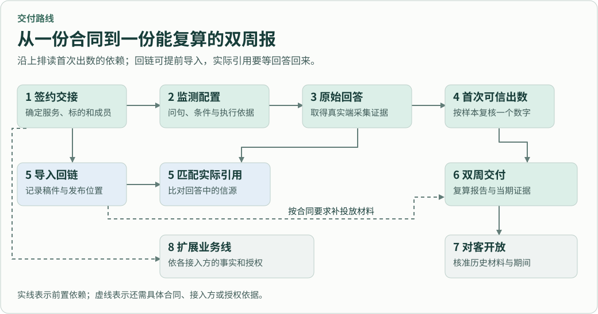

# 第四步：组织与版本交付

2026-11-19 · 项目级交付地图，供评审。签约后服务优先（D-017），客户和合同采用官方 ERPNext（D-033）。先让运营从一份已签合同走到首次可信出数，再让销售从一份双周报中的数字反查同一批证据。下列顺序是可调整的实施建议；每项都写明可以交给谁使用、如何判断完成。[第二步成果画面](natural-plan.md#第二步完成后是什么样) · [第三步六轮问答](opportunities.md#六轮自问自答)

首版建议以 C1 完成一次销售到运营的真实交接（A）。若首个版本只能预置合同与服务关联，则先验收授权查询（B），销售发起交接仍待下一版验证。详见[第四步产品评审](delivery-map-review.md)、[签约交接 PRD](../ways-of-work/plan/geo-service-delivery/contract-handoff/prd.md)和[可操作走查原型](handoff-prototype.html)。

## 交付队列与依赖

编号用于引用工作，前置列表示实际依赖。一个结果可拆成多个可用版本，尤其是移动端联调、跨服务复用和跨期比较。

| 顺序 | 谁能多完成一件什么事 | 依赖 | 验收证据 |
|---|---|---|---|
| 1 · 签约交接 | 销售向运营交接同一份已签合同。新签业务建议从系统模板出合同，历史已签或客户提供的合同可直接建档。获授权运营能找到服务、被服务组织及标的。 | 现有 8080 预览、ERPNext、可用案例资料 | 见下方首个行动。用两个普通员工账号从不同入口核对同一服务和可见范围。G1、G7、G9 |
| 2 · 监测配置 | 运营保留客户资料版本，为标的配置问句、竞品及别名、考核依据和第一份可执行监测计划。 | 1 的服务身份和权限 | C1、C2 各按普通合同流程配置。问句只去首尾空白；展示分组不派发任务。核对平台、端、全部采样参数、次数、间隔和分布。待确认的规则保留来源。G1、G3 |
| 3 · 首批原始回答 | 外部移动端能领取任务、回传原文、信源及约定证据；运营能查到计划的实采和缺口。 | 2 的有效计划；真实联调需设备维护方配合 | 先用模拟端核对契约，再分别用 DeepSeek、豆包 APP 跑通。重传只计一次，过期租约可重领；采集凭证只读执行所需字段。用合成重叠计划另验部分共享、分服务计数和使用方隔离。G2、G7、G10 |
| 4 · 首次可信出数 | 运营在看板上找到需处理的问句，能解释一个问句在一个平台的能见度、前三提及率和考核状态。 | 2 的适用口径、3 的获准样本 | 从分子、分母两次点击回到样本和原文。按名单及方法版本核对排名，测试并列、拒答及组合条件。漏采、待分析和确实未提及分别可查。G1、G3、G4 |
| 5 · 发文回链 | 运营导入稿件及回链；有采样证据时，可追到实际引用该发布位置的回答。 | 导入只依赖 1 的归属及外部发布记录；匹配实际引用需要 3 | 一稿两处发布、重复导入、仅一处被引，三种事实分别可核对；原始 URL、跳转和失效记录各自保留。费用未知时保留未知。G8、G13 |
| 6 · 双周交付 | 销售与报告 Agent 能按同一服务、期间和版本取数；运营能交付带解读、缺口、下期安排与原始凭据的报告。 | 4；客户约定的稿件与投放部分取自 5 | 同一指标经看板、报告和导出复算一致。换词、暂停、口径变化在时间线上可见；迟到证据或改判追加修订，已交付版本可还原。缺材料时可出有说明的草稿，正式交付按合同核齐。G5、G6、G9、G10 |
| 7 · 对客开放与跨期授权 | 各组织管理员可管理本组织成员；获准者可查看指定产品的旧期或组合视图。 | 1 的授权模型、4 的指标、6 的材料版本；对客开放需要实际授权范围 | 用渠道、终端、集团及子公司的普通账号验收续约、转直签与撤权；列表、组合分母、旧链接、附件和导出同步收窄。跨期可比范围另列。G11、G12 |
| 8 · 扩展业务线 | 独立应用沿用同一客户、合同和授权，逐步衔接售前、内容执行与经营核对。 | 对应业务的已验证接口、事实与授权 | 用一个实际消费者核对同一业务事实；订单、费用和退款有凭据，分摊与分成取得真实规则后再计算。G13 |

**能并行的工作。** 服务归属明确后，回链导入可以与监测配置并行。采集接口的字段与样例确定后，外部设备适配与内部分析口径走查可以并行；模拟回答用于开发，真实设备回答用于联调验收。正式报告需要的回链资料可以提前收集。报告 Agent 与看板共用同一取数契约。真实身份登录和目标 RDS 的验收分别随其环境就绪推进，8080 本地服务流程可先用受限测试账号验证。

## 第五步的首个行动

**在原 8080 预览中，从 C1 的一份已签合同交接一项服务。** 选 C1 是因为能够用外部客户的标段和服务范围核对交接；随后用 C2 检验同一流程能否复用。真实资料仅进入获准的本地预览和私有目录，版本记录使用代号。

1. 开工先读取 `frontend` 的实际安装清单，核对 ERPNext 的 Customer、Contract 和普通账号权限。用现有界面手工建档或复用已有记录，记录签约方、付款方、被服务组织、合同期间和原始依据。频次条款有差异时并列保存依据。
2. 让运营从其服务入口看到同一合同、一个优化标的、负责人及其可读资料；销售从合同能找回该服务。优先复用 Desk 和 Build。只补足完成交接所需的服务关联与授权。
3. 在 `http://127.0.0.1:8080` 用普通账号走查。后台、API、CLI 和配套 Agent 入口读取相同服务标识；本次开放的写操作服从同一授权并留审计。用另一服务的普通成员验证无法读取该项服务及其联系人、地址和私有附件；撤权后旧入口也不能重新读取。用有授权的成员作正向对照。

可验收的第一个结果是销售交出了哪项服务、运营接到了哪项服务，双方独立查出的合同和标的一致。进入第五步时先补本项的关系图、交接时序、权限和验收例子，再核对实际预览。若完整交接超过一次交付的容量，第一版可先交付“获授权的运营从一份已建合同查到自己的服务和标的”，下一版补录入与交接；读取隔离与跨入口核对仍随首版交付。

## 随业务动作落实的共同要求

| 工作归属 | 从哪里开始验证 |
|---|---|
| ERPNext 与 BizBase | ERPNext 承载客户与合同，Frappe 提供身份和角色，BizBase 统一跨应用的客户资料授权。第 1 项用实际 GEO 角色验证关联资料的服务端归属、授权与撤权。数据库兼容修复归所属上游组件。 |
| GEO 运营与外部系统 | GEO 管理服务成员、监测、分析、考核和交付。设备执行采集，发文系统提供稿件与回链。程序分别使用限定能力的凭证；代表员工操作的 Agent 沿用该员工权限。 |
| 审批、防错与审计 | 建档即做服务端校验；批量换词先看影响范围，重复提交只生效一次。向新组织扩大旧期材料范围时先审批，记录申请人、批准人、改前改后范围和生效时间。相应动作首次出现就验收。 |
| 性能、恢复与版本记录（G14） | 首次出数测代表性数据量下的列表、看板和取证耗时；批量导出时测设备领任务延迟与积压。恢复演练对照同一报告、原始附件和授权。每个版本记录入口、验收结果、限制及回退办法。 |

## 哪些事项要等实际依据

- C1 的执行频次和结算拆分由业务按原始材料核实。可先建档、起草计划、按明确的执行依据采样；未确认的结算口径保留待定。C2 也使用正常合同和考核流程。
- 客户登录、自管及组合界面在后续开放。服务授权、人员交接与撤权从第 1 项进入模型。员工真实单点登录需移山 ID 配置就绪。
- 目标 RDS 在获准的空白测试库上验部署、迁移和恢复，再进入生产启用判断。生产发布、生产数据迁移、权限扩大、付费投放及写入他人系统仍依 D-004 另行授权。[PG 本地实测与 RDS 验收范围](../research/2026-11-18-erpnext-on-postgres.md)

前四步确认后，按[第五步循环](natural-plan.md#第五步之后如何循环)取最靠前且前置已满足的一个结果。争取每天交付一个在约定预览可操作、已通过验收的版本。被外部条件阻塞时记录阻塞及影响，继续可独立验收的工作；每轮以实际使用和复盘调整后续队列。
