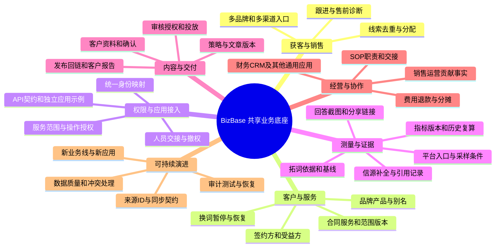

# 第三步：机会图与假设

这是 D-003 接受的头脑风暴池，不是已承诺开发清单。来源：用户业务说明与 SOP、[证据目录](../cycle/evidence.md)、既有能力盘点；节点是候选方向，不能解读为全部缺失。

## 同一问题的不同解法

| 问题 | 可以考虑的解法 | 现在不直接下结论的原因 |
|---|---|---|
| 客户记录对不上 | 来源 ID 映射；共同实体登记；选定主档后迁移 | 同名不等于同对象，实际使用和写入归属未核实 |
| 页面各自重复开发 | 标准管理页；复用现有工作台；独立前端接 API | 功能重复可接受，应看岗位收益和接入成本 |
| 权限不一致 | 既有身份服务配领域授权；复用应用网关；在数据服务层统一校验 | 单点登录和应用凭据不能独自表达客户范围 |
| 内容与回链割裂 | 适配现成接口；来源投影；缺口处补业务记录 | 必须先验证真实订单、文章版本和授权链 |
| 数据集中与扩展 | Frappe 持有共享业务模型；专业系统持有执行事实；按领域逐步调整 | 统一语义不要求先把全部数据搬进同一数据库 |

## 需要验证、允许推翻的假设

1. 共用服务身份和权限能明显降低跨应用接入成本；用两个实际消费者验证。
2. 当前最有价值的切片可能是服务目录、文章回链、或 SOP 交付确认；用数据可用性和业务收益比较，不按仓库体量决定。
3. 既有 App 和代码能省开发工作；需要验证接口、维护成本与当前部署，不能只数已有功能。
4. 探针表现、发布完成、被引用和成交是不同事实；目标之间的因果关系需要实际观察。
5. 清晰规划能减少反复，但无法自动消除未知数据、系统依赖或错误假设；每轮用验收和反馈校正行动。

候选及暂缓项进入 backlog；未来新增想法先入队，日常只选择当前下一步，不重做整张机会图。
