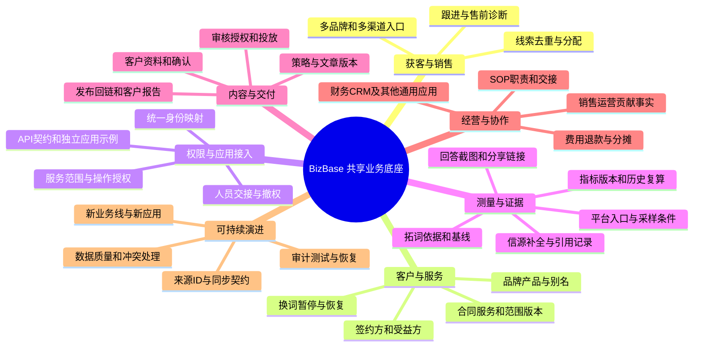

# 第三步：机会图与假设

**第三步已完成（2026-11-19）。** 围绕一次签约后服务做了六轮问答。前两轮沿业务正向和逆向找机会，后四轮用反例检视数据、权限、经营价值和可运行性。下文保留备选做法及判别依据，供第四步组织。依据为 D-003 以来的业务决定、[成果画面](natural-plan.md#第二步完成后是什么样)与[证据目录](../cycle/evidence.md)。

## 从一次真实服务展开（2026-11-19）

用 [G1–G14 的成果画面](natural-plan.md#第二步完成后是什么样)检视下列候选。签约后服务优先，C1 与 C2 都走正常合同流程。这里收集可比较的做法，第四步再组织依赖和交付顺序。

| 业务人员要回答的问题 | 可以尝试的做法 | 用什么辨别是否有用 |
|---|---|---|
| 销售交给运营的究竟是哪一项服务？ | 从 ERPNext 合同打开签约方、付款方、被服务组织和标的；也可让运营从自己的服务清单反查同一份合同。人员交接可以约定共同参与的起止时间。 | 双方从各自入口找到同一合同、标的与资料版本；交接结束后旧成员的读取范围随授权收窄。 |
| 今天哪些问句需要运营介入？ | 按问句和平台列出应采、实采、有效、已分析；从漏采或待分析直接追到对应任务，从真实未提及追到回答。 | 同一问句在两个平台分别漏采和未提及时，运营能分别找对原因；过期样本显示真实日期。 |
| 哪些任务可以少采一次？ | 将外部设备收到的任务和各服务自己的采样需求分别记录；用合成的重叠问句比较完全兼容、部分兼容和互不兼容的计划。 | 核对两份计划各自的独立样本数、时段与分布。共享只减少设备执行次数，各服务的分母和可见范围均可复核。 |
| 客户质疑双周报里的一个数，销售怎样答复？ | 从交付版本直接打开采用的样本；也可让授权的报告 Agent 按同一版本取数。运营按需追加复核结论及依据。 | 用一条有排名争议的回答对照原判与复核，再加入迟到样本，核对原报告和修订报告各自的分母。 |
| 客户想知道发出的哪篇稿件有了可观察的结果？ | 将外部回链导入与实际回答中的引用关联；同时支持从稿件看发布位置，以及从一条回答反查获准查看的发布记录。 | 用一稿多投、重复回链和部分被引逐项核对。缺少正文或发布归属时保留未知。 |
| 续约、渠道转直签或集团组合看数时，能交给对方哪些历史材料？ | 从新合同发起历史材料申请，预览接收组织、产品、期间、材料；用同一范围提供看板、CLI、附件和导出。 | 用两个组织的普通成员分别试读旧期与新期，撤销一项授权后再对比所有入口。 |

## 六轮自问自答

### 第一轮 · 假设今天接手一个已签客户，运营最先缺什么？

**问**　销售给了合同和问句表，运营就能开始服务吗？

**答**　运营还得知道这一期到底服务哪个组织、哪些标的和问句，用哪份资料，谁能确认变更。可以从 ERPNext 合同生成交接摘要，也可以让运营从“我负责的服务”反查相同资料。用 C1 走查时，销售与运营应各自找出我方承担的标段；用 C2 走查时，内部团队同样能找到合同和考核目标。

**再问**　两份签约材料的采样频次不同，要等全部澄清才开工吗？建档、保存两份原始依据和起草计划可以继续。值得提供两个独立答案：“当前按什么计划执行，有谁确认”和“最终按什么条款考核，有什么凭据”。交接是否有效，就看接手人能否在没有原经办人陪同的情况下找到这两个答案。

### 第二轮 · 假设客户只质疑一个百分比，销售需要什么？

**问**　看板能点到一张截图，是否足够解释双周报？

**答**　还得能找全当期分母。举一个合成例子：某问句在豆包有 12 条可判定样本，8 条进前三；另有 2 条拒答。报告应能解释为什么是 8/12。若复核把其中一条由前三改判为非前三，修订值为 7/12。销售能同时打开两版采用的依据，报告 Agent 用相同授权和版本也能复算两组数。

**再问**　当天漏采、待分析、确实未进前三，都可能让首页看起来没有成果。运营下一步一样吗？三者分别查设备任务、查分析执行、查回答提及和排名。可以用待处理清单，也可以在问句明细直接筛选；比较哪种方式让运营更快找到原因，且不会将昨天的回答当作今天的数据。

### 第三轮 · 假设想节约采集成本，哪种“成功”反而会把数做错？

**问**　同文问句今天在同平台已有五条回答，另一个服务每天只需一条，可以直接取最新一条吗？

**答**　先核对端、联网、思考等全部参数，再核对时窗、独立次数和分布。若该服务约定上午采一次，五条里只有一条合格，就只采用那一条；五条都在下午则仍缺上午样本。用合成的重叠计划对照逐计划独立执行与共享执行，观察设备实际执行次数、各计划缺口、各自分母；同时确认服务成员无法反查其他使用方。

**再问**　下期换了一条词，还能说总体提升了吗？服务总览可以保留整段趋势，并标出换词日。解释变化时另取同问句、同条件、同口径的子集。运营可以分别回答“本期监测范围表现怎样”和“前后可比部分变化多少”；合同如何跨期考核仍取其自身约定。

### 第四轮 · 假设一名运营离开，或终端客户从渠道转为直签，谁还看得到什么？

**问**　管理页收窄权限后，旧报告链接、组合视图和员工自己的 CLI 是否也收窄了？

**答**　值得用同一名普通成员在所有入口查同一个产品和期间，然后撤回其中一项授权，分别复查列表、分母、附件、旧链接和新导出。组织身份沿用；历史所属合同、交接期间、当前可读材料分别表达。高影响的历史开放申请可先预览将新增的期间和材料，再由有权人员批准。

**再问**　已经合法发给客户的文件还能收回吗？系统能阻止再次读取，并记录当时交付了哪一版。已经下载的副本由接收方持有。这个边界决定了向客户导出时就应只包含其获准取得的材料，也决定了交付前预览值得做在什么位置。

### 第五轮 · 假设管理者问“发文的钱花得值吗”，已有证据能回答到哪里？

**问**　一篇稿件投两个站点，两条回链中只有一条出现在本期采样里，能报告什么？

**答**　可以报告一篇稿件、两处发布，以及一处在本服务本期样本中被引用，并指向具体回答。重复导入同一来源行不能再增加发布数。若原行只有一笔总费用，可以保留原金额及凭据，待核实分摊；给每个链接都记全额会把费用翻倍。没有已核实的成交或成本依据时，留下待核项。

**再问**　缺费用和成交数据，怎么先判断系统有没有帮上忙？可在同一项实际服务记录一次手工准备双周报的工时、回复数字质疑的耗时和缺失回链数。上线后以同口径再量一次，连同问句和平台规模呈现。成本、收入及分成在取得真实规则后另算。

### 第六轮 · 假设数据多了十倍、设备中途离线、另一个应用也要接入，哪些做法还能成立？

**问**　采集程序已回传回答却没收到成功响应，同时报告 Agent 在做大批量导出，第二天怎么确认哪里需要补？

**答**　可对照计划需求、设备实际执行和服务采用记录。让设备重发同一次结果，检查分母只增加一次；在导出期间观察领取延迟、队列积压和漏采，再决定是否需要异步导出。用固定样本在恢复演练前后核对报告、原始附件和可读范围。这里提出的是实验，实际容量及性能目标留给实测。

**再问**　第二个应用要复用什么，才能检验 BizBase 值得做？选报告 Agent 作为独立读取方，用同一员工获授的范围复算 Desk 上的一个数；用受限的采集凭证作反例，领取任务成功而客户资料读取被拒。跨应用要一致的是身份、授权和事实。客户与合同归 ERPNext，共享授权归 BizBase；问句、排名和交付口径归 GEO；设备采集、发文投放仍由外部系统执行。

## 同一问题的不同解法

| 问题 | 可以考虑的解法 | 现在不直接下结论的原因 |
|---|---|---|
| 客户记录对不上 | 来源 ID 映射；共同实体登记；选定主档后迁移 | 同名不等于同对象，实际使用和写入归属未核实 |
| 页面各自重复开发 | 标准管理页；复用现有工作台；独立前端接 API | 功能重复可接受，应看岗位收益和接入成本 |
| 权限不一致 | 既有身份服务配领域授权；复用应用网关；在数据服务层统一校验 | 单点登录和应用凭据不能独自表达客户范围 |
| 内容与回链割裂 | 适配现成接口；来源投影；缺口处补业务记录 | 必须先验证真实订单、文章版本和授权链 |
| 数据集中与扩展 | Frappe 持有共享业务模型；专业系统持有执行事实；按领域逐步调整 | 统一语义不要求先把全部数据搬进同一数据库 |

## 需要验证、允许推翻的假设

1. 共用服务身份和权限能明显降低跨应用接入成本；用两个实际消费者验证。
2. 签约后全流程已确定优先。可以比较从合同顺向走到首次出数，以及从双周报中的一个数字逆向追到合同和采样这两种走查方法，观察哪种更早暴露缺口。
3. 既有 App 和代码能省开发工作；需要验证接口、维护成本与当前部署，不能只数已有功能。
4. 探针表现、发布完成、被引用和成交是不同事实；目标之间的因果关系需要实际观察。
5. 清晰规划能减少反复，但无法自动消除未知数据、系统依赖或错误假设；每轮用验收和反馈校正行动。

## 交给第四步的材料

| 第四步可组织的候选 | 辨别价值的依据 |
|---|---|
| 签约交接、服务范围与人员交接 | C1 与 C2 各取一项服务，销售和运营能独立指出同一合同范围、资料版本及尚待确认的事项。 |
| 采样需求、任务复用与运营异常处理 | 用真实移动端走通采集，再用合成重叠计划验证共享、漏采和重传；设备工作量与各服务分母可以分别核对。 |
| 指标复算、变更历史与报告修订 | 从一个已交付数字还原采用清单、口径、原文及证据；换词、改判或迟到样本均能解释。 |
| 回链导入、实际引用与经营事实 | 一稿多投、部分被引、重复来源及费用未知的样例，能从发布记录一直查到本期回答。 |
| 统一授权、跨入口查询与独立应用接入 | 普通成员、组织管理员及应用凭证分别走查交接、渠道转直签、集团组合查看和撤权。 |
| 支撑上述场景的审批、防错、审计、容量与恢复 | 选批量换词、开放旧期材料、导出期间回传、恢复后复算四个场景，随对应业务动作一起验证。 |

仍需外部证据的事项有 C1 条款解释与结算、实际历史授权、真实移动端联调和经营基线、目标 RDS 上的部署与恢复。每项随相应候选验证。获客、售前、内容生成、投放执行和费用分摊保留为后续机会。第四步可据此组织依赖和先后顺序。
