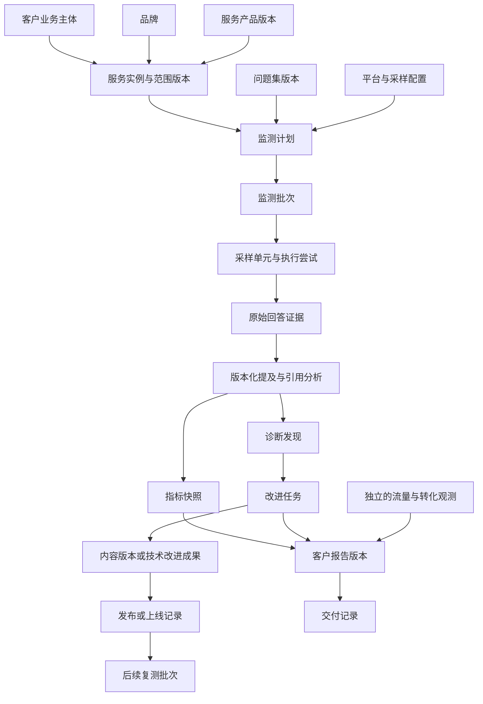

# GEO 业务能力与数据模型候选方案

调研日期：2026-11-17。状态：**供业务访谈使用的候选模型，不是公司已确认的业务规则，也不是已实现的数据库设计。**

后续记录：用户已介绍实际服务流程并补充 Top 5 / Top 3 的实体、别名、竞品集合及聚合层级，见 [GEO 服务业务梳理](../business/2026-11-17-geo-service-model.md)。本文件保留为访谈前的行业候选方案，不覆盖后续业务说明。

本方案结合 [海外厂商流程调研](2026-11-17-geo-vendor-workflows.md)、[国内服务商证据](2026-11-17-geo-china-evidence.md)及下文平台一手资料整理。厂商公开资料用于识别对象和能力，不用于证明某项优化必然带来排名、曝光或成交提升。用户将在调研完成后介绍公司实际做法。

## 1. 建设目标与判断标准

BizBase 服务于多个业务应用。不同销售、运营或 AI 构建的应用可以提供重复功能，但对同一客户、服务、监测证据和权限应有一致识别。

建议用以下结果判断底座是否有效：

1. 同一业务主体具有可跨应用引用的稳定标识；应用本地编号保留为外部映射。
2. 每个业务事实和关键字段有明确的维护方，其他应用通过统一业务能力读写或引用。
3. 同一人的访问范围不因换应用而扩大；来源应用自身也有授权边界。
4. 任何一个指标能解释其分母、采样范围、算法版本，并追溯到支持它的证据。
5. 新应用能接入现有客户与服务，不必再复制一套客户资料、组织关系和权限规则。

统一数据来源允许按数据特征使用不同存储。事务数据、原始回答文件和分析结果可以分工保存，但标识、归属、权限与变更规则必须一致。以下分层和对象均为本项目建议。

## 2. 行业工作如何转成能力

| 环节 | 需要回答的问题 | 可复用能力 | 主要输出 |
| --- | --- | --- | --- |
| 接单与界定范围 | 为谁、哪个品牌、哪些市场和平台提供什么服务？ | 主体识别、品牌关系、服务范围与有效期 | 服务实例、范围版本、团队授权 |
| 基线诊断 | 目标人群会问什么？当前哪些回答提及或引用客户？ | 问题库、采样计划、运行调度、证据留存 | 基线批次、回答、引用、诊断发现 |
| 制定改进 | 缺的是内容、事实信息、技术可访问性还是外部来源？ | 发现归类、改进任务、优先级与责任分配 | 可执行任务、验收标准 |
| 内容与发布 | 什么内容经过审核，发布到哪里，目前是否仍有效？ | 内容版本、审批、发布与状态检查 | 已批准版本、发布 URL、状态历史 |
| 复测与分析 | 在可比条件下发生了什么变化？ | 复测、指标计算、差异分析、覆盖率展示 | 指标快照、解释与证据 |
| 客户交付 | 本周期做了什么、观察到了什么、下一步是什么？ | 报告版本、交付记录、确认与问题跟进 | 客户报告、交付凭证、后续任务 |

不假设每家公司都出售以上全部环节。监测 SaaS、咨询、内容代运营、渠道服务和综合交付可以有不同组合；套餐名称不能代替明确的服务范围。

## 3. 候选对象与边界

### 3.1 主体、产品与服务

| 对象 | 建议含义 | 关键关系与注意事项 |
| --- | --- | --- |
| 业务主体 Party | 被共同识别的企业、机构或个人 | 不因成为潜客、付款客户或合作方就复制一个主体；这些角色的业务记录可以各自存在 |
| 品牌 Brand | 被监测、运营和展示的品牌实体 | 品牌名称与公司法定名称分开；品牌归属/运营关系需要角色与有效期，不能只存一个不可变公司字段 |
| 被测产品/服务 Market Offering | 客户面向市场提供、需要被监测或介绍的产品与服务 | 与本公司出售的 GEO 服务产品分开；关联品牌、别名、版本与适用市场 |
| 品牌事实及版本 Brand Fact / Revision | 可供内容和分析应用共同引用的品牌、产品主张及依据 | 保存来源、有效期、审核状态和版本；不同生成工具引用同一已确认事实，事实修订可追溯到受影响内容 |
| 联系人 Contact | 与业务往来的自然人联系资料 | 联系人与主体的任职/联系关系可以变化；有联系人权限不等于能访问其所有客户或项目 |
| 业务线 Business Line | 公司提供产品和服务的业务分类 | 用于分类与授权条件；同一客户可跨业务线，不能仅因业务线不同就复制客户 |
| 服务产品 Service Offering | 可销售的服务定义及其版本 | 监测频次、平台覆盖、交付物等可成为范围定义，但实际承诺取自具体服务实例 |
| 服务实例 Service Engagement | 针对客户的一次具体服务关系 | 连接商业来源、服务产品版本、负责人及范围；是否按合同、订单行或其他单位建立，待业务确认 |
| 服务范围 Service Scope | 本次服务涉及的品牌、市场、平台及交付约束 | 允许变更并保留历史；先保留关联表达能力，不预定“一服务只能一个品牌” |
| 服务周期/状态历史 | 服务在时间上的生效、暂停、恢复或结束记录 | 历史状态、履约周期和计费周期分别解释；暂停是否顺延尚待业务说明 |
| 外部标识映射 External Identity | 各系统记录与共享主体的对应关系 | 至少记录来源系统、对象类型、外部 ID、共享 ID；同名不能自动合并 |

合同、订单、发票等商业记录应与服务实例关联，具体由现有系统或 ERPNext 维护的选择待确认。不把品牌、CRM 商机、会计客户和服务实例合成一张“大客户表”。

### 3.2 监测与证据

| 对象 | 建议含义 | 必须保留的区分 |
| --- | --- | --- |
| 主题/意图 Topic / Intent | 用于组织问题和理解业务需求的分类 | 分类可多对多，且可能随方法变更；不直接等同真实市场需求量 |
| 问题 Prompt | 可稳定引用的逻辑问题 | 与文字版本分开；翻译、改写、上下文变化通过版本或关联表达 |
| 问题版本 Prompt Version | 一次确切的问题文本及上下文 | 运行必须绑定版本，避免改问题后历史曲线悄然变义 |
| 问题集版本 Prompt Set Version | 一组问题版本、标签与可选权重 | 增删问题或改权重会改变样本构成，应留下快照 |
| 平台与采样配置 Surface / Sampling Configuration | 在何种产品、入口和环境获取回答 | 平台、产品、地区、语言、联网模式、采集途径、模型可知信息、上下文条件；未知信息明确标未知 |
| 监测计划 Monitoring Plan | 要监测的问题集、目标品牌、平台组合和频次 | 与某一次执行分开；同一计划可服务多个报告，服务归属须显式关联 |
| 监测批次 Batch | 一次有边界的执行集合 | 保存预期样本数、时间窗口、完成/失败/排除数量及配置快照 |
| 采样单元 Sample | 计划中一次应获得的观测 | 绑定问题版本、配置、重复采样序号；用于定义完整分母 |
| 执行尝试 Attempt | 对采样单元的一次实际调用或采集 | 重试单独记录。重试返回不同答案时，按明确规则选择或纳入统计，不重复放大样本数 |
| 原始回答 Answer Evidence | 某次尝试取得的内容和元数据 | 原文、时间、来源、完整性、文件校验信息；后续解析不能覆盖原证据 |
| 提及 Mention | 回答中识别到的品牌/产品提及 | 记录目标、文本位置、识别版本、可选置信度/人工校正；提及不自动等于推荐 |
| 引用 Citation | 回答显式给出的引用或来源链接 | 保留原 URL、出现位置、规范化 URL 和解析版本；链接存在不等于相关页面实际支持该论断 |
| 来源页面 Source Page / Snapshot | 被观察或引用的网页及采集快照 | 第三方页面也可以是来源；不能因为被引用就认为是我们发布的内容 |
| 解析结果 Analysis Revision | 从同一原始回答派生的结构化分析 | 记录规则/模型版本，支持重新分析和人工复核；与原始采集时间分别记录 |

采样方法必须显式标注。某平台的模型 API 返回结果，不应直接宣称等同于该平台消费端网页或 App 中用户看到的回答。若来源工具无法披露条件，应记录信息缺口，限制比较结论。

### 3.3 改进与交付

| 对象 | 建议含义 | 关键关系 |
| --- | --- | --- |
| 诊断发现 Finding | 基于证据识别的不足或机会 | 关联证据、影响范围、提出者与状态，避免只存自由文本结论 |
| 改进任务 Improvement Task | 要执行并验收的一项工作 | 关联服务实例、发现、负责人、截止日期及成果；技术修复也可以是任务 |
| 内容资产 Content Asset | 公司管理的一项逻辑内容 | 与发布位置分开，同一内容可有多个版本和发布位置 |
| 内容版本 Content Revision | 某时点的具体内容 | 作者、来源依据、版本、审批状态；审核通过不等于已经发布 |
| 审核/验收记录 Review | 对某一明确版本或成果的决定 | 记录审核人、时间、结论及意见；不覆盖旧决定 |
| 发布记录 Publication | 某内容版本在某渠道的发布实例 | 关联账号/供应商、URL、发布时间、费用引用、存续/下架状态；不推定拥有第三方编辑权限 |
| 实验/变更记录 Intervention | 用于解释前后变化的操作集合 | 记录目标、时间、相关任务、内容和可比样本；普通前后对比不能自行证明因果 |
| 报告版本 Report Snapshot | 对一组证据与指标的确定版本说明 | 绑定服务周期、采样批次、指标定义及生成时间，支持交付后复查 |
| 交付记录 Delivery | 报告或其他成果向客户交付的事实 | 关联报告版本、交付方式、接收方和确认状态 |
| 流量/转化观测 Outcome Observation | 来自站点分析、CRM 等系统的实际结果 | 保留来源和归因口径，与模型提及、引用分开；没有观测时保持未知 |

### 3.4 权限与接入

候选对象包括用户、组织/团队、业务关系、应用、应用授权、数据范围、服务身份、审计记录。建议权限取“用户可访问范围”与“应用获准能力”的交集；后台任务记录服务身份及其业务范围。

应用登记、统一 ID 和登录成功都不等于数据治理完成。列表、详情、搜索、报表、导出、附件及后台任务必须执行一致的授权规则。原生 CRM/ERP 界面和框架 CRUD 路径也应纳入核查，避免定制 API 有限制而其他入口可绕过。Frappe 可复用的能力与需要自建的边界见 [官方应用评估](2026-11-17-frappe-apps-assessment.md)。

## 4. 关系示意

下图只表达候选关系，不锁定字段、数据库表名或最终基数；“范围关联”“团队授权”等中间对象未全部展开。

## 5. 指标作为有版本的业务对象

以下公式是建议的内部口径样例，不是全行业标准。最终取舍需根据采样方式与客户承诺确定。

| 指标 | 可采用的明确定义 | 必须同时展示/保存 |
| --- | --- | --- |
| 有效采样覆盖率 | 有效采样单元数 / 应采样单元数 | 失败、缺失、排除原因；不能把失败当“未提及” |
| 品牌提及率 | 提及指定品牌的有效回答数 / 纳入统计的有效回答数 | 一回答多次提及是否只计一次；品牌别名和识别规则 |
| 目标来源引用率 | 引用指定来源集合的有效回答数 / 纳入统计的有效回答数 | 来源集合版本、URL 规范化及引用去重规则 |
| 提及份额 | 指定品牌提及计数 / 已定义竞争集合的提及总计数 | 竞争集合、重复提及规则、未识别品牌处理 |
| 情绪分布 | 对目标实体的正/中/负/无法判断分类分布 | 分类单位、分类器版本和不确定项；不能等同客户满意度 |
| 流量与转化 | 使用来源系统给出的访问、事件和归因数据 | 观测时间、来源、归因窗口、缺失；不能由提及率反推 |

每个 `Metric Definition` 至少保存公式/算法版本、输入范围、分母、排除条件、去重策略、权重、时间口径；每个 `Metric Snapshot` 保存定义版本、输入批次及生成时间。没有分母的数据不要以百分比形式冒充可比较指标；零分母应显示不可计算。

横向比较前先检查问题集、语言/地区、平台入口、采样次数、时间窗口、竞争集合和计算规则。供应商原始分数可保留为 `Provider Metric`，连同供应商和版本记录；不直接合并成公司的统一“GEO 分”。

### 平台一手事实对模型的约束

- Google 于 2026-06-03 公布独立的 Search Generative AI performance reports，并在页面注明 2026-08-31 已全球推出；报告提供展示及页面、国家、设备、日期等视角。不能继续把“只能混在 Web 总报告中看”写成当前结论。本轮未登录客户账号、未验证接口可取字段，实际接入能力仍需确认。[Google 公告](https://developers.google.com/search/blog/2026/06/gen-ai-performance-reports)
- Bing 2026-06-16 的官方说明将 Citation Share 定义为同一 grounding query 下本网站引用占全部网站引用的比例，明确其是观测指标，不代表流量份额或排名。此类查询也不应无条件等同我们提交的 Prompt。[Bing 官方说明](https://blogs.bing.com/search/2026/6/New-AI-Visibility-Insights-in-Bing-Webmaster-Tools-Intents-Topics-Citation-Share-Compare/)
- Google 当前指南将生成式搜索优化放在搜索质量与 SEO 基础上讨论，强调独特、有用内容。对平台可见性的分析应区分可执行改进与无法保证的最终展示结果。[Google 指南](https://developers.google.com/search/docs/fundamentals/ai-optimization-guide)

据此，官方站点聚合报告、厂商抽样监测、原始问答、网站流量与客户成交应保存为不同来源和粒度的数据，按可验证的关联聚合，不能强行拼成同一种曝光记录。

## 6. 与 Frappe、CRM、ERPNext 的候选分工

本节是架构建议，尚未决定全部对象的实际维护方。

| 范围 | 候选维护方 | 接入原则 |
| --- | --- | --- |
| 用户、角色、基础权限和后台任务 | Frappe 基础设施 + BizBase 必要扩展 | 先复用框架，补应用级授权和业务数据范围 |
| 销售线索、商机和跟进 | 独立 Frappe CRM | 明确线索到共享主体/服务的关联，不再让每个新应用建独立销售档案 |
| 报价、订单、交易客户、收付款 | ERPNext 或经确认的现有权威系统 | 为各类业务角色保留映射；不自动把 CRM Organization 与 ERPNext Customer 当同一对象 |
| 跨应用主体标识、品牌、服务关系 | 自有 BizBase App 候选 | 先确定权威来源及字段归属，避免成为第三套重复客户主库 |
| GEO 问题集、采样配置、证据、分析、交付 | 自有 GEO 领域能力或既有专用系统 | 通过统一标识和权限接入；是否迁移存储需在业务梳理后决定 |
| 原始大文件、批量观测、汇总分析 | 依据实际容量选型 | 先测真实规模，再决定对象存储/分析库等；不把所有回答文件塞进事务单据 |

同一事实需要指定唯一权威维护方或明确冲突解决规则。数据可有缓存和分析副本，但必须记录来源、版本和刷新状态，不能形成多个无归属的可写副本。全局 ID 映射只是第一步，不能代替去重规则、字段归属和业务校验。

品牌事实及来源依据是内容生产的候选共享源头；问题集、采样证据和指标定义是监测分析的候选共享源头。二者都应允许多个应用使用，具体生成界面、分析方法和报告样式可以不同。品牌事实管理的候选依据见国内报告的内容/信源流程，以及 Profound 对品牌事实核查的产品描述；这不代表已验证自动事实核查的准确率。[Profound AEI / FactCheck](https://docs.tryprofound.com/answer-engine-insights/about)

## 7. 分阶段验证范围

### 第一阶段：业务访谈与事实清单

等待用户介绍实际 GEO 流程，梳理从签单到续费/结束的真实实例、现有系统、对象与编号、当前谁录入哪些字段、权限边界、报表口径及异常处理。输出数据归属表、术语修订与系统映射表；再决定哪些候选对象必要。

### 第二阶段：最小跨应用闭环

选一个销售视角与一个运营视角。最小集合可以是客户/品牌/服务关联，加一个有证据可追溯的监测批次；使用同一身份授权读取和更新。建立稳定业务 API、错误约定、幂等和审计，不要求两个应用使用同一前端。

验收场景：

1. 两个应用对同一客户使用同一共享标识，修改后读取结果一致。
2. 客户跨业务线或有多个品牌时，数据关联准确，用户只看到获准服务范围。
3. 撤销权限后，列表、详情、导出和附件不能继续返回受限数据；缓存按明确规则失效。
4. 重复提交不产生重复服务记录；重试采样不悄然扩大分母。
5. 报告数字能够追溯到问题集版本、采样配置、原始回答和计算口径。

### 第三阶段：复制接入模式

形成 API 文档、SDK/示例、AI coding 接入模板、开发沙箱和契约检查，让其他应用按相同方式接入。变更通知按业务需要提供，要求事件标识、消费者幂等与失败对账；不把“有 Webhook”视为已完成可靠数据同步。

## 8. 待用户业务介绍后再决定

- 客户、签约方、付款方、品牌方、代理商是否一致？服务实例以什么单位建立？
- 实际售卖监测、内容、发布、技术改进中的哪些组合？交付和计费如何对应？
- 暂停、续费、范围变更如何影响周期、配额和历史报告？
- 当前监测入口、采样方式、失败处理、指标公式和客户承诺是什么？
- 内容由谁生产和批准、在哪些渠道发布、发布事实如何验收？
- 哪个现有系统掌握最可信的数据，哪些只应读取或缓存？
- 内部员工、外包、合作方和客户各自需要看到什么？

这些是下一轮访谈提纲，本轮不要求用户提前作答，也不据此安装 App、迁移现有业务数据或修改生产权限。
