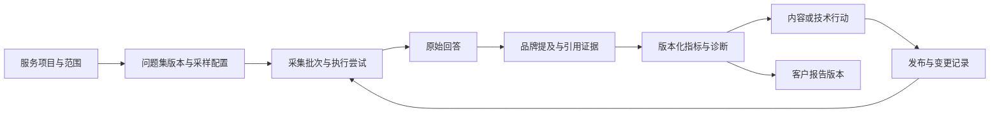

# 海外 GEO 厂商的业务流程、能力与候选数据对象

调研日期：2026-11-17。范围：Profound、Scrunch、Peec AI、OtterlyAI、Semrush 的官方产品文档、帮助中心和产品说明。用途：为 BizBase 的业务访谈和模型设计提供参照，不代表公司实际 GEO 流程已经确定，也不构成采购推荐。

## 1. 结论与证据边界

这些厂商共同展示了一条可供参考的业务链：确定品牌和市场 → 选择问题与竞品 → 定期采集 AI 回答 → 分析提及、引用和差距 → 实施内容、传播或技术改进 → 复测 → 向客户报告。完整交付跨越测量、决策、执行和结果验证；单独的可见性仪表盘只覆盖其中一部分。[Semrush 官方实施步骤](https://www.semrush.com/kb/1496-getting-started-with-ai-visibility-toolkit)、[Profound Agents](https://docs.tryprofound.com/agents/about)

本报告中的“支持某功能”指厂商公开文档陈述，不代表本次已登录付费产品验收。厂商案例中的增长、ROI 和“更可能购买”等说法，也不等于独立实验验证。以下候选对象和关系是依据公开流程做出的设计推导，不能声称是厂商内部数据库结构。

## 2. 五家厂商分别覆盖什么

| 厂商 | 官方可确认的能力与工作方式 | 对 BizBase 的启示 |
| --- | --- | --- |
| Profound | 按主题组织 prompts，采集回答并分析品牌可见性和引用；Agents 将分析连接到内容、外联和报告任务，也可接入既有工具与 CMS。现行文档已区分 Agents 与需要人工定义步骤的 Workflows。[AEI](https://docs.tryprofound.com/answer-engine-insights/about)、[Agents](https://docs.tryprofound.com/agents/about) | 测量数据、行动任务、生成产物和发布结果要能关联，但不能只用一个“执行成功”状态表示全部过程。 |
| Scrunch | 收集回答与引用，分析来源页面；可按 persona、国家、漏斗阶段等过滤。Site Diagnostics 检查网站被 AI 访问与理解的障碍。引用洞察还可衔接合作伙伴的内容传播服务。[URL 分析](https://scrunch.com/faqs/can-i-monitor-specific-urls-in-scrunch/)、[站点诊断](https://origin.scrunchai.com/platform/site-diagnostics/)、[引用与传播](https://scrunch.com/platform/monitoring/citations/) | 内容资产、外部来源、发布渠道、站点技术问题需要独立对象；“我方内容”与“第三方引用我方品牌的内容”不能混为一类。 |
| Peec AI | 支持品牌可见性、竞争份额、情绪、位置和来源分析；代理商可用短期 Pitch Project 做售前诊断，再转正式 Customer Project 并保留数据，提供客户项目与报告能力。[售前/正式项目](https://help.peec.ai/article/whats-the-difference-between-pitch-and-customer-projects-fpchm82x7il3buik95ic7rwp)、[代理商工作方式](https://peec.ai/for-agencies) | 售前观察与签约后的服务交付有连续性；不应在成交时重新创建一套断开的品牌和历史样本。 |
| OtterlyAI | 将 prompts 加入工作区后定期监测，可钻取单次回答和引用；GEO Audit 包括访问检查、内容检查和 Query Fan-Out；API/MCP 可提供指标与原始回答等数据。[监测](https://help.otterly.ai/search-prompt-monitoring)、[GEO Audit](https://help.otterly.ai/what-does-the-geo-audit-do?hsLang=en)、[MCP 数据能力](https://help.otterly.ai/does-otterlyai-have-an-mcp) | “用户原问题”“引擎扩展查询”和“实际回答”应分开；客户报告应能回溯到回答与来源，而不是只保留分数。 |
| Semrush | 组合全市场/主题数据库分析、自定义 Prompt Tracking、技术 Site Audit 及报告；实际改进工作可以由人员或其他内容工具完成。[实施流程](https://www.semrush.com/kb/1496-getting-started-with-ai-visibility-toolkit)、[数据来源](https://www.semrush.com/kb/1607-semrush-ai-visibility-data) | 市场研究、客户自定义监测和站点审计是不同数据集；它们的更新周期、覆盖范围和指标定义不能合并成一个无来源的数值。 |

这些产品主要是品牌或代理商使用的软件平台。软件提供监测、建议或自动化，不自动意味着它承担客户合同中的全部代运营责任。Peec 的代理商产品明确面向服务商管理多个客户；Scrunch 的传播能力有合作伙伴参与。这说明平台、服务交付团队与外部渠道至少是三个不同角色。[Peec 代理商](https://peec.ai/for-agencies)、[Scrunch 合作传播](https://scrunch.com/platform/monitoring/citations/)

## 3. 可以复用的交付流程骨架

下表是跨厂商能力的归纳，不是所有公司都必须采用的固定 SOP。

| 阶段 | 典型工作 | 应留下的可核查产物 | 来源与性质 |
| --- | --- | --- | --- |
| 售前诊断 | 确认目标品牌、产品、市场和竞品，取得初始表现 | 诊断范围、初始问题集、基线样本 | Peec 提供 Pitch Project → Customer Project 的连续路径。[文档](https://help.peec.ai/article/whats-the-difference-between-pitch-and-customer-projects-fpchm82x7il3buik95ic7rwp) |
| 制定测量计划 | 组织主题、意图、persona，选择渠道与采样周期 | 版本化问题集、目标市场与运行配置 | Profound 支持主题、标签与 persona；persona 会形成独立运行。[Persona 文档](https://docs.tryprofound.com/answer-engine-insights/personas) |
| 采集与核验 | 执行 prompts，保存回答，识别提及、引用和竞品 | 运行记录、原文、引用 URL、解析结果、失败记录 | Otterly 支持回答级与引擎级钻取。[监测文档](https://help.otterly.ai/search-prompt-monitoring) |
| 诊断机会 | 分析竞争差距、内容来源、品牌叙事、访问问题 | 机会/问题清单、证据链接、优先级 | Scrunch 提供来源与页面诊断。[站点诊断](https://origin.scrunchai.com/platform/site-diagnostics/) |
| 内容与技术执行 | 编写或更新内容、修订品牌事实、修复访问问题、开展外联 | 内容版本、审核记录、发布 URL、技术变更记录 | Profound 将洞察连接内容与外联；Semrush 将执行作为独立步骤。[Agents](https://docs.tryprofound.com/agents/about)、[Semrush](https://www.semrush.com/kb/1496-getting-started-with-ai-visibility-toolkit) |
| 复测与解释 | 在可比配置下重复采样，分析变化与未改善项 | 对照区间、样本量、变化说明、下一轮行动 | AI 回答存在运行间波动，需要持续观察。[Otterly 频率说明](https://help.otterly.ai/monitoring-interval) |
| 客户交付与续约 | 分客户展示成果、限制可见范围、输出报告 | 可回溯的报告版本、业务行动、客户反馈 | Peec 展示多客户与自动报告流程。[代理商说明](https://peec.ai/for-agencies) |

对公司流程的待验证点包括：是否提供售前试跑、是否负责内容发布、是否有第三方渠道采购、按什么周期验收、是否按效果或工作量收费。本轮没有证据替公司回答这些问题。

## 4. 指标必须保留定义，不能只统一名称

| 指标/厂商 | 本次核查到的定义 | 建模时应保留 |
| --- | --- | --- |
| Profound Visibility | 出现目标品牌的回答数 ÷ 至少出现一个品牌的回答总数。[AEI 定义](https://docs.tryprofound.com/answer-engine-insights/about) | 是否排除没有品牌的回答，品牌识别规则及版本。 |
| Peec Visibility | 出现目标品牌的回答数 ÷ 全部回答数。[Visibility](https://docs.peec.ai/metrics/brand-metrics/visibility) | 回答集合、有效样本判定；不能直接当作上述 Profound 指标。 |
| Peec Share of Voice | 目标品牌提及次数 ÷ 所有跟踪品牌提及次数。[Share of Voice](https://docs.peec.ai/metrics/brand-metrics/share-of-voice) | 竞品集合及其版本，单回答多次提及的计数规则。 |
| Semrush AI Visibility | 总览为 0–100 综合指标，结合主题覆盖与提及一致性。[数据口径](https://www.semrush.com/kb/1607-semrush-ai-visibility-data) | 供应商与产品模块、算法版本、研究主题集合，不能假定是简单提及率。 |
| Semrush Prompt Tracking Visibility / Position | 描述网站在被跟踪问题的引用结果中的位置表现；100% 对应每个问题均占首个引用位置。[指标说明](https://www.semrush.com/kb/1594-ai-seo-metrics) | “品牌在正文第几位”与“域名在引用列表第几位”应为不同指标。 |
| Scrunch Citation Consistency / Influence Score | 引用稳定性以回答中引用来源的比例表达；Influence Score 将引用该 URL 的不同问题数与引用比例组合。[URL 指标](https://scrunch.com/faqs/can-i-monitor-specific-urls-in-scrunch/) | 引用对象是 URL 还是域名、分母范围、唯一问题数和运行次数。 |
| Otterly Likelihood to Buy | 官方 KPI 页将其由平均位置通过公式变换，并设置最低值；不是观测到的客户购买率。[KPI 定义](https://help.otterly.ai/brand-report-kpi-definition) | 使用“供应商派生评分”类型保存；不可展示为实际成交概率。 |
| 情绪 | Peec 将情绪呈现为 0–100；其他厂商也提供情绪分析。[Peec 仪表盘](https://help.peec.ai/article/part-4-reading-your-dashboard-phist06f5krvh02d6snjrvbc) | 分析对象、量表、分类器版本、原文证据与人工纠正；跨工具数值不能直接平均。 |

**建议的统一指标记录**：`metric_definition_id + definition_version + provider/module + scope_snapshot + time_window + numerator + denominator + sample_count + value + computed_at`。这是一项 BizBase 设计建议；供应商没有提供完整分母时应记录“未披露”，不要反向编造。

“提及”是回答正文中的品牌出现，“引用”是回答关联的来源链接，二者可以分别发生。[Otterly 品牌报告说明](https://help.otterly.ai/onboarding4) 因此，“文章发布成功”“文章被抓取”“页面被引用”“品牌被推荐”“用户访问”“线索形成”“成交”应作为不同事实或状态，不串成一个未经验证的成功标记。

## 5. 采样与归因中必须保存的上下文

1. **产品界面与模型 API 分开标识。**Scrunch 明确采用浏览器自动化与官方 API 等多种方式，且使用平台界面回答做验证；其分析模型还承担情绪与实体抽取。这些角色不同。不能把一个基础模型的 API 回复直接标为某消费者产品的搜索结果。[采集方式](https://scrunch.com/faqs/what-methods-does-scrunch-use-to-collect-data-from-ai-platforms)
2. **重复运行是独立样本。**同一问题可返回不同答案；时间趋势必须带样本数、成功率和配置。采集失败与“成功但未提及”不能同记为 0。[非确定性说明](https://help.otterly.ai/monitoring-interval)
3. **问题的改动会改变测量对象。**增加/删除问题、调整竞品、地区、语言、persona 或引擎，会改变报表基线。Peec 已在变更记录中加入问题变化的图表标记，供用户区别测量范围变化与表现变化。[Peec Changelog](https://peec.ai/changelog)
4. **persona 是一种模拟条件。**Profound 会将 persona 信息加入文本并独立运行；这不等于观测到真实购买者的私人会话。[Persona](https://docs.tryprofound.com/answer-engine-insights/personas)
5. **抓取、点击和成交分开取数。**Scrunch 的 Agent Traffic 来自 CDN/托管集成，AI Referrals 来自 GA4 的访问与转化数据；前者不能充当客户流量。直接来源点击也不能覆盖所有间接品牌影响。[流量说明](https://scrunch.com/faqs/how-does-scrunch-track-ai-search-visits-to-my-website)
6. **供应商文档也存在口径漂移。**本次发现 Scrunch 不同页面列出的平台数不同；Semrush 数据说明的正文写滚动每日更新，末尾摘要仍出现月度字样。因此本报告不据此承诺精确平台数量或 SLA；正式接入必须核验实际订阅、API 返回和更新配置。[Scrunch 采集说明](https://scrunch.com/faqs/what-methods-does-scrunch-use-to-collect-data-from-ai-platforms)、[Scrunch 流量页](https://scrunch.com/faqs/how-does-scrunch-track-ai-search-visits-to-my-website)、[Semrush 数据来源](https://www.semrush.com/kb/1607-semrush-ai-visibility-data)

## 6. 候选业务对象与关系

以下为设计推导。父级商业关系、合同与服务范围需要由公司业务访谈补齐，不能照搬厂商工作区模型。

| 对象组 | 建议区分的对象 | 为什么需要区分 |
| --- | --- | --- |
| 客户与标的 | 客户组织、品牌、产品/服务、品牌别名、网站/域名 | 一个签约客户可能管理多个品牌，一个品牌可能拥有多个域名；客户法人和被测品牌不能默认一一对应。 |
| 服务上下文 | 服务项目、服务周期、目标市场、交付范围、成员授权 | 同一品牌可在不同地区、渠道和时间段接受不同服务；权限应随服务上下文限定。 |
| 测量设计 | 主题、意图、persona、问题、问题版本、问题集、竞品集合 | 厂商按主题/标签/persona/国家切分结果；集合变化会影响指标。 |
| 测量执行 | 计划、批次、执行尝试、回答、错误 | 批次可能只部分成功；重试不能覆盖原结果或重复充当多个计划样本。 |
| 证据与解析 | 品牌提及、引用、来源 URL、页面快照、解析任务与版本 | 一条回答可提及多个品牌并引用多个页面；原始回答和后续重新解析应可分离。 |
| 决策与执行 | 诊断问题、机会、建议、任务、内容资产、内容版本、发布记录、技术变更 | 一项行动可能对应多个问题；一份内容可能发布到多个渠道，发布不等于获引。 |
| 评估与交付 | 指标定义、指标结果、基线、评估区间、报告版本、反馈 | 既能重算，又能解释当时发给客户的数字；不能用动态仪表盘覆盖已交付报告。 |
| 外部结果 | AI 来源访问、转化事件、销售线索、订单关联 | 外部分析与 CRM 数据需通过明确规则关联；不能凭可见性提升推定收入提升。 |

对象边界的主要依据分别来自：[Profound 主题与问题](https://docs.tryprofound.com/answer-engine-insights/about)、[Scrunch URL 与切分维度](https://scrunch.com/faqs/can-i-monitor-specific-urls-in-scrunch/)、[Peec 客户项目](https://help.peec.ai/article/whats-the-difference-between-pitch-and-customer-projects-fpchm82x7il3buik95ic7rwp)、[Profound 执行动作](https://docs.tryprofound.com/agents/about)、[Scrunch 流量与转化](https://scrunch.com/faqs/how-does-scrunch-track-ai-search-visits-to-my-website)。商业对象的具体基数是候选假设，未由公司业务确认。

建议的最小可追溯关系：

这个链路不要求所有内容存入同一张表或同一个数据库；要求每个应用使用同一身份、对象 ID、授权范围、证据关联与指标定义。

## 7. 对 BizBase 的直接建议

- **先统一对象和证据，再统一报表。**第一批共享能力可围绕客户/品牌标识、项目范围、问题集、运行记录、引用证据和报告版本展开；高级优化建议允许由不同应用尝试。
- **对采集供应商做适配，不让供应商字段成为公司业务定义。**保留外部记录 ID 和原始载荷，内部使用统一 ID；供应商分数以其原口径保存，符合统一口径的基础事实再聚合。
- **测量、行动和商业结果保留独立责任人。**监测平台负责提供观察数据，交付团队负责执行并留痕，客户实际收入需从相应经营系统取得。是否采用这些角色由后续业务访谈确定。
- **客户隔离与公司共享并存。**Profound 提供组织、团队与类别级数据/资源组织；Peec 按客户项目分开管理。它们证明权限范围本身是核心对象，但不能直接推导公司的客户共享规则。[Profound 数据与访问组织](https://docs.tryprofound.com/getting-started/organizations-and-teams)、[Peec 代理商](https://peec.ai/for-agencies)
- **暂不把厂商营销评分写进合同验收。**先定义可重算、可解释的计量口径和证据，再讨论业务目标及承诺。

## 8. 本轮未完成、留待下一步验证

- 未登录各厂商付费后台、未调用付费 API，未实测采集精度、速率、成本、模型覆盖或导出完整性。
- 未验证这些厂商对中国境内模型、地区、语言和账号环境的实际覆盖。
- 未验证任何厂商所宣传优化方法对本公司客户的因果效果。
- 未确定本公司的定价、合同、角色分工、内容渠道、验收和续约流程。
- 海外厂商产品说明只能提供参考；公司业务模型需在用户介绍实际流程后收敛。本轮不创建生产业务表、不导入客户、不改变访问权限。
