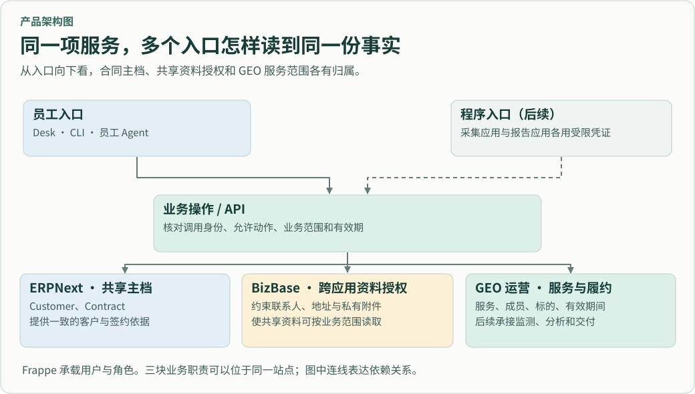
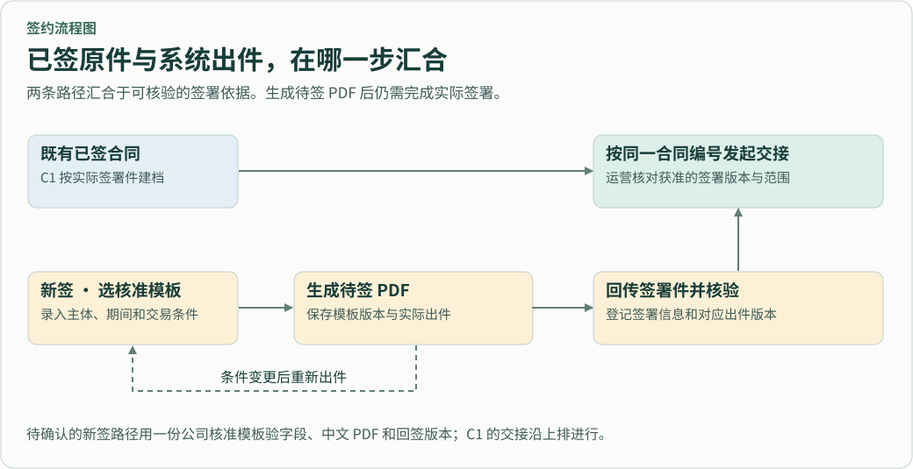
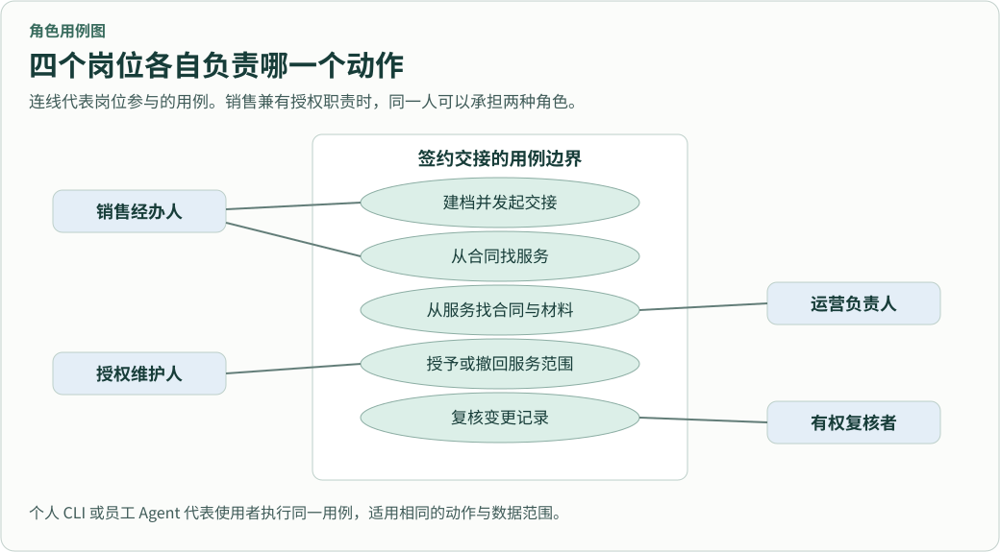
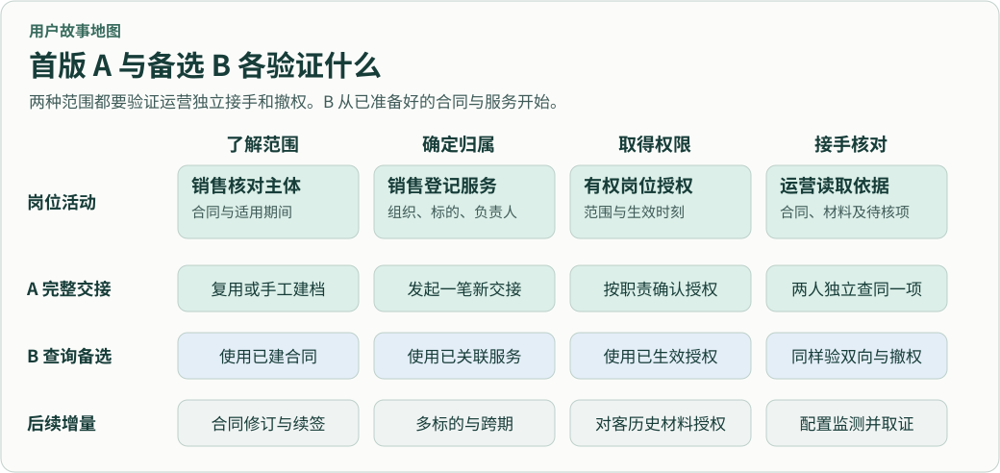
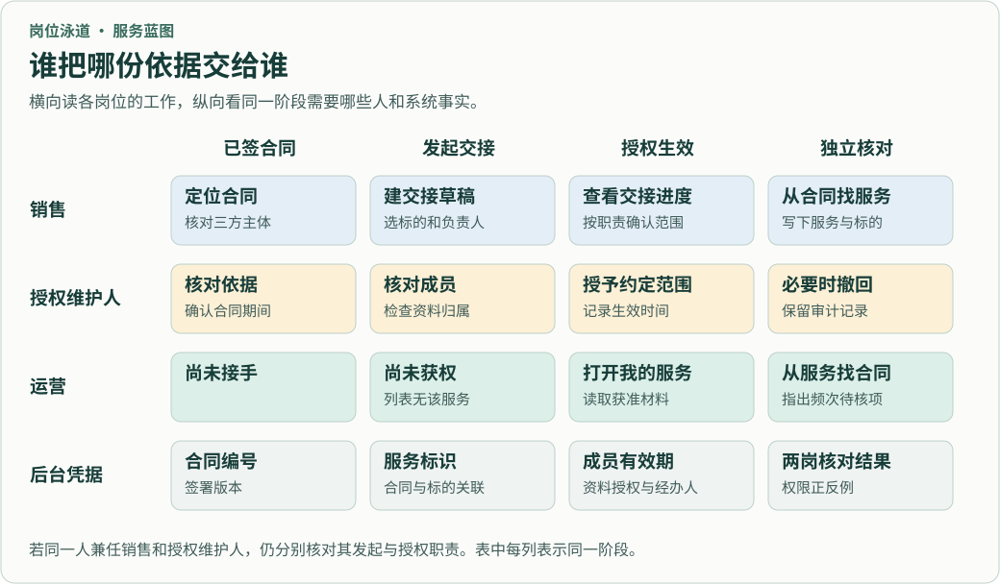
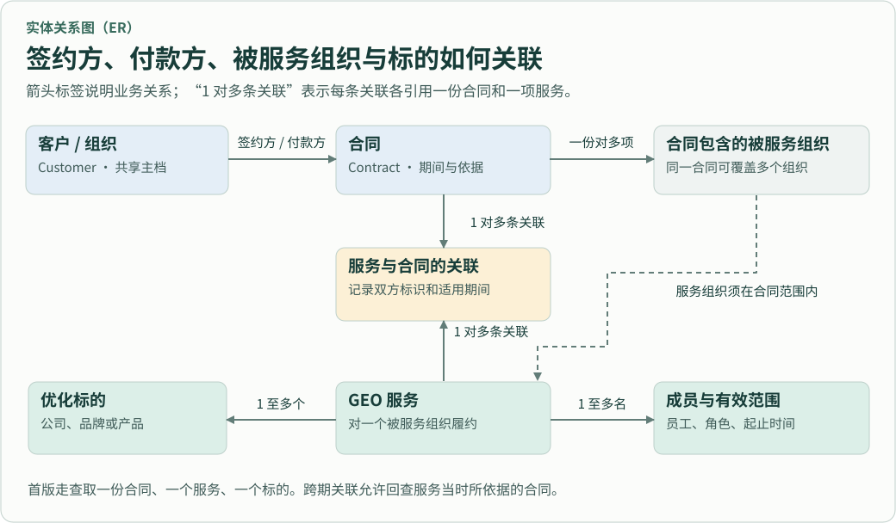
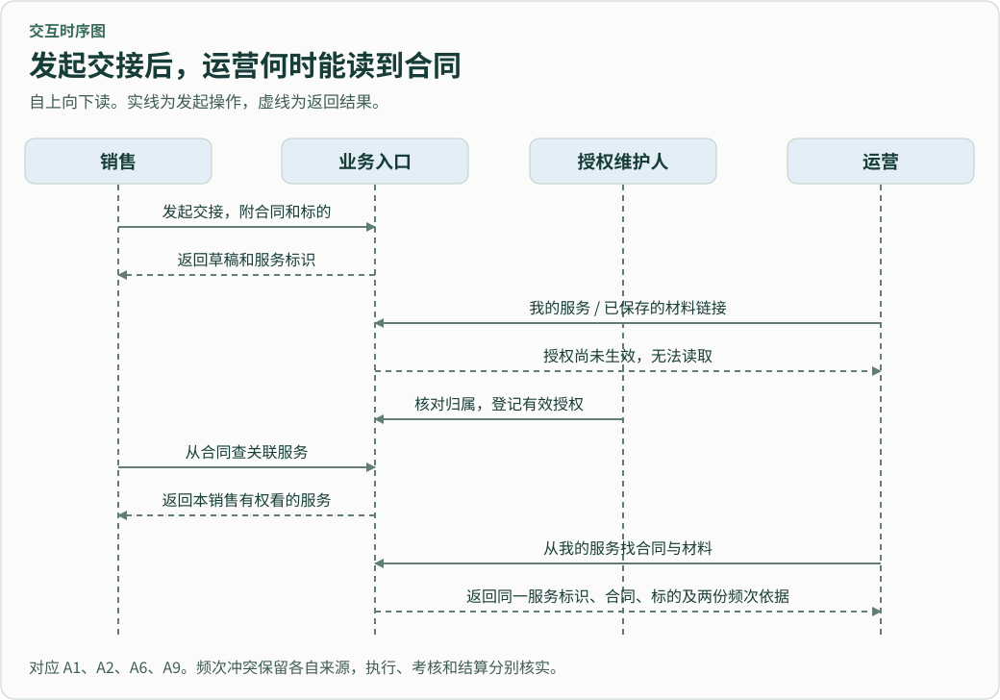
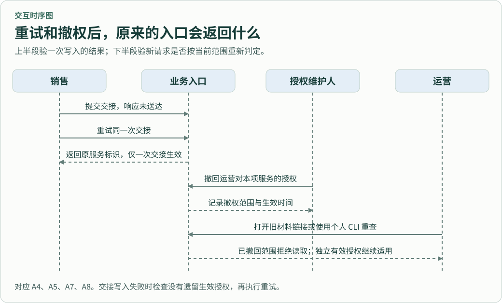
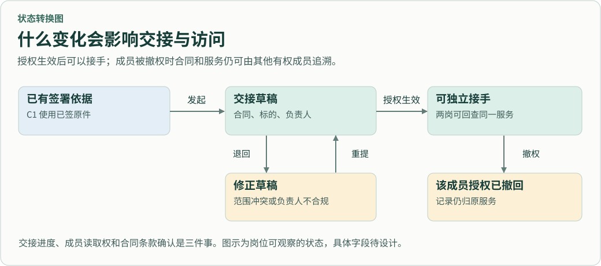
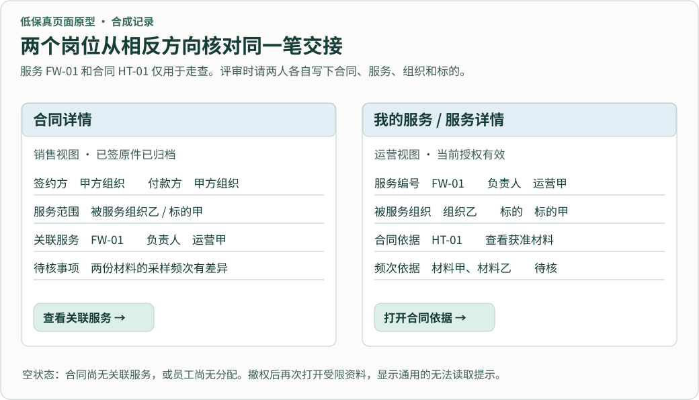

# 签约交接 PRD

2026-11-19 · 待评审。父项为 GEO 签约后服务，对应交付地图第 1 项，承担 G1 的合同到服务、G7 的隔离起点、G9 的员工入口一致性与 G14 的首轮审计。依据为[交付地图](../../../../planning/delivery-map.md)、[第四步评审](../../../../planning/delivery-map-review.md)、[成果画面](../../../../planning/natural-plan.md#第二步完成后是什么样)、[业务决策](../../../../cycle/decisions.md)和[已有领域设计](../../../../business/2026-11-18-service-v1/01-domain-model-er.md)。既有用例 UC-01、UC-04 和 UC-05 可作为实施参考。[已有用例与权限设计](../../../../business/2026-11-18-service-v1/04-use-cases-flows-permissions.md)

## 1. 问题、目标与首版

签约后，合同、具体承接范围和经办人需要从销售传到运营。签约方、付款方和被服务组织可能不同，客户名称本身无法回答实际服务谁。C1 的两份材料还有采样频次差异，接手人需要知道分别依据什么，哪些判断待确认。没有统一的服务身份和实际资料授权，后续问句、样本与报告可能挂错范围。

**首选 A**　用 C1 的一份已签合同、一个服务和一个优化标的完成一次销售到运营的真实交接。销售核对合同、发起交接并能从合同找回服务。运营从自己负责的服务进入，独立找回合同、被服务组织、标的、授权资料和待核事项。收到授权的用户通过 Desk、API、CLI、员工 Agent 核对相同标识。

**查询子版本 B**　由有权维护人员事先在约定预览准备真实的合同与服务关联及授权。销售从合同查服务，运营从自己的服务查合同，两人独立核对范围。普通员工的同一权限检查和撤权用例随本版完成。销售发起、经办角色的写入和完整交接在后续版本验收。

首版以可重复走查的 C1 结果判断。试用记录用时和补问次数，之后同口径复测。监测配置继续沿用本次服务标识，减少运营重复核对和建档。

### 系统出具制式合同（新签业务提案）

ERPNext 的 CRM 模块持有唯一的合同主档和制式模板。独立 Frappe CRM 可作为商机入口，GEO 运营通过合同编号关联签后的服务和交付。销售在 ERPNext 选客户、填写本次交易条件并选择已核准的 GEO 合同模板。系统把固定条款与合同字段合成正文，按公司版式输出待签 PDF。纸签盖章回传后，经办人核对签署件、登记签署信息，运营从同一合同编号接手。既有 C1 合同及客户指定文本按实际签署原件建档。

ERPNext v16.55.0 在选模板时根据**当时的合同字段**生成条款，Frappe 可按打印格式导出 PDF。建议配置签约方、被服务组织、标的、金额、期间、考核和付款约定等必要字段及公司版式。拟增加出件校验、模板版本和待签文件留档；若出件后变更交易条件，须重新生成待签版本，历史出件可复核。纸签回传即可验证这条链路，第三方电子签可另行接入。[合同模板实现](https://github.com/frappe/erpnext/blob/v16.55.0/erpnext/crm/doctype/contract_template/contract_template.py) · [合同表单](https://github.com/frappe/erpnext/blob/v16.55.0/erpnext/crm/doctype/contract/contract.js) · [PDF 导出](https://github.com/frappe/frappe/blob/v16.56.0/frappe/utils/print_format.py)

**验收样例。** 用一份经公司核准的模板和一笔测试交易生成 PDF，核对主体、金额、期间与服务范围。修改一项金额后再次出件，两版可区分；缺必填条款时提示补齐。仅生成 PDF 时合同仍待签；登记签署件后，销售从该合同发起交接，运营查到对应签署版本，无需重录。该场景待在预览验证。

## 2. 角色与职责

| 角色 | 交接中的职责和范围 |
|---|---|
| 销售经办人 | 维护其范围内的客户和本次合同，发起交接、核对服务关联；其作为销售成员时，在日常运营配置中使用只读权限。 |
| 运营负责人 | 从我的服务核对授权范围内的合同、服务标的和资料，指出待核事项。 |
| 服务授权维护人 | 核对合同、组织、标的与人员后确认授权；人员变动时收回授权。首版具体岗位由业务负责人指定。 |
| 另一服务的运营 | 持相同岗位角色、具有其本服务的权限，作为隔离的反向对照。 |
| 有权复核者 | 检查授权和变更记录。审计记录的可见范围按其复核权限控制。 |
| 员工通过 CLI 或 Agent 操作 | 用本人身份和同一份服务授权完成首版已开放的业务动作。 |

## 3. 用户故事

| 编号 | 故事 | 优先级 |
|---|---|---|
| S1 | 作为销售经办人，我要从合同找回自己负责的服务，以便后续跟进。我要能基于已签合同发起新交接，以便运营接手。 | B 验查找，A 补发起 |
| S2 | 作为运营负责人，我要从我的服务找到合同、组织、标的、资料与待核事项，以便我独立开始接手。 | A、B 必须 |
| S3 | 作为服务授权维护人，我要按职责开放和撤回服务及资料范围，以便只有有权人员在履约时能看到相关材料。 | A、B 必须 |
| S4 | 作为使用 CLI 或 Agent 的员工，我要复用自己的访问范围和权限，以便从不同入口处理同一项服务。 | A、B 必须 |
| S5 | 作为有权复核者，我要追溯交接和授权变更，以便我能查清生效范围、时间和经办人。 | A、B 必须 |

## 4. 功能要求与流程

1. **识别合同范围。** 复用 ERPNext `Customer` 和 `Contract`。在原生界面手工建档或按稳定标识复用主档。分别表达签约方、付款方及被服务组织，容纳三个字段同一主体的真实情形。确认合同依据、适用期间与标的归属。主体、标的与合同冲突或期间无效时，由服务端拒绝本次写入并给出可纠正的提示。
2. **交接给具体人。** 一次交接指向稳定的服务标识、有原始依据的一段合同期间、被服务组织、一个优化标的和一名有效运营负责人。保留销售经办人在这项服务中的联系与查找入口。一次发起重试找回同一交接结果，失败时避免残留已生效授权。由具备相应权限的岗位操作授权，发起人同时具备授权职责时可一并完成。岗位分工待评审，以实际角色验收。
3. **让运营独立找到依据。** 在原 8080 的 Desk 向获授权运营提供可查的服务入口，显示合同、组织、标的、负责人及获准资料。合同能反查获授权服务。C1 的频次材料各有来源。当前执行依据和最终考核、结算依据分别表达，缺少确认时标为待核。其余缺资料的字段明确标注缺口。
4. **按服务约束关联资料。** 按角色动作和有效服务范围判断是否可访问合同、客户及联系人、地址、私有附件。校验关联资料的实际归属与授权范围。集团、渠道或同一客户下的其他服务关系本身不授予服务资料。撤回某项授权后，从列表、关联搜索、详情、旧链接、附件和程序入口复查当前应该可见的范围，其他独立有效授权继续适用。
5. **验证员工的各个入口。** 首版开放的业务操作以同一员工身份经 Desk、API、CLI 和配套 Agent 入口验证。核对返回的服务标识、对象和字段范围、允许动作及拒绝。CLI 的结构化输出遵循 D-029。按每个已经开放的写动作验收可追溯性。

### 交接、授权与异常时序

这条流程表达产品行为。沿用已有模型中 ERPNext 主档、GEO 服务和成员范围的归属。界面入口、DocType 字段、API 形状与现有角色的兼容，在范围确认后的技术预检定稿。

## 5. 质量要求

- **事实一致。** 服务、合同与被服务组织在各入口使用相同的稳定标识。交接期限和授权生效时间分别表达。
- **隐私与资料。** C1 真实记录仅进获准的本地预览和私有资料目录，仓库及可共享的走查记录使用代号。应用访问动作按当前授权判断。
- **权限可复现。** 使用普通销售、普通运营、另一服务的普通运营和授权维护人分别复核。检视原生业务角色组合以及数据存在性可能通过搜索或提示泄露的边界。
- **审计与恢复。** 交接、范围变更和撤权可查经办人、入口、时间及改前改后范围。敏感凭据留在受限的凭据存储。版本记录入口、验收和回退步骤。试用时记录关键操作响应与测试规模，性能预算随后用代表性数据量复核。

## 6. 验收用例

| 编号 | 给定 | 操作 | 通过标准 |
|---|---|---|---|
| A1（S1，A） | C1 的已签合同及角色齐备 | 销售在其权限范围内复用或手工建档并发起交接，授权维护人确认 | 销售从合同打开正确的一项服务；核对主体、期间、标的、运营和原始依据。 |
| A2（S1/S2，A/B） | 一项已获授权的 C1 服务 | 销售从合同找服务，运营从自己的服务找合同，各自记录结果 | 双方独立找回同一服务、合同、被服务组织和标的。运营能指出负责人、获准的资料和频次冲突的待核状态。 |
| A3（S1/S3，按版本开放动作） | 合成案例中签约方、付款方、被服务组织分别是三个主体 | 正常关联一次，再用另一组织的标的、反向日期或不具备相应职责的负责人提交 | 正确关联成功；错误关联有针对性提示，数据和权限维持提交前状态。 |
| A4（S3，A/B） | 两个普通运营各自有不同服务，其中包括同客户的不同服务测试记录 | 核对双方各自服务，交叉核对列表、详情、搜索、联系人、地址与私有附件 | 双方都能读取其获准资料，越界访问被拒，合规界面不提示无权记录的存在。 |
| A5（S3，A/B） | 一名运营曾能读取 C1 服务，另一名成员仍获权 | 撤回前者的服务授权，保留其对应岗位角色；复查旧链接、附件、新查询及程序入口 | 被收回范围的读取和写入被拒，仍有效的独立授权及另一名成员的正向访问通过。 |
| A6（S4，A/B） | 同一普通员工通过 Desk、API、CLI 和员工 Agent 使用个人身份 | 执行本版的查询和所有已开放写入，再提交一次超范围请求 | 各入口结果标识、许可范围及写入校验一致。拒绝可辨认，CLI 可给出结构化结果。 |
| A7（S5，A/B） | 一次交接或授权变更及一次撤权已执行 | 有权人员复查，普通用户尝试改审计记录 | 可还原人员、入口、变更范围、时间与结果，普通用户的改写请求被拒。 |
| A8（S1/S3，A） | 一次发起成功但经办人没收到响应，另一次因授权确认失败 | 重复发起同一交接，核对失败实例及其后续重试 | 同一操作始终对应一个服务，失败尝试未遗留生效授权，经正确操作后可完成交接。 |
| A9（S3，A） | 销售具备发起权限，指定的运营此前无此范围授权 | 建交接草稿后在授权尚未生效时试读，生效后复查 | 生效前的读取请求被拒，生效后只读到获准的服务和资料。 |

**验收材料。** 标记采用 A 或 B，保存测试账号代号、角色、动作、预期与实际、服务和合同标识的脱敏对应，以及预览版本和回退方式。两种方案均由销售与运营分别完成岗位走查，权限与审计用例由有权复核者检查。任一适用用例失败均进入修复后复验。

## 7. 后续交付与前置条件

**预检记录（2026-11-19）。** 原 8080 预览可连接，使用 MariaDB，站点 `frontend` 已装 Frappe 16.56.0、ERPNext 16.55.0、CRM 16.0.4、HR 16.54.1、GEO 运营 0.0.1 和移山 ID 登录 0.1.0。站点查询到了 `Customer`、`Contract`、`Contact`、`Address` 和 `File`，尚无 `GEO Service`。普通账号的读写、撤权和附件行为仍需走查。

**试用优先级。** 必须验证双向查找、原生关联资料隔离、撤权、员工跨入口一致性和已开放写入的审计。尽量复用 Desk / Build，并记录手工基线耗时和补问次数。入口布局和提醒根据岗位试用反馈决定。工作树中的[走查原型](../../../../planning/handoff-prototype.html)用于讨论交接动作，其中销售先建草稿，授权维护人随后确认范围，运营可分别尝试在授权前后读取服务。实际站点以有权岗位完成授权为准，用例 A9 覆盖权限尚未生效时的读请求。

第 2 项继续处理客户资料版本、问句、竞品、考核配置及监测计划，随后交付真实采集、看板与报告。多标的批量交接、完整续约和修订流程、提醒、客户侧身份及自管随对应交付项验收。本首版仍应能表达合同、组织、标的和授权范围的关系，供后续继续使用。

进第五步前确认 A 或 B。开始实施前核对 C1 本地资料使用范围、参与走查的销售与运营、授权维护岗位，以及原 8080 普通账号的角色与原生关联对象行为。需要澄清的 C1 频次或结算口径保留待核和来源。生产相关动作按 D-004 另行确认。
